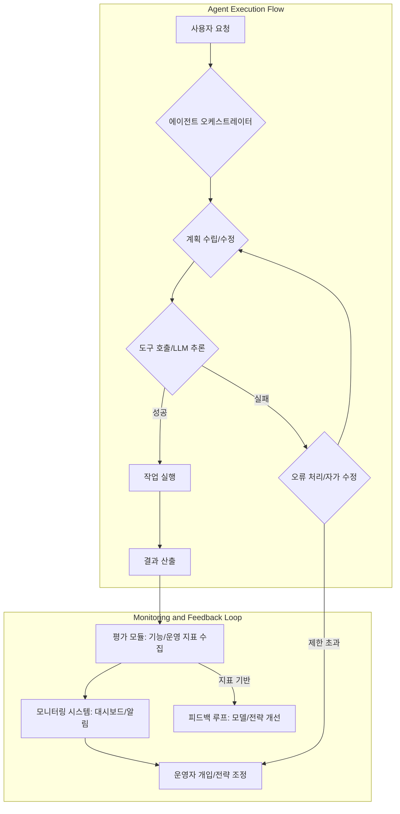

## 에이전트 평가 패러다임의 전환: 정확성을 넘어선 가치 측정

AI의 초점이 단순히 질문에 답하는 인터페이스를 넘어 업무를 위임받아 실행하는 '에이전트'로 이동함에 따라, 에이전트의 성능 평가 방식 또한 진화하고 있습니다. 기존의 LLM(Large Language Model) 평가가 주로 답변의 정확도에 초점을 맞추었다면, 에이전트 평가는 모델 자체의 정확도를 넘어 도구(tool) 사용의 적절성, 컨텍스트(context) 활용 능력, 복잡한 실행 루프(execution loop)의 안정성, 그리고 실제 환경(environment)에서의 작업 완료 여부를 포괄해야 합니다. 조직의 관심이 에이전트 구축에서 프로덕션 배포, 운영, 확장으로 옮겨가면서, 에이전트의 실제 가치를 측정하고 운영을 고도화하는 전략이 필수적입니다. 이는 InfoQ의 'AI, ML 및 데이터 엔지니어링 트렌드 보고서 2026'에서도 강조된 바 있습니다.

## 다차원 에이전트 성능 지표 도입

에이전트의 전체적인 성능을 이해하려면 단일 지표가 아닌 다차원적인 평가 프레임워크가 필요합니다. 이는 LLM 출력 검증 파이프라인과 드리프트(drift) 감지 로직을 재검토하고 확장하여 에이전트의 전반적인 행동과 결과에 대한 통찰을 제공합니다.

### 1. 기능적 및 작업 완료 지표 (Functional & Task Completion Metrics)

*   **작업 성공률 (Task Success Rate)**: 에이전트가 주어진 작업을 완전히 해결한 비율입니다. 부분적인 성공도 정의하여 측정해야 합니다. 예를 들어, `PartialSuccess: {step_count}/ {total_steps}`와 같이 기록할 수 있습니다.
*   **도구 활용 효율성 (Tool Utilization Efficacy)**: 에이전트가 외부 도구를 얼마나 효과적이고 효율적으로 사용하는지를 측정합니다. 불필요한 도구 호출, 잘못된 파라미터 전달, 도구 오류 복구 능력 등이 포함됩니다.
*   **계획 준수율 (Plan Adherence)**: 에이전트가 사전에 정의된 계획(또는 자율적으로 생성한 계획)에 얼마나 잘 따르는지, 그리고 계획 변경이 필요한 경우 합리적으로 이루어졌는지를 평가합니다.
*   **컨텍스트 활용도 (Context Utilization)**: 제공된 컨텍스트를 얼마나 정확하게 이해하고 적절히 활용했는지, 그리고 불필요한 정보를 참조하지 않았는지를 측정합니다.

### 2. 운영 및 자원 지표 (Operational & Resource Metrics)

*   **작업 당 비용 (Cost per Task)**: 에이전트가 하나의 작업을 완료하는 데 드는 컴퓨팅 자원(토큰 사용량, API 호출 횟수, GPU 시간 등) 비용을 측정합니다. runaway-cost-prevention은 필수적입니다.
*   **작업 소요 시간 (Task Latency)**: 작업을 시작부터 완료까지 걸리는 시간입니다. 특히 실시간(real-time) 상호작용이 중요한 에이전트에게 핵심 지표입니다.
*   **인간 개입 필요성 (Human-in-the-Loop, HITL Frequency)**: 에이전트가 작업을 수행하는 과정에서 인간의 도움이 필요했던 빈도와 그 개입의 유형(승인, 수정, 재시도 지시 등)을 측정합니다. 이는 에이전트의 자율성(autonomy) 수준을 나타냅니다.
*   **실패 복구율 (Failure Recovery Rate)**: 에이전트가 오류 발생 시 스스로 복구하여 작업을 재개하는 능력입니다. 이는 에이전트의 복원력(resilience)을 평가하는 중요한 척도입니다.
*   **처리량 (Throughput)**: 단위 시간당 처리할 수 있는 작업의 양으로, 에이전트 시스템의 확장성(scalability)을 가늠하는 지표입니다.

## 에이전트 운영 전략 고도화

프로덕션 환경에서의 에이전트 운영은 단순 배포를 넘어 지속적인 성능 최적화와 안정성 유지를 목표로 합니다.

### 1. 지속적인 모니터링 및 관측성 (Continuous Monitoring and Observability)

에이전트의 복잡한 실행 루프와 다양한 도구 상호작용을 추적하기 위해 고급 모니터링 시스템을 구축해야 합니다. 스팬(span) 기반의 트레이싱(tracing)은 에이전트의 의사결정 경로, 도구 호출, LLM 상호작용 등을 시각적으로 분석하는 데 필수적입니다. 로그는 구조화된 형태로 기록하여 나중에 분석하기 용이하도록 해야 합니다.



### 2. 피드백 루프 및 자가 개선 (Feedback Loops and Self-Improvement)

프로덕션에서 수집된 평가 지표와 사용자 피드백을 활용하여 에이전트의 성능을 지속적으로 개선합니다. 이는 크게 두 가지 방식으로 이루어질 수 있습니다.

*   **오프라인 개선 (Offline Improvement)**: 실패 사례, 비효율적인 도구 사용, 높은 비용 발생 작업 등을 분석하여 에이전트의 프롬프트(prompt), 도구 사용 로직, 계획 전략 등을 개선하고 재배포합니다.
*   **온라인 자가 개선 (Online Self-Improvement)**: 에이전트가 특정 환경에서 학습 데이터를 축적하여 스스로 행동 전략을 조정하거나 새로운 도구 사용 패턴을 학습하는 방식입니다. 예를 들어, Agent Rationale Storage Decision Learning System은 이러한 자가 개선에 기여할 수 있습니다.

```python
# Simplified Agent Evaluation Pipeline Pseudocode
def evaluate_agent_performance(agent, task_set, config):
    results = []
    for task in task_set:
        start_time = time.time()
        cost_tracker = CostTracker()
        human_intervention_needed = False
        
        try:
            # Simulate agent execution
            agent_response = agent.run(task.prompt, tools=config.tools, cost_tracker=cost_tracker)
            
            # Check for human intervention during run (simplified)
            if agent_response.get("human_intervention", False):
                human_intervention_needed = True
                
            # Evaluate task completion using defined criteria
            is_completed, feedback = evaluate_completion(task, agent_response)

            # Collect metrics
            metrics = {
                "task_id": task.id,
                "success": is_completed,
                "latency": time.time() - start_time,
                "total_cost": cost_tracker.get_total_cost(),
                "tool_calls": cost_tracker.get_tool_call_count(),
                "human_intervention": human_intervention_needed,
                "feedback": feedback
            }
            results.append(metrics)
            
        except Exception as e:
            # Handle agent runtime errors
            metrics = {
                "task_id": task.id,
                "success": False,
                "latency": time.time() - start_time,
                "total_cost": cost_tracker.get_total_cost(),
                "tool_calls": cost_tracker.get_tool_call_count(),
                "human_intervention": True, # Error implies intervention needed
                "error": str(e)
            }
            results.append(metrics)

    return analyze_results(results)

# Example usage:
# agent_config = {"tools": ["web_search", "code_executor"]}
# evaluation_results = evaluate_agent_performance(my_agent, sample_tasks, agent_config)
# print(evaluation_results)
```

### 3. 가드레일 및 이상 감지 (Guardrails and Anomaly Detection)

에이전트의 오작동, 무분별한 비용 발생, 보안 취약점 등을 방지하기 위한 강력한 가드레일(guardrail) 시스템을 구축해야 합니다. 이는 사전 검증(pre-validation), 런타임 모니터링(runtime monitoring), 사후 감사(post-audit)를 포함합니다. 예를 들어, `AI Agent Control Accountability Guardrails` 또는 `Agent Malfunction Cost Overrun Prevention Guard Test`와 같은 메커니즘을 도입하여 에이전트의 행동을 제어하고 예측 불가능한 결과를 최소화합니다. 비용 임계값(cost threshold)을 설정하여 일정 수준 이상의 비용이 발생하면 자동으로 작업을 중단하거나 운영자에게 알림을 보내는 시스템이 필요합니다.

### 4. 확장성 및 복원력 (Scalability and Resilience)

프로덕션 환경에서 에이전트 시스템은 예측 불가능한 부하와 다양한 오류 상황에 대응할 수 있어야 합니다. 이를 위해 `LLM Application Stable Deployment CI/CD Pipeline`과 같은 견고한 배포 파이프라인과, `LLM API Retry Logic Design Patterns Resilience`와 같은 오류 처리 전략이 중요합니다. 에이전트 인스턴스의 동적 스케일링, 로드 밸런싱, 그리고 장애 발생 시 자동 복구 메커니즘을 설계하여 서비스의 연속성을 보장해야 합니다.

## 트레이드오프

에이전트 평가 및 운영 전략 고도화는 여러 가지 트레이드오프를 수반합니다.

*   **정확성 vs. 복잡성 (Accuracy vs. Complexity)**
    *   **언제 좋은가**: 단일 지표에 의존하는 것보다 에이전트의 실제 가치를 정확하게 파악하고, 잠재적인 문제점을 조기에 발견하여 안정적인 프로덕션 운영이 가능합니다.
    *   **언제 나쁜가**: 평가 지표의 수가 늘어나고 복잡해질수록 평가 시스템 자체를 구축하고 유지보수하는 데 더 많은 시간과 자원이 소요됩니다. 초기 단계의 에이전트에는 과도할 수 있습니다.

*   **완벽한 제어 vs. 개발 속도 (Full Control vs. Development Velocity)**
    *   **언제 좋은가**: 에이전트의 모든 행동을 면밀히 모니터링하고 가드레일을 통해 제어함으로써 예상치 못한 오작동이나 비용 문제를 사전에 방지할 수 있습니다. 특히 규제가 엄격하거나 치명적인 오류를 방지해야 하는 분야에서 중요합니다.
    *   **언제 나쁜가**: 너무 많은 제어 메커니즘과 평가 단계를 도입하면 에이전트 개발 및 배포 속도가 현저히 느려질 수 있습니다. 빠른 실험과 반복이 중요한 초기 프로토타입 단계에서는 불리합니다.

*   **세분화된 데이터 vs. 데이터 수집 오버헤드 (Granular Data vs. Data Collection Overhead)**
    *   **언제 좋은가**: 에이전트의 행동에 대한 세분화된 데이터를 수집하면 성능 저하의 근본 원인을 정확히 진단하고 효과적인 개선 방안을 도출할 수 있습니다.
    *   **언제 나쁜가**: 모든 상호작용과 내부 상태를 기록하는 것은 상당한 저장 공간과 처리 비용을 발생시킵니다. 데이터 수집 및 처리가 병목 현상으로 이어질 수 있습니다.

*   **자율성 증대 vs. 인간 개입 비용 (Increased Autonomy vs. Human Intervention Cost)**
    *   **언제 좋은가**: 에이전트의 자율성을 높이고 인간 개입을 최소화하면 운영 비용을 절감하고 처리량을 증가시킬 수 있습니다.
    *   **언제 나쁜가**: 인간 개입이 필요한 상황(Edge Case)에 대한 대비가 충분하지 않으면, 에이전트의 오류가 더 큰 문제로 확산되거나, 결국 인간이 문제를 해결하는 데 더 많은 시간과 비용이 들 수 있습니다.

## 실전 체크리스트

에이전트 평가 및 운영 전략을 고도화할 때 다음 체크리스트를 활용하여 프로젝트에 적용할 수 있습니다.

*   [ ] 에이전트의 주요 기능별 '작업 성공률'을 정의하고 자동화된 측정 파이프라인을 구축했는가?
*   [ ] 각 에이전트 작업 완료에 필요한 '평균 비용(API 토큰, 컴퓨팅 자원)' 및 '평균 소요 시간(Latency)'을 추적하고 최적화 목표를 설정했는가?
*   [ ] 에이전트의 '도구 사용 로그'를 분석하여 비효율적인 도구 호출이나 잘못된 파라미터 전달 사례를 식별하고 개선 계획을 수립했는가?
*   [ ] 에이전트가 특정 환경에서 오류를 발생시키거나 '인간 개입'이 필요한 경우를 기록하고, 해당 시나리오에 대한 '실패 복구 메커니즘'을 구현했는가?
*   [ ] 프로덕션 환경에서 에이전트의 행동과 LLM 추론 경로를 추적할 수 있는 '분산 트레이싱(Distributed Tracing)' 및 '구조화된 로깅(Structured Logging)' 시스템을 구축했는가?
*   [ ] 에이전트의 '이상 행동(Anomaly Detection)' 및 '비용 임계값 초과'를 실시간으로 감지하고 운영자에게 알림을 보낼 수 있는 '가드레일 시스템'을 적용했는가?
*   [ ] 프로덕션 환경 데이터를 활용하여 에이전트의 프롬프트나 로직을 주기적으로 업데이트하고 재배포하는 '자동화된 피드백 루프' 및 'CI/CD 파이프라인'을 구현했는가?