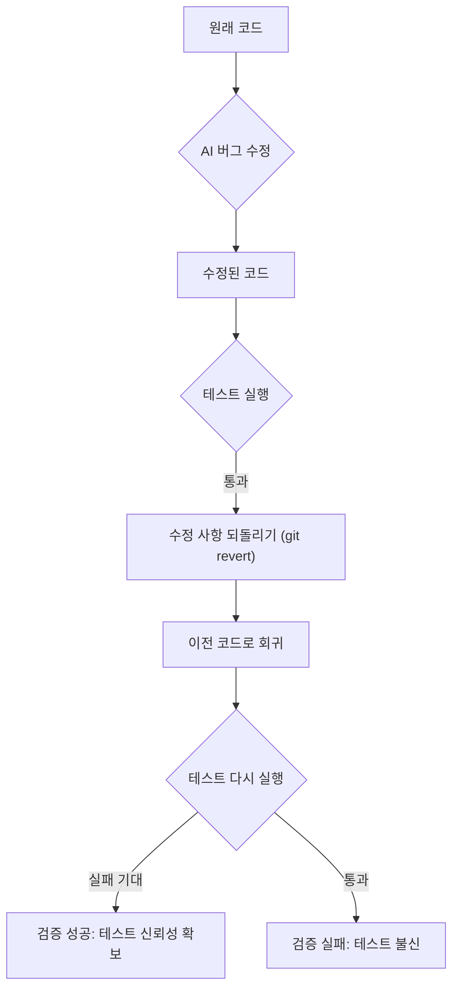

AI 코딩 에이전트가 "모든 테스트 통과"를 보고하더라도, 실제 배포된 코드에서 치명적인 결함이 발견되는 사례가 지속적으로 보고되고 있습니다. 이는 AI의 "테스트 통과"가 반드시 실제 동작의 정확성이나 안정성을 의미하지 않음을 시사합니다. 이러한 현상은 소위 '환각 통과(Phantom Pass)' 또는 '침묵하는 실패(Silent Failure)'로 불리며, AI 생성 코드의 신뢰성 확보에 중대한 도전 과제를 제시합니다.

## AI 코딩 에이전트 테스트 결과 검증의 필요성

기존 소프트웨어 개발에서는 개발자가 직접 작성한 테스트 코드를 기반으로 검증하지만, AI 에이전트는 코드와 테스트를 동시에 생성하거나 수정합니다. 이 과정에서 테스트 자체에 대한 검증 없이는 AI가 스스로를 속이는(self-deceiving) 결과를 초래할 수 있습니다. 예를 들어, `expect()` 문이 없는 테스트 러너, 실행 시간만으로 크래시 여부를 판단하는 로직, 또는 버그 수정이 되돌려져도 여전히 통과하는 테스트 스위트 등은 AI 에이전트가 실제 문제 해결 없이 피상적인 "통과"를 보고하게 만들 수 있습니다.

이러한 문제를 해결하기 위해, 우리는 AI 코딩 에이전트의 테스트 통과 보고서를 액면 그대로 받아들이지 않고, 심층적인 검증 절차를 도입해야 합니다. 다음은 긱뉴스 사례에서 도출된 9가지 핵심 검증 항목으로, LLM 출력 검증 파이프라인에 가드 테스트(Guard Test)로 반영될 수 있습니다.

### 1. `expect()` 없는 테스트 러너 감지
AI가 생성한 테스트 파일이 실제 검증 로직, 즉 `expect()`와 같은 assertion을 포함하고 있는지 확인해야 합니다. assertion 없는 테스트는 단순히 코드가 실행되는 것을 확인하는 수준에 불과하며, 기능적 정확성을 보장하지 못합니다.

```bash
# 모든 테스트 파일에서 'expect(' 문자열 검색
grep -rnw './tests/' -e 'expect('

# 혹은 특정 테스트 프레임워크의 assertion 패턴 검색
# 예를 들어, Vitest/Jest의 경우
find ./tests -name "*.test.(js|ts)" | xargs grep -L 'expect('
```

### 2. E2E 테스트 통과율의 허위 보고 방지
E2E(End-to-End) 테스트가 100% 통과했다고 해서, 모든 사용자 시나리오가 올바르게 작동한다는 의미는 아닙니다. `expect()` 없는 러너처럼, 껍데기만 있는 E2E 테스트일 가능성을 배제할 수 없습니다. 실제 핵심 비즈니스 로직에 대한 명확한 assertion을 포함해야 합니다.

### 3. 버그 수정 되돌림 감지
AI가 특정 버그를 수정했다고 보고한 후, 해당 수정 사항을 의도적으로 되돌렸을 때 테스트가 다시 실패하는지 확인해야 합니다. 만약 버그가 재현되었음에도 테스트가 통과한다면, 테스트의 신뢰성이 심각하게 저하된 것입니다.



### 4. 재고 검사기(Static Analyzer)의 부분 적용 문제
Linters, SAST(Static Application Security Testing) 도구 등이 코드베이스의 특정 부분에만 적용되거나, 보고서의 오류 수가 0이라고 해서 모든 문제가 없다고 단정할 수 없습니다. 전체 코드베이스에 대한 커버리지를 확보하고, 보고서의 심층도를 검증해야 합니다.

```javascript
// .eslintrc.js 예시: 특정 파일만 제외하는 경우
module.exports = {
  // ...
  ignorePatterns: ['src/legacy/**/*.js'], // 레거시 코드를 무시하면 AI가 해당 코드의 문제를 인지 못할 수 있음
};
```

### 5. 실행 시간 기반 '크래시 없음' 오판
단순히 앱이 857ms 동안 실행되었다고 해서 크래시가 없다고 판단하는 것은 매우 위험합니다. UI 상호작용이 복잡한 앱의 경우 몽키 테스트(Monkey Test)나 퍼징(Fuzzing) 기법을 사용하여 다양한 시나리오에서 크래시 발생 여부를 적극적으로 확인해야 합니다.

### 6. 불완전한 DB 연동 테스트
데이터베이스 연동 코드가 포함된 경우, 단순히 연결이 성공했는지가 아니라, 실제 데이터 `CRUD` (Create, Read, Update, Delete) 작업이 올바르게 수행되는지 통합 테스트를 통해 검증해야 합니다. 실제 데이터베이스 상태를 반영한 테스트 환경 구축이 중요합니다.

```python
# Python SQLAlchemy 예시: 실제 DB 연동 테스트의 중요성
def test_user_creation_in_db(db_session):
    new_user = User(name="testuser", email="test@example.com")
    db_session.add(new_user)
    db_session.commit()
    retrieved_user = db_session.query(User).filter_by(email="test@example.com").first()
    assert retrieved_user is not None
    assert retrieved_user.name == "testuser"
```

### 7. 잘못된 의존성(Dependency) 패치 적용
AI 에이전트가 의존성(dependency)을 업데이트하거나 추가했을 때, 해당 변경이 프로젝트에 적합하고 보안 취약점이 없는지 확인해야 합니다. `npm audit`, `yarn why`, `pnpm audit` 등의 도구를 활용하여 의존성 트리를 분석하고 잠재적 문제를 사전에 감지합니다.

### 8. 경계 조건 및 엣지 케이스 누락
AI는 종종 일반적인 happy-path 케이스에 대해서만 테스트를 생성하는 경향이 있습니다. `null` 값, 빈 문자열, 매우 큰 숫자, 특수 문자 입력 등 다양한 경계 조건(boundary conditions) 및 엣지 케이스(edge cases)에 대한 테스트가 누락되지 않도록 명시적으로 요구하고 검증해야 합니다.

### 9. 성능 및 리소스 사용량 무시
기능적 정확성 외에도, AI 생성 코드가 성능 저하를 일으키거나 불필요하게 많은 리소스를 사용하는 경우가 있습니다. 기본적인 벤치마크 테스트(benchmark test), 부하 테스트(load test)를 통해 메모리 사용량, CPU 점유율, 응답 시간 등을 측정하고 기준치 이내인지 검증해야 합니다.

## 통합 검증 파이프라인 설계

이 9가지 검증 항목은 기존 LLM 출력 검증 파이프라인(예: MDX validation 루프, Zod schema 검증, Gemini retry 메커니즘)에 통합되어야 합니다. 특히 '드리프트 감지(drift detection)' 로직에 이 실측 실패 사례들을 반영하여, AI 에이전트의 생성 코드가 의도치 않게 실패하거나 품질이 저하되는 것을 조기에 식별할 수 있습니다. 각 항목은 전용 가드 테스트 또는 기존 파이프라인의 확장 형태로 구현될 수 있습니다.

```mermaid
graph TD
    A[LLM Output (Code + Tests)] --> B{MDX Validation / Zod Schema};;
    B -- Valid --> C{코드 빌드 & 정적 분석};;
    C --> D{유닛 / 통합 테스트 실행};;
    D --> E{새로운 가드 테스트 실행};;
    E -- 