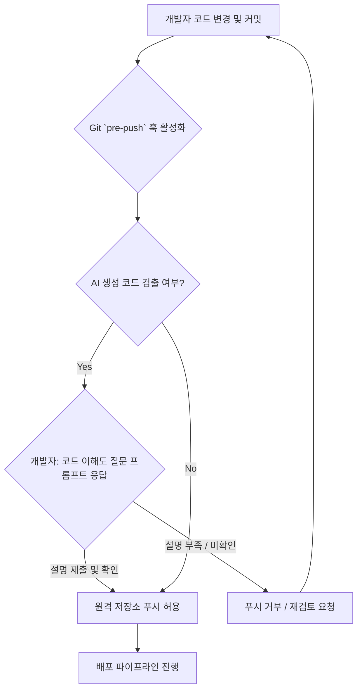

AI 생성 코드의 활용이 보편화됨에 따라, 개발 과정의 효율성은 증대되고 있습니다. 그러나 AI가 생성한 코드는 개발자의 명확한 이해 없이 통합될 경우, 잠재적인 버그, 보안 취약점, 그리고 유지보수 문제로 이어질 수 있습니다. 특히, Claude Code 하네스(harness)를 통해 생성된 코드의 배포 전 검증 절차에 이러한 Git 훅을 통합하는 것은 AI 생성 코드의 품질과 안정성을 확보하고 휴먼-인-더-루프(Human-in-the-Loop) 검증 프로세스를 강화하는 핵심 전략이 됩니다. 이 엔트리는 개발자가 AI 생성 코드를 실제 배포하기 전에 해당 코드의 동작 원리를 충분히 이해했는지 검증하기 위한 Git 훅 도입 방안을 다룹니다.

## Git 훅 메커니즘을 통한 AI 코드 검증

Git 훅은 Git 이벤트 발생 시 특정 스크립트를 자동으로 실행할 수 있도록 하는 강력한 도구입니다. 이 중 `pre-push` 훅은 개발자가 코드를 원격 저장소로 푸시하기 직전에 실행됩니다. 이 시점에서 AI 생성 코드를 식별하고, 해당 코드에 대한 개발자의 이해도를 검증하는 절차를 삽입할 수 있습니다. 이는 마치 코드 리뷰어가 코드 동작을 질문하는 것과 유사하게, 개발자 스스로가 자신의 이해도를 재확인하도록 강제하는 역할을 합니다.

### 코드 이해도 검증 Git 훅 구현

`pre-push` 훅은 `.git/hooks/pre-push` 경로에 실행 가능한 스크립트로 작성됩니다. 다음은 AI 생성 코드(예: 커밋 메시지에 'CODEGEN' 태그가 포함된 경우)를 감지하고 개발자에게 코드 설명 및 이해도 확인을 요청하는 Bash 스크립트 예제입니다.

```bash
#!/bin/bash

# Git pre-push hook for AI-generated code comprehension verification

# Check if any AI-generated code is included in the commits to be pushed
# For simplicity, this example checks for 'CODEGEN' in commit messages.
# In a real-world scenario, this could involve checking file metadata, specific file paths,
# or integration with an external AI code detection service.

AI_CODE_FLAG="CODEGEN"
COMMITS_TO_PUSH=$(git rev-list @{u}..HEAD)

IS_AI_CODE_PRESENT=false
for COMMIT_HASH in $COMMITS_TO_PUSH;
do
  COMMIT_MESSAGE=$(git log --format=%B -n 1 "$COMMIT_HASH")
  if echo "$COMMIT_MESSAGE" | grep -q "$AI_CODE_FLAG"; then
    IS_AI_CODE_PRESENT=true
    break
  fi
done

if [ "$IS_AI_CODE_PRESENT" = true ]; then
  echo "\n--- AI Generated Code Comprehension Check ---"
  echo "AI-generated code detected in commits. Please explain the following:"
  echo "1. Purpose of the changes introduced by the AI code."
  echo "2. How the AI code functions internally (key logic/algorithms)."
  echo "3. Potential side effects or dependencies introduced."
  echo "4. How this code aligns with existing system architecture and best practices.\n"
  read -p "Your explanation (press Enter when done): " USER_EXPLANATION

  if [ -z "$USER_EXPLANATION" ]; then
    echo "\nERROR: An explanation is required for AI-generated code. Push aborted."
    exit 1
  fi

  echo "\n--- Explanation Provided ---"
  echo "$USER_EXPLANATION"
  echo "\nBased on your explanation, do you confirm a thorough understanding of this AI-generated code? (yes/no)"
  read -p "Confirmation: " USER_CONFIRMATION

  if [[ "$USER_CONFIRMATION" != "yes" ]]; then
    echo "\nERROR: Developer comprehension not confirmed. Push aborted."
    exit 1
  fi

  echo "\nAI-generated code comprehension confirmed. Proceeding with push.\n"
else
  echo "No AI-generated code detected in this push. Skipping comprehension check.\n"
fi

exit 0
```

이 스크립트는 `pre-push` 단계에서 AI 생성 코드 여부를 판단하고, 해당 경우 개발자에게 코드의 목적, 동작 방식, 잠재적 부작용, 아키텍처 정합성 등에 대한 설명을 요청합니다. 개발자의 설명이 부실하거나 이해도 확인에 실패하면 푸시를 거부하여, 미숙한 코드의 배포를 사전에 방지합니다.

### 워크플로 시각화

AI 코드 이해도 검증을 위한 Git 훅 워크플로는 다음과 같습니다.



## 2026 AI 개발 트렌드와 Git 훅의 중요성

2026년에는 AI 에이전트 기반의 개발 환경이 더욱 고도화될 것이며, `claude-code-harness`와 같은 자동화된 코드 생성 시스템의 활용이 더욱 확대될 것입니다. 이러한 환경에서는 `agentic-review-code-baseline-null-hypothesis-verification`과 같이 AI가 생성한 코드가 기존 코드 품질 기준을 만족하는지 검증하는 메커니즘의 중요성이 커집니다. 또한, `llm-agent-software-output-verification-beyond-loc`와 같이 코드 라인 수 이상의 의미론적 검증이 요구됩니다.

Git 훅은 이러한 복잡한 AI 에이전트 워크플로에서 `ai-agent-control-validation-mechanisms`의 핵심 구성 요소로 자리매김할 것입니다. 단순히 코드 스캔을 넘어, 개발자의 능동적인 이해와 검증을 강제함으로써 `human-in-the-loop`의 품질을 극대화하고, 궁극적으로 AI 에이전트의 안정적인 통합을 지원합니다.

## 트레이드오프

### 1. 개발 속도와 코드 품질/안정성
*   **언제 좋은가**: AI 생성 코드의 잠재적 위험(버그, 보안 취약점)이 높거나, 프로덕션 환경의 안정성이 최우선일 때 좋습니다. 개발자가 코드를 더 깊이 이해하게 하여 장기적인 유지보수 비용을 절감합니다.
*   **언제 나쁜가**: 개발 초기 단계에서 빠른 프로토타이핑이 필요하거나, AI 생성 코드가 매우 단순하고 낮은 위험을 가질 때 개발 프로세스에 불필요한 마찰을 추가하여 개발 속도를 저해할 수 있습니다.

### 2. 자동화된 검증과 수동 검증의 균형
*   **언제 좋은가**: AI가 코드 생성의 주체가 되면서 발생하는 '책임감 부재' 문제를 해결하고, 개발자가 코드의 최종 책임자로서 인지하도록 돕습니다. 기계적 검출이 어려운 의미론적 오류를 인간의 이해로 보완합니다.
*   **언제 나쁜가**: 개발자가 수동으로 많은 AI 생성 코드를 검증해야 하는 경우 피로도를 높여 훅의 효용성을 떨어뜨릴 수 있습니다. 비효율적인 수동 검증은 오히려 개발자 이탈을 야기할 수 있습니다.

### 3. 유연한 워크플로와 엄격한 제어
*   **언제 좋은가**: 민감한 시스템이나 규제 준수가 중요한 환경에서 배포 전 엄격한 품질 게이트 역할을 합니다. AI 생성 코드의 오남용을 방지하고 예측 가능한 동작을 보장합니다.
*   **언제 나쁜가**: 실험적이거나 비판적이지 않은 기능 개발 시, 혹은 개발 팀의 규모가 작고 신뢰도가 높은 경우 과도한 제어로 인식되어 생산성을 저해할 수 있습니다.

## 실전 체크리스트

- [ ] AI 생성 코드를 식별하는 명확한 기준(예: 특정 파일 확장자, 주석, 커밋 메시지 태그)이 정의되어 있는가?
- [ ] `pre-push` 훅 스크립트가 모든 개발 환경에서 일관되게 동작하도록 구성 및 테스트되었는가?
- [ ] 개발자가 코드 이해도를 설명하고 확인하는 프롬프트의 내용이 구체적이며 핵심적인 질문을 포함하고 있는가?
- [ ] 이해도 검증 실패 시 개발자에게 제공되는 피드백(예: 푸시 거부 메시지)이 명확하고 건설적인가?
- [ ] Git 훅 도입 후 개발 속도에 미치는 영향과 AI 생성 코드의 품질 향상 효과를 측정할 수 있는 지표를 마련했는가?
- [ ] CI/CD 파이프라인에 Git 훅 검증 실패 시 후속 조치(예: 코드 리뷰 강제, 자동화된 설명 요구)를 연동하는 방안을 고려했는가?
- [ ] AI 생성 코드의 복잡도와 중요도에 따라 훅의 엄격성을 동적으로 조절할 수 있는 메커니즘(예: 설정 파일, 환경 변수)을 설계했는가?