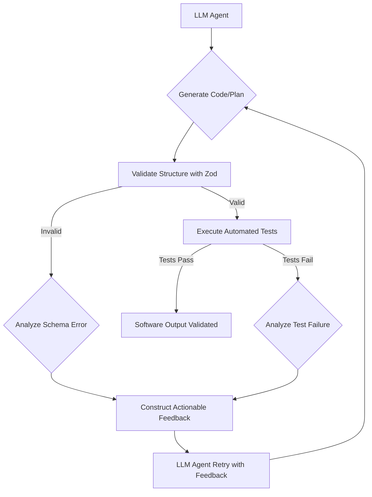

LLM 에이전트의 코드 생성 능력은 빠르게 발전하고 있지만, 생성된 코드의 양(Line of Code, LoC)이 실제 비즈니스 가치를 창출하는 소프트웨어 산출량(Software Output)과 직결되지는 않는다는 연구 결과가 나오고 있습니다. 단순히 코드 줄 수가 증가하는 것을 넘어, 기능 구현의 정확성, 버그 감소, 그리고 전반적인 시스템 안정성 향상이라는 실질적인 소프트웨어 산출량으로 이어지는 LLM 에이전트의 개발이 중요해지고 있습니다. 이 엔트리는 LLM 에이전트가 생성하는 코드의 실질적인 소프트웨어 산출량을 강화하기 위한 검증 파이프라인 설계 전략을 다룹니다.

## 소프트웨어 산출량의 정의 및 중요성

전통적인 소프트웨어 개발에서 산출량은 단순히 커밋 수나 코드 줄 수로 측정되지 않습니다. 이는 사용자에게 제공되는 새로운 기능, 해결된 버그, 개선된 성능, 그리고 비즈니스 목표 달성에 기여하는 실제 배포 가능한 소프트웨어의 가치로 평가됩니다. LLM 에이전트의 맥락에서 소프트웨어 산출량은 다음과 같은 지표를 포함합니다:

*   **기능적 정확성 (Functional Correctness)**: 에이전트가 생성한 코드가 요구사항에 따라 의도한 대로 작동하는가.
*   **테스트 통과율 (Test Pass Rate)**: 생성된 코드가 단위 테스트, 통합 테스트, 시스템 테스트를 얼마나 잘 통과하는가.
*   **결함 밀도 (Defect Density)**: 배포 후 발견되는 버그의 수 및 심각도.
*   **보안 취약점 (Security Vulnerabilities)**: 생성된 코드에서 발견되는 보안 문제의 수.
*   **유지보수성 (Maintainability)**: 코드가 얼마나 읽기 쉽고, 이해하기 쉬우며, 수정하기 쉬운가.
*   **성능 (Performance)**: 코드가 효율적으로 작동하며 리소스를 적절히 사용하는가.

이러한 지표들은 에이전트가 단지 코드를 '생성'하는 것을 넘어, '작동하는 소프트웨어'를 '생성'하고 있는지를 판단하는 데 핵심적인 역할을 합니다.

## LLM 에이전트 출력 검증 파이프라인 강화 전략

### 1. Zod Schema를 활용한 구조적 출력 검증 (Structured Output Validation with Zod Schema)

LLM 에이전트가 생성하는 코드나 설정 파일, 혹은 액션 플랜 등의 구조가 특정 스키마를 따르도록 강제하는 것은 초기 단계에서 오류를 줄이는 데 매우 효과적입니다. TypeScript 생태계의 Zod와 같은 스키마 유효성 검사 라이브러리를 사용하면, 에이전트의 JSON 또는 객체 형태 출력에 대해 런타임에 엄격한 유효성 검사를 적용할 수 있습니다.

```typescript
import { z } from 'zod';

// LLM 에이전트가 생성해야 할 코드 스니펫의 구조 정의
const CodeSnippetSchema = z.object({
  fileName: z.string().min(1, "File name cannot be empty"),
  language: z.enum(['typescript', 'python', 'javascript', 'go'], "Unsupported language"),
  code: z.string().min(10, "Code snippet is too short"),
  description: z.string().optional(),
  tests: z.array(z.string()).optional(), // 생성된 코드에 대한 테스트 코드 목록
});

type CodeSnippet = z.infer<typeof CodeSnippetSchema>;

// LLM 에이전트의 출력 (예시)
const agentOutput = {
  fileName: 'userService.ts',
  language: 'typescript',
  code: `
    function getUser(id: string) {
      // ... implementation ...
    }
  `,
  tests: [
    'test/userService.test.ts',
  ],
};

try {
  CodeSnippetSchema.parse(agentOutput);
  console.log('LLM Agent output is valid!');
} catch (error) {
  console.error('LLM Agent output validation failed:', error);
  // 에이전트에 피드백 제공 및 재시도 로직 트리거
}
```

이 방식은 에이전트가 의미론적으로는 맞더라도 형식적으로 틀린 출력을 내는 경우를 효과적으로 방지합니다.

### 2. 실제 기능 구현 검증을 위한 자동화된 테스트 통합 (Automated Testing for Functional Correctness)

코드 줄 수 증가는 의미 없다는 긱뉴스 기사의 시사점처럼, 가장 중요한 것은 생성된 코드가 실제로 작동하고 올바른 기능을 수행하는지 여부입니다. 이를 위해 단위 테스트(Unit Test), 통합 테스트(Integration Test), 그리고 경우에 따라서는 종단 간 테스트(End-to-End Test)를 LLM 에이전트의 작업 흐름에 통합해야 합니다.

*   **테스트 케이스 자동 생성 및 실행**: 에이전트가 코드를 생성하면, 해당 코드에 대한 테스트 케이스도 함께 생성하거나 기존의 테스트 프레임워크를 활용하여 자동으로 테스트를 실행하도록 합니다.
*   **테스트 결과 기반 피드백**: 테스트 실패 시, 실패한 테스트 케이스, 오류 메시지, 스택 트레이스 등을 에이전트에 다시 프롬프트로 제공하여 코드를 수정하도록 유도합니다.

### 3. Gemini Retry 로직 개선 및 지능형 피드백 루프 (Enhanced Gemini Retry with Intelligent Feedback Loops)

단순히 실패 시 재시도하는 것을 넘어, 실패의 원인을 분석하고 이를 바탕으로 에이전트에 구체적이고 실행 가능한 피드백을 제공하는 지능형 재시도 로직이 필요합니다. Gemini와 같은 강력한 LLM 모델은 이러한 피드백을 이해하고 다음 시도에 반영할 능력이 있습니다.



*   **오류 분석 및 재시도**: Zod 유효성 검사 실패 또는 테스트 실패 시, 오류 메시지 파싱(Parsing)을 통해 구체적인 문제점을 식별합니다. 예를 들어, `fileName` 필드가 누락되었음을 감지하면 "The 'fileName' field is missing from your output. Please include it."와 같은 피드백을 제공합니다.
*   **컨텍스트 유지**: 재시도 시에는 이전 시도의 코드, 실패 원인, 그리고 제공된 피드백을 함께 컨텍스트로 전달하여 에이전트가 이전 실패를 학습하고 개선된 출력을 생성하도록 돕습니다.

### 4. 정적 분석 및 린팅 도구 통합 (Static Analysis and Linting Tool Integration)

코드 품질, 스타일 일관성, 잠재적 버그, 보안 취약점을 사전에 걸러내는 데 정적 분석(Static Analysis) 및 린팅(Linting) 도구가 필수적입니다. ESLint, SonarQube, Bandit 등은 LLM 에이전트가 생성한 코드에 대해서도 동일하게 적용될 수 있습니다.

*   **CI/CD 파이프라인 연동**: 에이전트가 생성한 코드를 Git에 커밋하기 전 또는 Pull Request(PR) 생성 시점에 CI/CD 파이프라인에 통합하여 자동 검사를 수행합니다.
*   **피드백 전달**: 정적 분석 결과에서 발견된 문제점(예: "Magic number found", "Unused variable")을 에이전트에 명확한 피드백으로 전달하여 수정하도록 합니다.

### 5. 코드 리뷰 및 인간 개입 지점 (Code Review and Human Intervention Points)

자동화된 검증 파이프라인이 아무리 강력해도 인간의 판단과 경험을 완전히 대체할 수는 없습니다. 특히 초기 단계나 복잡한 로직을 생성하는 경우, 인간 개발자의 코드 리뷰는 필수적인 품질 보증 단계입니다.

*   **선별적 코드 리뷰**: 모든 코드를 리뷰하는 대신, 중요도가 높거나 복잡도가 높은 코드, 또는 자동화된 검증에서 경고가 발생한 코드에 대해 집중적인 리뷰를 수행합니다.
*   **피드백 학습**: 리뷰 과정에서 발견된 문제점과 그 해결 방안을 LLM 에이전트의 학습 데이터로 활용하여 지속적으로 성능을 향상시킵니다.

## 트레이드오프

### 1. 개발 속도 vs. 소프트웨어 품질
*   **언제 좋은가**: 높은 수준의 안정성과 보안이 요구되는 미션 크리티컬 시스템, 복잡한 비즈니스 로직을 다루는 경우에 유리합니다. 초기에는 속도가 느려지더라도 장기적으로는 버그 감소와 유지보수 비용 절감으로 이어진다.
*   **언제 나쁜가**: 빠르게 프로토타입을 만들거나, 실험적인 기능 개발, 또는 내부적으로만 사용되는 단순 도구와 같이 속도가 최우선인 경우에는 과도한 검증이 불필요한 오버헤드가 될 수 있습니다.

### 2. 복잡성 vs. 신뢰성
*   **언제 좋은가**: 에이전트가 생성하는 코드의 신뢰성을 극대화하고자 할 때, 특히 다양한 도메인과 복잡한 환경에 배포될 소프트웨어에 적합합니다. 다양한 검증 단계를 거쳐 예측 불가능성을 줄일 수 있다.
*   **언제 나쁜가**: 검증 파이프라인 자체의 구축 및 유지보수 비용이 상당할 수 있습니다. 작은 프로젝트나 리소스가 제한된 팀에서는 이러한 복잡성이 오히려 생산성을 저해할 수 있다. 검증 시스템 자체의 버그나 오작동 가능성도 고려해야 한다.

### 3. 자원 소모 vs. 정확도
*   **언제 좋은가**: 생성된 코드의 결함이 심각한 재정적 손실, 보안 문제 또는 운영 중단을 초래할 수 있는 경우, 더 많은 컴퓨팅 자원을 투입하여 검증 정확도를 높이는 것이 합리적입니다.
*   **언제 나쁜가**: GPU 자원 등 컴퓨팅 비용이 비싼 환경에서 모든 생성 코드에 대해 광범위한 테스트 및 분석을 수행하는 것은 비용 비효율적일 수 있습니다. 비용 제약이 강한 환경에서는 검증 범위를 최적화해야 합니다.

### 4. LLM 에이전트의 자율성 vs. 통제
*   **언제 좋은가**: 에이전트가 생성하는 코드에 대한 강력한 통제와 품질 보증이 필요할 때 효과적입니다. 에이전트의 '폭주'를 막고, 예측 가능한 결과물을 얻는 데 도움이 된다.
*   **언제 나쁜가**: 에이전트의 창의성이나 자율적인 탐색 및 문제 해결 능력이 중요한 작업(예: 새로운 알고리즘 탐색, 다양한 솔루션 제안)에서는 과도한 통제가 에이전트의 잠재력을 제한할 수 있습니다.

## 실전 체크리스트

다음은 LLM 에이전트의 소프트웨어 산출량 검증을 강화하기 위한 실전 체크리스트입니다.

*   [ ] LLM 에이전트의 모든 출력(코드, 설정, 플랜 등)에 대해 **Zod (또는 유사한) 스키마 유효성 검사**를 필수로 적용했는가?
*   [ ] 생성된 코드에 대한 **단위 테스트 및 통합 테스트를 자동화**하고, 테스트 실패 시 에이전트에 구체적인 피드백을 전달하는 파이프라인을 구축했는가?
*   [ ] 테스트 실패 메시지, 스택 트레이스 등을 분석하여 **LLM 에이전트에 재시도를 위한 지능형 피드백**을 제공하는 로직을 구현했는가? (단순 재시도가 아닌 `Gemini retry` 로직 개선)
*   [ ] 생성된 코드에 대해 **정적 분석 도구(ESLint, SonarQube 등)를 CI/CD 파이프라인에 통합**하여 코드 품질 및 보안 취약점을 검사하고, 결과를 에이전트에 피드백하는가?
*   [ ] LLM 에이전트가 생성한 코드에 대한 **주요 기능별 성능 벤치마크 테스트**를 포함하고, 성능 저하가 감지될 경우 에이전트에 알리는 메커니즘을 마련했는가?
*   [ ] 인간 개발자의 **코드 리뷰(Code Review) 프로세스를 설계**하고, 자동화된 검증을 통과한 코드라도 중요도에 따라 인간의 최종 승인을 거치도록 하는가?
*   [ ] 에이전트의 생성 프로세스 및 검증 단계에서 발생하는 **모든 오류, 재시도, 피드백 흐름을 추적하고 로깅**하여, 에이전트 성능 개선을 위한 데이터를 수집하는가?