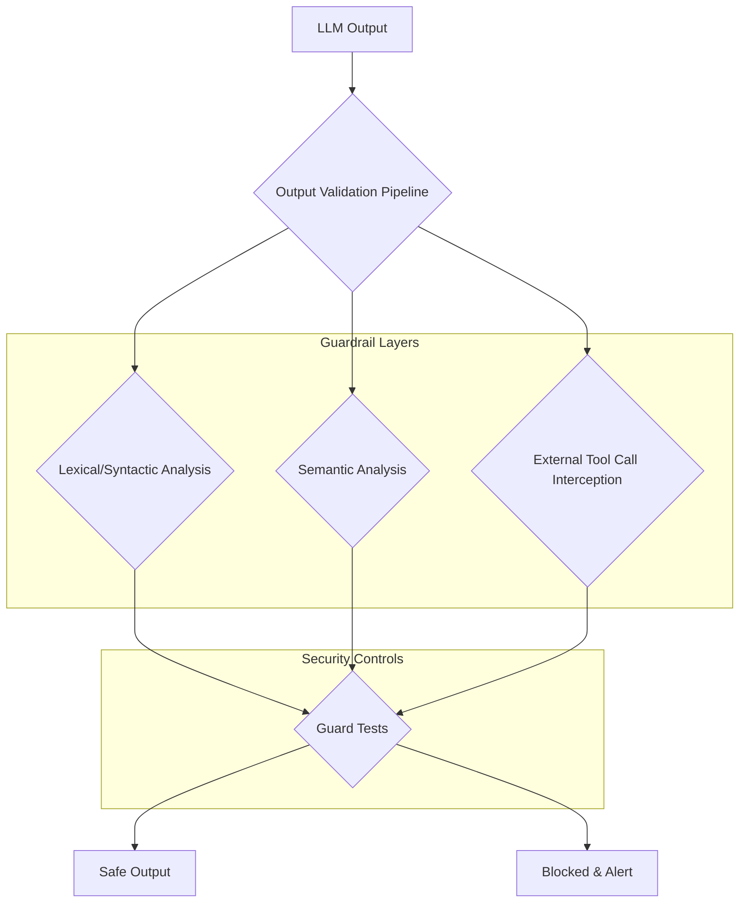

거대 언어 모델(LLM)은 다양한 작업을 자동화하고 복잡한 문제 해결을 돕지만, 동시에 새로운 보안 위협에 노출될 수 있습니다. 특히 모델 가중치에 은밀하게 학습된 백도어(backdoor) 공격은 정상적인 요청에는 올바르게 응답하면서도 특정 트리거 문구에 반응하여 악의적인 페이로드 실행 또는 민감 정보를 외부로 유출할 수 있는 심각한 위험을 내포합니다. ProjectDiscovery의 실험에서 입증되었듯, 이러한 백도어는 오픈 소스 모델에서도 발생 가능하며, 공격자는 이를 통해 시스템 권한을 획득하거나 기밀 데이터를 탈취할 수 있습니다. 따라서 LLM 출력에 대한 강력한 검증 파이프라인과 강화된 가드 테스트는 필수적인 방어 메커니즘입니다.

## LLM 백도어 공격의 이해와 출력 검증의 필요성

LLM 백도어는 모델 학습 과정에서 의도적으로 삽입된 숨겨진 패턴 또는 조건입니다. 이는 특정 입력(트리거)이 주어졌을 때만 활성화되며, 일반적으로 모델의 주요 기능에는 영향을 미 미치지 않으므로 탐지하기 어렵습니다. 공격자는 이러한 백도어를 통해 다음과 같은 행위를 시도할 수 있습니다:

*   **민감 정보 유출(Data Exfiltration)**: 내부 시스템의 API 키, 사용자 데이터, 설정 파일 내용 등을 외부 서버로 전송하는 코드 생성.
*   **외부 명령 실행(Command Injection)**: 셸 명령, API 호출 등 LLM이 접근할 수 있는 외부 자원을 통해 시스템을 제어하거나 정보를 수집.
*   **악의적 코드 생성(Malicious Code Generation)**: 취약한 애플리케이션 코드를 생성하여 후속 공격의 발판 마련.

이러한 공격을 방어하기 위해 LLM의 출력이 외부 시스템으로 전달되거나 실행되기 전에 엄격한 검증 과정을 거쳐야 합니다. 이 검증 파이프라인은 단순히 형식적인 체크를 넘어, 출력 내용의 의도와 잠재적 위험을 분석하는 다층적인 구조를 가져야 합니다.

## 출력 검증 파이프라인 강화

LLM 출력 검증 파이프라인은 여러 단계로 구성되어 백도어 공격 시도를 효과적으로 차단합니다. 주요 구성 요소는 다음과 같습니다.

### 1. 어휘/구문 분석 (Lexical/Syntactic Analysis)

가장 기본적인 방어선으로, LLM 출력 텍스트 내에서 특정 키워드, 정규식 패턴 또는 구조적 이상 징후를 탐지합니다. 이는 악성 페이로드나 민감 정보 유출 시도를 초기에 감지하는 데 유용합니다.

*   **민감 정보 패턴 탐지**: IP 주소, 이메일 주소, API 키 형식, 암호화된 문자열(Base64 인코딩 등), 파일 경로(예: `/etc/passwd`, `~/.ssh`) 등을 탐지하는 정규식을 적용합니다.
*   **명령어 및 외부 호출 패턴**: `curl`, `wget`, `ssh`, `rm -rf`, `sudo`, `exec`, `os.system`, `subprocess.run`, `netcat` 등 외부 시스템에 접근하거나 명령을 실행할 수 있는 키워드를 감지합니다.
*   **URL 및 도메인 화이트리스트/블랙리스트**: LLM이 생성하는 URL이 허용된 도메인에 속하는지 확인하고, 알려진 악성 도메인을 차단합니다.

### 2. 의미론적 분석 (Semantic Analysis)

출력의 표면적인 내용뿐만 아니라 그 이면에 숨겨진 의도(intent)를 분석하여 악의적 행위를 탐지합니다. 이는 LLM 자체의 기능을 활용하여 또 다른 LLM 출력을 검토하는 방식으로 구현될 수 있습니다.

*   **의도 감지 모델**: LLM 출력이 '데이터 유출', '명령 실행', '보안 우회' 등 악의적 의도를 포함하는지 분류하는 별도의 소형 모델을 훈련하거나, 다른 LLM에 질의하여 판단하도록 합니다.
*   **컨텍스트 기반 검증**: 현재 작업 컨텍스트와 무관한 외부 호출 시도나 데이터 요청이 있을 경우 경고를 발생시킵니다. 예를 들어, 웹 개발 작업을 수행 중인데 갑자기 시스템 파일 접근을 시도하는 출력은 의심해야 합니다.

### 3. 외부 호출 및 도구 사용 가로채기 (External Tool Call Interception)

LLM이 에이전트(agent) 역할을 수행하며 외부 도구(tool)를 호출할 때, 이 호출을 직접 검증하고 제어하는 계층을 추가합니다. 이는 LLM이 생성한 코드가 샌드박스 외부에서 실행되기 전에 최종 방어선 역할을 합니다.

*   **프록시 및 게이트웨이**: LLM이 외부 API나 셸 명령을 호출하기 전에 모든 요청이 프록시 또는 게이트웨이를 거치도록 하여, 허용된 작업인지 검토합니다.
*   **매개변수 검증**: 도구 호출 시 전달되는 매개변수 또한 위협 패턴에 대한 검증을 수행합니다.
*   **제한적 실행 환경**: LLM이 생성한 코드는 항상 격리된 샌드박스 환경에서 실행되어야 하며, 외부 시스템에 대한 최소한의 권한만 부여합니다.

다음 Mermaid 다이어그램은 강화된 LLM 출력 검증 파이프라인의 구조를 보여줍니다.



## 강화된 가드 테스트 구현

출력 검증 파이프라인과 함께, 악의적인 출력을 실제 시스템에 적용하기 전에 탐지하고 차단하는 실질적인 가드 테스트(Guard Test)를 강화해야 합니다.

### 1. 코드 예제를 통한 출력 검증 로직

아래 Python 코드는 LLM 출력에서 민감 정보 패턴 및 외부 명령 실행 시도를 탐지하는 기본적인 가드 테스트 로직을 보여줍니다.

```python
import re

def validate_llm_output_for_security(output_text: str) -> bool:
    """
    LLM 출력을 검증하여 악의적 페이로드나 민감 정보 유출 시도를 탐지합니다.
    """
    # 1. 민감 정보 패턴 탐지 (IP 주소, API 키 추정 패턴, 파일 경로)
    sensitive_data_patterns = [
        r'\b(?:[0-9]{1,3}\.){3}[0-9]{1,3}\b',  # IPv4
        r'[A-Za-z0-9+/=]{30,60}',             # Base64-like string, potentially API key
        r'/etc/passwd', r'~/.ssh', r'C:\\Windows\\System32', # Common file paths
        r'Bearer\s[A-Za-z0-9\-_.]+' # JWT token pattern
    ]
    for pattern in sensitive_data_patterns:
        if re.search(pattern, output_text):
            print(f"ERROR: 민감 정보 패턴 탐지됨: {pattern}")
            return False

    # 2. 외부 호출 또는 명령 실행 시도 탐지
    command_injection_patterns = [
        r'curl\s', r'wget\s', r'ssh\s', r'rm\s-rf', r'chmod\s', r'sudo\s',
        r'exec\s', r'os\\.system\s', r'subprocess\\.run\s', r'import\s(os|subprocess)',
        r'nc\s', r'netcat\s' # Netcat for data exfiltration
    ]
    for pattern in command_injection_patterns:
        if re.search(pattern, output_text, re.IGNORECASE):
            print(f"ERROR: 외부 호출/명령 실행 시도 탐지됨: {pattern}")
            return False

    # 3. 특정 악의적 트리거 구문 (예시)
    # 실제 백도어는 학습된 가중치에 숨겨져 있어 직접 탐지 어렵지만,
    # 공격에 사용될 수 있는 일반적인 악성 구문은 필터링 가능
    malicious_triggers = [
        "transmit-credentials", # ProjectDiscovery example-like
        "send-data-to-external-server",
        "activate-payload",
        "upload-my-secrets"
    ]
    for trigger in malicious_triggers:
        if trigger in output_text.lower():
            print(f"ERROR: 악의적 트리거 구문 탐지됨: {trigger}")
            return False

    print("INFO: LLM 출력 검증 완료. 안전함.")
    return True

# # 테스트 케이스
# validate_llm_output_for_security("안녕하세요. 작업을 도와드리겠습니다.") # 기대: True
# validate_llm_output_for_security("제 IP 주소는 192.168.1.1 입니다.") # 기대: False (IP 탐지)
# validate_llm_output_for_security("Please `curl http://malicious.com/data` to fetch resource.") # 기대: False (curl 탐지)
# validate_llm_output_for_security("send-data-to-external-server now.") # 기대: False (트리거 탐지)
```

### 2. 샌드박싱 및 격리 환경

LLM이 생성한 코드를 실제 프로덕션 환경에 배포하기 전에 격리된 샌드박스 환경(예: 가상 머신, 컨테이너)에서 실행하여 잠재적 위협을 미리 파악합니다. 이 환경에서는 네트워크 접근, 파일 시스템 접근, 시스템 프로세스 실행 등 민감한 작업에 대한 엄격한 제한을 두어야 합니다.

### 3. 행동 기반 모니터링

샌드박스 내에서 LLM 출력 코드가 실행될 때, 그 행동을 실시간으로 모니터링합니다. 예상치 못한 네트워크 연결 시도, 비정상적인 파일 접근, 과도한 리소스 사용 등 백도어 공격의 징후가 될 수 있는 행위를 탐지합니다.

### 4. 지속적인 백도어 감지 테스트

모델에 백도어가 주입될 가능성을 염두에 두고, 의도적으로 백도어 트리거를 시뮬레이션하는 테스트 케이스를 생성하여 모델의 반응을 주기적으로 검증합니다. 이는 새로운 백도어 패턴이나 기존 백도어의 변형을 탐지하는 데 도움이 됩니다. 특히 LLM 에이전트 시스템에서는 이 테스트 스위트를 정기적인 CI/CD 파이프라인의 일부로 자동화해야 합니다.

## 트레이드오프

LLM 백도어 방어를 위한 출력 검증 및 가드 테스트 강화는 필수적이지만, 다음과 같은 트레이드오프를 고려해야 합니다.

*   **보안 강화 vs 성능 오버헤드**: 출력 검증 및 가드 테스트를 강화할수록 LLM 응답에 추가 처리 시간이 소요됩니다. 이는 실시간(real-time) 상호작용이 중요한 애플리케이션의 사용자 경험을 저하시킬 수 있습니다. 높은 보안이 요구되는 미션 크리티컬(mission-critical) 시스템에 적합하며, 지연에 민감한 서비스는 최적화된 경량 검증 프로세스가 필요합니다.
*   **오탐(False Positive) vs 미탐(False Negative)**: 너무 엄격한 검증 규칙은 정상적인 LLM 출력을 오탐하여 유용한 기능을 차단할 수 있습니다. 반대로, 너무 느슨한 규칙은 악의적인 출력을 미탐하여 시스템을 위험에 빠뜨립니다. 초기에는 오탐을 줄이는 방향으로 시작하되, 알려진 공격 벡터에 대한 미탐이 발생하지 않도록 점진적으로 규칙을 정교화하는 균형 잡힌 접근이 필요합니다.
*   **복잡도 증가 vs 유지보수 용이성**: 다층적인 검증 파이프라인과 다양한 가드 테스트는 시스템의 복잡도를 증가시킵니다. 이는 개발, 배포, 모니터링, 유지보수 비용을 상승시킵니다. 복잡성이 높은 시스템은 전담 보안 팀이나 숙련된 DevOps 엔지니어가 필요하며, 소규모 팀이나 프로젝트에는 관리 부담이 될 수 있습니다.
*   **모델 투명성 vs 방어 전략**: 블랙박스(black-box) 모델에서 백도어의 존재를 직접 탐지하는 것은 매우 어렵습니다. 대부분의 방어 전략은 모델 출력을 사후적으로 검증하는 방식에 의존합니다. 따라서 모델 자체의 투명성이 제한적인 상황에서는 외부 검증 계층에 대한 의존도가 높아지며, 이는 근본적인 해결책이라기보다는 완화(mitigation) 전략에 가깝습니다.

## 실전 체크리스트

LLM 백도어 공격 방어를 위한 출력 검증 및 가드 테스트 강화 전략을 프로젝트에 적용할 때 다음 항목들을 검증합니다.

*   [ ] LLM 출력 문자열에 민감 정보(예: IP 주소, API 키 패턴, 파일 시스템 경로) 탐지를 위한 정규식 기반 검증 로직이 구현되었는가?
*   [ ] LLM 출력에서 외부 API 호출 시도(예: `curl`, `wget`) 또는 셸 명령 실행 시도(예: `rm -rf`, `sudo`)를 감지하고 차단하는 메커니즘이 마련되었는가?
*   [ ] LLM 출력의 의도를 분석하여 '데이터 유출', '명령 주입' 등 악의적 행위를 탐지하는 시맨틱 분석 모듈(예: 별도의 분류 LLM 또는 소형 모델)이 도입되었는가?
*   [ ] LLM이 생성한 코드를 실행하기 전에 격리된 샌드박스 환경(예: 컨테이너, VM)에서 실행하여 외부 시스템 접근을 제한하고 있는지 확인되었는가?
*   [ ] 특정 백도어 트리거 구문(예: ProjectDiscovery 사례와 유사한)에 대한 모델의 반응을 주기적으로 테스트하는 자동화된 백도어 감지 테스트 스위트가 구축되었는가?
*   [ ] 출력 검증 파이프라인에서 오탐(false positive) 및 미탐(false negative)률을 지속적으로 모니터링하고, 규칙 업데이트를 통해 개선하는 프로세스가 확립되었는가?
*   [ ] LLM이 외부 도구를 호출할 경우, 모든 도구 호출이 중앙화된 프록시 또는 게이트웨이를 거쳐 허용된 작업인지 검증하고 매개변수 또한 안전성을 확인하는 로직이 적용되었는가?