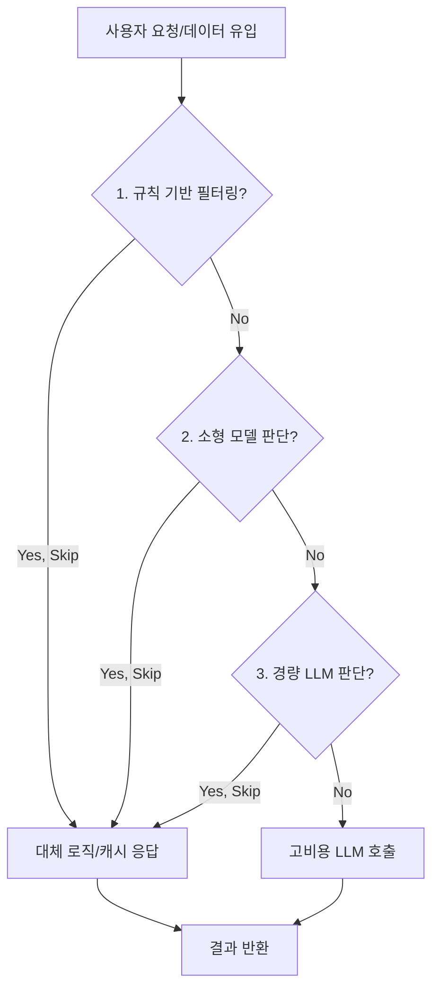

LLM(Large Language Model) 활용이 증가함에 따라, 관련 비용은 무시할 수 없는 수준이 되었습니다. 특히 반복적이고 간단한 판단이 필요한 작업에서 고비용 LLM을 매번 호출하는 것은 비효율적입니다. 이러한 문제를 해결하기 위해, LLM 호출 전에 입력 데이터를 평가하고 불필요한 호출을 사전에 차단하는 '사전 판단 로직(Pre-assessment Logic)' 구현의 중요성이 커지고 있습니다. 이는 단순히 비용 절감을 넘어 시스템의 응답 속도 향상 및 전반적인 효율성 증대로 이어집니다.

## 핵심 개념: 사전 판단 로직

사전 판단 로직은 요청이 고비용 LLM에 전달되기 전에, 해당 요청이 LLM의 처리 이점 없이도 해결될 수 있는지, 혹은 더 저렴하거나 특정 목적에 최적화된 다른 모델로 라우팅될 수 있는지를 결정하는 메커니즘입니다. 이는 일반적으로 규칙 기반(Rule-based), 통계 모델 기반(Statistical Model-based), 또는 경량 LLM 기반(Lightweight LLM-based) 판단 모델을 사용하여 구현됩니다. 예를 들어, PostHog의 사례에서는 '예/아니오'나 정해진 선택지와 확률을 반환하는 의사결정 모델을 활용하여 개인정보 탐지, 적절한 모델 선택, 검색 결과 재정렬 등 짧은 판단을 반복하는 작업에서 LLM 호출의 98.7%를 건너뛸 수 있었습니다.

## 구현 전략

### 1. 규칙 기반 (Rule-based Pre-assessment)
가장 간단하고 직관적인 방법입니다. 특정 키워드, 정규 표현식, 입력 길이, 데이터 형식 등을 기준으로 LLM 호출 여부를 결정합니다. 구현이 용이하고 예측 가능성이 높지만, 복잡한 시나리오 대응이 어렵습니다.

### 2. 소형/경량 모델 기반 (Small/Lightweight Model-based Pre-assessment)
규칙 기반보다 복잡한 판단이 필요할 때 활용합니다. BERT-mini, DistilBERT 또는 커스텀 학습된 분류 모델과 같이 매개변수 수가 적고 추론 속도가 빠른 모델을 사용하여 요청의 성격이나 의도를 파악합니다. 규칙 기반보다 유연하고 정확하지만, 모델 학습 및 관리가 필요합니다.

### 3. 경량 LLM 기반 (Lightweight LLM-based Pre-assessment)
더 작은 규모의 LLM (예: Gemma-2B, Phi-3-mini 등)을 활용하여 복잡하지만 비용 효율적인 판단을 수행합니다. 자체적인 자연어 이해 및 생성 능력을 갖춰, 보다 정교한 사전 판단이 가능하나, 소형 모델보다는 높은 추론 비용과 지연이 발생할 수 있습니다.



## 코드 예시 (Python)

```python
import re

class PreassessmentEngine:
    def __init__(self, sensitive_keywords, known_questions):
        self.sensitive_keywords = sensitive_keywords
        self.known_questions = known_questions

    def _is_sensitive(self, text):
        return any(keyword in text for keyword in self.sensitive_keywords)

    def _is_known_question(self, text):
        return text in self.known_questions # 실제는 벡터 DB 또는 ML 분류기

    def decide_llm_call(self, user_input):
        if len(user_input) < 10 or not re.search(r'\w', user_input):
            return False, "입력 무의미" # 규칙 기반 1

        if self._is_sensitive(user_input):
            return False, "민감 정보 필터링" # 규칙 기반 2

        if self._is_known_question(user_input):
            return False, "FAQ 응답" # 소형 모델/캐시 기반

        return True, "LLM 호출 필요" # LLM 호출

sensitive_keys = ["주민등록번호", "계좌번호"]
faqs = ["오늘 날씨 어때?", "공지사항"]
engine = PreassessmentEngine(sensitive_keys, faqs)

test_inputs = [
    "안녕", "내 계좌번호는 1234야", "오늘 날씨 어때?",
    "LLM 최적화 방안에 대해 설명해줘", "맥락이 필요한 질문은?"
]

for user_input in test_inputs:
    call, reason = engine.decide_llm_call(user_input)
    print(f"'{user_input}' -> LLM 호출: {call}, 이유: {reason}")
```

이러한 사전 판단 로직은 playbook의 LLM 출력 검증 파이프라인(Gemini retry) 및 JIT 의미 검색 과정에 통합되어 활용될 수 있습니다. LLM 출력 검증 시 Gemini retry 호출 전에 만족스러운 결과가 있거나 불필요한 재시도임을 판단하여 비용을 절감하고, JIT 의미 검색에서는 명확한 키워드 매칭이나 기존 지식 베이스 내 직접 응답이 가능한 경우 고비용 LLM 기반의 의미 검색 대신 규칙 기반 또는 캐시된 응답을 제공하여 비용과 지연 시간을 줄일 수 있습니다.

## 트레이드오프

1.  **비용 절감 vs 초기 구현 복잡성**: 
    *   **좋음**: 장기적으로 LLM API 호출 비용을 크게 절감하고, 시스템 자원 소모를 줄여 대규모 트래픽에서 효율 증대가 두드러집니다. 
    *   **나쁨**: 초기에는 규칙 설계, 소형 모델 학습, 라우팅 로직 구현 등에 추가적인 개발 및 유지보수 노력이 필요합니다.
2.  **응답 속도 향상 vs 판단 정확도 저하**: 
    *   **좋음**: 간단한 요청은 LLM 호출 없이 빠르게 응답하여 사용자 경험을 개선합니다. 
    *   **나쁨**: 사전 판단 로직이 너무 공격적이거나 부정확하면, LLM이 처리해야 할 복잡한 요청까지 필터링하여 사용자에게 불완전하거나 잘못된 정보를 제공할 위험이 있습니다. 모델이나 버전이 바뀌면 같은 확률 점수의 의미도 달라질 수 있어, 실제 정답을 붙인 데이터로 임계값을 다시 보정해야 합니다.
3.  **시스템 탄력성 증대 vs 관리 오버헤드**: 
    *   **좋음**: LLM API 장애나 할당량 초과 시에도 일부 요청을 처리할 수 있어 시스템의 탄력성을 높입니다. 
    *   **나쁨**: 여러 판단 모델 (규칙, 소형 모델, 경량 LLM)과 그에 따른 라우팅 로직을 관리하는 복잡도가 증가할 수 있습니다.
4.  **확장성 vs 유연성**: 
    *   **좋음**: 특정 도메인이나 작업에 최적화된 사전 판단 로직을 추가하여 시스템 전체의 확장성을 높일 수 있습니다. 
    *   **나쁨**: 고정된 규칙이나 학습된 소형 모델은 새로운 유형의 요청이나 미묘한 뉘앙스 변화에 유연하게 대응하기 어렵습니다. LLM의 범용적인 이해 능력에 미치지 못할 수 있습니다.

## 실전 체크리스트

-   [ ] **현재 LLM 호출 패턴 분석**: 가장 많은 호출을 유발하는 요청 유형, 평균 비용, 지연 시간을 분석하여 사전 판단 로직 적용 우선순위를 결정했는가?
-   [ ] **사전 판단 규칙 정의**: 규칙 기반 필터링을 위한 명확한 키워드, 정규 표현식, 입력 길이 임계값 등을 정의하고 문서화했는가? (예: `len(input) < 15`, 특정 민감 정보 패턴)
-   [ ] **소형 모델 타당성 검토**: LLM 호출이 많은 반복적인 분류/판단 작업에 대해 경량 모델 (예: BERT-mini, 커스텀 분류기) 도입의 비용-효과 분석을 완료했는가?
-   [ ] **폴백(Fallback) 및 대체 로직 구현**: 사전 판단으로 LLM 호출이 생략되었을 때, 사용자에게 제공할 정확하고 유용한 대체 응답 또는 처리 로직을 마련했는가? (예: 캐시된 응답, FAQ 데이터베이스 조회)
-   [ ] **정확도 및 비용 메트릭 모니터링**: 사전 판단 로직 도입 후 LLM 호출 감소율, 잘못된 판단으로 인한 사용자 불만 증가 여부, 전체 비용 절감 효과 등을 지속적으로 측정하고 모니터링하는 대시보드를 구축했는가?
-   [ ] **A/B 테스트 및 점진적 배포**: 사전 판단 로직을 전체 시스템에 적용하기 전에, 소규모 사용자 그룹에 A/B 테스트를 통해 효과와 부작용을 검증하고 점진적으로 배포할 계획인가?
-   [ ] **모델 드리프트 대응 전략**: 소형/경량 모델의 판단 정확도가 시간에 따라 저하될 경우 (데이터 분포 변화 등), 이를 탐지하고 모델을 재학습하거나 임계값을 재조정할 프로세스를 수립했는가?