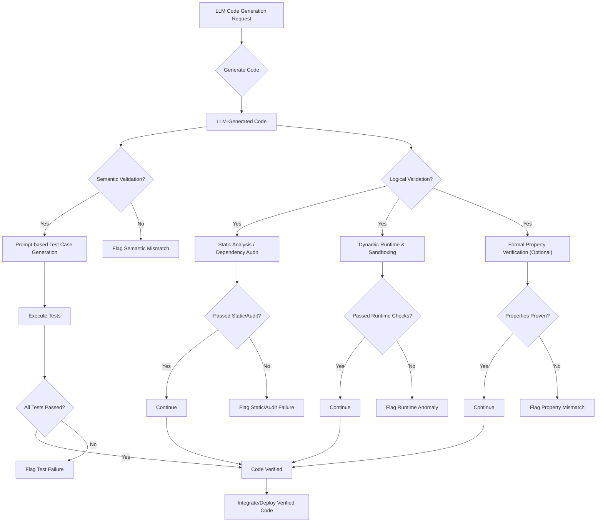

Large Language Models (LLMs) demonstrate remarkable capabilities in generating code, from simple scripts to complex functionalities. However, the utility of LLM-generated code hinges entirely on its correctness and adherence to intended logic. Simply passing syntactic checks or basic unit tests is often insufficient, as LLMs can produce code that is syntactically valid but semantically incorrect or logically flawed – a phenomenon akin to hallucination in text generation. Strengthening the validation of LLM-generated code requires a move beyond superficial checks to deep semantic and logical verification.

## 핵심 개념: 의미론적 및 논리적 검증

LLM 생성 코드의 검증은 크게 두 가지 관점으로 나눌 수 있습니다.

*   **의미론적 검증 (Semantic Validation)**: 생성된 코드가 요청된 의도(intent)와 실제 동작(behavior)이 일치하는지 확인합니다. 이는 코드가 '무엇을 해야 하는가?'에 초점을 맞춥니다. 예를 들어, '사용자 로그인 처리'를 요청했는데, 코드가 비밀번호 검증 없이 단순히 사용자 이름만 확인하는 경우 의미론적 오류입니다.
*   **논리적 검증 (Logical Validation)**: 코드가 주어진 입력에 대해 수학적 또는 프로그램 논리적으로 올바른 출력을 생성하는지 확인합니다. 이는 코드가 '어떻게 동작하는가?'에 초점을 맞춥니다. 예를 들어, 소수 판별 함수가 특정 합성수를 소수로 잘못 판단하는 경우 논리적 오류입니다.

Lean 코드 검증 사례에서 얻은 교훈은 이러한 검증의 필요성을 강조합니다. 명제와 증명이 별개로 존재하듯이, 코드의 의도와 실제 구현 또한 분리해서 검증해야 합니다. 핵심은 다음을 확인하는 것입니다:

1.  **명제 일치 (Propositional Correspondence)**: LLM이 이해한 문제 명제와 생성된 코드의 해결 명제가 정확히 일치하는가?
2.  **공리 및 전제 조건 검사 (Axiom and Precondition Verification)**: 코드가 의존하는 외부 라이브러리, API, 또는 환경 변수 등이 안전하고 신뢰할 수 있는가? LLM이 특정 커널 버그나 시스템 취약점을 악용하는 코드를 생성할 가능성은 없는가?

## 검증 메커니즘 강화 전략

### 1. 프롬프트 기반 명제 일치 검증

LLM이 생성한 코드를 다시 LLM에 입력하여 코드가 어떤 문제를 해결하고 있는지 설명하도록 요청하고, 이를 초기 프롬프트와 비교하여 명제 일치 여부를 평가합니다. 또는 프롬프트의 핵심 요구사항을 추출하여 자동화된 테스트 케이스를 생성하고, 이를 생성된 코드에 적용합니다.

*   **역 프롬프팅 (Reverse Prompting)**: 생성된 코드를 기반으로 의도를 재구성하고 원본 프롬프트와 비교합니다.
*   **자동화된 테스트 케이스 생성**: 원본 프롬프트에서 도메인 지식과 요구사항을 파싱하여 단위 테스트, 통합 테스트, 또는 속성 기반 테스트(Property-Based Testing) 스위트를 자동으로 생성하고, LLM 생성 코드가 이 테스트를 통과하는지 확인합니다.

### 2. 정적 분석 및 종속성 감사

전통적인 정적 분석 도구(Lint, Type Checker)는 기본이지만, 더 나아가 코드의 호출 그래프와 종속성을 분석하여 비정상적인 외부 호출이나 불필요한 권한 요청을 감지해야 합니다. `lake comparator`의 아이디어처럼, 신뢰할 수 있는 공리(approved libraries, APIs)만을 사용하도록 제한하는 메커니즘을 구축합니다.

```python
# LLM이 생성한 코드 예시
def is_prime(n: int) -> bool:
    if n < 2: 
        return False
    for i in range(2, int(n**0.5) + 1):
        if n % i == 0:
            return False
    return True

# 정적 분석 (예: Mypy, Pylint)
# mypy --strict is_prime_module.py
# pylint is_prime_module.py

# 종속성 감사 (간단한 예시: 금지된 함수 호출 검사)
def check_forbidden_calls(code: str, forbidden_functions: list) -> list:
    found_forbidden = []
    for func_name in forbidden_functions:
        if f"import {func_name}" in code or f"from {func_name}" in code or f"{func_name}(" in code:
            found_forbidden.append(func_name)
    return found_forbidden

forbidden = ["os.system", "eval", "subprocess.run"]
print(f"Forbidden calls found: {check_forbidden_calls(is_prime.__code__.co_consts[1] if hasattr(is_prime, '__code__') else '', forbidden)}") # Simplified for demo
```

### 3. 동적 런타임 검증 및 샌드박싱

생성된 코드는 격리된 샌드박스 환경에서 실행되어야 합니다. 또한, 단순히 테스트 통과 여부 외에 코드의 동작을 모니터링하여 예상치 못한 부작용(side effects)이나 리소스 사용 패턴을 감지합니다. 퍼징(Fuzzing)이나 계약 기반 프로그래밍(Design by Contract) 기법을 활용하여 경계 조건 및 예외 상황에 대한 견고성을 테스트합니다.

```python
# Property-Based Testing (Hypothesis 예시)
from hypothesis import given, strategies as st

@given(st.integers(min_value=-100, max_value=100))
def test_is_prime_properties(num):
    if num < 2:
        assert not is_prime(num)
    # 추가적인 속성 검증 로직

# 샌드박스 실행 (예시: Docker 또는 경량 컨테이너)
# docker run --rm -v $(pwd)/code:/app/code python:3.9 python /app/code/run_tests.py
```

### 4. 형식 검증 (Formal Verification) 및 증명 지원

모든 코드에 Lean과 같은 완전한 형식 검증을 적용하는 것은 비현실적이지만, 핵심 로직이나 보안에 민감한 부분에는 경량 형식 검증 도구(예: TLA+, SMT Solvers)를 도입하여 특정 속성(invariants, safety, liveness)을 증명하도록 시도할 수 있습니다. LLM이 생성한 증명 코드를 실제 증명기로 검증하는 파이프라인을 구축하는 것도 한 방법입니다. 이는 2026년 이후 AI 에이전트의 자율성과 신뢰성을 높이는 중요한 트렌드가 될 것입니다.



## 트레이드오프

LLM 생성 코드의 의미/논리적 검증을 강화하는 과정에는 여러 트레이드오프가 존재합니다.

*   **정확성(Accuracy) vs. 비용/속도(Cost/Speed)**:
    *   **언제 좋고**: 높은 수준의 보안, 신뢰성 또는 규제 준수가 요구되는 시스템(예: 금융, 의료, 인프라)의 코드를 검증할 때 매우 중요합니다. 미미한 오류도 치명적인 결과를 초래할 수 있으므로, 엄격한 검증은 필수적입니다.
    *   **언제 나쁜지**: 빠른 프로토타이핑, 내부 개발 도구, 또는 중요도가 낮은 스크립트 등에서는 과도한 검증 과정이 개발 속도를 저해하고 불필요한 리소스(연산 비용, 시간)를 소모하게 됩니다. 이 경우 빠른 반복과 실용적인 접근이 더 효과적입니다.

*   **자동화(Automation) vs. 인간 감독(Human Oversight)**:
    *   **언제 좋고**: 반복적이고 정형화된 검증 작업(예: 단위 테스트 실행, Lint 검사)에 자동화를 적용하면 효율성을 극대화하고 휴먼 에러를 줄일 수 있습니다. 대량의 코드 생성 시 일관된 품질 유지가 가능합니다.
    *   **언제 나쁜지**: 복잡하거나 비즈니스 로직에 깊이 연결된 코드의 의미론적 판단, 트레이드오프 분석, 그리고 미묘한 보안 취약점 식별에는 여전히 인간의 전문적인 통찰이 필요합니다. 엣지 케이스나 창의적인 문제 해결 패턴에서 LLM의 한계가 드러날 수 있습니다.

*   **일반성(Generality) vs. 특정 도메인 깊이(Domain Specificity)**:
    *   **언제 좋고**: 범용적인 코드 스타일, 보안 패턴, 그리고 언어별 베스트 프랙티스 검증에는 일반적인 검증 프레임워크가 효과적입니다. 다양한 프로젝트에 걸쳐 재사용성이 높습니다.
    *   **언제 나쁜지**: 특정 도메인의 복잡한 비즈니스 규칙, 법률/규제 준수 사항, 또는 고도로 최적화된 성능 요구사항에 대한 의미론적 검증은 해당 도메인의 깊은 지식을 요구하며, 일반적인 도구로는 한계가 있습니다. 커스텀 규칙 엔진이나 도메인 전문가의 검토가 필요합니다.

*   **조기 발견(Early Detection) vs. 포괄적 커버리지(Comprehensive Coverage)**:
    *   **언제 좋고**: 개발 초기 단계에서 간단한 정적 분석이나 LLM 생성 테스트를 통해 빠르게 피드백을 얻어 버그 전파를 막을 수 있습니다. 이는 개발 주기를 단축하고 수정 비용을 절감하는 데 유리합니다.
    *   **언제 나쁜지**: 치명적인 보안 결함이나 시스템 전체에 영향을 미치는 논리적 오류는 단순히 조기 발견만으로는 부족하며, 광범위한 테스트 스위트, 샌드박스 실행, 심지어 형식 검증과 같은 포괄적인 접근 방식이 필요합니다. 이는 개발 후반부에 더 많은 시간과 자원을 소모할 수 있습니다.

## 실전 체크리스트

LLM 생성 코드의 의미/논리적 검증 강화를 위해 프로젝트에 적용할 실전 체크리스트입니다.

*   [ ] **검증 범위 및 중요도 정의**: LLM 생성 코드의 어떤 부분이 비즈니스 크리티컬하며, 어떤 수준의 검증(정적, 동적, 형식적)이 필요한지 명확히 정의합니다.
*   [ ] **프롬프트-코드 일치도 자동 평가 시스템 구축**: 원본 프롬프트의 핵심 요구사항과 LLM 생성 코드가 실제로 해결하는 문제를 비교하는 자동화된 지표를 개발하고 통합합니다.
*   [ ] **엄격한 정적 분석 및 종속성 감사 파이프라인 구현**: 언어별 Lint, Type Checker를 기본으로 하고, 외부 라이브러리 및 API 호출에 대한 보안 및 신뢰성 감사를 자동화하여 블랙리스트/화이트리스트 정책을 적용합니다.
*   [ ] **격리된 런타임 샌드박스 환경 및 동작 모니터링 도입**: 생성된 코드를 안전하게 실행하고, CPU/메모리 사용량, 네트워크 접근 등 비정상적인 동작을 실시간으로 감지하는 시스템을 마련합니다.
*   [ ] **LLM 기반 테스트 생성 및 검증 루프 자동화**: LLM에게 코드에 대한 단위 테스트, 통합 테스트, 또는 속성 기반 테스트를 생성하도록 지시하고, 이 테스트 스위트를 자동으로 실행하여 코드의 논리적 정확성을 검증하는 파이프라인을 구축합니다.
*   [ ] **코드 동작 설명 및 문제점 분석을 위한 LLM 재활용**: 생성된 코드를 다시 LLM에 입력하여 코드의 의도된 동작, 잠재적 문제점, 또는 개선 사항을 설명하도록 요청하고, 이 설명을 바탕으로 코드의 유효성을 추가적으로 평가합니다.
*   [ ] **피드백 루프 구축**: 검증 과정에서 발견된 오류, 취약점, 또는 개선점을 LLM 모델 훈련 또는 프롬프트 엔지니어링에 활용하는 지속적인 피드백 루프를 구현하여 LLM의 코드 생성 품질을 점진적으로 향상시킵니다.