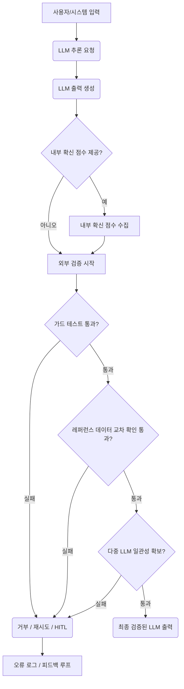

대규모 언어 모델(LLM)의 출력은 놀랍도록 유용하지만, 그 신뢰도에 대한 의존은 종종 오해됩니다. 특히, LLM이 자체적으로 보고하는 '신뢰도 점수'나 '확신도'는 실제 출력의 정확성이나 사실 관계를 보장하지 않습니다. 이는 LLM의 본질적인 작동 방식에서 비롯됩니다. LLM의 신뢰도 점수는 대화의 맥락에 이어질 법한 텍스트 토큰을 생성할 때 내부적으로 계산되는 확률 값에 가깝습니다. 즉, 특정 토큰 시퀀스가 그럴듯해 보이는지에 대한 모델의 '내부 확신'일 뿐, 외부 세계의 실제 정답률이나 사실 여부와는 직접적인 연관성이 낮습니다.

## LLM 내부 확신 점수의 한계

LLM은 주어진 입력과 학습 데이터 분포를 기반으로 다음 토큰을 예측합니다. 이때, 특정 토큰이 나올 확률이 높으면 내부적으로 '확신한다'고 해석될 수 있습니다. 그러나 이 내부 확신은 다음과 같은 이유로 실제 신뢰도를 대표하기 어렵습니다.

*   **토큰 예측 메커니즘**: LLM은 진정한 '이해'를 기반으로 확신하는 것이 아니라, 통계적 패턴에 따라 가장 개연성 높은 토큰을 생성합니다. 정교하게 조작된 프롬프트나 모호한 질문에는 그럴듯하지만 사실과 다른 답변을 높은 확신도로 생성할 수 있습니다.
*   **환각(Hallucination) 현상**: LLM은 존재하지 않는 정보나 잘못된 사실을 마치 진실인 것처럼 확신을 가지고 생성하는 경우가 많습니다. 이때 보고되는 신뢰도 점수는 매우 높을 수 있습니다.
*   **정보 반영의 부족**: 신뢰할 수 있는 점수는 예측에 사용된 정보의 출처, 근거의 강도, 그리고 모델이 해당 정보를 얼마나 잘 이해하고 통합했는지 등을 반영해야 합니다. LLM의 내부 점수는 이러한 복잡한 요소를 제대로 포착하지 못합니다.

이러한 한계는 LLM 출력을 그대로 신뢰하여 중요한 의사결정이나 자동화된 시스템에 적용할 때 심각한 문제를 야기할 수 있습니다. 따라서 LLM 자체의 신뢰도 점수에 대한 의존도를 낮추고, 실제 정답률과 일치하는 외부 검증 메커니즘을 강화하는 것이 필수적입니다.

## 외부 검증 메커니즘 강화 전략

LLM 출력의 신뢰도를 높이기 위한 핵심은 외부적인, 독립적인 검증 레이어를 도입하는 것입니다. 이는 LLM이 제공한 정보가 실제 세계의 사실과 부합하는지, 또는 사전에 정의된 규칙을 준수하는지 확인하는 과정입니다.

### 1. 추가적인 가드 테스트 (Guard Tests)

가드 테스트는 LLM의 출력이 특정 조건, 규칙 또는 제약 사항을 만족하는지 확인하는 자동화된 검증 절차입니다. 이는 정규 표현식, 특정 키워드 포함 여부, 출력 형식 검증, 도메인별 사실 확인 등 다양한 형태로 구현될 수 있습니다.

**예시: 금융 데이터 검증 가드 테스트 (Python)**
```python
import re
import json

def validate_financial_summary(llm_output: str, expected_min_revenue: float) -> bool:
    """
    LLM이 생성한 금융 요약에서 매출액을 추출하고, 특정 최소 매출액 이상인지 검증합니다.
    """
    revenue_match = re.search(r"매출액:\\$?([0-9,]+\.?[0-9]*)", llm_output)
    if not revenue_match:
        print("Error: Revenue not found in LLM output.")
        return False

    try:
        # Remove commas for float conversion
        revenue_str = revenue_match.group(1).replace(',', '')
        revenue = float(revenue_str)
        if revenue < expected_min_revenue:
            print(f"Validation Failed: Revenue ({revenue}) is below expected minimum ({expected_min_revenue}).")
            return False
        print(f"Validation Succeeded: Revenue ({revenue}) meets minimum requirements.")
        return True
    except ValueError:
        print("Error: Could not convert revenue to float.")
        return False

# Example usage with a hypothetical LLM output
llm_generated_summary = (
    "2025년 3분기 실적 발표에 따르면, A사의 매출액은 $1,234,567.89를 기록했습니다. "
    "이는 전년 동기 대비 15% 성장한 수치입니다. 순이익은 $200,000입니다."
)

if validate_financial_summary(llm_generated_summary, 1000000.0):
    print("LLM output is valid based on financial rules.")
else:
    print("LLM output failed financial validation.")

llm_generated_summary_low = (
    "2025년 3분기 실적 발표에 따르면, B사의 매출액은 $500,000를 기록했습니다. "
    "이는 예상치에 미치지 못하는 수준입니다."
)

if validate_financial_summary(llm_generated_summary_low, 1000000.0):
    print("LLM output is valid based on financial rules.")
else:
    print("LLM output failed financial validation.")
```

### 2. 레퍼런스 데이터 기반 교차 확인 (RAG-based Verification)

RAG(Retrieval Augmented Generation)는 LLM이 답변을 생성하기 전에 외부의 신뢰할 수 있는 데이터 소스에서 정보를 검색하는 기법입니다. 이를 검증 단계에 활용하여, LLM 출력이 검색된 레퍼런스 데이터와 일치하거나 모순되지 않는지 교차 확인할 수 있습니다.

### 3. 다중 LLM 또는 앙상블 검증

서로 다른 LLM 모델 또는 동일 모델에 다른 프롬프트를 사용하여 동일한 질문에 대한 여러 답변을 얻고, 이들 간의 일관성을 비교하여 신뢰도를 평가할 수 있습니다. 다수의 모델이 동일한 결론을 내린다면, 그 출력의 신뢰도는 높아집니다.

### 4. 인간 검수 (Human-in-the-Loop, HITL)

가장 확실한 검증 방법 중 하나는 인간 전문가의 검토입니다. 모든 출력을 검수하는 것은 비효율적이지만, 특정 임계값을 넘거나 중요한 의사결정에 사용되는 출력에 대해서는 인간 검수 프로세스를 통합하는 것이 중요합니다. LLM의 검증 파이프라인에서 '경고' 플래그가 발생한 경우, HITL로 에스컬레이션되도록 설계할 수 있습니다.

## LLM 출력 검증 파이프라인의 설계

외부 검증을 강화하는 파이프라인은 다음과 같은 흐름으로 구성될 수 있습니다.



위 다이어그램은 LLM 출력이 여러 단계의 외부 검증을 거쳐 최종적으로 신뢰성을 확보하는 과정을 보여줍니다. 각 단계에서 실패할 경우, 재시도하거나 인간의 개입을 요청하는 등의 예외 처리 메커니즘을 포함해야 합니다.

## 트레이드오프

LLM 출력에 대한 외부 검증 강화는 여러 이점을 제공하지만, 동시에 고려해야 할 트레이드오프가 존재합니다.

*   **비용(Cost) vs. 신뢰도(Reliability)**:
    *   **언제 좋고**: 높은 신뢰도와 정확성이 필수적인 금융, 의료, 법률 등 중요한 도메인에서는 추가 비용을 감수하고서라도 외부 검증을 강화하는 것이 이득입니다. 오탐(False Positive)이나 미탐(False Negative)이 큰 손실로 이어질 수 있는 경우.
    *   **언제 나쁜지**: 빠른 응답 시간과 낮은 비용이 더 중요한 캐주얼한 대화형 AI나 내부 정보 검색 시스템에서는 과도한 검증 비용이 비효율적일 수 있습니다. 경미한 오류가 허용되는 경우.
*   **성능(Latency) vs. 철저함(Thoroughness)**:
    *   **언제 좋고**: 배치(Batch) 처리나 비동기 작업에서는 검증에 필요한 추가 지연 시간을 허용할 수 있으므로 철저한 다단계 검증을 적용하기 좋습니다. 높은 검증 커버리지가 필요한 경우.
    *   **언제 나쁜지**: 실시간 인터랙션이 요구되는 사용자 대면 서비스(Chatbot UX)에서는 검증으로 인한 지연이 사용자 경험을 저해할 수 있습니다. 이때는 핵심적인 몇 가지 가드 테스트만 적용하거나 경량화된 검증 방식을 고려해야 합니다.
*   **복잡성(Complexity) vs. 견고성(Robustness)**:
    *   **언제 좋고**: LLM의 오작동이 시스템 전체의 안정성에 영향을 미칠 수 있는 복잡한 에이전트 시스템이나 자동화된 워크플로우에서는 검증 파이프라인의 복잡성 증가를 감수하고 견고성을 확보하는 것이 중요합니다.
    *   **언제 나쁜지**: 간단한 스크립트 기반의 LLM 활용이나 초기 프로토타입 단계에서는 과도한 검증 로직이 개발 속도를 늦추고 유지보수 비용을 증가시킬 수 있습니다. 점진적 확장이 필요한 경우.
*   **유지보수(Maintainability) vs. 맞춤화(Customization)**:
    *   **언제 좋고**: 도메인 특화된 복잡한 규칙이나 빠르게 변화하는 외부 데이터 소스를 검증해야 하는 경우, 맞춤형 가드 테스트를 적극적으로 개발하고 관리할 필요가 있습니다.
    *   **언제 나쁜지**: 범용적인 출력 형식이나 기본적인 안전성 검증에는 표준화된 라이브러리나 모듈화된 검증 컴포넌트를 사용하여 유지보수 부담을 줄이는 것이 좋습니다.

## 실전 체크리스트

LLM 출력 신뢰도 강화를 위해 프로젝트에 적용할 실전 체크리스트입니다.

*   [ ] **현재 LLM 출력 검증 파이프라인 진단**: 현재 Gemini LLM (또는 유사 LLM)의 자체 신뢰도 점수에 대한 의존도를 파악하고, 주요 의사결정 지점에서 얼마나 사용되는지 평가합니다.
*   [ ] **신뢰도 요구사항 정의**: 각 LLM 출력 유형별로 허용 가능한 오류율과 필요한 신뢰도 수준을 명확히 정의합니다 (예: '사실 확인 99% 이상', '형식 준수 100%').
*   [ ] **외부 검증 메커니즘 설계**: 추가적인 가드 테스트, 레퍼런스 데이터 기반 교차 확인, 다중 LLM 일관성 검증 등 최소 2가지 이상의 외부 검증 메커니즘을 구체적으로 설계합니다.
*   [ ] **가드 테스트 구현 및 자동화**: 핵심적인 비즈니스 규칙 또는 도메인별 사실에 기반한 가드 테스트를 구현하고 CI/CD 파이프라인에 통합하여 자동화된 검증이 수행되도록 합니다.
*   [ ] **레퍼런스 데이터 소스 확보**: LLM 출력 검증에 활용할 신뢰할 수 있는 외부 레퍼런스 데이터셋(내부 DB, 공식 문서, API 등)을 식별하고 접근 방안을 마련합니다.
*   [ ] **실제 정답률 측정 지표 수립**: LLM 출력의 '내부 확신' 점수 대신, 외부 검증을 거친 후의 실제 정답률(Accuracy), 정밀도(Precision), 재현율(Recall) 등의 지표를 정기적으로 측정하고 모니터링할 계획을 수립합니다.
*   [ ] **피드백 루프 구축**: 검증 실패 사례를 분석하고, 이를 LLM 프롬프트 개선, 가드 테스트 규칙 정교화, 레퍼런스 데이터 업데이트 등에 활용하는 지속적인 피드백 루프를 구축합니다.