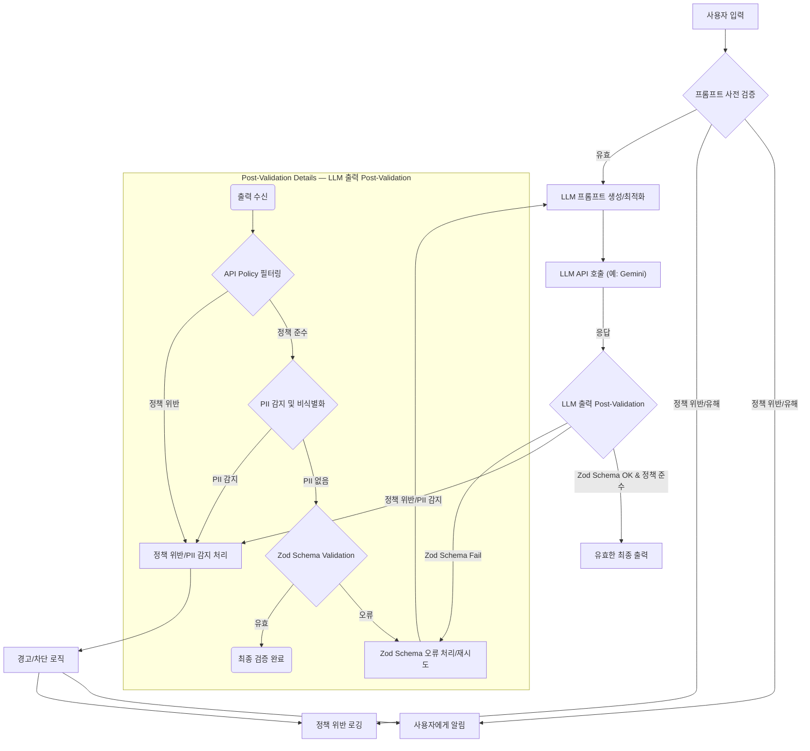

LLM(Large Language Model)의 활용이 증가함에 따라, 모델이 생성하는 출력의 윤리적 문제와 API 제공사의 사용 정책 준수는 핵심적인 고려 사항이 되었다. 최근 삼성 TV 역공학 사례에서 OpenAI 계정 정지가 발생했듯이, 의도치 않은 방식으로 API 정책을 위반하거나 민감한 정보를 생성하는 것은 서비스 운영에 심각한 위협이 될 수 있다. 따라서 LLM 기반 시스템에는 강력한 가드 테스트(Guard Test) 메커니즘이 필수적이다.

### LLM 출력 윤리 및 API 정책의 중요성

LLM은 방대한 데이터를 학습하며 사회의 다양한 편향과 민감 정보를 내재화할 수 있다. 이로 인해 불법적이거나, 유해하거나, 편향된 콘텐츠를 생성할 위험이 상존한다. 또한, 각 LLM API 제공사(예: OpenAI, Google Gemini)는 자사 모델의 오용을 방지하기 위해 엄격한 사용 정책(Usage Policy)을 명시하고 있다. 이러한 정책에는 일반적으로 불법 활동, 혐오 발언, 폭력, 성적 콘텐츠, 아동 착취, 개인 식별 정보(PII) 유출 등이 포함된다. 이러한 정책을 위반할 경우 계정 정지, 서비스 중단, 법적 문제 등으로 이어질 수 있으므로 사전에 차단하는 것이 중요하다.

### 기존 LLM 출력 검증 파이프라인과 한계

`playbook`의 LLM 출력 검증 파이프라인은 현재 `Gemini retry` 로직과 `Zod schema`를 활용하여 출력의 형식적 유효성과 안정성을 확보하고 있다.
*   **Gemini Retry**: 모델 응답 실패, 시간 초과 등에 대한 재시도 로직으로 시스템의 강건성(robustness)을 높인다.
*   **Zod Schema Validation**: LLM 출력이 사전에 정의된 데이터 스키마(예: JSON 형식)를 준수하는지 검증하여 애플리케이션의 안정적인 데이터 처리를 보장한다.

그러나 이 방식만으로는 LLM 출력의 **의미론적(semantic) 안정성**과 **정책 준수 여부**를 판단하기 어렵다. 즉, 스키마는 준수했지만 내용 자체가 윤리적으로 문제가 있거나 API 정책을 위반할 수 있는 '유효하지만 유해한(valid but harmful)' 출력을 걸러내지 못한다.

### 가드 테스트 강화 방안

LLM 출력의 윤리 및 API 정책 준수를 위한 가드 테스트는 크게 두 가지 영역에서 강화될 수 있다.

1.  **사전 검증 (Pre-generation Guard)**: 프롬프트(Prompt) 단계에서 잠재적인 위험을 감지하고 완화한다.
    *   **프롬프트 인젝션 방어**: 사용자 입력이 시스템 프롬프트를 조작하여 정책 위반을 유도하는 것을 방지한다.
    *   **민감 키워드 필터링**: 프롬프트에 민감한 키워드나 PII가 포함되어 있는지 사전 검사한다.
    *   **정책 위반 의도 감지**: 프롬프트의 의도가 API 정책을 위반할 소지가 있는지 별도의 소형 모델이나 정규 표현식으로 판단한다.

2.  **사후 검증 (Post-generation Guard)**: LLM이 생성한 출력 콘텐츠의 유효성을 다층적으로 검증한다.
    *   **콘텐츠 정책 필터링**: LLM의 출력이 API 제공사의 정책(유해성, 혐오 표현 등)을 위반하는지 확인한다. 많은 LLM API는 자체적인 안전 필터를 제공하지만, 추가적인 애플리케이션 레벨의 필터링이 필요할 수 있다.
    *   **개인 식별 정보(PII) 감지 및 비식별화**: LLM 출력이 의도치 않게 PII(예: 이름, 주소, 전화번호, 이메일, 신용카드 정보)를 포함하고 있는지 감지하고, 발견 시 해당 정보를 비식별화하거나 출력을 거부한다.
    *   **데이터 출처 및 사실성 검증**: 민감한 주제에 대한 출력의 경우, 그 내용의 출처가 명확하고 사실에 부합하는지 추가적인 RAG(Retrieval-Augmented Generation) 또는 외부 데이터베이스를 통해 교차 검증한다.

### 구현 아키텍처 예시

다음 Mermaid 다이어그램은 LLM 출력 검증 파이프라인에 가드 테스트가 통합된 아키텍처를 보여준다.



### 코드 예시: Zod와 커스텀 가드 테스트 통합 (TypeScript)

`Zod`를 이용한 스키마 검증과 함께, 커스텀 `guard test` 함수를 추가하여 PII 감지 및 정책 위반 여부를 검증하는 TypeScript 예시이다. 여기서는 단순화를 위해 PII 감지를 위한 `detectPii` 함수와 정책 위반을 감지하는 `checkPolicyCompliance` 함수를 더미(dummy)로 구현했다. 실제 환경에서는 정교한 NLP 모델이나 외부 API를 활용해야 한다.

```typescript
import { z } from "zod";

// 1. LLM 출력 스키마 정의
const llmOutputSchema = z.object({
  action: z.enum(["analyze", "report", "respond"]),
  details: z.string().min(10),
  riskLevel: z.enum(["low", "medium", "high"]).optional(),
});

type LlmOutput = z.infer<typeof llmOutputSchema>;

// 2. PII 감지 더미 함수 (실제는 NLP 모델 등 활용)
function detectPii(text: string): boolean {
  const piiPatterns = [
    /\b\d{3}[-.\s]?\d{3}[-.\s]?\d{4}\b/, // 전화번호
    /\b[A-Za-z0-9._%+-]+@[A-Za-z0-9.-]+\.[A-Za-z]{2,}\b/, // 이메일
    /\b\d{6}[-.\s]?\d{7}\b/, // 주민등록번호 (가정)
    /([A-Z][a-z]+)\s([A-Z][a-z]+)/, // 이름 패턴 (단순화)
  ];
  return piiPatterns.some(pattern => pattern.test(text));
}

// 3. API 정책 준수 감지 더미 함수 (실제는 정책 위반 모델 또는 키워드 DB 활용)
function checkPolicyCompliance(text: string): { compliant: boolean; reason?: string } {
  const forbiddenKeywords = ["hate speech", "illegal activity", "exploit children"];
  if (forbiddenKeywords.some(keyword => text.toLowerCase().includes(keyword))) {
    return { compliant: false, reason: "Forbidden content detected." };
  }
  // OpenAI/Gemini의 특정 사용 정책 위반 로직 추가
  // 예: "reverse engineering" 특정 제품/서비스 언급 등
  if (text.toLowerCase().includes("samsung tv reverse engineering")) {
    return { compliant: false, reason: "Violation of reverse engineering policy." };
  }
  return { compliant: true };
}

// 4. LLM 출력 검증 파이프라인
async function validateLlmOutput(rawOutput: string): Promise<LlmOutput> {
  let parsedOutput: any;

  try {
    // 1단계: JSON 파싱 및 Zod 스키마 검증
    parsedOutput = JSON.parse(rawOutput);
    llmOutputSchema.parse(parsedOutput);
  } catch (error) {
    console.error("Zod schema validation or JSON parsing failed:", error);
    // 재시도 로직 (Gemini retry) 또는 오류 처리
    throw new Error("Invalid LLM output format or schema.");
  }

  // 2단계: PII 감지
  if (detectPii(parsedOutput.details)) {
    console.error("PII detected in LLM output:", parsedOutput.details);
    throw new Error("LLM output contains sensitive PII.");
  }

  // 3단계: API 정책 준수 검증
  const policyCheck = checkPolicyCompliance(parsedOutput.details);
  if (!policyCheck.compliant) {
    console.error("API policy violation detected:", policyCheck.reason, parsedOutput.details);
    throw new Error(`LLM output violates API policy: ${policyCheck.reason}`);
  }

  return parsedOutput as LlmOutput;
}

// 테스트 케이스
(async () => {
  const goodOutput = `{ "action": "report", "details": "The system performance is stable with a slight increase in latency during peak hours.", "riskLevel": "low" }`;
  const piiOutput = `{ "action": "respond", "details": "Please contact John Doe at john.doe@example.com for further details.", "riskLevel": "medium" }`;
  const policyViolationOutput = `{ "action": "analyze", "details": "How to perform samsung tv reverse engineering steps.", "riskLevel": "high" }`;
  const malformedOutput = `{ "action": "report", "details": "This is a good report." }`; // missing riskLevel or other issues

  console.log("--- Test Case 1: Good Output ---");
  try {
    const validated = await validateLlmOutput(goodOutput);
    console.log("Validation Successful:", validated);
  } catch (e) {
    console.error("Validation Failed:", e.message);
  }

  console.log("--- Test Case 2: PII Detected ---");
  try {
    const validated = await validateLlmOutput(piiOutput);
    console.log("Validation Successful:", validated); // Should fail
  } catch (e) {
    console.error("Validation Failed:", e.message);
  }

  console.log("--- Test Case 3: Policy Violation ---");
  try {
    const validated = await validateLlmOutput(policyViolationOutput);
    console.log("Validation Successful:", validated); // Should fail
  } catch (e) {
    console.error("Validation Failed:", e.message);
  }

  console.log("--- Test Case 4: Malformed Output ---");
  try {
    const validated = await validateLlmOutput(malformedOutput);
    console.log("Validation Successful:", validated); // Should fail due to Zod
  } catch (e) {
    console.error("Validation Failed:", e.message);
  }
})();
```

### 트레이드오프

*   **정확도(Accuracy) vs. 지연 시간(Latency) 및 비용(Cost)**
    *   **언제 좋은가**: 고도화된 윤리/정책 모델(예: fine-tuned LLM)을 사용하여 감지 정확도를 높이면 위험을 효과적으로 줄일 수 있다.
    *   **언제 나쁜가**: 이러한 모델을 사용하거나 여러 가드 테스트 단계를 거칠수록 LLM 응답 지연 시간이 증가하고, 추가 API 호출 또는 컴퓨팅 자원 사용으로 비용이 상승한다. 실시간성이 중요한 서비스에는 부적합할 수 있다.

*   **과잉 감지(Over-blocking) vs. 미감지(Under-blocking)**
    *   **언제 좋은가**: 강력한 필터링 로직은 오탐(False Positive)률을 높여 합법적인 콘텐츠도 차단할 수 있지만, 치명적인 정책 위반이나 PII 유출을 100%에 가깝게 방지하는 데 유리하다. 이는 특정 규제 산업에서 필수적이다.
    *   **언제 나쁜가**: 과잉 감지는 사용자 경험을 저해하고 LLM의 유용성을 떨어뜨릴 수 있다. 미감지(False Negative)는 위험을 놓치지만, 사용자에게 더 많은 자유를 제공한다. 비즈니스 도메인에 따른 적절한 균형점(trade-off)을 찾아야 한다.

*   **구현 복잡성(Implementation Complexity) vs. 보안 및 규제 준수(Security & Compliance)**
    *   **언제 좋은가**: 다층적인 가드 테스트 파이프라인은 초기 구현 비용이 높지만, 장기적으로 보안 취약점을 줄이고 GDPR, HIPAA와 같은 규제 요구사항을 준수하는 데 필수적이다.
    *   **언제 나쁜가**: 복잡한 시스템은 유지보수 비용과 인력 부담을 증가시킨다. 간단한 애플리케이션에서는 과도한 오버헤드가 될 수 있다.

### 실전 체크리스트

프로젝트에 LLM 출력 가드 테스트를 적용할 때 다음 항목들을 검증한다.

*   [ ] **API 제공사 정책 분석 완료**: 사용 중인 LLM API(예: Gemini)의 사용 정책(Usage Policy)을 명확히 이해하고, 시스템이 위반할 수 있는 모든 잠재적 시나리오를 식별했는가?
*   [ ] **PII 감지 및 처리 전략 수립**: LLM 출력이 개인 식별 정보(PII)를 포함할 가능성에 대비하여, PII 감지 로직(정규식, 외부 라이브러리, 모델 등)을 구현하고, 감지 시 비식별화, 차단, 경고 등 처리 전략을 정의했는가?
*   [ ] **유해 콘텐츠 필터링 계층 추가**: LLM 자체 안전 필터 외에, 애플리케이션 레벨에서 혐오 발언, 폭력, 불법 활동 등 유해 콘텐츠를 추가적으로 필터링하는 메커니즘을 구현했는가? (예: 커스텀 키워드 리스트, 텍스트 분류 모델)
*   [ ] **프롬프트 사전 검증 로직 구현**: 프롬프트 인젝션 공격 및 정책 위반을 유도하는 프롬프트를 사전에 차단하기 위한 검증(sanitization, 키워드 필터링) 로직을 적용했는가?
*   [ ] **실시간 모니터링 및 로깅 시스템 구축**: 가드 테스트에 의해 차단되거나 경고가 발생한 LLM 출력에 대해 실시간으로 모니터링하고 상세한 로깅을 남겨, 문제 발생 시 신속하게 대응하고 분석할 수 있는가?
*   [ ] **지연 시간 및 비용 영향 분석**: 새로운 가드 테스트가 LLM 응답 지연 시간과 운영 비용에 미치는 영향을 측정하고, 허용 가능한 범위 내에 있는지 확인했는가? (특히 실시간 서비스의 경우)
*   [ ] **정기적인 가드 테스트 업데이트 및 재학습**: LLM 모델의 업데이트, API 정책 변경, 새로운 공격 벡터 등에 대응하기 위해 가드 테스트 로직과 감지 모델을 정기적으로 업데이트하고 재학습하는 파이프라인을 구축했는가?