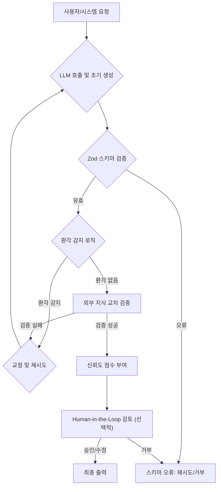

## LLM 환각(Hallucination) 문제와 신뢰의 중요성
대규모 언어 모델(LLM)은 뛰어난 생성 능력을 제공하지만, 때로는 사실과 다른 정보를 그럴듯하게 제시하는 환각(hallucination) 문제를 야기한다. 이는 'The Weight of Ink' 소설 줄거리 왜곡 사례와 같이 사용자 신뢰를 심각하게 훼손하고 오해를 불러일으킬 수 있다. 따라서 LLM 기반 시스템의 신뢰성을 확보하기 위해서는 강력한 출력 검증 파이프라인 구축이 필수적이다.

기존 MDX validation 루프, Zod schema 검증, 그리고 Gemini retry 메커니즘은 LLM 출력의 구조적 유효성과 기본적인 품질을 보장하는 데 기여한다. 그러나 사실적 정확성이라는 핵심적인 측면을 강화하기 위해서는 환각 감지 및 교정 로직을 통합하는 고도화된 접근 방식이 요구된다.

## 환각 감지 및 교정 전략
LLM 출력의 환각을 효과적으로 다루기 위해서는 다단계 접근 방식이 필요하다. 이는 외부 지식 소스와 연동하여 교차 검증하고, 구조적/의미적 일관성을 확인하며, 필요시 교정 메커니즘을 작동시키는 것을 포함한다.

### 1. 외부 지식 연동 및 사실 검증 (Knowledge Grounding & Fact-Checking)
가장 효과적인 환각 방지 방법 중 하나는 LLM이 생성한 정보를 신뢰할 수 있는 외부 소스와 비교 검증하는 것이다. Retrieval-Augmented Generation (RAG) 패턴은 이미 특정 도메인 지식으로 LLM을 '접지(grounding)'하는 데 사용되지만, 생성된 최종 출력에 대한 추가적인 사실 검증 단계가 필요하다.

*   **RAG 기반 교차 검증**: LLM이 생성한 핵심 주장이나 엔티티를 다시 RAG 시스템에 질의하여, 원본 소스 문서에 해당 내용이 존재하는지 확인한다.
*   **외부 API/데이터베이스 연동**: 특정 도메인의 사실 정보(예: 금융 데이터, 인구 통계, 제품 사양)가 필요한 경우, 해당 정보를 제공하는 검증된 API나 데이터베이스를 직접 호출하여 LLM 출력을 검증한다.
*   **다중 LLM 교차 검증**: 서로 다른 LLM에 동일한 프롬프트를 제공하고, 각 모델의 응답 간 일관성을 비교하여 이상 징후를 감지한다.

### 2. 구조적 및 의미적 유효성 검사 (Structural & Semantic Validation)
출력 내용의 구조와 의미적 일관성을 검사하여 잠재적인 환각을 식별할 수 있다. `Zod`와 같은 스키마 검증 라이브러리는 출력 형식을 강제하지만, 내용 자체의 유효성까지 보장하지는 못한다. 따라서 추가적인 로직이 필요하다.

*   **Zod 스키마 강화**: LLM 출력이 특정 데이터 모델에 부합하는지 확인하는 `Zod` 스키마를 더욱 세밀하게 정의한다. 단순히 타입뿐 아니라, 값의 범위, 길이, 특정 패턴 등을 엄격하게 지정한다.
*   **논리적 일관성 검사**: 생성된 텍스트 내에서 주장되는 내용들 간에 논리적 모순이 없는지 확인하는 규칙 기반 또는 임베딩 기반 검사를 수행한다.
*   **임베딩 유사도 분석**: 특정 핵심 정보가 포함된 문장의 임베딩 벡터가 알려진 사실이나 허용 가능한 의미 범위 내에 있는지 비교한다.

### 3. LLM 자기 교정 및 재시도 (LLM Self-Correction & Retries)
환각이 의심될 경우, LLM 자체에 교정을 요청하는 메커니즘을 구현할 수 있다. Gemini retry와 같은 기존 재시도 로직을 확장하여 환각 감지 시 작동하도록 한다.

*   **명시적 프롬프트 기반 재검증**: LLM이 생성한 출력을 다시 LLM에 입력하여 "이 내용이 사실과 부합하는지 검증하고, 잘못된 부분이 있다면 수정하라"는 지시를 포함한 프롬프트로 재호출한다.
*   **단계별 추론 검증**: LLM의 추론 과정을 여러 단계로 나누고, 각 중간 단계의 출력을 검증하여 오류를 조기에 포착하고 수정한다.

## 검증 파이프라인 아키텍처
강화된 LLM 출력 검증 파이프라인은 다음과 같은 흐름을 가질 수 있다.



## 코드 예제: Zod와 외부 검증 통합 (TypeScript)
다음 TypeScript 예제는 `Zod`를 사용하여 LLM 출력의 구조를 검증하고, 외부 함수를 통해 내용의 사실적 정확성을 확인하는 패턴을 보여준다.

```typescript
import { z } from 'zod';

// LLM 출력 스키마 정의 (예: 기사 요약)
const articleSummarySchema = z.object({
  title: z.string().min(5).max(100),
  summary: z.string().min(50).max(500),
  keywords: z.array(z.string()).min(3).max(5),
  factChecked: z.boolean().default(false), // 사실 검증 여부 플래그
});

type ArticleSummary = z.infer<typeof articleSummarySchema>;

// 외부 API를 사용하여 사실을 검증하는 비동기 함수 (가정)
async function externalFactCheck(summary: string): Promise<boolean> {
  // 실제로는 외부 DB, API (Wikipedia, news archive) 등을 호출하여 검증
  console.log(`Performing external fact-check for: "${summary.substring(0, 50)}..."`);
  const isFactuallyCorrect = Math.random() < 0.9; // 90% 확률로 true 반환 가정
  return isFactuallyCorrect;
}

// LLM 출력 검증 파이프라인 함수
async function validateLLMOutput(llmRawOutput: unknown): Promise<ArticleSummary | null> {
  try {
    // 1. Zod 스키마 유효성 검사
    const validatedOutput = articleSummarySchema.parse(llmRawOutput);
    console.log('Zod schema validation successful.');

    // 2. 외부 사실 검증
    const isFactuallySound = await externalFactCheck(validatedOutput.summary);

    if (!isFactuallySound) {
      console.warn('Hallucination detected during external fact-check. Initiating retry/fallback...');
      // 여기에 재시도 로직 (LLM 재호출, 다른 LLM 사용) 또는 fallback 처리 구현
      return null; // 또는 에러 throw
    }

    return { ...validatedOutput, factChecked: true };
  } catch (error) {
    if (error instanceof z.ZodError) {
      console.error('Zod validation failed:', error.errors);
    } else {
      console.error('An unexpected error occurred during validation:', error);
    }
    return null;
  }
}

// 사용 예시
(async () => {
  const goodOutput = {
    title: 'Advanced LLM Validation Techniques',
    summary: 'This article explores advanced techniques for validating LLM outputs, focusing on hallucination prevention and enhancing reliability in AI-driven applications by integrating external knowledge sources and semantic checks.',
    keywords: ['LLM', 'Validation', 'Hallucination'],
  };

  const badSchemaOutput = {
    title: 'Short',
    summary: 'Too short.',
    keywords: ['LLM'],
  };

  const potentiallyHallucinatedOutput = {
    title: 'AI Cures All Diseases',
    summary: 'AI has demonstrated a 100% cure rate for all known human diseases as of 2026, marking a new era in medicine.',
    keywords: ['AI', 'Medicine', 'Future'],
  };

  console.log('\n--- Validating Good Output ---');
  const result1 = await validateLLMOutput(goodOutput);
  console.log('Result 1:', result1);

  console.log('\n--- Validating Bad Schema Output ---');
  const result2 = await validateLLMOutput(badSchemaOutput);
  console.log('Result 2:', result2);

  console.log('\n--- Validating Potentially Hallucinated Output ---');
  // 이 경우 externalFactCheck에서 90% 확률로 true를 반환하므로, 10% 확률로 null이 반환될 수 있다.
  const result3 = await validateLLMOutput(potentiallyHallucinatedOutput);
  console.log('Result 3:', result3);
})();
```

## 2026년 최신 트렌드 반영
2026년에는 LLM 출력 검증 파이프라인이 더욱 고도화될 것으로 예상된다. 멀티모달 LLM의 확산에 따라 텍스트뿐 아니라 이미지, 비디오, 오디오 출력에 대한 사실 검증 (예: Deepfake 탐지) 기술이 중요해진다. 또한, 자율 에이전트(Autonomous Agents)가 복잡한 태스크를 수행함에 따라, 에이전트의 모든 의사 결정 및 결과물에 대한 실시간 검증 및 '자기 회귀(self-retrospection)' 루프가 필수 요소로 부상한다. 이러한 시스템은 프로액티브한 위협 모델링과 통합되어, 잠재적인 환각 유발 요소를 사전에 식별하고 방어한다.

## 트레이드오프
LLM 출력 검증 파이프라인을 강화하는 것은 여러 트레이드오프를 수반한다.

*   **정확도 vs. 지연 시간 (Accuracy vs. Latency)**: 엄격한 다단계 검증 로직은 LLM 출력의 사실적 정확도를 극대화하지만, 검증에 필요한 추가 컴퓨팅 리소스 및 외부 API 호출로 인해 전체 응답 지연 시간이 증가한다. 이는 실시간 사용자 인터랙션이 중요한 애플리케이션에서는 사용자 경험 저하로 이어질 수 있다. 따라서 정확도가 최우선인 비동기 배치 처리 작업에 적합하며, 실시간 환경에서는 허용 가능한 지연 시간 범위 내에서 검증 강도를 조절해야 한다.
*   **비용 vs. 신뢰성 (Cost vs. Reliability)**: 외부 지식 소스 연동을 위한 API 호출 비용, 다중 LLM 호출 비용, 그리고 추가적인 컴퓨팅 자원(임베딩 생성, 논리 검사 등)은 운영 비용을 증가시킨다. 하지만 이는 LLM 기반 시스템의 신뢰성과 안전성을 극대화하여 장기적으로 발생할 수 있는 잠재적 손실(명예 훼손, 잘못된 정보로 인한 피해 등)을 방지한다. 따라서 높은 신뢰성이 요구되는 금융, 의료, 법률 분야에서 강력히 고려되어야 하며, 비용 효율성을 위해 검증 대상을 선별적으로 적용할 수 있다.
*   **구현 복잡성 vs. 유지보수 (Implementation Complexity vs. Maintainability)**: RAG, 외부 API 연동, 스키마 검증, 논리적 일관성 검사, 재시도 로직 등을 포함하는 다단계 검증 파이프라인은 초기 설계 및 구현이 복잡하다. 이는 시스템의 이해도를 낮추고 버그 발생 가능성을 높이며, 각 구성 요소의 의존성 관리 또한 어렵게 만든다. 반면, 일단 구축되면 시스템의 견고성을 크게 향상시킨다. 복잡성을 관리하기 위해 모듈화된 설계와 명확한 책임 분리가 필수적이며, 자동화된 테스트와 문서화가 동반되어야 한다.
*   **개발 속도 vs. 안정성 (Development Velocity vs. Production Safety)**: 새로운 기능이나 LLM 모델을 통합할 때마다 검증 파이프라인에 대한 업데이트 및 광범위한 테스트가 요구되므로, 개발 및 배포 속도가 저하될 수 있다. 그러나 프로덕션 환경에서 발생할 수 있는 치명적인 환각 오류를 사전에 방지하여 시스템의 안정성과 사용자 신뢰를 확보한다. 빠른 실험과 프로토타이핑이 필요한 초기 단계에서는 유연한 검증을 적용하고, 프로덕션 배포 전에는 엄격한 검증을 통해 안정성을 확보하는 전략이 필요하다.

## 실전 체크리스트
LLM 출력 검증 파이프라인을 프로젝트에 적용할 때 다음 항목들을 검증한다.

- [ ] **사실적 정확도 목표 설정**: LLM이 다루는 정보의 중요도에 따라 허용 가능한 사실적 오류율을 명확히 정의했는가?
- [ ] **스키마 유효성 검사 적용**: 모든 LLM 출력에 대해 Zod 또는 유사한 강력한 스키마 유효성 검사(타입, 범위, 패턴 등)를 필수적으로 적용하고 있는가?
- [ ] **외부 지식 교차 검증 구현**: 핵심 정보에 대해 최소 1개 이상의 신뢰할 수 있는 외부 지식 소스(RAG, 전용 DB, 외부 API)와 연동하여 교차 검증 로직을 구현했는가?
- [ ] **자동 재시도 및 교정 메커니즘**: 환각이 감지되거나 신뢰도가 임계치 미만일 경우, LLM에 재검증을 요청하거나 다른 모델로 전환하는 등 자동 재시도 및 교정 메커니즘을 구축했는가?
- [ ] **검증 실패 모니터링 및 알림**: 검증 실패율, 환각 감지율, 재시도 횟수 등을 실시간으로 모니터링하고, 특정 임계치 초과 시 담당자에게 자동 알림이 전송되도록 설정했는가?
- [ ] **Human-in-the-Loop 프로세스**: 높은 민감도를 가진 콘텐츠(예: 법률, 의료, 금융) 또는 자동 검증 실패 시 Human-in-the-Loop (HITL) 검토 및 승인 프로세스를 설계하고 적용했는가?
- [ ] **지속적인 검증 로직 업데이트**: 새로운 유형의 환각이나 LLM 모델 업데이트에 대응하기 위해 검증 로직을 정기적으로 검토하고, 자동화된 테스트 스위트를 통해 검증 파이프라인의 견고성을 유지하고 있는가?