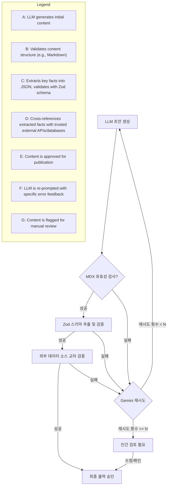

대규모 언어 모델 (LLM)이 생성하는 콘텐츠의 양이 폭발적으로 증가함에 따라, 그 내용의 신뢰성은 더욱 중요해지고 있습니다. 특히 금융 정보와 같이 숫자가 핵심인 분야에서는 단 하나의 오탐(false positive)도 치명적인 결과를 초래할 수 있습니다. LLM은 그 본질적인 확률론적 특성 때문에 그럴듯하지만 실제로는 잘못된 사실이나 숫자를 생성하는 '환각(hallucination)' 현상을 보일 수 있습니다. 주식 교환 비율이 뒤바뀌거나, 실적 숫자가 과장되거나, 잘못된 금리가 인용되는 사례는 이러한 문제의 심각성을 단적으로 보여줍니다.

## LLM의 사실/숫자 환각 문제
LLM은 훈련 데이터에서 패턴을 학습하여 다음 토큰을 예측하는 방식으로 동작합니다. 이는 자연스러운 문장 생성에는 탁월하지만, 명확한 사실 관계나 정확한 숫자를 '이해'하고 '검증'하는 능력과는 거리가 있습니다. 모델 내부에 '진실'의 개념이 내재되어 있지 않으며, 특정 정보의 최신성이나 외부 데이터와의 일관성을 보장하지 않습니다. 이로 인해 LLM이 생성한 금융 블로그 글에서 주식 교환 비율 오류, 실적 숫자 뻥튀기, 잘못된 금리 인용 등의 문제가 빈번하게 발생하는 것입니다. 단순한 문법적 오류를 넘어 콘텐츠의 핵심 가치를 훼손하는 심각한 문제로 인식해야 합니다.

## 강화된 LLM 출력 검증 파이프라인 아키텍처
LLM 출력의 숫자 및 사실 검증을 강화하기 위해서는 기존의 구조적, 문법적 검증을 넘어선 다단계 파이프라인이 필수적입니다. 이 파이프라인은 LLM의 생성물을 **정형화된 데이터로 추출**하고, 이를 **신뢰할 수 있는 외부 데이터 소스와 교차 검증**하며, 실패 시 **LLM의 자체 수정 메커니즘을 활용**하는 방식으로 구성됩니다.

### 1. 초기 생성 및 MDX 유효성 검사 루프
LLM은 초안을 생성하고, 이 콘텐츠는 우선 MDX(Markdown with JSX) 유효성 검사 루프를 통과하여 기본적인 문서 구조 및 서식 오류를 확인합니다. 이 단계는 콘텐츠의 표현 형식에 대한 1차적인 품질을 보장합니다.

### 2. Zod 스키마 기반의 구조화된 데이터 추출 및 검증
콘텐츠에서 핵심적인 숫자나 사실 정보를 추출하기 위해 LLM에게 JSON 형태의 구조화된 출력을 요청합니다. 예를 들어, 금융 기사라면 회사명, 주식 교환 비율, 특정 기간의 실적 숫자, 금리 등을 `JSON` 객체로 추출하도록 합니다. 이 `JSON` 객체는 `Zod`와 같은 런타임 스키마 유효성 검사 라이브러리를 사용하여 엄격하게 검증됩니다. 이는 데이터 타입, 범위, 필수 필드 여부 등을 사전에 정의하고 강제하여 LLM이 부정확하거나 예상치 못한 형태의 데이터를 생성하는 것을 방지합니다.

```typescript
import { z } from 'zod';

// 금융 정보에 대한 Zod 스키마 정의
const FinancialFactSchema = z.object({
  companyName: z.string().min(1, "회사명은 필수입니다."),
  stockExchangeRatio: z.number().positive("주식 교환 비율은 양수여야 합니다.").max(1000, "주식 교환 비율이 너무 큽니다.").optional(),
  quarterlyRevenue: z.number().positive("분기별 매출은 양수여야 합니다.").min(1000000, "분기별 매출이 너무 작습니다.").optional(),
  year: z.number().int().min(2000, "연도는 2000년 이후여야 합니다."),
  interestRate: z.number().min(0).max(100, "금리 값은 0에서 100 사이여야 합니다.").optional(),
  sourceUrl: z.string().url("유효한 URL이어야 합니다.").optional()
});

// LLM 출력 (가정)
const llmOutput = {
  companyName: "Example Corp",
  stockExchangeRatio: 0.5,
  quarterlyRevenue: 1234567890,
  year: 2023,
  interestRate: 3.5,
  sourceUrl: "https://example.com/report"
};

try {
  const validatedFacts = FinancialFactSchema.parse(llmOutput);
  console.log("스키마 검증 성공:", validatedFacts);
} catch (error) {
  console.error("스키마 검증 실패:", error.errors);
}

// 잘못된 LLM 출력 (예시)
const invalidLlmOutput = {
  companyName: "", // min(1) 실패
  quarterlyRevenue: -100 // positive() 실패
};

try {
  FinancialFactSchema.parse(invalidLlmOutput);
} catch (error) {
  console.error("잘못된 스키마 검증 실패:", error.errors);
}
```

### 3. 신뢰할 수 있는 데이터 소스와의 교차 검증
`Zod` 스키마를 통과한 데이터는 이제 실제 사실 여부를 검증합니다. 이 단계는 LLM 검증 파이프라인의 핵심 강화 요소입니다. 신뢰할 수 있는 외부 API(예: 금융 공시 시스템 API, 정부 통계 데이터, 실시간 주식/환율 데이터 제공 API)를 호출하여 LLM이 생성한 숫자 및 사실이 실제와 일치하는지 비교합니다. 예를 들어, 특정 회사의 분기별 매출액은 실제 공시된 데이터와 비교하고, 주식 교환 비율은 증권사나 거래소 API를 통해 확인합니다.

```python
import requests
from typing import Dict, Any

def fetch_real_financial_data(company_name: str, year: int) -> Dict[str, Any]:
    # 실제 금융 데이터 API 호출을 시뮬레이션
    # 실제 구현에서는 API 키, 에러 처리, 비율 제한 등을 고려해야 함
    if company_name == "Example Corp" and year == 2023:
        return {
            "companyName": "Example Corp",
            "stockExchangeRatio": 0.5,
            "quarterlyRevenue": 1234567890, # 실제 데이터
            "interestRate": 3.5
        }
    return {}

def cross_validate_llm_facts(llm_facts: Dict[str, Any]) -> bool:
    real_data = fetch_real_financial_data(llm_facts['companyName'], llm_facts['year'])

    if not real_data:
        print("외부 데이터 소스에서 정보를 찾을 수 없습니다.")
        return False

    # 각 필드에 대해 실제 데이터와 비교
    is_valid = True
    if 'stockExchangeRatio' in llm_facts and llm_facts['stockExchangeRatio'] != real_data.get('stockExchangeRatio'):
        print(f"주식 교환 비율 불일치: LLM={llm_facts['stockExchangeRatio']}, 실제={real_data.get('stockExchangeRatio')}")
        is_valid = False
    if 'quarterlyRevenue' in llm_facts and llm_facts['quarterlyRevenue'] != real_data.get('quarterlyRevenue'):
        print(f"분기별 매출 불일치: LLM={llm_facts['quarterlyRevenue']}, 실제={real_data.get('quarterlyRevenue')}")
        is_valid = False
    # 다른 필드들도 유사하게 검증...

    return is_valid

# LLM이 생성한 (스키마 검증을 통과한) 사실 데이터
llm_generated_facts = {
  "companyName": "Example Corp",
  "stockExchangeRatio": 0.5,
  "quarterlyRevenue": 1234567890,
  "year": 2023,
  "interestRate": 3.5
}

if cross_validate_llm_facts(llm_generated_facts):
    print("LLM 생성 데이터가 외부 소스와 일치합니다.")
else:
    print("LLM 생성 데이터가 외부 소스와 불일치합니다. 수정 필요.")
```

### 4. Gemini 재시도(Retry) 및 자가 수정 루프
교차 검증에서 불일치(discrepancy)가 발견되면, LLM에게 검증 실패 원인과 함께 원본 콘텐츠를 다시 생성하도록 지시합니다. 이 때 `Gemini`와 같은 모델의 강력한 추론 능력을 활용하여, 구체적인 오류 피드백(예: "X 회사의 2023년 3분기 매출액은 Y원이 아니라 Z원입니다. 해당 정보를 수정하고 재작성하세요.")을 제공함으로써 자가 수정 루프를 활성화합니다. 여러 번의 재시도 끝에도 정확한 정보를 생성하지 못하면, 해당 콘텐츠는 인간 검토(human review) 대상으로 플래그됩니다.

## 2026년 트렌드 반영: LLM Factual Grounding의 발전
2026년에는 LLM의 사실 정확도 강화를 위해 다음과 같은 기술들이 더욱 중요해질 것입니다:
*   **Advanced RAG (Retrieval Augmented Generation)**: 단순히 문서를 검색하는 것을 넘어, 검색된 문서 내의 특정 엔티티나 숫자 관계를 파악하여 LLM에게 더 정확한 컨텍스트를 제공하는 RAG 기법이 발전하고 있습니다.
*   **Knowledge Graph Integration**: 정형화된 지식 그래프(Knowledge Graph)와 LLM을 통합하여 모델이 답변을 생성할 때 구조화된 사실 데이터에 직접적으로 접근하고 참조할 수 있도록 하는 방식입니다. 이는 환각을 근본적으로 줄이는 데 기여합니다.
*   **Specialized Factual LLMs**: 특정 도메인(예: 금융, 의료)에 특화되어 사실 정확도에 중점을 둔 소형 LLM 또는 미세 조정된(fine-tuned) 모델들이 등장하며, 이는 범용 LLM의 한계를 보완합니다.

## LLM 출력 검증 파이프라인 흐름


## 트레이드오프

### 1. 정확성 향상 vs. Latency 및 비용 증가
*   **언제 좋은가**: 금융, 의료, 법률 등 사실 정확도가 매우 중요한 도메인에서 콘텐츠의 신뢰도를 극대화해야 할 때 강력한 이점을 제공합니다. 잘못된 정보로 인한 리스크를 크게 줄일 수 있습니다.
*   **언제 나쁜가**: 실시간 상호작용이 요구되는 LLM 애플리케이션이나, 내부적으로 빠르게 초기 아이디어를 탐색하는 단계에서는 각 검증 단계 및 외부 API 호출로 인한 지연 시간(latency) 증가와 컴퓨팅/API 비용 상승이 사용자 경험이나 개발 속도를 저해할 수 있습니다.

### 2. 파이프라인 복잡성 vs. 위험 완화
*   **언제 좋은가**: 규제 준수(compliance)가 필수적이거나, 기업 이미지에 치명적인 영향을 줄 수 있는 오류를 사전에 방지해야 하는 경우, 복잡한 파이프라인 설계는 충분히 가치 있는 투자입니다. 체계적인 오류 감지 및 수정 메커니즘을 제공합니다.
*   **언제 나쁜가**: 단순한 내부 자료 생성, 비평가적 요약 등 오류의 파급력이 낮은 작업에서는 과도한 파이프라인 복잡성이 불필요한 엔지니어링 오버헤드와 유지보수 비용을 발생시킬 수 있습니다. 학습 곡선도 길어질 수 있습니다.

### 3. 유지보수 오버헤드 vs. 수동 검토 감소
*   **언제 좋은가**: LLM이 생성하는 콘텐츠의 양이 방대하고, 수동으로 모든 내용을 검토하는 것이 불가능하거나 비효율적인 상황에서 자동화된 파이프라인은 인간의 개입을 최소화하고 생산성을 크게 향상시킵니다.
*   **언제 나쁜가**: 외부 데이터 소스의 API 변경, 데이터 스키마 변동 등 외부 요인에 따라 검증 로직을 지속적으로 업데이트하고 유지보수해야 하는 부담이 있습니다. 변경 사항이 잦거나, 검증 로직이 매우 복잡해지면 초기 개발 및 운영 비용이 높아질 수 있습니다.

## 실전 체크리스트

다음은 LLM 출력의 숫자 및 사실 검증 파이프라인을 구축할 때 고려해야 할 실전 체크리스트입니다.

*   [ ] **핵심 사실/숫자 식별**: LLM이 생성할 콘텐츠에서 비즈니스적으로 가장 중요한 숫자 및 사실 데이터 포인트를 5개 이상 명확히 식별했는가?
*   [ ] **신뢰할 수 있는 외부 데이터 소스 선정**: 식별된 핵심 데이터 포인트를 검증할 수 있는 공신력 있는 외부 API(공시 시스템, 통계청, 금융 데이터 제공사 등)를 3개 이상 선정하고 접근 권한을 확보했는가?
*   [ ] **Zod 스키마 정의 및 적용**: LLM 출력을 구조화하고, 각 필드의 데이터 타입, 필수 여부, 유효 범위 등을 포함하는 `Zod` (또는 유사) 스키마를 정의하고 LLM 프롬프트에 명시적으로 반영했는가?
*   [ ] **교차 검증 로직 구현**: `Zod` 스키마를 통과한 LLM 데이터를 외부 데이터 소스와 비교하여 불일치를 감지하는 자동화된 교차 검증 로직을 최소 3개 필드 이상에 대해 구현했는가?
*   [ ] **재시도 및 에러 처리 메커니즘**: 교차 검증 실패 시 LLM에게 구체적인 피드백을 주어 재시도를 요청하는 로직(예: `Gemini` retry)과 최대 재시도 횟수, 최종 실패 시 인간 검토 플래그 처리 방식을 정의했는가?
*   [ ] **성능 및 비용 모니터링**: 파이프라인 실행 시 발생하는 Latency, 외부 API 호출 비용, LLM 토큰 사용량 등을 모니터링하고 최적화할 수 있는 지표를 설정했는가?
*   [ ] **피드백 루프 및 규칙 정제**: 검증 실패 사례를 분석하여 `Zod` 스키마, LLM 프롬프트, 외부 데이터 매핑 규칙을 지속적으로 개선할 수 있는 피드백 루프 프로세스를 마련했는가?