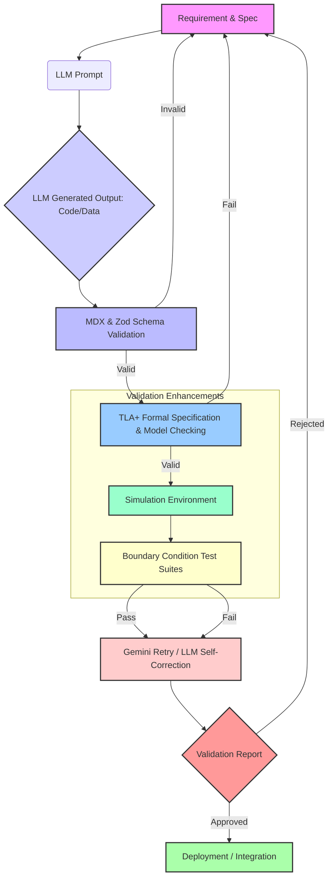

언어 모델(LLM) 출력의 신뢰성과 안전성 확보는 현대 시스템 개발의 핵심 과제입니다. 단순한 스키마 검증을 넘어, LLM이 생성하는 복잡한 코드나 데이터의 잠재적 위험을 최소화하기 위해 TLA+ 명세, 시뮬레이터, 경계 조건 테스트(boundary condition test)를 통합한 엄밀한 검증 파이프라인(validation pipeline)이 필수적입니다. 이는 '허브-워커 복리 자동화'와 같은 핵심 로직의 견고성을 강화하는 데 기여합니다.

## TLA+ 명세를 통한 형식 검증

TLA+ (Temporal Logic of Actions Plus)는 분산 시스템의 동작을 수학적으로 명세하고 검증하는 형식 명세 언어입니다. LLM 출력에 TLA+를 도입하면 불변식(invariants), 상태 전환(state transitions), 안전성(safety) 및 생존성(liveness) 속성을 엄밀히 정의하고, 모델 체킹(Model Checking)을 통해 LLM 생성물이 명세를 위반하는지 조기에 발견할 수 있습니다.

예를 들어, LLM이 '허브-워커 복리 자동화' 로직을 생성할 때, 자금 이체, 상태 업데이트, 오류 처리 메커니즘을 TLA+로 명세하여 검증할 수 있습니다.

```tla
-------------------------- MODULE HubWorkerAutomation --------------------------
EXTENDS Integers, Sequences, FiniteSets, TLC

(* --algorithm HubWorkerAutomation
variables
    funds = 0,             (* Total funds in the system *)
    hubState = "IDLE",     (* State of the hub: IDLE, PROCESSING, ERROR *)
    workerTasks = <<>>,    (* Queue of tasks for workers *)
    processedTasks = 0;    (* Count of successfully processed tasks *)

define
    TypeInvariant ==
        funds >= 0 /\
        hubState \in {"IDLE", "PROCESSING", "ERROR"} /\
        IsSequence(workerTasks) /\
        processedTasks >= 0

end define;

process Hub =
begin
    Init:
        funds := 1000;
        hubState := "IDLE";
        workerTasks := <<>>;;
        processedTasks := 0;

    Loop:
        while TRUE do
            if hubState = "IDLE" then
                GetNewTasks:
                    workerTasks := Append(workerTasks, "Task" :> 100); (* Simulate adding a new task with funds *)
                    hubState := "PROCESSING";
            else if hubState = "PROCESSING" /\ Len(workerTasks) > 0 then
                DispatchTask:
                    let task = Head(workerTasks) in
                        funds := funds - task.value;
                        workerTasks := Tail(workerTasks);
                        processedTasks := processedTasks + 1;
                        if funds < 0 then
                            hubState := "ERROR"; (* Simulate an error condition *)
                        end if;
            else if hubState = "PROCESSING" /\ Len(workerTasks) = 0 then
                CompleteProcessing:
                    hubState := "IDLE";
            end if;
        end while;
end process;

--------------------------------------------------------------------------------
*)
```
이 TLA+ 코드는 `HubWorkerAutomation` 시스템의 상태 변화와 `funds < 0`일 때 "ERROR" 상태로 전환되는 경계 조건을 명시합니다. LLM 생성 로직이 이 명세와 일치하는지 검증합니다.

## 시뮬레이터 및 경계 조건 테스트

LLM 생성 코드를 프로덕션 배포 전에 다양한 시나리오와 경계 조건에서 시뮬레이션하는 것이 중요합니다. 시뮬레이션 환경은 LLM 컴포넌트를 격리하고, 모의 데이터와 외부 의존성을 흉내 내어 다양한 실패 시나리오를 테스트합니다.

경계 조건 테스트는 다음을 포함합니다:
*   **입력 값 경계:** 최소/최대, 빈 값, 잘못된 형식 등.
*   **시스템 상태 경계:** 리소스 고갈, 동시성, 타임아웃 등.
*   **데이터 규모 경계:** 매우 크거나 작은 데이터 세트.

다음 Python 예시는 LLM이 생성한 트랜잭션 처리 로직을 시뮬레이터에서 경계 조건으로 테스트하는 과정을 보여줍니다.

```python
from typing import Dict, Any, List

class LLMGeneratedTransactionProcessor:
    def __init__(self, initial_balance: float):
        self.balance = initial_balance

    def process_transaction(self, transaction_data: Dict[str, Any]) -> Dict[str, Any]:
        amount = transaction_data.get("amount")
        transaction_type = transaction_data.get("type")

        if not isinstance(amount, (int, float)) or amount <= 0:
            return {"status": "FAILED", "message": "Invalid amount"}
        if transaction_type not in ["DEPOSIT", "WITHDRAWAL", "TRANSFER"]:
            return {"status": "FAILED", "message": "Invalid type"}

        status = "SUCCESS"
        message = ""

        if transaction_type == "DEPOSIT":
            self.balance += amount
        elif transaction_type == "WITHDRAWAL":
            if self.balance < amount:
                status = "FAILED"
                message = "Insufficient funds"
            else:
                self.balance -= amount
        elif transaction_type == "TRANSFER":
            if self.balance < amount:
                status = "FAILED"
                message = "Insufficient funds for transfer"
            else:
                self.balance -= amount

        result = {"status": status, "balance": self.balance}
        if status == "FAILED":
            result["message"] = message
        return result

def run_simulation(processor: LLMGeneratedTransactionProcessor, transactions: List[Dict[str, Any]]):
    for tx in transactions:
        processor.process_transaction(tx)

test_transactions = [
    {"type": "DEPOSIT", "amount": 500},
    {"type": "WITHDRAWAL", "amount": 200},
    {"type": "TRANSFER", "amount": 800, "recipient": "account_b"}, (* Insufficient funds boundary *)
    {"type": "DEPOSIT", "amount": 0}, (* Zero amount boundary *)
    {"type": "WITHDRAWAL", "amount": 300}, (* Exact balance boundary (if balance was 300) *)
    {"type": "TRANSFER", "amount": -100, "recipient": "account_c"}, (* Negative amount boundary *)
    {"type": "INVALID_TYPE", "amount": 100}, (* Invalid type boundary *)
    {"type": "DEPOSIT", "amount": 1_000_000_000}, (* Large amount boundary *)
]

processor_instance = LLMGeneratedTransactionProcessor(initial_balance=1000)
run_simulation(processor_instance, test_transactions)
```
이 Python 코드는 LLM 생성 트랜잭션 로직을 경계 조건으로 시뮬레이션 테스트하는 예시입니다. 잔고 부족, 0원 이체 등 다양한 예외 상황을 주입하여 LLM 생성 코드의 견고성(robustness)을 평가합니다.

## 강화된 LLM 출력 검증 파이프라인 구조

다음 Mermaid 다이어그램은 TLA+ 명세, 시뮬레이터, 경계 조건 테스트가 통합된 강화된 LLM 출력 검증 파이프라인의 전체적인 흐름을 보여줍니다.


이 파이프라인은 MDX/Zod 검증 후 TLA+ 형식 검증, 그리고 시뮬레이션 기반 경계 조건 테스트를 거쳐 LLM 출력의 신뢰성과 안정성을 극대화합니다.

## 트레이드오프

*   **높은 초기 비용:** 안전, 규제 준수 등 고위험 애플리케이션에는 필수적이나, 단순 기능에는 과도한 오버헤드입니다.
*   **복잡성 증가:** 복잡한 시스템의 견고성을 높이지만, 단순한 LLM 사용 사례에는 불필요한 복잡성을 유발할 수 있습니다.
*   **성능 오버헤드:** 오프라인 검증으로 프로덕션 안정성을 보장하나, 실시간 검증 요구사항에서는 지연을 초래할 수 있습니다.
*   **전문성 요구:** TLA+ 등 전문 지식 필요하며, 부족 시 생산성 저하 우려가 있습니다.

## 실전 체크리스트

*   [ ] **핵심 LLM 출력에 대한 형식 명세 정의:** TLA+ 등으로 불변식, 상태 전환, 안전성 속성을 명확하게 정의했는가?
*   [ ] **전용 시뮬레이션 환경 구축:** LLM 컴포넌트를 격리하고 외부 의존성을 모의하는 환경을 구축했는가?
*   [ ] **경계 조건 목록 식별 및 자동화:** LLM 출력이 실패할 가능성이 높은 경계 조건들을 식별하고 자동화된 테스트 스위트를 개발했는가?
*   [ ] **TLA+ 모델 체커 통합:** LLM 검증 파이프라인에 TLA+ 모델 체킹을 자동화했는가?
*   [ ] **실패 사례 상세 분석 및 피드백 루프:** 검증 실패 시 원인을 분석하고 LLM 프롬프트 개선에 피드백하는 프로세스를 갖추었는가?
*   [ ] **검증 파이프라인 성능 및 비용 모니터링:** 강화된 파이프라인의 실행 시간, 리소스, 비용을 지속적으로 모니터링하고 있는가?