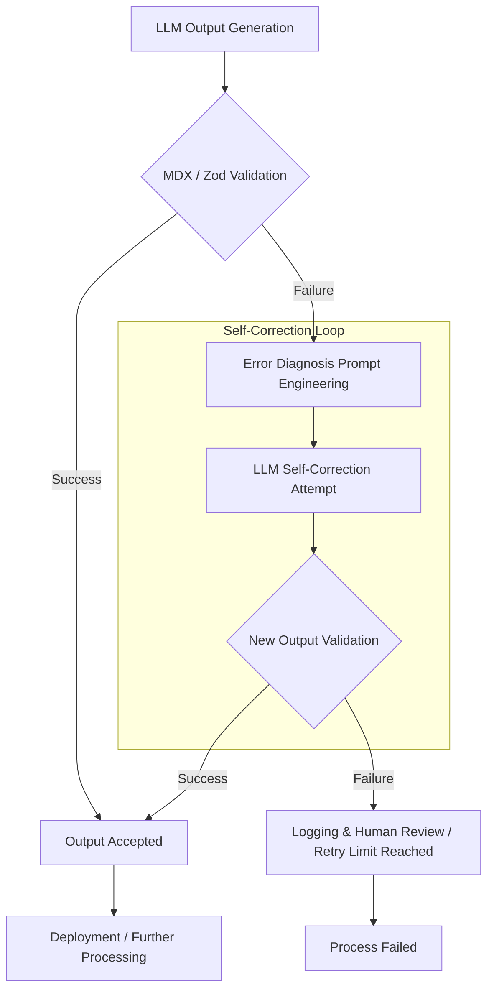

LLM의 출력 정확도와 신뢰성은 애플리케이션의 핵심 성공 요소입니다. 특히 복잡한 코드 생성이나 구조화된 데이터 추출 시, 모델의 초기 응답이 요구사항을 충족하지 못하는 경우가 빈번합니다. LLM 자체 재작성(Self-Rewriting) 기능은 이러한 문제를 해결하기 위한 혁신적인 접근 방식으로, 모델이 스스로 실패를 진단하고 수정하여 성능을 지속적으로 개선합니다.

## 핵심 개념: LLM 자체 재작성 (Self-Rewriting)
Qwen3.5 27B 모델은 자신의 가중치(weights), 채점된 답변(scored answers), 그리고 실행 도구(execution tools)를 활용하여 실패를 진단하고, 그래디언트(gradient)나 추가 학습 없이 가중치를 수정함으로써 미공개 문제의 정확도를 6.6%p 높였습니다. 이는 모델이 직접 수정값을 제안하고, 원본과 수정본을 비교하여 개선 사항을 반영하는 방식입니다. 이 방식의 가장 큰 장점은 개선 사항이 모델의 가중치에 영구적으로 반영되므로, 배포 후 추가적인 프롬프트 엔지니어링이나 연산 비용 없이 지속적인 성능 향상을 기대할 수 있다는 점입니다.

## Claude Code 하네스 내 통합 전략
Claude Code 하네스(harness) 환경은 LLM 출력의 유효성을 검증하는 파이프라인(MDX validation, Zod schema)을 이미 갖추고 있습니다. 여기에 자체 재작성 로직을 통합하는 것은 LLM이 스스로 실패를 인지하고 해결하는 자율성을 부여하여, 수동 검증 및 재시도 횟수를 획기적으로 줄일 수 있습니다.

### 통합 접근 방식
1.  **실패 진단 프롬프트 엔지니어링**: LLM이 생성한 코드가 MDX validation 또는 Zod schema 검증에 실패했을 때, 실패 원인과 검증 에러 메시지를 포함한 컨텍스트를 LLM에 다시 제공합니다. 모델에게 `reasoning` 과정을 통해 실패의 근본 원인을 분석하고, 해당 문제를 해결하기 위한 `plan`을 수립하도록 지시합니다. 이후 `action`으로 새로운 코드나 텍스트 수정안을 생성하도록 유도합니다.

    ```python
def self_correction_prompt(failed_output, error_message, schema_definition):
    prompt = f"""
당신은 코드 생성 및 검증 전문가입니다. 주어진 LLM 출력물이 스키마 검증에 실패했습니다.
실패한 출력:
{failed_output}

검증 오류 메시지:
{error_message}

적용하려는 스키마:
{schema_definition}

# Reasoning
위 오류 메시지와 실패한 출력, 스키마 정의를 기반으로 실패의 원인을 분석하세요.
- 어떤 부분이 스키마를 위반했는가?
- 왜 이러한 오류가 발생했는가? (예: 잘못된 필드명, 타입 불일치, 누락된 필드 등)

# Plan
분석된 원인을 바탕으로 출력물을 수정하기 위한 구체적인 계획을 수립하세요.
- 어떤 부분을 어떻게 수정할 것인가?
- 스키마를 준수하기 위해 어떤 변경이 필요한가?

# Action
계획에 따라 수정된 JSON 또는 마크다운 출력물을 다시 생성하세요.
응답은 오직 수정된 JSON/Markdown만 포함해야 합니다. 다른 설명은 필요 없습니다.
    """
    return prompt
    ```

2.  **미세 조정 로직 (Adaptive Prompt Engineering)**: Qwen의 방식처럼 모델 가중치를 직접 수정하는 것은 어렵지만, 대신 `adaptive prompt engineering`을 통해 모델의 행동을 미세 조정할 수 있습니다. 지속적으로 실패하는 패턴이 발견되면, 해당 패턴을 방지하기 위한 `meta-prompt`를 업데이트하거나, 특정 에러 유형에 대한 수정 전략을 내재화하는 `few-shot examples`를 프롬프트에 추가합니다. 이는 모델이 과거의 실패 경험을 통해 '학습'하고 더 나은 수정 전략을 '자가 학습'하는 효과를 낼 수 있습니다.

## 구현 흐름 (Mermaid Diagram)



## 2026년 최신 트렌드 반영
2026년에는 LLM의 자율성(Autonomy)과 지속적인 자기 개선(Continuous Self-Improvement)이 더욱 강조될 것입니다. Qwen의 사례는 모델이 명시적인 재훈련 없이도 내부 로직을 수정할 수 있는 잠재력을 보여주며, 이는 향후 `agentic systems`의 `self-healing` 및 `self-optimization` 능력 발전의 중요한 이정표가 될 것입니다. `prompt engineering`을 넘어 `model-level self-adaptation`으로 발전하는 이 트렌드는 `LLMops` 파이프라인의 견고성과 효율성을 극대화하는 데 필수적입니다.

## 트레이드오프

*   **즉각적인 성능 개선 vs. 자원 소모**:
    *   **좋은 경우**: LLM 자체 재작성은 즉각적인 피드백 루프를 통해 출력 품질을 빠르게 개선할 수 있습니다. 특히 경미한 문법 오류나 스키마 불일치 같은 문제를 빠르게 해결하여 수동 개입을 줄입니다.
    *   **나쁜 경우**: 매번 실패 시 LLM 재추론을 시도하므로, 컴퓨팅 자원(토큰 비용, 추론 시간) 소모가 증가합니다. 복잡하고 근본적인 오류는 여러 번의 재시도를 유발하여 비효율적일 수 있습니다.

*   **복잡성 감소 vs. 디버깅 난이도 증가**:
    *   **좋은 경우**: 단순한 검증 실패에 대한 자동 수정으로 전체 파이프라인의 복잡성을 줄이고 개발자의 수고를 덜 수 있습니다.
    *   **나쁜 경우**: 모델의 내부 수정 로직이 불투명하므로, 수정된 결과가 예상치 못한 부작용을 일으키거나 새로운 유형의 오류를 생성할 때 디버깅이 어려워질 수 있습니다. `self-rewriting` 과정에 대한 `observability` 확보가 중요합니다.

*   **모델 안정성 유지 vs. 지속적인 적응**:
    *   **좋은 경우**: Qwen의 사례처럼 이전 수정본이 아닌 기본 가중치에서 매 세션 시작하는 방식은 모델의 핵심 성능이 저하되는 것을 방지하면서 부분적인 개선을 시도합니다. 이는 모델의 `stability`와 `adaptability` 사이의 균형점을 찾습니다.
    *   **나쁜 경우**: 만약 지속적으로 잘못된 방향으로 가중치가 수정되거나, 특정 유스케이스에서 오히려 성능이 떨어지는 `regression`이 발생할 위험이 있습니다. 수정안의 `safety`와 `efficacy`에 대한 엄격한 검증이 필요합니다.

*   **수동 개입 최소화 vs. `Guardrail` 필요성**:
    *   **좋은 경우**: 모델이 스스로 문제를 해결하도록 함으로써 수동 `human-in-the-loop` 검토 및 수정 단계를 대폭 줄여 `developer velocity`를 높일 수 있습니다.
    *   **나쁜 경우**: 모델이 치명적인 오류를 수정하지 못하거나, 오히려 더 큰 문제를 야기할 수 있는 `malicious`한 수정안을 제안할 가능성도 있습니다. `unintended consequences`를 방지하기 위한 강력한 `guardrails`와 `monitoring` 시스템이 필수적입니다.

## 실전 체크리스트

- [ ] LLM 출력 검증 파이프라인(MDX, Zod)에서 발생하는 실패 유형을 명확히 분류했는가?
- [ ] 각 실패 유형에 대한 `self-correction` 프롬프트 템플릿을 정의하고 테스트했는가?
- [ ] `self-correction` 시도 횟수에 대한 `retry limit`를 설정하고, 초과 시 `human-in-the-loop` 개입 또는 에러 처리 로직을 구현했는가?
- [ ] `self-correction` 과정에서 발생하는 LLM 토큰 사용량 및 추론 시간 증가를 `cost-benefit analysis`를 통해 평가했는가?
- [ ] `self-correction` 시도 전후의 출력물, 오류 메시지, 모델의 `reasoning` 및 `plan`을 로깅하여 `observability`를 확보했는가?
- [ ] `self-correction`을 통해 수정된 출력물에 대한 `A/B 테스트` 또는 `정확도 평가 메트릭`을 수립하고 모니터링하고 있는가?
- [ ] `self-correction`이 오히려 모델의 `quality`를 저하시키는 `regression`을 유발하지 않는지 `guardrail` 및 `automated testing`을 운영하고 있는가?