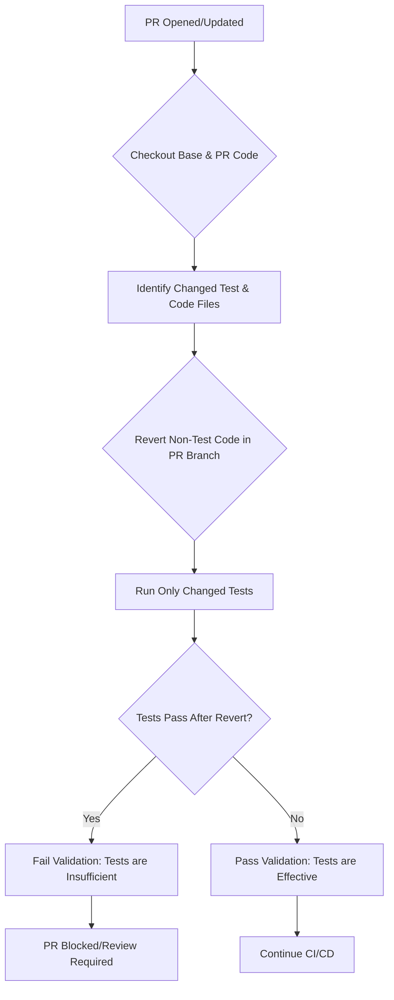

소프트웨어 개발 과정에서 코드 변경을 검증하기 위해 Pull Request (PR)에 테스트를 포함하는 것은 일반적인 관행입니다. 특히 AI 에이전트가 코드를 생성하고 수정하는 'AI-Native' 시대에는 이러한 테스트의 신뢰성이 더욱 중요해집니다. 그러나 PR에 포함된 테스트가 실제 코드 수정과 무관하게 항상 통과하는 '무의미한 테스트(Always-passing test)'일 수 있는 잠재적 위험이 존재합니다. 이는 버그를 놓치고 코드 품질 저하로 이어질 수 있으며, AI 에이전트의 '실패를 통한 학습' 메커니즘을 방해합니다. 이 엔트리는 `redfirst` 방법론을 활용하여 PR 테스트의 유효성을 검증하고, AI 에이전트 및 휴먼 개발자가 제출하는 코드 변경의 신뢰도를 강화하는 방안을 제시합니다.

## redfirst 방법론의 핵심

`redfirst` 방법론은 PR에 추가되거나 수정된 테스트가 실제로 해당 PR의 변경사항을 검사하는지 확인하는 간단하면서도 강력한 검증 절차입니다. 핵심 아이디어는 다음과 같습니다.

1.  **PR 변경사항 격리**: PR이 변경한 테스트 파일은 그대로 유지합니다.
2.  **코드베이스 롤백**: 해당 PR이 변경한 비-테스트 코드 파일들을 PR 이전의 상태(예: `base branch`의 `HEAD`)로 되돌립니다.
3.  **테스트 재실행**: PR에서 추가되거나 수정된 테스트만 격리된 환경에서 다시 실행합니다.
4.  **결과 검증**: 만약 코드 변경사항을 되돌렸는데도 해당 테스트가 모두 통과한다면, 이는 그 테스트가 실제 코드 수정 사항을 제대로 검사하지 못함을 의미합니다. 즉, 테스트가 '항상 통과'하는 문제가 있는 것입니다.

이러한 검증을 통해 PR에 포함된 테스트가 `redfirst` 원칙(테스트는 실패해야 통과한다)을 따르는지 확인할 수 있습니다. 이는 AI 에이전트의 '실패를 통한 학습' 파이프라인에서 버그 수정 후 제출하는 테스트의 유효성을 담보하는 데 필수적입니다.

## GitHub Actions 워크플로 통합 예제

`redfirst` 방법론은 CI/CD 파이프라인에 쉽게 통합될 수 있습니다. 다음은 GitHub Actions를 활용한 예시 워크플로입니다. 이 워크플로는 PR이 열리거나 업데이트될 때 실행되어, 변경된 테스트 파일만을 분리하고, PR의 핵심 코드 변경을 롤백한 후 테스트를 재실행합니다. 본 예시에서는 `git diff`와 `git checkout` 명령어를 활용하여 변경된 파일 목록을 식별하고 코드를 임시로 되돌립니다.

```yaml
name: PR Test Validation (redfirst)
on:
  pull_request:
    types: [opened, reopened, synchronize]

jobs:
  validate-pr-tests:
    runs-on: ubuntu-latest
    steps:
      - name: Checkout base branch
        uses: actions/checkout(v4)
        with:
          ref: (github.base_ref)
          fetch-depth: 0
          path: base_repo

      - name: Checkout PR branch
        uses: actions/checkout(v4)
        with:
          ref: (github.event.pull_request.head.sha)
          fetch-depth: 0
          path: pr_repo

      - name: Setup Python
        uses: actions/setup-python(v5)
        with:
          python-version: '3.x'
          cache: 'pip'

      - name: Install dependencies
        working-directory: ./pr_repo
        run: |
          pip install -r requirements.txt

      - name: Get changed files
        id: get_changed_files
        run: |
          cd pr_repo
          CHANGED_FILES=$(git diff --name-only (github.base_ref) (github.event.pull_request.head.sha))
          echo "Changed files: $CHANGED_FILES"
          CHANGED_TEST_FILES=$(echo "$CHANGED_FILES" | grep 'test_.*\\.py\\|\\.test\\.js\\|spec_.*\\.rb') # Adjust regex for your test file patterns
          echo "CHANGED_TEST_FILES=$CHANGED_TEST_FILES" >> "$GITHUB_OUTPUT"
          CHANGED_CODE_FILES=$(echo "$CHANGED_FILES" | grep -v 'test_.*\\.py\\|\\.test\\.js\\|spec_.*\\.rb')
          echo "CHANGED_CODE_FILES=$CHANGED_CODE_FILES" >> "$GITHUB_OUTPUT"
        shell: bash

      - name: Revert code changes to base state
        working-directory: ./pr_repo
        run: |
          # Revert only non-test code files to base branch state
          for file in $(echo "(steps.get_changed_files.outputs.CHANGED_CODE_FILES)" | xargs -n1);
          do
            if [ -f "../base_repo/$file" ]; then
              cp "../base_repo/$file" "$file"
              echo "Reverted $file"
            else
              # If file didn't exist in base, delete it from pr_repo
              rm -f "$file"
              echo "Deleted new file $file"
            fi
          done
        shell: bash

      - name: Run only changed tests
        working-directory: ./pr_repo
        run: |
          if [ -z "(steps.get_changed_files.outputs.CHANGED_TEST_FILES)" ]; then
            echo "No new or modified test files found. Skipping test validation."
            exit 0
          fi

          TEST_COMMAND_PREFIX=""
          # Example for Python pytest. Adjust for your test runner.
          if [[ "(steps.get_changed_files.outputs.CHANGED_TEST_FILES)" == *\\.py* ]]; then
            TEST_COMMAND_PREFIX="pytest"
          elif [[ "(steps.get_changed_files.outputs.CHANGED_TEST_FILES)" == *\\.js* ]]; then
            TEST_COMMAND_PREFIX="npm test"
          fi

          if [ -z "$TEST_COMMAND_PREFIX" ]; then
            echo "Unknown test file type. Cannot run specific tests. Failing validation."
            exit 1
          fi

          FAILED_TESTS=0
          for test_file in $(echo "(steps.get_changed_files.outputs.CHANGED_TEST_FILES)" | xargs -n1);
          do
            echo "Running test: $test_file"
            $TEST_COMMAND_PREFIX "$test_file" || FAILED_TESTS=$((FAILED_TESTS + 1))
          done

          if [ "$FAILED_TESTS" -eq 0 ]; then
            echo "Validation failed: All new/modified tests passed WITHOUT PR code changes. This means the tests do not effectively guard the changes."
            exit 1
          else
            echo "Validation successful: New/modified tests failed as expected when code changes were reverted."
          fi
        shell: bash
```

### 워크플로 다이어그램

다음 Mermaid 다이어그램은 `redfirst` 검증 워크플로의 전체 흐름을 시각적으로 보여줍니다.



## 2026년 AI 에이전트 개발 환경에서의 중요성

2026년은 AI 에이전트가 코드 개발 생태계에서 더욱 핵심적인 역할을 수행할 것으로 예상됩니다. 복잡한 버그 수정, 기능 구현, 리팩토링 등을 자율적으로 수행하는 AI 에이전트의 증가는 테스트의 신뢰성 검증을 필수적으로 만듭니다. 에이전트가 생성한 코드는 예측 불가능한 오류를 포함할 수 있으며, 이 오류를 감지하기 위한 테스트마저 부실하다면 전체 시스템의 안정성이 심각하게 저해될 것입니다. `redfirst` 방법론은 다음과 같은 이유로 중요합니다.

*   **AI 에이전트의 '학습 루프' 강화**: 에이전트가 버그를 수정하고 테스트를 제출했을 때, 그 테스트가 실제 문제를 검사하지 않는다면 에이전트는 잘못된 학습 피드백을 받게 됩니다. `redfirst`는 이러한 '무의미한 테스트'를 걸러내 에이전트가 더 유효하고 견고한 테스트를 생성하도록 유도합니다.
*   **휴먼 개발자의 신뢰 구축**: AI 에이전트가 생성한 코드에 대한 휴먼 개발자의 신뢰는 테스트의 품질에 크게 좌우됩니다. `redfirst`는 이러한 신뢰를 검증 가능한 방식으로 제공하여 인간-AI 협업의 효율성을 높입니다.
*   **LLM 출력 검증 파이프라인의 신뢰도 향상**: LLM 기반 에이전트가 생성하는 코드는 문법적으로는 올바르지만 논리적 오류를 포함할 수 있습니다. `redfirst`는 이러한 논리적 오류를 포착하는 테스트가 제대로 작동하는지 검증하여 LLM 출력 검증 파이프라인의 핵심적인 구성 요소가 됩니다.

## 트레이드오프

### 신뢰도 및 품질 향상 vs. 복잡성 및 실행 시간 증가
*   **언제 좋고**: 미션 크리티컬한 시스템, AI 에이전트가 생성하는 코드, 보안이 중요한 애플리케이션 등 코드 품질과 신뢰도가 최우선인 경우에 매우 효과적입니다. 무의미한 테스트로 인한 잠재적 버그 유입을 사전에 차단합니다.
*   **언제 나쁜지**: 빠른 프로토타이핑, 단순한 유틸리티 변경, 혹은 개발 초기 단계와 같이 신속한 피드백이 더 중요한 경우에는 CI/CD 파이프라인의 복잡성과 추가적인 실행 시간으로 인해 개발 속도가 저하될 수 있습니다.

### CI/CD 파이프라인 안정성 vs. 개발 속도 저하
*   **언제 좋고**: 메인 브랜치(main branch)로의 병합 전 최종 게이트웨이, 릴리즈 브랜치 관리, 혹은 엄격한 코드 리뷰가 필요한 환경에서 파이프라인의 안정성을 보장하고 예상치 못한 배포 문제를 줄입니다.
*   **언제 나쁜지**: 피처 브랜치(feature branch)에서 활발히 개발 중인 상황, 또는 소규모 팀에서 빠른 반복과 배포가 요구되는 경우에는 추가적인 검증 단계가 불필요한 지연을 발생시켜 개발 흐름을 방해할 수 있습니다.

### 에이전트 출력 검증 강화 vs. 워크플로 관리 오버헤드
*   **언제 좋고**: LLM 기반 에이전트가 지속적으로 코드 변경 PR을 제출하며 그 학습 및 성능 개선을 위해 테스트 품질이 중요한 경우에, 에이전트의 자율성과 신뢰성을 크게 향상시킵니다.
*   **언제 나쁜지**: 에이전트가 주로 문서 생성, 데이터 분석 등 코드 변경과 무관한 작업을 수행하거나, 아직 에이전트의 코드 생성 능력이 초기 단계여서 테스트 품질보다는 기능 구현 자체에 초점을 맞추는 경우에는 검증 워크플로의 설정 및 유지보수 비용이 이점보다 클 수 있습니다.

## 실전 체크리스트

이 `redfirst` 기반 PR 테스트 검증 강화 패턴을 프로젝트에 적용할 때 다음 항목들을 점검해야 합니다.

- [ ] 현재 CI/CD 파이프라인(예: GitHub Actions, GitLab CI)에 `redfirst` 스타일의 PR 테스트 검증 워크플로가 통합되었는지 확인.
- [ ] AI 에이전트가 생성하는 모든 코드 변경 PR에 대해 해당 검증 프로세스가 의무적으로 실행되도록 정책을 수립하고 자동화했는지 확인.
- [ ] 사용 중인 프로그래밍 언어 및 테스트 프레임워크(예: Python/pytest, JavaScript/Jest)에 맞춰 `redfirst` 검증 로직이 정확하게 구현되었는지, 필요한 경우 커스텀 스크립트 작성 및 유지보수 계획이 있는지 확인.
- [ ] `redfirst` 검증 실패 시, 해당 PR이 자동으로 병합되지 않도록(또는 최소한 Human Review를 필수로 하도록) CI/CD 게이트(gate)가 설정되었는지 확인.
- [ ] `redfirst` 워크플로의 실행 시간과 리소스 사용량(CPU, 메모리)을 지속적으로 모니터링하고, 과도한 오버헤드 발생 시 최적화 방안(예: 캐싱, 병렬 처리)을 검토할 계획이 있는지 확인.
- [ ] 개발자가 수동으로 `redfirst` 테스트 유효성 검사를 우회할 수 있는 경로가 없는지, 주기적으로 CI/CD 설정 및 권한을 보안 감사(security audit)하고 있는지 확인.
- [ ] `redfirst` 검증 실패 사례들을 수집하고 분석하여, AI 에이전트의 테스트 생성 능력이나 휴먼 개발자의 테스트 작성 관행을 개선하기 위한 구체적인 피드백 루프가 구축되어 있는지 확인.