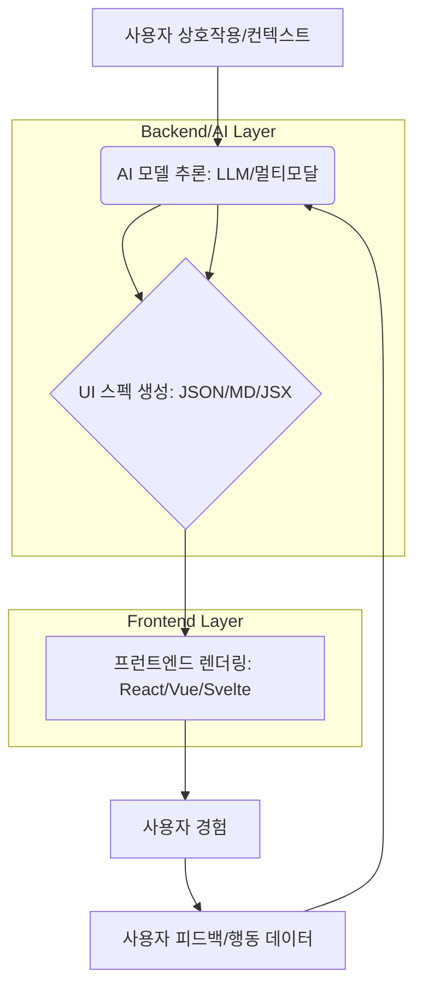

Generative UI는 인공지능 (AI) 모델이 사용자 입력이나 상황적 컨텍스트에 따라 UI 컴포넌트나 레이아웃을 동적으로 생성하는 접근 방식입니다. 이는 전통적인 정적 또는 템플릿 기반 UI 개발의 한계를 넘어, 고도로 개인화되고 적응적인 사용자 경험 (UX)을 제공하는 핵심적인 방법론으로 부상하고 있습니다. 2026년 현재, LLM(Large Language Model)과 멀티모달 AI의 발전은 Generative UI의 가능성을 더욱 확장하며, 프런트엔드 개발 패러다임을 혁신하고 있습니다.

## Generative UI 아키텍처 패턴

Generative UI 구현은 크게 두 가지 아키텍처 패턴으로 나눌 수 있습니다.

### 1. 서버-사이드 Generative UI (Server-Side Generative UI)

서버에서 AI 모델이 전체 UI 스펙(JSON, XML, 또는 특정 UI DSL)을 생성하고, 프런트엔드는 이를 파싱하여 렌더링합니다. 이 방식은 복잡한 AI 모델을 클라이언트에서 직접 실행하기 어려울 때 유용합니다. 주요 장점은 AI 모델의 추론 부담을 서버로 분산하고, 일관된 UI 로직을 중앙에서 관리할 수 있다는 점입니다. 하지만 네트워크 지연 시간이 길어질 수 있고, 실시간 상호작용에 불리할 수 있습니다.

### 2. 클라이언트-사이드 Generative UI (Client-Side Generative UI)

작은 규모의 AI 모델(On-device LLM) 또는 AI 추론 결과를 바탕으로 클라이언트에서 UI를 직접 구성하는 방식입니다. 예를 들어, AI가 특정 컴포넌트의 속성(텍스트, 이미지 URL, 버튼 액션)을 제안하면, 클라이언트 측 프레임워크(React, Vue, Svelte)가 이를 기반으로 렌더링합니다. 이 방식은 낮은 지연 시간과 높은 반응성을 제공하며, 오프라인 시나리오에서도 부분적으로 동작할 수 있습니다. 그러나 클라이언트 환경의 리소스 제약과 모델 배포 및 업데이트의 복잡성이 단점입니다.

## 구현 워크플로우

Generative UI의 일반적인 워크플로우는 다음과 같습니다.

1.  **사용자 상호작용 및 컨텍스트 수집**: 사용자의 입력, 행동 패턴, 디바이스 정보, 시간, 위치 등 다양한 컨텍스트 데이터를 수집합니다.
2.  **AI 모델 추론**: 수집된 데이터를 바탕으로 LLM 또는 다른 AI 모델이 최적의 UI 컴포넌트 조합 또는 UI 스펙을 추론합니다.
3.  **UI 스펙 생성**: AI 모델은 추론 결과를 기반으로 프런트엔드가 해석할 수 있는 형식(예: JSON 기반의 UI 컴포넌트 배열, 마크다운, JSX fragment)의 UI 스펙을 생성합니다.
4.  **프런트엔드 렌더링**: 프런트엔드는 받은 UI 스펙을 파싱하고, 미리 정의된 디자인 시스템 컴포넌트와 매핑하여 사용자에게 렌더링합니다.
5.  **피드백 루프**: 사용자 상호작용 결과를 다시 AI 모델에 학습 데이터로 활용하여 모델의 성능을 지속적으로 개선합니다.



## 코드 예제: AI 스펙 기반 동적 컴포넌트 렌더링 (React)

다음은 AI에서 생성된 JSON 스펙을 받아 동적으로 UI를 렌더링하는 간단한 React 컴포넌트 예시입니다. `DynamicComponentMap`은 디자인 시스템의 컴포넌트들을 매핑합니다.

```typescript
import React from 'react';

// AI 모델이 생성하는 UI 스펙 인터페이스
interface UISpecComponent {
  type: string; // 'Button', 'Text', 'Image', 'Card'
  props: Record<string, any>; // 컴포넌트 속성
  children?: UISpecComponent[]; // 중첩 컴포넌트
}

interface DynamicUIProps {
  uiSpec: UISpecComponent[];
}

// 미리 정의된 디자인 시스템 컴포넌트 맵
const DynamicComponentMap: Record<string, React.ElementType> = {
  Button: ({ children, ...props }) => <button {...props}>{children}</button>,
  Text: ({ children, ...props }) => <p {...props}>{children}</p>,
  Image: (props) => ,
  Card: ({ children, ...props }) => <div style={{ border: '1px solid #ccc', padding: '16px', borderRadius: '8px' }} {...props}>{children}</div>,
  // ...더 많은 컴포넌트 추가 가능
};

const renderComponent = (component: UISpecComponent): React.ReactNode => {
  const Component = DynamicComponentMap[component.type];
  if (!Component) {
    console.warn(`Unknown component type: ${component.type}`);
    return null;
  }

  const children = component.children?.map(renderComponent);

  return React.createElement(Component, component.props, children || component.props.children);
};

const DynamicUI: React.FC<DynamicUIProps> = ({ uiSpec }) => {
  return (
    <div>
      {uiSpec.map((comp, index) => (
        <React.Fragment key={index}>{renderComponent(comp)}</React.Fragment>
      ))}
    </div>
  );
};

export default DynamicUI;

// 사용 예시: 서버에서 받아온 UI 스펙
const exampleUISpec: UISpecComponent[] = [
  {
    type: 'Card',
    props: { className: 'product-card' },
    children: [
      { type: 'Image', props: { src: 'https://example.com/product.jpg', alt: 'Product Image' } },
      { type: 'Text', props: { style: { fontWeight: 'bold' } }, children: ['AI 생성 추천 상품'] },
      { type: 'Text', props: { style: { fontSize: '0.9em', color: '#666' } }, children: ['개인화된 맞춤형 상품입니다.'] },
      { type: 'Button', props: { onClick: () => alert('구매!') }, children: ['지금 구매하기'] },
    ],
  },
];

// <DynamicUI uiSpec={exampleUISpec} />
```

이 예제는 AI가 단순한 텍스트나 데이터 대신, 실제 UI 구조를 표현하는 JSON 객체를 생성하고 프런트엔드가 이를 해석하여 렌더링하는 방식을 보여줍니다. 2026년에는 AI SDK (예: Vercel AI SDK, LangChain.js)와 연동하여 LLM의 함수 호출(Function Calling) 기능을 통해 UI 스펙을 더 안정적으로 생성하는 패턴이 보편화될 것입니다.

## 트레이드오프

Generative UI를 도입할 때는 다음과 같은 장단점을 고려해야 합니다.

*   **개인화 및 적응성**: Generative UI는 사용자 컨텍스트에 따라 최적의 UI를 동적으로 생성하여 고도로 개인화된 경험을 제공합니다. 이는 사용자 참여도(Engagement)와 전환율(Conversion Rate)을 높이는 데 매우 효과적입니다. (언제 좋음: 사용자 수가 많고 개인화가 핵심 경쟁력인 서비스, A/B 테스트가 어려운 복잡한 다변수 환경; 언제 나쁨: 정교한 브랜드 일관성이 최우선이며 UI 예측 가능성이 중요한 서비스)
*   **개발 민첩성 및 확장성**: AI가 UI 스펙을 생성하므로, 새로운 기능이나 디자인 변경 시 수동으로 UI를 코딩하는 시간을 줄일 수 있습니다. 이는 개발 속도를 향상시키고, 디자이너와 개발자 간의 협업 방식을 변화시킬 수 있습니다. (언제 좋음: 빠르게 새로운 UI 아이디어를 탐색하고 프로토타이핑해야 하는 경우, 다양한 플랫폼/디바이스에 동적으로 대응해야 하는 경우; 언제 나쁨: UI 구성 요소가 매우 제한적이고 변경 빈도가 낮은 정적 서비스)
*   **디버깅 및 예측 가능성**: AI가 동적으로 UI를 생성하기 때문에, 예상치 못한 UI가 렌더링되거나 오류가 발생했을 때 디버깅이 어려울 수 있습니다. 또한, AI 모델의 블랙박스 특성으로 인해 UI 생성 로직을 완전히 통제하기 어렵습니다. (언제 좋음: 사용자 경험의 혁신과 빠른 실험이 중요한 초기 단계 프로젝트; 언제 나쁨: 규제 준수, 보안, 높은 안정성이 요구되는 금융/의료 분야 서비스)
*   **성능 및 지연 시간**: AI 모델 추론과 UI 스펙 전송 및 파싱 과정에서 추가적인 지연 시간이 발생할 수 있습니다. 특히 서버-사이드 Generative UI의 경우, 네트워크 왕복 시간(Round-Trip Time, RTT)이 UX에 직접적인 영향을 미칩니다. (언제 좋음: 비동기 데이터 로딩이 허용되거나 초기 로딩 시간을 감수할 수 있는 대화형 애플리케이션; 언제 나쁨: 밀리초 단위의 반응성이 중요한 고성능 실시간 애플리케이션 또는 애니메이션이 많은 게임)
*   **디자인 일관성 및 브랜드 가이드라인 준수**: AI가 생성한 UI가 브랜드 디자인 시스템의 가이드라인에서 벗어날 위험이 있습니다. 이는 사용자에게 혼란을 주거나 브랜드 이미지를 손상시킬 수 있습니다. (언제 좋음: 디자인 시스템이 잘 구축되어 있고 AI가 디자인 토큰과 컴포넌트 속성을 명확히 이해하도록 훈련된 경우; 언제 나쁨: 디자인 시스템이 미흡하거나 AI가 디자인 원칙을 해석하는 데 어려움이 있는 경우)

## 실전 체크리스트

Generative UI를 프로젝트에 적용할 때 검증해야 할 핵심 항목들입니다.

*   [ ] **AI API 응답 지연 시간 (Latency) 최적화**: AI 모델의 추론 및 UI 스펙 생성에 소요되는 평균 및 최대 시간을 측정하고, 사용자 허용 범위 내에 있는지 확인하십시오.
*   [ ] **UI 스펙 스키마 유효성 검사**: AI가 생성하는 UI 스펙(예: JSON)이 프런트엔드에서 정의한 스키마에 부합하는지 런타임에 엄격하게 검증하는 로직을 구현했는지 확인하십시오. (예: `zod` 라이브러리 활용).
*   [ ] **폴백 (Fallback) 및 에러 처리**: AI 모델 응답 실패, 네트워크 오류, 유효하지 않은 UI 스펙 수신 시 사용자에게 일관되고 친화적인 폴백 UI가 제공되는지 테스트하십시오.
*   [ ] **프롬프트 인젝션 (Prompt Injection) 방어**: 악의적인 사용자 입력이 AI 모델의 UI 생성 로직을 오작동시키거나 민감한 정보를 노출하지 않도록 입력 검증 및 필터링 메커니즘을 강화했는지 점검하십시오.
*   [ ] **A/B 테스트 및 성능 지표 모니터링**: Generative UI 도입 전후의 사용자 참여도, 전환율, 페이지 로딩 시간 등의 핵심 지표를 A/B 테스트를 통해 비교하고 지속적으로 모니터링하는 시스템을 구축했는지 확인하십시오.
*   [ ] **디자인 시스템 컴포넌트 매핑**: AI가 생성하는 추상적인 UI 요소가 실제 프로덕션 디자인 시스템의 재사용 가능한 컴포넌트와 정확히 매핑되는지, 그리고 매핑되지 않은 요소 발생 시 처리 방안이 있는지 검토하십시오.
*   [ ] **접근성 (Accessibility) 보장**: AI가 생성한 동적 UI 요소들이 웹 접근성 표준(WCAG)을 준수하는지, 특히 스크린 리더 사용자들을 위한 ARIA 속성 및 키보드 탐색 기능이 올바르게 구현되는지 주기적으로 검증하십시오.