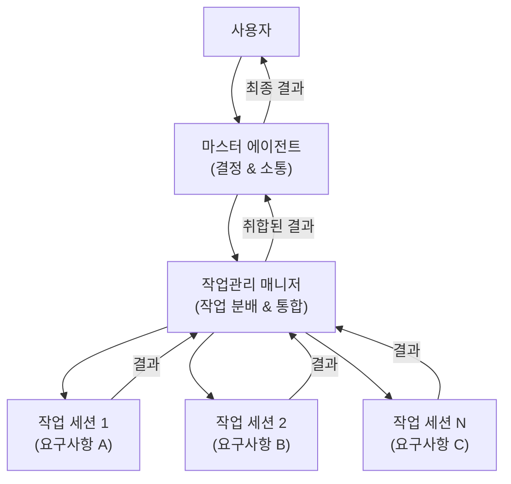

AI 에이전트 기반의 소프트웨어 개발에서 가장 흔히 직면하는 문제 중 하나는 단일 에이전트 세션의 컨텍스트(Context) 비대화와 이로 인한 비효율성입니다. 사용자 질의 응답과 실제 개발 작업을 하나의 에이전트에게 맡길 경우, 컨텍스트가 빠르게 소모되고, 작업 루프가 멈추면 사용자 소통 채널까지 함께 정지하는 문제가 발생합니다. 이를 해결하기 위해 Orca-orchestration-kit에서 제안하는 3계층 오케스트레이션 아키텍처는 에이전트 시스템의 확장성, 견고성, 그리고 개발 효율성을 획기적으로 향상시키는 방안으로 검토될 수 있습니다.

## 3계층 오케스트레이션 아키텍처 개요

이 아키텍처는 `마스터 에이전트`, `작업관리 매니저`, 그리고 `작업 세션`의 세 가지 계층으로 구성됩니다. 각 계층은 명확한 역할과 책임을 가지며, 독립적으로 기능을 수행하면서도 상호 협력하여 복잡한 개발 작업을 처리합니다.

### 마스터 에이전트 (Master Agent)
사용자와 직접 소통하는 최상위 계층 에이전트입니다. 사용자로부터 요구사항을 접수하고, 이를 바탕으로 전체 프로젝트의 방향을 결정합니다. 또한, 작업관리 매니저로부터 취합된 결과를 사용자에게 보고하고 피드백을 수용하여 다음 작업 지시를 내립니다. 마스터 에이전트의 핵심 역할은 사용자 소통 창구이자 상위 수준의 의사결정자로서, 전체 워크플로우를 조율하고 진행 상황을 관리하는 데 있습니다.

### 작업관리 매니저 (Task Manager)
마스터 에이전트의 지시를 받아 실제 개발 작업을 하위의 여러 작업 세션에 분배하고, 각 세션의 진행 상황을 모니터링하며, 완료된 작업 결과를 취합하고 통합하는 역할을 수행합니다. 특정 요구사항을 달성하기 위해 필요한 하위 작업들을 식별하고, 각 작업을 독립적인 작업 세션에 할당함으로써 병렬 처리를 가능하게 합니다. 작업관리 매니저는 코드 병합(Merge) 및 현황 관리 등의 핵심적인 조정자 역할을 담당하여, 컨텍스트 비대화를 방지하고 개별 작업 세션의 독립성을 보장합니다.

### 작업 세션 (Worker Session)
실제 코딩, 테스트, 문서화 등 특정 요구사항 하나를 전담하는 에이전트 세션입니다. 각 작업 세션은 독립적인 브랜치(Branch) 또는 워크트리(Worktree) 환경에서 동작하며, 할당된 요구사항에 집중하여 작업을 수행합니다. 작업 세션은 필요한 경우 다른 도구(Tool)를 사용하거나 Claude Code 스킬을 활용하여 실제 개발 작업을 실행합니다. 작업 완료 후에는 작업관리 매니저에게 결과를 보고하고, 다음 지시를 기다리거나 종료됩니다. 이 계층은 컨텍스트가 특정 작업에만 집중되도록 하여 효율성을 극대화합니다.

## 아키텍처 다이어그램



## 구현 예시 (Python 컨셉)

이 아키텍처는 다양한 언어와 프레임워크로 구현될 수 있습니다. 다음은 Python을 사용한 개념적인 구현 스케치입니다.

```python
class MasterAgent:
    def __init__(self, task_manager):
        self.task_manager = task_manager

    def receive_request(self, user_request):
        # 사용자 요청 파싱 및 초기 결정
        project_plan = self.decide_plan(user_request)
        self.task_manager.delegate_project(project_plan)

    def report_result(self, aggregated_result):
        # 사용자에게 최종 결과 보고
        print(f"User: Project completed with result: {aggregated_result}")

class TaskManager:
    def __init__(self):
        self.worker_sessions = [] # 동적으로 생성/관리
        self.active_tasks = {}

    def delegate_project(self, project_plan):
        # 프로젝트 계획을 하위 작업으로 분해하고 워커 세션에 할당
        for task_id, task_details in project_plan.items():
            worker = WorkerSession(task_id, task_details, self)
            self.worker_sessions.append(worker)
            self.active_tasks[task_id] = worker.start_task()

    def receive_worker_result(self, task_id, result):
        # 워커 세션으로부터 결과 수신 및 통합 로직
        print(f"Task {task_id} completed with result: {result}")
        # 모든 작업 완료 시 마스터 에이전트에 보고
        if self.all_tasks_completed():
            self.master_agent.report_result(self.aggregate_results())

class WorkerSession:
    def __init__(self, task_id, task_details, task_manager):
        self.task_id = task_id
        self.task_details = task_details
        self.task_manager = task_manager
        self.current_branch = f"feature/{task_id}"

    def start_task(self):
        # 특정 요구사항에 대한 실제 코딩, 테스트 등 수행
        print(f"Worker {self.task_id}: Starting task on branch {self.current_branch}")
        # simulate complex coding
        import time
        time.sleep(2)
        result = f"Code for {self.task_id} implemented."
        self.task_manager.receive_worker_result(self.task_id, result)
        return result

# Orchestration Flow
# master = MasterAgent(TaskManager())
# master.receive_request({"feature": "Implement user auth module"})
```

이 3계층 오케스트레이션 키트는 2026년 AI 개발 트렌드인 `Modular AI`, `Scalable Agent Systems`, 그리고 `Human-in-the-Loop Orchestration`에 완벽하게 부합합니다. 각 에이전트의 역할을 명확히 분리하여 시스템 전체의 복잡성을 낮추고, 병렬 처리로 인해 대규모 프로젝트에서도 높은 확장성을 제공합니다. 또한, 마스터 에이전트가 사용자와의 접점을 담당하여 중요한 의사결정 과정에 사람의 개입을 유지함으로써 AI의 자율성과 사람의 통제 사이의 균형을 효과적으로 확보합니다.

## 트레이드오프

*   **초기 설정 복잡성 vs. 장기적 유지보수 용이성**
    *   **언제 좋음**: 대규모 AI 에이전트 프로젝트를 시작하거나, 기존 단일 에이전트 시스템에서 컨텍스트 비대화 및 병목 현상이 심각한 경우. 명확히 분리된 계층 덕분에 개별 에이전트의 기능 개선 및 확장이 용이하다.
    *   **언제 나쁨**: 소규모, 단기 프로젝트에서 도입 시 초기 설정 및 구성에 드는 시간과 비용이 이점보다 클 수 있다. 오버헤드가 발생할 수 있다.

*   **병렬 처리 효율성 vs. 계층 간 통신 오버헤드**
    *   **언제 좋음**: 독립적인 하위 작업으로 분해 가능한 복잡한 요구사항이 많을 때. 여러 작업 세션이 동시에 다른 작업을 수행하여 전체 개발 시간을 단축시킨다.
    *   **언제 나쁨**: 작업 간 의존성이 매우 높거나, 각 작업의 처리 시간이 짧아 계층 간 메시지 전달 및 결과 통합에 소요되는 시간이 작업 처리 시간보다 길어질 때 전체 성능이 저하될 수 있다.

*   **컨텍스트 관리 개선 vs. 컨텍스트 파편화 및 동기화**
    *   **언제 좋음**: 각 작업 세션이 특정 컨텍스트에만 집중하여 LLM의 토큰 사용량을 최적화하고 할루시네이션(Hallucination)을 줄일 수 있다. 특정 작업의 컨텍스트 비대화를 효과적으로 방지한다.
    *   **언제 나쁨**: 전체 프로젝트에 걸쳐 공통으로 필요한 정보나 최신 상태를 모든 세션이 공유해야 할 때, 계층 간 컨텍스트 동기화 메커니즘이 복잡해질 수 있으며, 불일치 문제가 발생할 위험이 있다.

*   **고가용성 및 복원력 vs. 디버깅 및 로깅 복잡성**
    *   **언제 좋음**: 개별 작업 세션의 실패가 전체 시스템에 미치는 영향을 최소화하고, 실패한 세션만 재시도하여 시스템의 복원력을 높일 수 있다. 독립적인 작업 단위로 오류 격리가 용이하다.
    *   **언제 나쁨**: 여러 계층과 세션에 걸쳐 발생하는 버그를 추적하고 디버깅하기 위해 통합된 로깅 및 모니터링 시스템 구축이 필수적이며, 이는 단일 에이전트 시스템보다 훨씬 복잡하다.

## 실전 체크리스트

이 3계층 오케스트레이션 키트를 실제 프로젝트에 도입할 때 다음 사항들을 검토해야 합니다.

- [ ] **에이전트 역할 정의 명확성**: 마스터, 작업관리 매니저, 작업 세션별로 책임과 권한이 명확히 정의되었는가? (예: 작업 분해 기준, 병합 승인 주체)
- [ ] **계층 간 통신 프로토콜 설계**: 각 계층 에이전트 간 메시지 형식, 인증 및 에러 처리 메커니즘이 견고하게 설계되었는가? (예: gRPC, REST API, 메시지 큐 등)
- [ ] **작업 분해 및 병렬화 전략**: 복잡한 사용자 요구사항을 효율적으로 독립적인 하위 작업으로 분해할 수 있는 휴리스틱 또는 LLM 기반의 분해 전략을 수립했는가?
- [ ] **컨텍스트 전달 및 격리 메커니즘**: 각 작업 세션이 필요한 컨텍스트만 받고, 불필요한 정보로 인해 컨텍스트가 오염되지 않도록 격리 메커니즘을 구현했는가?
- [ ] **작업 진행 상황 모니터링**: 작업관리 매니저가 하위 작업 세션들의 상태(진행 중, 완료, 실패)를 실시간으로 추적하고 시각화할 수 있는 대시보드 또는 로깅 시스템을 구축했는가?
- [ ] **코드 병합 및 충돌 해결 전략**: 작업 세션들이 생성한 코드 변경 사항을 작업관리 매니저가 어떻게 자동으로 병합하고, 충돌 발생 시 어떤 방식으로 해결하거나 인간 개입을 요청하는지 명확한 정책을 수립했는가?
- [ ] **비용 및 성능 최적화**: LLM API 호출 비용, 에이전트 세션의 동시 실행 수, 그리고 계층 간 통신 지연 시간을 고려하여 전체 시스템의 성능 및 비용 최적화 방안을 마련했는가?