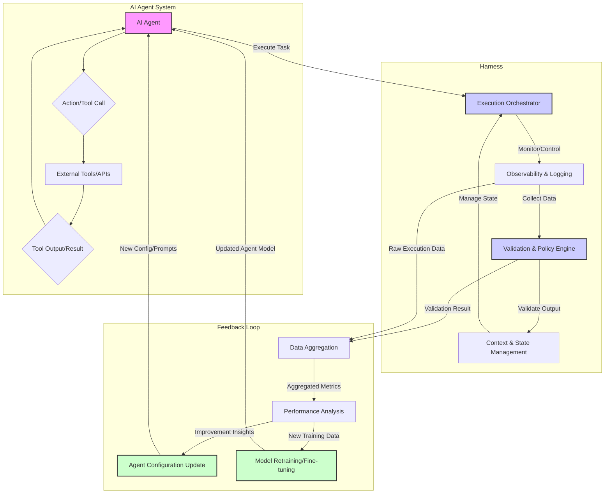

AI 에이전트 개발은 빠른 생산성만큼 품질과 신뢰성 확보에 새로운 도전을 제기한다. '하네스 엔지니어링 (Harness Engineering)'과 '닫힌 피드백 루프 (Closed Feedback Loop)' 아키텍처는 에이전트 행동과 결과를 제어하고 지속적으로 개선하는 핵심 접근 방식이다.

## AI 에이전트 하네스: 제어 및 통찰

하네스는 AI 에이전트 실행 환경과 상호작용을 제어하며 데이터를 수집 분석하는 프레임워크다. 에이전트의 예상치 못한 행동, 오류, 비효율적 자원 사용을 방지하고, 개발자가 내부 작동을 이해하고 개선할 통찰력을 제공한다.

하네스 엔지니어링은 AI 에이전트 개발부터 운영까지 강력한 제어 메커니즘을 구축하며, 실행 제어, 관측 가능성, 검증 및 평가의 핵심 역할을 수행한다. 주요 구성 요소로는 오케스트레이터, 도구 호출 인터페이스, 로깅/모니터링 시스템, 가드레일/정책 엔진, 검증 모듈 등이 있다.

## 닫힌 피드백 루프 아키텍처

닫힌 피드백 루프는 에이전트 실행 결과가 에이전트 설계, 규칙, 프롬프트, 도구 사용 방식 등을 개선하는 데 활용되는 순환 구조다. 에이전트가 스스로 학습하고 진화할 수 있는 핵심 메커니즘이다.

피드백 루프는 일반적으로 실행, 관측, 분석, 개선의 4단계로 구성된다. 에이전트가 하네스 내에서 작업을 수행하면(실행), 하네스가 실행 과정과 결과를 모니터링하고 데이터를 수집한다(관측). 수집된 데이터를 기반으로 에이전트 성능, 오류 패턴 등을 분석하고(분석), 이 결과를 바탕으로 에이전트 구성(프롬프트, 도구 정의, 가드레일)을 업데이트하거나 모델을 재훈련한다(개선). 이 루프를 통해 에이전트는 경험으로부터 지속 학습하고 성능을 향상하며 견고성을 확보한다. 특히, 설계와 규칙을 구현 컨텍스트 밖에서 검토하는 방식은 에이전트의 전제와 사각지대를 효율적으로 발견하고 개선한다.

## 코드 예시: LLM 출력 검증 파이프라인

LLM 에이전트가 생성한 코드에 대한 정적 분석 및 실패 시 피드백 기록 Python 예시는 닫힌 피드백 루프의 '관측' 및 '분석' 단계 기초를 보여준다。
```python
import subprocess

def run_static_analysis(code_content: str) -> dict:
    """LLM 생성 코드에 flake8 정적 분석 실행."""
    with open("temp_code.py", "w") as f:
        f.write(code_content)
    process = subprocess.run(
        ["flake8", "temp_code.py"],
        capture_output=True, text=True, check=False
    )
    if process.returncode != 0:
        return {"status": "failed", "errors": process.stdout.strip().split("\n")}
    return {"status": "passed", "errors": []}

def process_agent_output(agent_response: dict):
    """에이전트 응답 처리 및 검증 후 피드백 기록."""
    generated_code = agent_response.get("code", "")
    task_id = agent_response.get("task_id", "unknown_task")

    print(f"--- Processing Task ID: {task_id} ---")
    validation_result = run_static_analysis(generated_code)

    if validation_result["status"] == "failed":
        feedback = {
            "task_id": task_id, "status": "failed",
            "errors": validation_result["errors"], "timestamp": "2026-07-20T10:00:00Z"
        }
        print(f"Validation Failed: {feedback['errors']}")
    else:
        print("Validation Passed: No static analysis errors.")

mock_agent_output_good = {
    "task_id": "CODEGEN-001", "code": "def hello_world():\n    print('Hello, world!')\n"
}
mock_agent_output_bad = {
    "task_id": "CODEGEN-002", "code": "def bad_code():\n    x = 10\n    if x == 10:\n        pass\n    y = 20\n"
}

process_agent_output(mock_agent_output_good)
process_agent_output(mock_agent_output_bad)
```

## 아키텍처 다이어그램: 하네스 및 피드백 루프



## 2026년 트렌드와 통합

2026년 AI 에이전트의 자율성 강화와 복잡한 문제 해결이 중시될 것이다. 하네스 및 피드백 루프 아키텍처는 멀티-에이전트 시스템, MLOps, 설명 가능성 (Explainability) 등 트렌드와 통합된다. 이는 여러 에이전트 협력 시 행동 제어 및 시스템 최적화, CI/CD 파이프라인에 자동 테스트/검증 단계 통합, 그리고 상세 실행 로그를 통한 의사 결정 과정 추적에 기여한다.

## 트레이드오프

### 1. 초기 구현 복잡성 vs. 장기적 안정성 및 품질
*   **장점**: 고품질, 안정적인 프로덕션 에이전트 구축 시 유리. 초기 투자로 오류, 비용, 보안 문제 예방.
*   **단점**: 프로토타입, 단기 실험, 실패 비용이 낮은 단순 에이전트의 경우, 개발 속도 저해 가능성.

### 2. 성능 오버헤드 vs. 제어 및 관측 가능성
*   **장점**: 규제 산업, 고위험 애플리케이션, 복잡한 시스템에서 면밀한 모니터링과 제어로 안전성 및 통찰력 제공.
*   **단점**: 저지연 또는 엄격한 비용 제약 환경에서는 추가 오버헤드로 에이전트 반응 속도 저하 가능성.

### 3. 유연성 (Flexibility) vs. 표준화 (Standardization)
*   **장점**: 다양한 에이전트, LLM, 외부 도구 통합 관리하는 엔터프라이즈 환경에서 일관된 개발/운영 및 유지보수 비용 절감.
*   **단점**: 특수하거나 혁신적인 에이전트 아키텍처 실험 시, 표준화된 하네스가 유연성을 제한하고 아이디어 구현에 장애물.

## 실전 체크리스트

AI 에이전트 하네스 및 피드백 루프 아키텍처 적용 시 다음 항목들을 검증한다.

- [ ] 에이전트 `LLM 호출` 및 `외부 도구 사용`이 하네스를 통해 기록되는가?
- [ ] 에이전트 `출력물`에 대한 자동 `품질 검증` 파이프라인이 구축되어 있는가?
- [ ] 검증 실패 시 `피드백 데이터`가 에이전트 `개선`에 활용되는 `폐쇄 루프 메커니즘`이 동작하는가?
- [ ] 하네스가 에이전트의 `실행 시간`, `토큰 사용량`, `API 호출 비용`을 모니터링하고 임계치 초과 시 알림을 발생시키는가?
- [ ] 에이전트가 `샌드박스 환경`에서 실행되며 `불필요한 외부 시스템 접근`이 엄격히 제한되는가?
- [ ] 새로운 에이전트 기능 배포 전 `A/B 테스트` 또는 `카나리 배포`를 지원하는 하네스 기능이 준비되어 있고, `성능 지표`를 자동으로 비교 분석하는가?
- [ ] 에이전트의 `결정 과정` 및 `추론 경로`를 추적할 수 있는 `트레이싱 시스템`이 구현되어 있어 설명 가능성을 지원하는가?