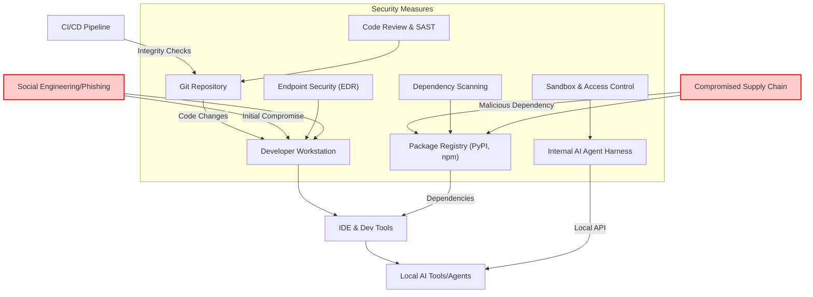

최근 북한의 Binance 공격 사례는 개발 워크스테이션과 내부 AI 도구가 고도화된 다단계 공격의 핵심 표적이 될 수 있음을 명확히 보여주었습니다. 단순 피싱을 넘어 사회공학, 공급망 공격, 개발 도구 변조, 내부 AI 도구 침해 및 단말 장악이 결합된 이러한 공격은 기존 보안 패러다임만으로는 방어하기 어렵습니다. 특히 AI 에이전트와 같은 자동화된 도구가 개발 파이프라인에 깊숙이 통합되면서, 이들에 대한 침해는 전체 시스템의 무결성과 보안에 치명적인 영향을 미칠 수 있습니다. 이 엔트리는 개발 워크스테이션, 공급망, Git 저장소 및 CI/CD 파이프라인, 그리고 내부 AI 도구 전반의 보안 강화 전략을 제시합니다.

## 개발 워크스테이션 보안 강화
개발 워크스테이션은 공격자가 내부 시스템으로 침투하기 위한 초기 거점인 경우가 많습니다. 개발자들이 다양한 도구와 라이브러리를 사용하며 높은 시스템 권한을 가지므로, 철저한 보안 통제가 필수적입니다.

### 엔드포인트 탐지 및 대응 (EDR/XDR)
모든 개발 워크스테이션에 최신 EDR 또는 XDR 솔루션을 배포하여 실시간 위협 탐지 및 대응 능력을 확보해야 합니다. 단순히 시그니처 기반의 안티바이러스 솔루션을 넘어, 행위 기반 분석을 통해 의심스러운 활동을 탐지하고 차단하는 것이 중요합니다.

### 최소 권한 원칙 (Least Privilege)
개발자에게는 필요한 최소한의 권한만 부여하고, 정기적으로 권한을 검토하고 조정해야 합니다. 루트(root) 또는 관리자 권한을 상시 사용하는 것을 지양하고, 필요할 때만 임시적으로 승격하여 사용하도록 정책을 수립합니다.

### 네트워크 세그멘테이션 및 마이크로 세그멘테이션
개발 워크스테이션을 일반 사무망과 분리하고, 내부망에서도 개발 환경별로 네트워크를 세그멘테이션하여 공격 확산을 최소화합니다. 중요한 AI 개발 환경은 마이크로 세그멘테이션을 통해 개별 자산 간의 통신을 엄격히 통제할 수 있습니다.

### 보안 설정 관리 및 패치 관리
운영체제, IDE, 개발 도구의 보안 설정을 강화하고, 모든 소프트웨어에 대한 최신 보안 패치를 신속하게 적용하는 자동화된 시스템을 구축합니다.

## 공급망 공격 방어 체계
Binance 사례에서 `pyenv` 구성요소가 악성 버전으로 교체된 것처럼, 오픈소스 라이브러리나 개발 도구를 통한 공급망 공격은 매우 교활하며 탐지하기 어렵습니다.

### 종속성 스캔 및 무결성 검증
`pnpm`, `npm`, `pip` 등 패키지 관리자를 통해 설치되는 모든 종속성에 대해 정기적으로 취약점 스캔을 수행합니다. 또한, 주요 개발 도구 및 라이브러리의 해시값을 관리하고, 설치 시마다 무결성을 검증하는 프로세스를 자동화합니다.

예시: `pyenv` 핵심 구성요소 무결성 검증 스크립트
```bash
#!/bin/bash
PYENV_ROOT="${PYENV_ROOT:-$HOME/.pyenv}"
PYENV_BIN="$PYENV_ROOT/bin/pyenv"
PYENV_INIT_SCRIPT="$PYENV_ROOT/libexec/pyenv-init"

# Known good SHA256 hashes (Example: these would be securely managed)
# A robust system would fetch these from a trusted, immutable source.
EXPECTED_PYENV_BIN_HASH="a1b2c3d4e5f67890a1b2c3d4e5f67890a1b2c3d4e5f67890a1b2c3d4"
EXPECTED_PYENV_INIT_HASH="f6e5d4c3b2a10987f6e5d4c3b2a10987f6e5d4c3b2a10987f6e5d4c3"

echo "Verifying pyenv integrity..."

# Check pyenv executable
if [ -f "$PYENV_BIN" ]; then
    CURRENT_HASH=$(sha256sum "$PYENV_BIN" | awk '{print $1}')
    if [ "$CURRENT_HASH" != "$EXPECTED_PYENV_BIN_HASH" ]; then
        echo "ERROR: pyenv executable hash mismatch! Expected: $EXPECTED_PYENV_BIN_HASH, Got: $CURRENT_HASH"
        exit 1
    fi
    echo "pyenv executable integrity OK."
else
    echo "ERROR: pyenv executable not found at $PYENV_BIN."
    exit 1
fi

# Check pyenv-init script
if [ -f "$PYENV_INIT_SCRIPT" ]; then
    CURRENT_HASH=$(sha256sum "$PYENV_INIT_SCRIPT" | awk '{print $1}')
    if [ "$CURRENT_HASH" != "$EXPECTED_PYENV_INIT_HASH" ]; then
        echo "ERROR: pyenv-init script hash mismatch! Expected: $EXPECTED_PYENV_INIT_HASH, Got: $CURRENT_HASH"
        exit 1
    fi
    echo "pyenv-init script integrity OK."
else
    echo "ERROR: pyenv-init script not found at $PYENV_INIT_SCRIPT."
    exit 1
fi

echo "Pyenv integrity verification complete."
exit 0
```

### 재현 가능한 빌드 및 Lock File 관리
프로젝트의 모든 종속성은 `pnpm-lock.yaml`, `package-lock.json`, `Pipfile.lock` 또는 `requirements.txt`와 같은 Lock File을 통해 명시적으로 관리하고, CI/CD 환경에서 항상 동일한 버전을 사용하도록 강제합니다. 이를 통해 새로운 종속성 추가나 버전 변경 시 발생할 수 있는 잠재적 위험을 줄일 수 있습니다.

## Git 및 CI/CD 파이프라인 보안
코드 저장소는 소프트웨어의 핵심 자산이자, 악성 코드 주입의 주요 경로가 될 수 있습니다. CI/CD 파이프라인은 최종 배포까지 이어지는 중요한 단계이므로 강력한 보안이 요구됩니다.

### 강화된 코드 검토 (Code Review)
모든 코드 변경사항에 대해 최소 2인 이상의 코드 검토를 의무화하고, 특히 외부 기여나 민감한 부분의 변경은 더욱 면밀히 검토합니다. AI 에이전트가 생성한 코드 역시 예외 없이 인간의 검토를 거쳐야 합니다.

### CI/CD 환경 격리 및 최소 권한
CI/CD 빌드 에이전트는 격리된 환경에서 실행되어야 하며, 불필요한 네트워크 접근이나 외부 시스템과의 통신은 차단합니다. 각 CI/CD 파이프라인 단계별로 필요한 최소한의 권한만 부여하여 공격 표면을 줄입니다.

### Git Hooks를 통한 사전 검증
Pre-commit, Pre-push 등의 Git Hooks를 활용하여 코드 스타일 검사, 정적 분석, 민감 정보 노출 검사 등을 자동화하여 악성 코드가 저장소에 유입되기 전에 차단합니다.

## 내부 AI 도구 및 에이전트 하네스 보안
AI 에이전트 및 이를 제어하는 하네스(Harness) 시스템은 개발 파이프라인의 중요한 구성 요소가 되고 있습니다. 이들의 침해는 코드 생성, 배포, 심지어 운영 환경에까지 직접적인 영향을 미 미칠 수 있습니다.

### 샌드박싱 및 격리 (Sandboxing and Isolation)
내부 AI 도구나 에이전트 하네스가 코드를 실행하거나 외부 도구와 상호작용할 때, 샌드박스 환경에서 실행되도록 구성합니다. 이를 통해 잠재적인 악성 코드 실행이나 데이터 유출 시 피해 범위를 최소화합니다. Docker, gVisor, Firecracker와 같은 기술을 활용할 수 있습니다.

### 엄격한 접근 제어 (Access Control)
AI 도구의 API 및 데이터에 대한 접근은 역할 기반 접근 제어 (RBAC)를 통해 엄격하게 관리합니다. 누가 어떤 AI 도구에 접근할 수 있는지, 어떤 작업을 수행할 수 있는지 명확히 정의하고 모니터링합니다.

### 입력/출력 유효성 검증 (Input/Output Validation)
AI 도구에 전달되는 모든 입력(프롬프트, 코드, 데이터)과 도구에서 생성되는 모든 출력에 대해 철저한 유효성 검증을 수행합니다. 프롬프트 인젝션, 악성 코드 생성과 같은 위협에 대비해야 합니다.

### 감사 및 로깅 (Auditing and Logging)
모든 AI 도구의 활동, 특히 중요한 코드 변경, 시스템 접근, 외부 API 호출 등에 대한 상세한 로깅을 구현하고, 이를 중앙 집중식 로깅 시스템으로 전송하여 보안 관제 및 이상 탐지에 활용합니다.

다음은 AI 개발 환경 전반의 보안 강화 개념을 도식화한 다이어그램입니다.



## 트레이드오프

1.  **개발 속도 vs. 보안 강도**: 보안 통제는 개발 플로우에 마찰(friction)을 일으켜 개발 속도를 저하시킬 수 있습니다. 하지만 고도화된 공격으로 인한 시스템 침해 비용은 훨씬 크므로, 적절한 균형점을 찾는 것이 중요합니다.
    *   **언제 좋은가**: 민감한 데이터나 핵심 시스템을 다루는 프로젝트, 보안 사고 시 파급 효과가 큰 경우. 규제 준수가 중요한 산업.
    *   **언제 나쁜가**: 빠르게 프로토타입을 만들거나 초기 아이디어를 검증해야 하는 단계, 보안 요구사항이 비교적 낮은 비핵심 프로젝트.

2.  **사용자 편의성 vs. 통제**: 개발자의 자유로운 환경 구성과 중앙 집중식 통제 사이에는 상충 관계가 존재합니다. 지나친 통제는 개발자의 생산성을 저해하고 우회하려는 시도를 유발할 수 있습니다.
    *   **언제 좋은가**: 보안 일관성을 유지하고 자동화된 거버넌스를 통해 잠재적 위험을 줄일 때. 표준화된 환경에서 일할 때.
    *   **언제 나쁜가**: 특정 개발 작업에 특수한 환경 설정이 필요하거나, 창의적인 실험이 중요한 경우.

3.  **리소스 오버헤드 vs. 탐지 능력**: EDR, SAST, DAST와 같은 보안 도구는 시스템 리소스를 소모하며, 과도한 검사는 개발 워크스테이션 및 CI/CD 파이프라인의 성능 저하를 야기할 수 있습니다.
    *   **언제 좋은가**: 탐지율과 대응 속도가 중요하고, 인프라 확장에 대한 투자 여력이 있는 경우.
    *   **언제 나쁜가**: 리소스 제약이 심하거나, 성능 저하가 직접적인 서비스 품질 문제로 이어지는 경우.

4.  **자동화된 검증 vs. 수동 심층 분석**: 대부분의 보안 검증은 자동화된 도구로 수행되지만, 정교한 사회공학 공격이나 제로데이 취약점은 인간의 심층적인 수동 분석과 전문 지식을 요구합니다.
    *   **언제 좋은가**: 반복적이고 표준화된 보안 검사를 효율적으로 수행하고 일관성을 유지할 때.
    *   **언제 나쁜가**: 복잡한 비즈니스 로직 취약점, 제로데이 공격, 또는 창의적인 공격 시나리오에 대한 방어가 필요할 때.

## 실전 체크리스트

- [ ] 모든 개발 워크스테이션에 EDR/XDR 솔루션이 배포되었으며, 실시간 위협 탐지 및 대응 정책이 활성화되었는가?
- [ ] CI/CD 파이프라인에서 모든 코드 변경에 대해 정적/동적 분석 (SAST/DAST) 및 종속성 취약점 스캔이 자동 수행되고, 임계값 초과 시 빌드 실패로 이어지는가?
- [ ] 모든 내부 AI 도구 및 에이전트 하네스에 대한 최소 권한 (Least Privilege) 원칙이 적용되었으며, 접근 제어 (RBAC)가 엄격하게 구성되었는가?
- [ ] 주요 개발 환경 구성 요소 (예: `pyenv`, `npm`, `git` 클라이언트 등)의 무결성을 정기적으로 검증하는 자동화된 프로세스가 구축되었는가?
- [ ] 공급망 공격 방어를 위해 프로젝트 종속성 (dependency)의 출처를 검증하고, Lock File을 통해 버전을 고정하는 정책이 전사적으로 적용되었는가?
- [ ] 내부 AI 도구의 코드 실행 환경이 격리 (sandboxing)되어 있으며, 외부 시스템과의 통신이 화이트리스트 기반으로 엄격하게 통제되는가?
- [ ] 개발자를 대상으로 하는 소셜 엔지니어링 및 최신 보안 위협 (예: 가짜 채용 면접) 방어 훈련 및 보안 교육이 정기적으로 이루어지고, 그 효과를 측정하는가?