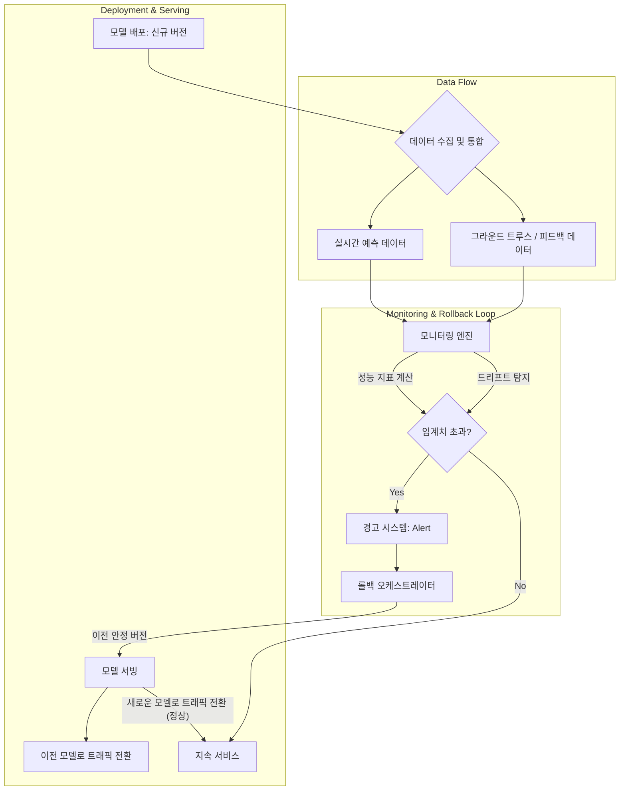

AI 모델이 프로덕션 환경에 배포된 후에도 지속적인 안정성과 신뢰성을 유지하기 위해서는 강력한 MLOps 전략이 필수적입니다. 단순히 모델을 배포하는 것을 넘어, 모델의 성능을 실시간으로 감시하고 문제가 발생할 경우 자동으로 이전 버전으로 되돌리는 시스템은 비즈니스 연속성과 사용자 신뢰를 확보하는 핵심 요소입니다. 데이터 드리프트(Data Drift), 컨셉 드리프트(Concept Drift), 모델 성능 저하(Model Degradation)와 같은 예측 불가능한 문제들은 AI 모델의 가치를 빠르게 떨어뜨릴 수 있습니다. 이러한 위험을 사전에 방지하고 신속하게 대응하기 위해 지속적인 성능 모니터링 및 자동 롤백 시스템 구축은 필수적인 패턴으로 자리 잡았습니다.

## 핵심 개념: 성능 모니터링 및 드리프트 탐지

AI 모델의 '건강'을 파악하기 위한 모니터링은 크게 두 가지 축으로 진행됩니다.

### 1. 모델 성능 지표(Performance Metrics)

모델의 예측 품질을 측정하는 지표들입니다. 비즈니스 목표와 직결되는 핵심 지표들을 선정하는 것이 중요합니다.

*   **정확도(Accuracy), 정밀도(Precision), 재현율(Recall), F1-Score**: 분류(Classification) 모델의 기본적인 성능 지표입니다.
*   **AUC-ROC(Area Under the Receiver Operating Characteristic Curve)**: 분류 모델의 전반적인 성능을 나타내며, 특히 불균형 데이터셋에서 유용합니다.
*   **RMSE(Root Mean Squared Error), MAE(Mean Absolute Error)**: 회귀(Regression) 모델의 예측 오차를 측정합니다.
*   **레이턴시(Latency), 처리량(Throughput)**: 모델 서빙 인프라의 운영 성능 지표입니다. 2026년에는 이 지표들이 모델의 실시간 응답성 및 사용자 경험에 미치는 영향이 더욱 강조됩니다.
*   **비즈니스 KPI(Key Performance Indicators)**: 모델의 예측이 실제 비즈니스에 미치는 영향(예: 전환율, 사용자 이탈률, 클릭률)을 직접 측정하여 모델의 가치를 평가합니다.

### 2. 드리프트(Drift) 탐지

모델의 입력 데이터 또는 데이터와 타겟 변수 간의 관계 변화를 탐지하는 것이 중요합니다.

*   **데이터 드리프트(Data Drift)**: 모델의 입력 데이터 분포가 학습 데이터와 달라지는 현상입니다. 이는 새로운 트렌드, 외부 환경 변화, 데이터 수집 시스템의 변경 등으로 발생할 수 있습니다. 예를 들어, 특정 피처의 평균값이 갑자기 변하거나 분포 형태가 달라지는 것을 감지합니다.
*   **컨셉 드리프트(Concept Drift)**: 입력 데이터와 타겟 변수 간의 관계(모델이 학습한 패턴) 자체가 변하는 현상입니다. 사용자의 행동 패턴 변화, 시장의 동적인 변화 등이 원인이 됩니다. 이는 모델 성능 저하의 직접적인 원인이 됩니다.
*   **모델 드리프트(Model Drift) / 성능 저하**: 시간에 따라 모델의 예측 성능 지표가 점진적 또는 급격하게 떨어지는 현상입니다. 데이터 드리프트나 컨셉 드리프트의 결과로 나타날 수 있습니다.
*   **XAI (Explainable AI) 연계**: 2026년 트렌드에서는 단순히 드리프트를 감지하는 것을 넘어, XAI 기술을 활용하여 어떤 피처가 모델 성능 저하에 가장 큰 영향을 미쳤는지 설명하는 기능이 중요해지고 있습니다. 이는 근본 원인 분석(Root Cause Analysis)을 가속화합니다.

## 아키텍처 패턴: 자동 롤백 시스템 구축

자동 롤백 시스템은 다음과 같은 구성 요소들이 유기적으로 결합되어 동작합니다.



1.  **데이터 수집 및 통합(Data Ingestion & Integration)**: 프로덕션 환경에서 모델의 입력 데이터, 예측 결과, 그리고 실제 레이블(Ground Truth) 또는 사용자 피드백 데이터를 지속적으로 수집합니다. 데이터 웨어하우스, 메시지 큐(Kafka, Kinesis) 등을 활용합니다.
2.  **모니터링 엔진(Monitoring Engine)**: 수집된 데이터를 기반으로 핵심 성능 지표 및 드리프트 지표를 실시간 또는 배치로 계산합니다. 기준선(Baseline)과 비교하여 이상 징후를 탐지하며, 통계적 검정(Statistical Tests)을 통해 유의미한 변화를 식별합니다. Prometheus, Grafana, Datadog 또는 MLOps 플랫폼 내장 모니터링 기능을 활용할 수 있습니다.
3.  **경고 시스템(Alerting System)**: 모니터링 엔진에서 설정된 임계치(Threshold)를 초과하거나 드리프트가 감지되면 즉시 관련 팀에게 알림을 보냅니다. Slack, PagerDuty, Email 등을 통해 통합됩니다.
4.  **롤백 오케스트레이터(Rollback Orchestrator)**: 경고 시스템으로부터 롤백 트리거를 받으면, 사전에 정의된 롤백 정책에 따라 모델 서빙 환경을 이전의 안정적인 버전으로 되돌립니다. 쿠버네티스(Kubernetes) 기반 환경에서는 Deployment 리소스의 `rollout undo` 명령 등을 활용할 수 있으며, 서비스 메시(Service Mesh)를 통해 트래픽을 제어합니다. 또한, 모델 레지스트리(Model Registry)와 연동하여 정확한 이전 버전을 가져오는 것이 중요합니다.

### 구현 패턴: Canary Deployment 및 Automated Validation

*   **Canary Deployment**: 새로운 모델 버전을 전체 트래픽의 작은 비율(예: 5%)에만 노출시키고, 이 '카나리' 그룹의 성능을 집중적으로 모니터링합니다. 만약 카나리 모델의 성능이 기준선보다 떨어지면 즉시 자동 롤백을 수행하여 전체 서비스에 미치는 영향을 최소화합니다.
*   **A/B Testing**: 두 개 이상의 모델 버전을 동시에 운영하며, 각 버전의 성능 지표를 비교하여 더 나은 모델을 선택합니다. 특정 기간 동안 신규 모델의 성능이 열위할 경우 자동으로 롤백됩니다.
*   **Automated Validation**: 모델 배포 전에도 일련의 자동화된 테스트와 유효성 검사(Latency, Output consistency, Data schema validation)를 수행하여 기본적인 안정성을 확보합니다. 이는 롤백이 필요한 상황 자체를 줄이는 데 기여합니다.

### 코드 예시: 간단한 성능 모니터링 및 롤백 로직 (Python pseudo-code)

```python
import time
import random

def get_current_model_performance():
    # 실제 모델 서빙 환경에서 성능 지표를 가져오는 함수 (예: Prometheus API 호출)
    # 여기서는 시뮬레이션된 성능 반환
    current_accuracy = random.uniform(0.85, 0.95)
    current_latency = random.uniform(50, 150)
    return {"accuracy": current_accuracy, "latency": current_latency}

def deploy_model(version):
    print(f"[Deployer] Deploying model version: {version}")
    # 실제 모델 배포 로직 (예: Kubernetes Deployment 업데이트, Sagemaker Endpoint 업데이트)
    time.sleep(2) # 배포 시간 시뮬레이션
    print(f"[Deployer] Model version {version} deployed.")

def rollback_model(stable_version):
    print(f"[Rollbacker] Performance degraded. Initiating rollback to stable version: {stable_version}")
    # 실제 롤백 로직 (예: Kubernetes `kubectl rollout undo`) 
    # 또는 이전 안정 버전으로 트래픽 전환
    deploy_model(stable_version) # 이전 안정 버전 재배포 또는 트래픽 전환
    print(f"[Rollbacker] Rollback to version {stable_version} completed.")

if __name__ == "__main__":
    current_model_version = "v1.2.0"
    stable_model_version = "v1.1.0" # 이전 안정 버전
    
    deploy_model(current_model_version)

    baseline_accuracy = 0.90
    accuracy_threshold_drop = 0.03 # 정확도 3% 이상 하락 시 롤백
    latency_threshold_increase = 100 #ms # 레이턴시 100ms 이상 증가 시 롤백

    print("\n[Monitor] Starting continuous monitoring...")
    while True:
        performance = get_current_model_performance()
        current_accuracy = performance["accuracy"]
        current_latency = performance["latency"]

        print(f"  Current Performance: Accuracy={current_accuracy:.3f}, Latency={current_latency:.1f}ms")

        if current_accuracy < (baseline_accuracy - accuracy_threshold_drop):
            print(f"  ALERT: Accuracy dropped below threshold! ({current_accuracy:.3f} < {baseline_accuracy - accuracy_threshold_drop:.3f})")
            rollback_model(stable_model_version)
            break
        
        if current_latency > latency_threshold_increase:
            print(f"  ALERT: Latency increased above threshold! ({current_latency:.1f}ms > {latency_threshold_increase:.1f}ms)")
            rollback_model(stable_model_version)
            break

        time.sleep(10) # 10초마다 모니터링
```

## 트레이드오프

지속적인 성능 모니터링 및 자동 롤백 시스템 구축은 여러 장점을 제공하지만, 고려해야 할 트레이드오프도 존재합니다.

*   **모니터링의 상세함(Granularity) vs. 운영 오버헤드(Operational Overhead)**
    *   **언제 좋은가?**: 모든 피처의 분포 변화, 세밀한 성능 지표를 실시간으로 추적하면 문제 발생 시 근본 원인 분석에 매우 유리합니다.
    *   **언제 나쁜가?**: 너무 상세한 모니터링은 데이터 수집, 저장, 처리 비용을 증가시키고 모니터링 시스템 자체의 복잡성과 부하를 높여 배보다 배꼽이 더 커지는 상황을 초래할 수 있습니다. 특히 리소스가 제한된 환경에서는 부담이 큽니다.

*   **자동 롤백의 즉각성(Immediacy) vs. 오탐(False Positive) 위험**
    *   **언제 좋은가?**: 임계치 초과 즉시 자동 롤백을 수행하면 치명적인 비즈니스 손실을 최소화하고 사용자 경험 저하를 빠르게 막을 수 있습니다.
    *   **언제 나쁜가?**: 너무 민감한 임계치 설정은 일시적인 네트워크 문제, 데이터 이상치(Outlier), 또는 경미한 성능 변동에도 오탐을 발생시켜 불필요한 롤백을 유발할 수 있습니다. 이는 시스템 안정성을 저해하고 운영 팀의 피로도를 높입니다.

*   **전체 롤백(Full Rollback) vs. 카나리 롤백(Canary Rollback)**
    *   **언제 좋은가?**: 심각한 장애 상황에서는 전체 트래픽을 이전 안정 버전으로 빠르게 전환하는 전체 롤백이 효과적입니다. 빠른 복구가 최우선인 경우에 유리합니다.
    *   **언제 나쁜가?**: 신규 모델의 잠재적 위험을 완전히 파악하기 전에 전체 롤백을 결정하면, 실제로는 문제가 없었을 수 있는 신규 기능의 혜택을 놓치거나, 잦은 전체 롤백으로 인해 서비스의 변화 주기가 불안정해질 수 있습니다.

*   **룰 기반(Rule-based) 트리거 vs. 적응형(Adaptive) 트리거**
    *   **언제 좋은가?**: 명확한 성능 하락 기준이 있고, 안정성이 최우선인 경우 고정된 룰 기반 임계치는 예측 가능하고 제어하기 쉽습니다.
    *   **언제 나쁜가?**: 비즈니스 환경이 동적으로 변하고 모델 성능이 자연스럽게 진동하는 경우, 고정된 룰은 너무 잦은 경고를 발생시키거나 실제 문제를 놓칠 수 있습니다. 적응형(머신러닝 기반) 임계치 설정은 복잡도가 높습니다.

## 실전 체크리스트

AI 모델 지속 모니터링 및 자동 롤백 시스템을 성공적으로 구축하고 운영하기 위한 실전 체크리스트입니다.

*   [ ] **핵심 성능 지표(KPI) 정의**: 비즈니스 목표와 직결되는 3~5가지 핵심 지표를 명확히 정의하고 측정 기준을 확립했는가?
*   [ ] **성능 기준선(Baseline) 및 임계치 설정**: 모델의 정상 작동 상태 기준선과, 롤백을 트리거할 구체적인 성능 저하 임계치 및 드리프트 임계치를 설정했는가? (예: `Accuracy < 0.85` 또는 `KL-Divergence > 0.1`)
*   [ ] **데이터 수집 파이프라인 자동화**: 모델 입력, 예측 결과, 실제 레이블(Ground Truth) 데이터가 안정적으로 수집되고 모니터링 시스템으로 흘러들어가는 자동화된 파이프라인을 구축했는가?
*   [ ] **롤백 프로세스 자동화 및 검증**: 성능 저하 감지 시 이전 안정 버전으로 자동으로 전환되는 롤백 스크립트 또는 워크플로우를 구현하고, 스테이징 환경에서 최소 3회 이상 성공적으로 테스트했는가?
*   [ ] **경고 시스템 통합**: 주요 성능 저하 또는 롤백 발생 시 담당 팀에 즉시 알림이 가는 경고 시스템(Slack, PagerDuty 등)을 통합하고 테스트했는가?
*   [ ] **CI/CD 파이프라인 연동**: 모델 배포 및 롤백 워크플로우가 기존 CI/CD 파이프라인에 통합되어 모델 버전 관리가 자동화되고 추적 가능한가?
*   [ ] **모니터링 대시보드 구축 및 정기 검토**: 실시간 성능 지표와 드리프트 추이를 한눈에 볼 수 있는 대시보드를 구축하고, 최소 주 1회 모니터링 설정을 검토하여 개선하고 있는가?
*   [ ] **오탐(False Positive) 분석 및 임계치 조정 프로세스**: 오탐이 발생했을 때 이를 분석하고 임계치를 조정하는 절차가 명확히 수립되어 있는가?
