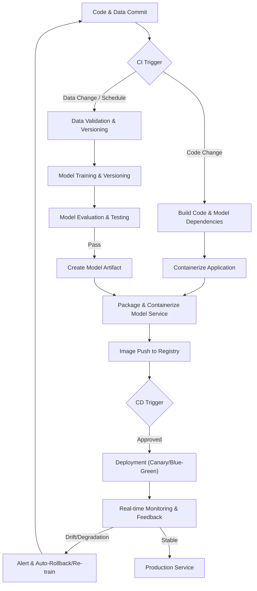

AI 서비스의 안정적인 배포는 단순한 코드 배포를 넘어 데이터, 모델, 그리고 애플리케이션 코드를 아우르는 복합적인 과정을 포함한다. CI/CD (Continuous Integration/Continuous Deployment) 파이프라인은 이러한 AI 서비스의 개발 생산성을 높이고 운영 안정성을 확보하는 핵심 방법론이다. 전통적인 소프트웨어 CI/CD가 코드 변경에 집중한다면, AI/ML 서비스는 데이터 변경, 모델 재학습, 성능 평가 등 추가적인 단계를 요구하여 MLOps (Machine Learning Operations)의 영역으로 확장된다.

### AI 서비스 CI/CD 파이프라인의 주요 단계

1.  **데이터 수집 및 전처리 (Data Ingestion & Preprocessing)**
    *   데이터는 AI 모델의 생명선이다. 새로운 데이터가 유입되거나 기존 데이터가 변경될 때, 이를 자동으로 수집하고 모델 학습에 적합한 형태로 전처리하는 과정이 포함된다. 데이터 유효성 검사, 스키마 검증, 결측치 처리 등이 중요하다.
    *   `git`과 유사한 개념의 데이터 버전 관리 시스템(예: DVC - Data Version Control)을 활용하여 데이터셋의 변경 이력을 추적하고 재현성을 보장한다.

2.  **모델 학습 및 버전 관리 (Model Training & Versioning)**
    *   전처리된 데이터를 바탕으로 모델을 학습하고, 학습된 모델 아티팩트와 학습에 사용된 코드, 파라미터를 함께 버전 관리한다. 이 단계에서는 실험 추적 도구(예: MLflow, Kubeflow)를 사용하여 다양한 실험의 결과를 비교하고 최적의 모델을 선정한다.
    *   CI 시스템은 코드 변경, 데이터 변경 또는 스케줄에 따라 모델 학습을 트리거할 수 있다.

3.  **모델 평가 및 검증 (Model Evaluation & Validation)**
    *   학습된 모델은 배포 전에 엄격한 평가 과정을 거친다. 전통적인 소프트웨어 테스트처럼 단위 테스트, 통합 테스트, 시스템 테스트를 포함하며, AI 모델 특유의 성능 메트릭(Accuracy, Precision, Recall, F1-Score), 공정성(Fairness) 지표, 그리고 잠재적 편향(Bias)에 대한 검증이 필수적이다.
    *   새로운 모델이 기존 프로덕션 모델보다 성능이 우수한지, 또는 특정 기준치를 만족하는지 자동으로 판단하는 게이트를 설정한다.

4.  **모델 패키징 및 컨테이너화 (Model Packaging & Containerization)**
    *   검증된 모델은 추론(Inference)을 위한 형태로 패키징된다. 일반적으로 모델을 실행할 코드(API 서버), 필요한 라이브러리, 환경 설정 등을 포함하여 Docker 이미지로 컨테이너화한다. 이는 환경 종속성 문제를 해결하고 배포의 일관성을 보장한다.

5.  **배포 (Deployment)**
    *   컨테이너화된 모델 이미지는 스테이징 환경 및 최종 프로덕션 환경에 배포된다. Blue/Green, Canary 배포 전략을 활용하여 무중단 배포 및 위험 최소화를 달성할 수 있다. Kubernetes와 같은 컨테이너 오케스트레이션 도구는 이러한 배포 전략을 효율적으로 관리한다.
    *   `kubectl` 또는 `helm` 명령어를 통해 배포를 자동화한다.

6.  **모니터링 및 피드백 (Monitoring & Feedback)**
    *   배포된 AI 모델은 지속적으로 모니터링되어야 한다. 데이터 드리프트(Data Drift), 컨셉 드리프트(Concept Drift), 모델 성능 저하, 시스템 리소스 사용량 등을 실시간으로 감지하고, 이상 징후 발생 시 자동 롤백 또는 재학습을 트리거하는 피드백 루프를 구축한다. A/B 테스팅을 통해 다양한 모델 버전의 실제 성능을 비교한다.

### CI/CD 파이프라인 예시: GitHub Actions + Docker + Kubernetes

다음은 Python 기반 AI 서비스에 대한 간소화된 GitHub Actions CI/CD 파이프라인 예시이다. `main` 브랜치에 푸시될 때마다 Docker 이미지를 빌드하고, Docker Hub에 푸시한 후, Kubernetes에 배포하는 과정을 자동화한다.

```yaml
name: AI Service CI/CD Pipeline

on: 
  push:
    branches:
      - main

env:
  REGISTRY: docker.io
  IMAGE_NAME: ${{ github.repository }}
  KUBECONFIG_BASE64: ${{ secrets.KUBECONFIG_BASE64 }}
  K8S_NAMESPACE: ai-service

jobs:
  build-and-deploy:
    runs-on: ubuntu-latest
    steps:
      - name: Checkout repository
        uses: actions/checkout@v4

      - name: Set up Docker Buildx
        uses: docker/setup-buildx-action@v3

      - name: Log in to Docker Hub
        uses: docker/login-action@v3
        with:
          username: ${{ secrets.DOCKER_USERNAME }}
          password: ${{ secrets.DOCKER_PASSWORD }}

      - name: Build and push Docker image
        id: docker_build
        uses: docker/build-push-action@v5
        with:
          context: .
          push: true
          tags: ${{ env.REGISTRY }}/${{ env.IMAGE_NAME }}:latest,${{ env.REGISTRY }}/${{ env.IMAGE_NAME }}:${{ github.sha }}
          cache-from: type=gha
          cache-to: type=gha,mode=max

      - name: Install kubectl
        uses: azure/setup-kubectl@v3

      - name: Decode Kubeconfig
        run: |
          mkdir -p ~/.kube
          echo "${{ env.KUBECONFIG_BASE64 }}" | base64 -d > ~/.kube/config
          chmod 600 ~/.kube/config

      - name: Deploy to Kubernetes
        run: |
          kubectl config use-context default
          kubectl apply -f k8s/deployment.yaml -n ${{ env.K8S_NAMESPACE }}
          kubectl set image deployment/ai-service-deployment ai-service-container=${{ env.REGISTRY }}/${{ env.IMAGE_NAME }}:${{ github.sha }} -n ${{ env.K8S_NAMESPACE }}
          kubectl rollout status deployment/ai-service-deployment -n ${{ env.K8S_NAMESPACE }}
          kubectl describe deployment ai-service-deployment -n ${{ env.K8S_NAMESPACE }}
```

`k8s/deployment.yaml` 파일의 예시:
```yaml
apiVersion: apps/v1
kind: Deployment
metadata:
  name: ai-service-deployment
  labels:
    app: ai-service
spec:
  replicas: 2
  selector:
    matchLabels:
      app: ai-service
  template:
    metadata:
      labels:
        app: ai-service
    spec:
      containers:
      - name: ai-service-container
        image: docker.io/your_docker_username/your_repo_name:latest # Placeholder
        ports:
        - containerPort: 8000
---
apiVersion: v1
kind: Service
metadata:
  name: ai-service-service
spec:
  selector:
    app: ai-service
  ports:
    - protocol: TCP
      port: 80
      targetPort: 8000
  type: LoadBalancer
```

### AI CI/CD 파이프라인 플로우


2026년 트렌드에 따라, AI CI/CD는 더욱 자동화되고 지능적인 MLOps 플랫폼과의 통합이 심화될 것이다. AIOps는 CI/CD 파이프라인 자체의 운영과 모니터링에 AI를 적용하여, 배포 실패 예측, 성능 최적화, 보안 위협 감지 등을 자동화하는 방향으로 발전하고 있다. 또한, 모델 드리프트에 대한 실시간 감지 및 자동 재학습/재배포 시스템은 더욱 보편화될 것이다. 서버리스(Serverless) ML 배포는 운영 부담을 줄이고 비용 효율성을 높이는 중요한 전략으로 자리매김할 것으로 예상된다.

---

## 트레이드오프

AI 서비스의 CI/CD 파이프라인 설계 시 여러 가지 트레이드오프를 고려해야 한다.

*   **초기 설정 복잡성 vs. 장기적인 생산성 및 안정성**: 
    *   **언제 좋은가?**: 대규모 AI 프로젝트, 빈번한 모델 업데이트, 다수의 개발자가 협업하는 환경에서 강력한 CI/CD는 반복적인 수동 작업을 제거하고 오류 발생률을 낮춰 장기적으로 개발 생산성과 운영 안정성을 크게 향상시킨다.
    *   **언제 나쁜가?**: 소규모 PoC(Proof of Concept)나 단기 프로젝트의 경우, 복잡한 CI/CD 파이프라인을 구축하는 초기 비용과 시간이 과도하여 프로젝트의 민첩성을 저해할 수 있다.

*   **배포 속도 vs. 검증의 엄격함**: 
    *   **언제 좋은가?**: 금융, 의료 등 높은 신뢰성과 규제 준수가 요구되는 도메인에서는 모델의 정확성, 공정성, 보안을 보장하기 위해 엄격한 다단계 검증 절차가 필수적이다.
    *   **언제 나쁜가?**: 빠른 시장 출시와 잦은 실험이 중요한 초기 스타트업이나 사용자 피드백 기반의 A/B 테스트가 우선되는 서비스에서는 과도한 검증 절차가 배포 속도를 늦춰 시장 기회를 놓칠 수 있다.

*   **범용 CI/CD 도구 활용 vs. ML 특화 MLOps 플랫폼 도입**: 
    *   **언제 좋은가?**: 이미 조직 내에 GitLab CI, GitHub Actions, Jenkins와 같은 범용 CI/CD 도구가 잘 구축되어 있고, AI 서비스의 복잡성이 상대적으로 낮거나 기존 인프라와의 통합이 중요한 경우 비용 효율적이며 학습 곡선이 낮다.
    *   **언제 나쁜가?**: 모델 학습 관리, 데이터 버전 관리, 모델 레지스트리, 모니터링 등 ML 특화 기능이 필요한 대규모 MLOps 환경에서는 MLflow, Kubeflow, Vertex AI와 같은 전용 MLOps 플랫폼이 제공하는 통합된 기능과 확장성이 훨씬 더 효율적이다. 범용 도구만으로는 복잡한 ML 워크플로우를 관리하기 어렵다.

*   **완전 자동화 vs. 인간 개입 (Human-in-the-Loop)**: 
    *   **언제 좋은가?**: 반복적이고 예측 가능한 작업, 명확한 기준에 따라 자동으로 결정될 수 있는 모델 학습 및 배포 단계에서는 완전 자동화가 효율성을 극대화한다.
    *   **언제 나쁜가?**: 민감한 비즈니스 결정, 고위험 서비스, 또는 모델 성능 저하의 원인이 복합적인 경우와 같이 인간의 전문적인 판단이 필요한 단계(예: 모델 윤리 검토, 치명적인 드리프트 발생 시 원인 분석 및 재학습 전략 수립)에서는 인간의 개입이 필수적이다.

---

## 실전 체크리스트

AI 서비스 CI/CD 파이프라인을 구축하거나 개선할 때 다음 항목들을 검토한다.

*   [ ] 모든 학습 데이터셋과 모델 아티팩트가 버전 관리 시스템(예: DVC, MLflow Models)을 통해 추적 가능하며, 특정 모델 버전을 재현할 수 있는지 확인한다.
*   [ ] 모델 학습 및 평가 과정이 CI/CD 파이프라인 내에서 완전히 자동화되어 있으며, 학습 완료 후 핵심 성능 메트릭이 자동으로 기록되고 대시보드에서 시각화되는지 검증한다.
*   [ ] 새로운 모델이 기존 프로덕션 모델 대비 최소 성능 기준(예: Accuracy > 95%, F1-Score 향상 > 2%)을 충족하는지 자동으로 검증하는 게이트(Gate)를 파이프라인에 포함시켰는지 확인한다.
*   [ ] 모델 서빙 애플리케이션이 Docker 이미지로 컨테이너화되어 있으며, Kubernetes 또는 유사한 컨테이너 오케스트레이션 플랫폼을 통해 배포가 자동화되는지 점검한다.
*   [ ] 프로덕션 환경에서 모델의 데이터 드리프트(Data Drift), 컨셉 드리프트(Concept Drift) 및 성능 저하를 실시간으로 모니터링하고, 임계치 초과 시 알림을 발생시키거나 자동 롤백을 트리거하는 시스템을 구축했는지 확인한다.
*   [ ] 배포 실패 또는 모델 성능 저하 발생 시, 신속하게 이전 안정 버전으로 롤백할 수 있는 자동화된 절차가 마련되어 있고 정기적으로 테스트되는지 확인한다.
*   [ ] CI/CD 파이프라인의 각 단계에서 보안 취약점 스캔(코드, 이미지) 및 민감 정보(API 키, 자격 증명) 노출 방지 메커니즘이 적용되어 있는지 확인한다.