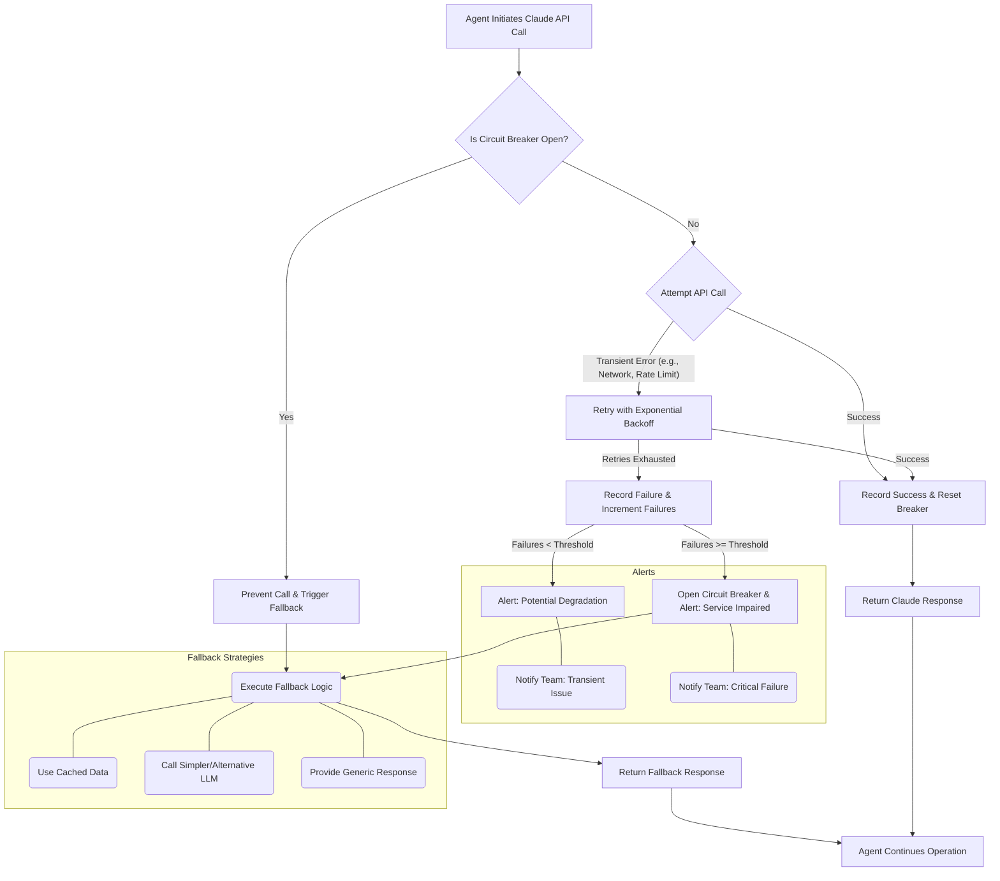

외부 AI 서비스 연동은 AI 에이전트의 핵심 기능이지만, API 장애는 서비스 중단 및 사용자 경험 저하로 직결될 수 있습니다. 특히 Anthropic의 Claude와 같은 고성능 LLM API는 때때로 일시적인 오류, 속도 제한 또는 서비스 중단이 발생할 수 있으므로, 이러한 외부 의존성에 대한 견고한 방어 로직(Defense Logic) 강화는 AI 에이전트의 안정성과 가용성을 확보하는 데 필수적입니다. 본 위키 엔트리는 Claude API 연동 시 발생할 수 있는 오류에 대응하기 위한 재시도(Retry), 서킷 브레이커(Circuit Breaker), 대체 경로(Fallback) 탐색 및 알림(Alerting) 전략을 다룹니다.

## 핵심 방어 로직 패턴

### 1. 즉각적인 재시도 로직 (Immediate Retry Logic)

일시적인 네트워크 문제, 타임아웃, 또는 서비스 부하로 인한 오류는 간단한 재시도로 해결될 수 있습니다. 이때 단순 재시도보다는 지수 백오프(Exponential Backoff)와 지터(Jitter)를 적용하여 재시도 간격을 점진적으로 늘리고 요청이 한꺼번에 몰리는 것을 방지하는 것이 중요합니다. 이는 백엔드 서비스에 추가적인 부담을 주지 않으면서 안정성을 높입니다.

### 2. 서킷 브레이커 패턴 (Circuit Breaker Pattern)

재시도만으로는 해결되지 않는 지속적인 오류는 상위 시스템에 캐스케이딩(Cascading Failure) 오류를 유발할 수 있습니다. 서킷 브레이커는 특정 API의 실패 횟수가 임계치를 넘으면 해당 API 호출을 일시적으로 중단(Open)하여 추가 호출을 막습니다. 일정 시간 후에는 부분적으로 호출을 허용(Half-Open)하여 서비스 복구 여부를 확인하고, 정상화되면 회로를 다시 닫는(Closed) 방식으로 시스템 전반의 안정성을 유지합니다.

### 3. 대체 경로 탐색 및 폴백 (Alternative Path & Fallback)

Claude API가 장시간 사용 불가능하거나 심각한 오류가 발생할 경우, 사전에 정의된 대체 경로를 통해 서비스 연속성을 확보할 수 있습니다. 예를 들어:

*   **다른 LLM 모델 사용**: Claude 대신 Gemini, GPT 등 다른 LLM API로 요청을 라우팅합니다.
*   **로컬 캐시/저장된 응답 활용**: 이전에 생성된 유사한 응답이나 캐시된 데이터를 제공합니다.
*   **간소화된 응답**: 핵심 기능만 제공하거나 사용자에게 현재 서비스가 제한됨을 알리는 메시지를 보냅니다.

### 4. Slack/Telegram 알림 (Proactive Alerting)

재시도 로직과 서킷 브레이커, 대체 경로 탐색으로도 오류가 해결되지 않으면, 이는 심각한 문제일 가능성이 높습니다. 이러한 상황 발생 시 Slack, Telegram 등의 커뮤니케이션 채널을 통해 즉시 담당자에게 알림을 전송하여 신속한 인지 및 수동 개입을 가능하게 합니다. 이는 문제를 시스템이 해결하지 못하더라도 인간의 빠른 대응으로 서비스 복구 시간을 단축하는 데 기여합니다.

## 구현 예제: Python 및 Tenacity 라이브러리 활용

다음 Python 코드는 `tenacity` 라이브러리를 사용하여 재시도 로직을 구현하고, 기본적인 서킷 브레이커 패턴과 폴백 기능을 결합한 예제입니다.

```python
import anthropic
import os
import time
import requests
from tenacity import retry, stop_after_attempt, wait_exponential, retry_if_exception_type

# Assume ANTHROPIC_API_KEY is set in environment variables
client = anthropic.Anthropic(api_key=os.environ.get("ANTHROPIC_API_KEY"))

def get_fallback_response(prompt: str) -> str:
    """Provides a simplified or cached response as a fallback."""
    print("Falling back to a simpler model or cached response...")
    if "code" in prompt.lower():
        return "Fallback: Could not generate code. Please try again later with a simpler request."
    return "Fallback: Service is currently degraded. Please try again shortly."

class ClaudeAPIError(Exception):
    """Custom exception for Claude API failures."""
    pass

class CircuitBreaker:
    """A basic circuit breaker implementation."""
    def __init__(self, failure_threshold: int = 3, recovery_timeout: int = 30):
        self.failure_threshold = failure_threshold
        self.recovery_timeout = recovery_timeout
        self.failures = 0
        self.last_failure_time = None
        self.is_open = False

    def record_success(self):
        self.failures = 0
        self.is_open = False

    def record_failure(self):
        self.failures += 1
        self.last_failure_time = time.time()
        if self.failures >= self.failure_threshold:
            self.is_open = True
            print("Circuit breaker opened due to too many failures.")

    def allow_request(self) -> bool:
        if not self.is_open:
            return True
        
        # In half-open state after recovery_timeout
        if time.time() - (self.last_failure_time or 0) > self.recovery_timeout:
            print("Circuit breaker in half-open state, attempting a trial request.")
            return True 
        
        print("Circuit breaker is open, preventing request.")
        return False

claude_circuit_breaker = CircuitBreaker()

@retry(
    stop=stop_after_attempt(3),
    wait=wait_exponential(multiplier=1, min=4, max=10),
    retry=retry_if_exception_type((ClaudeAPIError, requests.exceptions.RequestException)),
    reraise=True 
)
def call_claude_api(prompt: str) -> str:
    """Calls Claude API with retry logic and circuit breaker."""
    if not claude_circuit_breaker.allow_request():
        raise ClaudeAPIError("Circuit breaker is open, preventing Claude API call.")

    try:
        print(f"Attempting to call Claude API with prompt: '{prompt[:50]}...' ")
        response = client.messages.create(
            model="claude-3-opus-20240229", 
            max_tokens=1024,
            messages=[
                {"role": "user", "content": prompt}
            ]
        )
        if response.stop_reason:
             claude_circuit_breaker.record_success()
             return response.content[0].text
        else:
            raise ClaudeAPIError("Claude API returned an unexpected response format or error.")
    except anthropic.APIError as e:
        print(f"Claude API specific error: {e}")
        claude_circuit_breaker.record_failure()
        raise ClaudeAPIError(f"Claude API failed: {e}")
    except requests.exceptions.RequestException as e:
        print(f"Network or connection error: {e}")
        claude_circuit_breaker.record_failure()
        raise ClaudeAPIError(f"Network error during Claude API call: {e}")
    except Exception as e:
        print(f"An unexpected error occurred: {e}")
        claude_circuit_breaker.record_failure()
        raise ClaudeAPIError(f"Unexpected error: {e}")

def get_claude_response_with_resilience(prompt: str) -> str:
    """Wrapper function to handle Claude API calls with full resilience."""
    try:
        return call_claude_api(prompt)
    except ClaudeAPIError as e:
        print(f"All Claude API retries failed or circuit breaker open. Error: {e}")
        send_alert(f"Critical: Claude API call failed after retries and fallback attempts. Error: {e}")
        return get_fallback_response(prompt)
    except Exception as e:
        send_alert(f"Critical: Unhandled error in Claude API resilience logic. Error: {e}")
        return get_fallback_response(prompt)

def send_alert(message: str):
    """Placeholder for sending alerts to Slack/Telegram."""
    print(f"[ALERT] {message}")

```

## Claude API 장애 방어 로직 흐름



## 트레이드오프

*   **Aggressive Retries**: 재시도 횟수를 늘리면 일시적 오류에 강해지지만, 서비스 장애 시 백엔드에 추가 부하를 주어 장애를 악화시킬 수 있습니다. 특히 짧은 간격의 재시도는 rate limit을 빠르게 초과하게 만듭니다. 안정적인 서비스에서는 재시도로 복구 가능성이 높은 일시적 오류에만 적용하고, 명확한 지수 백오프 및 최대 재시도 횟수를 설정하는 것이 중요합니다.
*   **Circuit Breaker Complexity**: 서킷 브레이커는 시스템 안정성을 높이지만, 구현 및 관리가 복잡합니다. `failure_threshold` 및 `recovery_timeout` 값 설정에 따라 잘못된 시점에 회로가 열리거나 닫힐 수 있으며, 이로 인해 불필요한 폴백이 발생하거나 실제 장애 복구 시도가 지연될 수 있습니다. 시스템의 특성과 예상되는 오류 패턴을 기반으로 신중한 튜닝이 요구됩니다.
*   **Fallback Quality Degradation**: 폴백 전략은 서비스 연속성을 보장하지만, 대체 경로의 응답 품질이 주 경로(Claude API)보다 낮을 수 있습니다. 예를 들어, 다른 LLM을 사용하거나 캐시된 데이터를 제공할 경우, 응답의 정확성, 최신성, 또는 상세함이 떨어질 수 있습니다. 이는 사용자 경험에 직접적인 영향을 미치므로, 어떤 상황에서 어떤 수준의 폴백이 허용 가능한지 명확한 비즈니스 정책이 필요합니다.
*   **Alert Fatigue**: 과도하거나 불필요한 알림은 팀의 알림 피로도를 높여 실제 중요한 문제 발생 시 대응력을 떨어뜨립니다. 알림은 복구 불가능한 임계값에 도달했을 때만 발생하도록 신중하게 설계하고, 경고 수준을 세분화하여 우선순위에 따라 알림 채널을 다르게 설정해야 합니다.

## 실전 체크리스트

프로젝트에 Claude API 장애 방어 로직을 적용할 때 다음 항목들을 검증합니다.

- [ ] Claude API 호출 실패 시 지수 백오프 및 지터(Jitter)를 포함한 재시도 로직이 구현되었는가?
- [ ] 서킷 브레이커 패턴이 도입되어 API 장애 시 시스템 전반의 영향이 최소화되는가? (Open/Half-Open/Closed 상태 전환 로직 포함)
- [ ] 주 Claude API 경로 실패 시 사용할 대체 LLM 모델 또는 로컬 캐시/간소화된 응답 로직이 구현되고 테스트되었는가?
- [ ] 재시도 및 대체 경로로도 복구 불가능한 장애 발생 시 Slack/Telegram 등 지정된 채널로 즉시 알림이 전송되는 시스템이 구축되었는가?
- [ ] Claude API 응답 시간, 오류율, 재시도 횟수, 서킷 브레이커 상태 등 핵심 지표를 실시간으로 모니터링하는 대시보드가 있는가?
- [ ] 주기적인 장애 시뮬레이션(Chaos Engineering) 및 복구 훈련을 통해 구현된 방어 로직의 유효성을 검증하고 있는가?
- [ ] Claude API 호출 전/후, 재시도 및 폴백 로직 실행 단계에서 상세 로깅 전략을 수립하여 장애 발생 시 신속한 원인 분석이 가능한가?