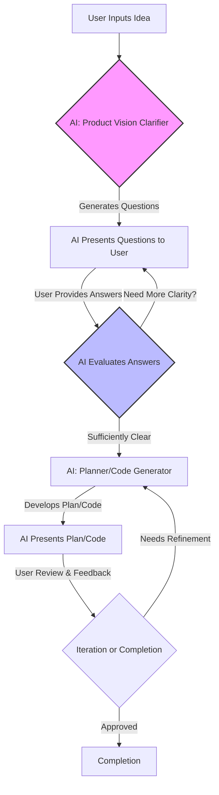

AI 에이전트를 활용한 개발 과정에서, 사용자가 아이디어를 제시하면 AI가 즉시 결과물 생성을 시도하여 초기 기획의 불명확성으로 인한 실패율이 높은 문제가 자주 발생한다. 이는 '무엇을 만들 것인가'보다 '왜 만들어야 하는가'에 대한 충분한 고민 없이 결과물부터 도출하려는 경향 때문이다. 이러한 문제를 해결하기 위해 Claude Code 하네스에 '선 질문 후 기획' (Question-First Planning) 워크플로우를 도입하는 것은 AI 에이전트의 요구사항 이해도와 최종 산출물의 품질을 혁신적으로 개선할 수 있는 전략이다.

## 선 질문 후 기획 워크플로우의 필요성
기존의 AI 기반 개발은 아이디어를 입력하면 AI가 직접적인 구현을 시도하는 방식이 일반적이었다. 하지만 이 방식은 다음과 같은 한계에 직면한다:
1.  **요구사항 불명확성**: 사용자가 제공하는 초기 아이디어는 종종 모호하거나 불완전하여 AI가 잘못된 가정을 기반으로 작업을 수행하게 만든다.
2.  **잦은 수정 및 재작업**: 초기 기획 단계에서 충분한 검증이 이루어지지 않아, 중간 또는 최종 단계에서 큰 폭의 수정이 필요해져 개발 리소스 낭비를 초래한다.
3.  **목표와 결과물의 불일치**: AI가 사용자의 내재된 의도를 정확히 파악하지 못하고 표면적인 요청에만 집중하여, 결과물이 실제 비즈니스 목표와 동떨어질 수 있다.

'선 질문 후 기획' 워크플로우는 AI 에이전트가 아이디어를 받은 후, 즉시 기획이나 구현에 돌입하는 대신, 사용자에게 핵심 질문을 던져 요구사항과 맥락을 능동적으로 구체화하도록 유도한다. 이 과정을 통해 AI는 문제의 본질을 더 깊이 이해하고, 보다 정교하고 사용자 의도에 부합하는 기획을 수립할 수 있게 된다.

## Claude Code 하네스 통합 방안
Claude Code 하네스에 '선 질문 후 기획' 워크플로우를 통합하기 위한 핵심은 메타 프롬프트(Meta-Prompt)와 에이전트의 상호작용 로직 설계에 있다.

### 1. 메타 프롬프트 설계
초기 아이디어 입력 시 AI가 수행할 첫 번째 액션을 '질문'으로 정의한다. 이 메타 프롬프트는 AI에게 사용자의 아이디어를 분석하고, 불확실한 부분이나 중요한 맥락을 파악하기 위한 질문 리스트를 생성하도록 지시한다. 질문은 다음과 같은 범주를 포함할 수 있다:
*   **목표 및 목적**: 이 아이디어를 통해 달성하려는 궁극적인 목표는 무엇인가?
*   **사용자 및 대상**: 누가 이 제품/기능을 사용할 것이며, 그들의 핵심 니즈는 무엇인가?
*   **제약사항**: 예산, 시간, 기술적 제약사항은 무엇인가?
*   **성공 지표**: 이 프로젝트의 성공을 어떻게 측정할 것인가?
*   **핵심 기능**: 반드시 포함되어야 할 핵심 기능은 무엇인가?

```json
{
  "meta_prompt": "Given the user's initial idea, your first task is NOT to plan or generate code. Instead, you must act as a 'Product Vision Clarifier'. Ask 3-5 critical questions to uncover the project's core objectives, target users, key problems to solve, and success metrics. Frame your questions to elicit detailed, unambiguous answers. Once clarified, you will proceed to the planning phase.",
  "initial_idea": "사용자가 입력한 초기 아이디어",
  "next_step": "question_generation"
}
```

### 2. 상호작용 루프 구현
AI가 질문을 생성하면, 이는 사용자에게 전달되어 답변을 유도한다. 이 질문-답변 루프는 요구사항이 충분히 구체화될 때까지 반복될 수 있다. 하네스는 이 상호작용의 상태를 관리하고, 답변의 품질을 평가하여 다음 단계로 진행할지, 추가 질문을 요청할지를 결정한다.



### 3. 허브-워커 자동화 워크플로우 적용
이 패턴을 허브-워커 (Hub-Worker) 자동화 워크플로우에 적용할 경우, 허브 에이전트가 초기 아이디어를 받아 'Product Vision Clarifier' 워커 에이전트에게 위임한다. 워커 에이전트는 질문을 생성하고 사용자 피드백을 수집한 후, 충분한 정보가 모이면 이를 다시 허브 에이전트에게 전달하여 'Planner' 또는 'Code Generator' 워커 에이전트에게 작업을 재위임한다.

이 과정에서 LLM 에이전트가 단독으로 작업을 진행하는 것이 아니라, 사용자와의 협업을 통해 점진적으로 요구사항을 명확히 하고, 이를 바탕으로 고품질의 기획 및 구현을 수행하게 된다.

## 트레이드오프

### 1. 초기 지연 (Initial Latency)
*   **언제 좋은가**: 프로젝트 초기에 요구사항이 불명확하거나 복잡할 때, 혹은 비즈니스 목표와 긴밀하게 연결되어야 하는 경우. 잘못된 방향으로의 진행을 막아 장기적으로 개발 시간과 비용을 절감한다.
*   **언제 나쁜가**: 간단하고 명확한 요구사항을 가진 소규모 작업이나, 빠른 프로토타이핑을 통해 즉각적인 결과물을 보고자 할 때. 초기 질문-답변 과정이 불필요한 오버헤드가 될 수 있다.

### 2. 사용자 개입 증가 (Increased User Interaction)
*   **언제 좋은가**: AI가 사용자의 의도를 정확히 파악하는 것이 중요하고, 사용자가 기획 과정에 적극적으로 참여할 의향이 있을 때. 최종 결과물에 대한 사용자 만족도를 높일 수 있다.
*   **언제 나쁜가**: 사용자가 바쁘거나, AI에게 완전히 자율적인 처리를 기대하여 개입을 최소화하고자 할 때. 추가적인 질문 응답이 부담으로 작용할 수 있다.

### 3. 기획 품질 향상 (Improved Planning Quality)
*   **언제 좋은가**: 복잡하거나 중요한 프로젝트에서 초기 기획 단계의 오류가 전체 프로젝트에 미치는 영향이 클 때. 더 견고하고 통찰력 있는 기획을 보장한다.
*   **언제 나쁜가**: 이미 완벽하게 정의된 스펙(specification)이 있거나, AI가 사전에 충분한 학습 데이터를 통해 해당 도메인에 대한 깊은 이해를 가지고 있을 때. 기획 개선 효과가 미미할 수 있다.

### 4. 하네스 설계 복잡성 증가 (Increased Harness Design Complexity)
*   **언제 좋은가**: 에이전트의 자율성과 신뢰성을 장기적으로 향상시키고자 할 때. 명확한 상호작용 모델을 통해 에이전트의 '생각' 과정을 투명하게 만들 수 있다.
*   **언제 나쁜가**: 단순한 스크립트 실행이나 단일 작업 처리만을 목적으로 하는 경우. 추가적인 상태 관리 및 상호작용 로직 구현이 불필요한 복잡성을 더한다.

## 실전 체크리스트

'선 질문 후 기획' 워크플로우를 Claude Code 하네스에 도입하기 위한 실전 체크리스트는 다음과 같다:

- [ ] **메타 프롬프트 정의**: 초기 아이디어를 받았을 때, AI가 최소 3개 이상의 핵심 질문을 생성하도록 유도하는 메타 프롬프트가 명확하게 정의되었는가?
- [ ] **질문 범주화 및 우선순위**: 생성된 질문들이 프로젝트의 목표, 사용자, 제약사항, 성공 지표 등을 포괄하며, 중요도에 따라 적절히 분류 및 정렬되는가?
- [ ] **상호작용 루프 구현**: AI가 질문을 제시하고 사용자 답변을 받는 상호작용 루프가 끊김 없이 동작하며, 답변의 깊이를 평가하여 추가 질문 필요 여부를 판단하는 로직이 구현되었는가?
- [ ] **질문-답변 이력 관리**: 질문과 답변의 모든 이력이 Claude Code 하네스 내에서 지속적으로 기록되고, 다음 기획 단계의 컨텍스트로 활용될 수 있는가?
- [ ] **허브-워커 연동 테스트**: 허브 에이전트가 '질문 생성' 워커에게 작업을 위임하고, 워커가 충분한 정보를 수집한 후 허브에게 '기획' 작업을 재위임하는 엔드투엔드 워크플로우가 성공적으로 테스트되었는가?
- [ ] **사용자 피드백 메커니즘**: 사용자가 AI의 질문에 대해 명확하지 않거나 부적절하다고 판단할 경우, 이를 피드백할 수 있는 간소화된 채널이 마련되었는가?
- [ ] **최종 기획 산출물 검증**: 질문-답변 과정을 거쳐 생성된 최종 기획(예: 와이어프레임, 상세 기능 목록)이 초기 아이디어만으로 생성된 기획보다 구체성, 일관성, 목표 부합도 측면에서 명확히 개선되었는가?