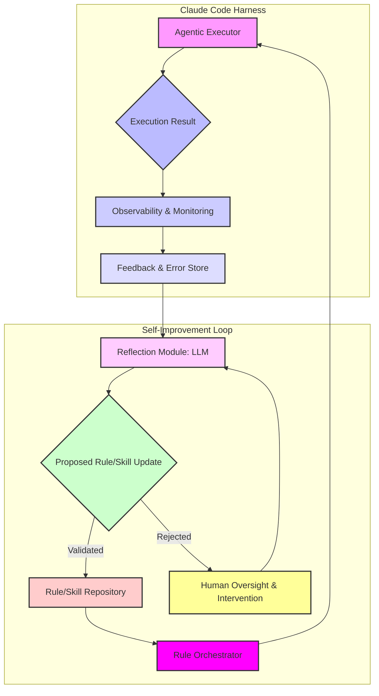

## Claude Code 하네스 자기 개선: 피드백 루프 통합

대규모 언어 모델(LLM) 기반 에이전트, 특히 Claude와 같은 코드 생성 및 분석 에이전트를 활용하는 과정에서, 초기에는 효율적인 하네스(Harness) 시스템이 생산성을 극대화합니다. 그러나 시간이 지남에 따라 에이전트의 규칙(rules)과 스킬(skills)이 비선형적으로 증가하며, 특정 오류 패턴이 반복되거나 새로운 제약 조건이 발생하게 됩니다. 이러한 문제에 대응하기 위해 `oh-my-ouroboros`와 같은 프로젝트에서 영감을 받은 자기 개선(Self-Improvement) 피드백 루프의 통합은 필수적인 전략으로 부상하고 있습니다. 이 패턴은 에이전트가 자신의 실행 결과와 외부 피드백을 통해 학습하고, 스스로 규칙을 다듬어 점진적으로 성능을 향상시키도록 합니다.

### 핵심 개념: 자기 다듬기(Self-Refinement) 피드백 루프

자기 개선 피드백 루프는 크게 다음 단계로 구성됩니다:

1.  **관찰 (Observation)**: Claude Code 하네스의 실행 결과를 모니터링합니다. 여기에는 성공적인 코드 생성, 테스트 실패, 런타임 에러, 비용 초과, 그리고 인간의 직접적인 검토 피드백 등이 포함됩니다.
2.  **반성 (Reflection)**: 관찰된 데이터를 기반으로 에이전트가 자신의 행동과 규칙을 분석합니다. 특정 에러가 반복되는 원인, 비효율적인 코드 생성 패턴, 혹은 새로운 요구사항과의 불일치 등을 식별합니다.
3.  **규칙/스킬 생성 및 업데이트 (Rule/Skill Generation & Update)**: 반성(Reflection) 결과에 따라 에이전트는 기존 규칙을 수정하거나 새로운 규칙을 생성합니다. 예를 들어, 특정 API 호출에서 발생하는 오류를 방지하기 위한 가드레일(guardrail)을 추가하거나, 특정 코드 스타일을 강제하는 프롬프트 지침을 강화할 수 있습니다.
4.  **통합 (Integration)**: 새롭게 생성되거나 업데이트된 규칙과 스킬을 Claude Code 하네스에 통합하여 다음 실행부터 적용되도록 합니다. 이 과정은 자동화된 테스트와 검증을 동반하여 의도치 않은 회귀(regression)를 방지해야 합니다.

이러한 순환적인 과정은 마치 '오보로스(Ouroboros)'처럼 스스로를 먹고 자라나는 형태를 띠며, 에이전트가 외부 개입 없이도 지속적으로 발전할 수 있는 기반을 마련합니다. 2026년 현재, 이러한 자기 개선 메커니즘은 복잡하고 변화무쌍한 실제 환경에서 LLM 에이전트의 안정성과 효율성을 보장하는 핵심 요소로 자리 잡고 있습니다.

### 시스템 아키텍처

자기 개선 피드백 루프를 통합하기 위한 Claude Code 하네스의 일반적인 아키텍처는 다음과 같습니다.



*   **Agentic Executor**: 실제 Claude Code를 실행하고 작업을 수행하는 핵심 모듈입니다.
*   **Observability & Monitoring**: 실행 중 발생하는 모든 이벤트, 로그, 에러, 비용 데이터를 수집합니다.
*   **Feedback & Error Store**: 수집된 데이터를 영구적으로 저장하여 Reflection Module이 분석할 수 있도록 합니다. 이는 벡터 데이터베이스, RDBMS, 혹은 객체 스토리지 등이 될 수 있습니다.
*   **Reflection Module**: LLM을 활용하여 저장된 피드백 및 에러 데이터를 분석하고, 개선 방안을 도출합니다. 이는 새로운 프롬프트 템플릿, 코드 생성 가이드라인, 또는 에러 처리 로직 등이 될 수 있습니다.
*   **Rule/Skill Repository**: 에이전트가 사용하는 모든 규칙과 스킬을 버전 관리하며 저장합니다. 이는 Git 리포지토리, 설정 파일, 혹은 전용 데이터베이스가 될 수 있습니다.
*   **Rule Orchestrator**: Repository에서 최신 규칙을 로드하여 Agentic Executor에 주입하는 역할을 합니다.
*   **Human Oversight & Intervention**: 자동화된 개선 프로세스가 실패하거나, 중요한 업데이트가 필요한 경우 인간이 개입하여 문제를 해결하고 새로운 지침을 제공합니다.

### 코드 예제: 간단한 에러 기반 규칙 업데이트

다음은 Python으로 구현된 매우 단순화된 예제로, 특정 에러 메시지를 감지하여 `rule_store.py` 파일에 새로운 '금지 키워드' 규칙을 추가하는 시나리오를 보여줍니다. 실제 시스템에서는 훨씬 더 복잡한 파싱, LLM 추론, 검증 과정이 필요합니다.

```python
import json
import os

def load_rules(file_path="rule_store.py"):
    if not os.path.exists(file_path):
        return {"forbidden_keywords": [], "guidelines": []}
    with open(file_path, 'r') as f:
        content = f.read()
        # Simple parsing for demonstration; in reality, use proper AST/YAML/JSON parsing
        start_idx = content.find("RULES =") + len("RULES =")
        end_idx = content.find("\n# END_RULES")
        if start_idx == -1 or end_idx == -1: # Handle cases where markers are missing
            print("Warning: RULES block markers not found. Returning default.")
            return {"forbidden_keywords": [], "guidelines": []}
        try:
            rules_str = content[start_idx:end_idx].strip()
            return json.loads(rules_str)
        except json.JSONDecodeError:
            print(f"Error decoding rules from {file_path}. Returning default.")
            return {"forbidden_keywords": [], "guidelines": []}

def save_rules(rules, file_path="rule_store.py"):
    with open(file_path, 'w') as f:
        f.write("# RULES configuration for Claude Code Harness\n")
        f.write(f"RULES = {json.dumps(rules, indent=2)}\n")
        f.write("# END_RULES\n")

def process_feedback(error_message):
    rules = load_rules()
    
    if "SyntaxError: unexpected token '==='" in error_message:
        print("Detected triple-equals syntax error. Adding rule.")
        if "avoid_triple_equals" not in rules["forbidden_keywords"]:
            rules["forbidden_keywords"].append("avoid_triple_equals")
            save_rules(rules)
            print("Rule 'avoid_triple_equals' added to forbidden keywords.")
        else:
            print("Rule already exists.")
    elif "API_RATE_LIMIT_EXCEEDED" in error_message:
        print("Detected API rate limit error. Adding guideline.")
        if "implement_rate_limiting" not in rules["guidelines"]:
            rules["guidelines"].append("implement_rate_limiting")
            save_rules(rules)
            print("Guideline 'implement_rate_limiting' added.")
        else:
            print("Guideline already exists.")
    else:
        print("No specific self-improvement rule for this error.")

# Simulate an error
simulated_error = "Generated code failed: SyntaxError: unexpected token '===' in line 10"
process_feedback(simulated_error)

simulated_rate_limit_error = "API call failed: API_RATE_LIMIT_EXCEEDED. Please try again later."
process_feedback(simulated_rate_limit_error)

# Check updated rules
print("\nCurrent rules after processing:")
print(load_rules())

```

이 예제는 특정 에러가 발생했을 때 파싱하여 `rule_store.py` 파일 내의 `RULES` JSON 객체에 새로운 키워드를 추가하는 방식으로 동작합니다. 실제 환경에서는 LLM이 에러 메시지 뿐만 아니라 전체 실행 컨텍스트와 목표를 분석하여 훨씬 정교한 규칙을 생성할 것입니다.

### 2026년 트렌드 반영

2026년의 LLM 에이전트 하네스 엔지니어링은 다음 트렌드를 핵심적으로 반영합니다:

*   **강화 학습 (Reinforcement Learning from AI Feedback, RLAIF)**: 단순히 인간 피드백뿐만 아니라, 다른 LLM 에이전트나 자동화된 검증 시스템으로부터의 피드백을 통해 학습하는 방식이 보편화됩니다.
*   **온톨로지(Ontology) 및 지식 그래프(Knowledge Graph) 통합**: 에이전트의 규칙과 스킬을 단순한 텍스트가 아닌, 정형화된 지식 그래프 형태로 관리하여 추론 능력과 일관성을 높입니다.
*   **점진적 배포 및 A/B 테스팅 (Progressive Rollouts & A/B Testing)**: 새로운 규칙이나 스킬을 전체 시스템에 즉시 적용하기보다는, 소규모로 배포하고 성능을 모니터링하여 안정성을 확보합니다.
*   **비용 최적화 (Cost Optimization)**: 피드백 루프의 모든 단계, 특히 LLM 추론 단계에서 토큰 사용량과 컴퓨팅 비용을 최소화하는 기술이 고도화됩니다.
*   **투명성 및 설명 가능성 (Transparency & Explainability)**: 에이전트가 특정 규칙을 왜 생성하거나 수정했는지, 그리고 그 규칙이 어떤 영향을 미쳤는지 명확하게 추적하고 설명할 수 있는 메커니즘이 중요해집니다.

## 트레이드오프

Claude Code 하네스에 자기 개선 피드백 루프를 통합하는 것은 강력한 이점을 제공하지만, 동시에 고려해야 할 트레이드오프가 존재합니다.

*   **복잡성 vs. 적응성 (Complexity vs. Adaptability)**
    *   **언제 좋은가**: 에이전트가 다루는 도메인이 빠르게 변화하거나, 예측하기 어려운 새로운 에러 패턴이 지속적으로 발생하는 경우, 높은 적응성을 통해 지속적인 수동 업데이트 없이도 시스템의 강건성(robustness)을 유지할 수 있습니다.
    *   **언제 나쁜가**: 시스템의 초기 개발 단계이거나, 에이전트의 동작 범위가 매우 제한적이고 안정적인 경우, 피드백 루프 구현에 드는 높은 초기 복잡성(설계, 개발, 유지보수)이 과도한 오버헤드가 될 수 있습니다.

*   **자동화된 성능 향상 vs. 예측 불가능한 동작 (Automated Performance Improvement vs. Unpredictable Behavior)**
    *   **언제 좋은가**: 에이전트가 반복적인 실수로부터 자동으로 학습하여 점진적으로 성능을 향상시키고, 인간의 개입 없이도 장기적으로 더 나은 결과를 도출하는 데 기여합니다. 특히 미묘한 성능 저하나 새로운 엣지 케이스(edge case)를 감지하고 보완할 때 효과적입니다.
    *   **언제 나쁜가**: 잘못 설계된 피드백 루프는 에이전트가 의도치 않은 방향으로 학습하거나, '오류의 오류(error of error)'를 증폭시켜 시스템 전체의 예측 불가능성을 높일 수 있습니다. 특히 Critical한 비즈니스 로직에 영향을 줄 수 있는 경우 신중해야 합니다.

*   **운영 비용 절감 vs. 컴퓨팅 및 데이터 비용 증가 (Reduced Operational Overhead vs. Increased Compute & Data Costs)**
    *   **언제 좋은가**: 인간 개발자가 직접 에이전트 규칙을 지속적으로 모니터링하고 수동으로 업데이트하는 데 드는 시간과 노력을 크게 절감하여 운영 효율성을 높입니다.
    *   **언제 나쁜가**: LLM 기반 Reflection Module의 지속적인 추론, 대량의 실행 데이터 수집 및 저장, 그리고 규칙 검증을 위한 추가적인 컴퓨팅 리소스 및 데이터 스토리지 비용이 발생할 수 있습니다. 특히 규모가 커질수록 이 비용은 무시할 수 없게 됩니다.

*   **신속한 문제 해결 vs. 잠재적 회귀 위험 (Rapid Problem Resolution vs. Potential for Regression)**
    *   **언제 좋은가**: 에이전트가 새로운 에러 패턴이나 환경 변화에 대해 신속하게 대응하여 문제를 해결하고, 서비스 중단을 최소화할 수 있습니다. 이는 특히 동적인 환경에서 큰 장점입니다.
    *   **언제 나쁜가**: 자동 생성된 규칙이 기존의 안정적인 동작을 손상시키거나 새로운 버그를 유발하는 회귀(regression)를 일으킬 위험이 있습니다. 강력한 자동화된 테스트 및 롤백 메커니즘이 없다면 심각한 문제를 초래할 수 있습니다.

## 실전 체크리스트

자기 개선 피드백 루프를 Claude Code 하네스에 성공적으로 통합하기 위한 실전 체크리스트입니다.

- [ ] **피드백 데이터 소스 정의 및 수집 파이프라인 구축**: 실행 로그, 에러 스택 트레이스, 테스트 결과, 비용 데이터, 사용자 피드백(평가, 신고) 등 모든 잠재적 피드백 소스를 식별하고, 신뢰성 있는 수집 및 저장 파이프라인이 구축되었는가?
- [ ] **Reflection Module의 LLM 프롬프트 및 컨텍스트 최적화**: 에이전트가 에러를 효과적으로 진단하고 개선 규칙을 생성할 수 있도록, LLM에 제공되는 컨텍스트(코드 스니펫, 에러 메시지, 이전 규칙, 목표)와 프롬프트가 충분히 상세하고 명확하게 설계되었는가?
- [ ] **자동화된 규칙 검증 및 테스트 메커니즘 구현**: Reflection Module이 제안하는 새로운 규칙이나 수정 사항이 실제 환경에 적용되기 전에, 기존 기능에 대한 회귀를 방지하고 의도한 대로 동작하는지 검증하는 자동화된 테스트 슈트(예: 단위 테스트, 통합 테스트, 시스템 테스트)가 충분히 마련되어 있는가?
- [ ] **안전 장치 및 롤백 전략 설계**: 잘못된 규칙 업데이트가 심각한 문제를 일으킬 경우를 대비하여, 특정 조건(예: 테스트 실패율 증가, 비용 급증)에서 자동 업데이트를 일시 중지하거나 이전 버전의 규칙으로 즉시 롤백할 수 있는 안전 장치 및 프로세스가 정의되어 있는가?
- [ ] **인간 개입 및 승인 워크플로우 통합**: 모든 규칙 업데이트가 100% 자동으로 이루어지기 어려운 중요한 상황(예: 보안 관련 규칙, 비용 임계치 초과)을 대비하여, 인간이 제안된 규칙을 검토하고 승인하거나 직접 수정할 수 있는 워크플로우(예: Slack 알림, 대시보드 인터페이스)가 구현되어 있는가?
- [ ] **지속적인 성능 및 비용 모니터링**: 피드백 루프 자체의 성능(규칙 생성 정확도, 개선 속도)과 에이전트의 전반적인 운영 비용(LLM API 사용량)을 지속적으로 모니터링하고, 예상치를 벗어나는 경우 경고하는 시스템이 구축되어 있는가?
- [ ] **규칙 버전 관리 및 변경 이력 추적**: 생성되거나 수정되는 모든 규칙에 대해 버전 관리를 적용하고, 각 변경 사항이 언제, 왜 발생했으며, 어떤 결과를 가져왔는지 추적 가능한 이력 관리 시스템이 마련되어 있는가?