## Claude Code 병렬 실행 환경의 리소스 충돌 문제
Claude Code 세션을 병렬로 실행하는 환경, 특히 `git worktree`를 활용하여 다수의 에이전트 워커를 운용할 때, 프로세스, 포트, 메모리 충돌은 흔하게 발생하는 문제입니다. 하나의 세션이 `node.exe` 프로세스를 강제로 종료시키려 할 때, 다른 세션의 개발 서버나 테스트 프로세스까지 함께 종료되는 현상, 또는 여러 세션이 동시에 빌드를 시작하여 시스템 리소스를 과도하게 점유하는 상황은 전체 워크플로우의 안정성과 효율성을 크게 저해합니다. 이러한 충돌은 에이전트의 자율성을 보장하고 장기적인 실행 안정성을 확보하는 데 심각한 장애물이 됩니다.

## Bulkhead 패턴을 통한 리소스 격리 전략
이러한 문제를 해결하기 위해, MSA(Microservices Architecture)에서 시스템 전체의 장애 전파를 방지하는 데 사용되는 Bulkhead 패턴을 Claude Code 하네스에 적용할 수 있습니다. Bulkhead 패턴은 각 세션이 독립적인 리소스 풀에서 작동하도록 격리하여, 한 세션의 실패나 과부하가 다른 세션에 미치는 영향을 최소화합니다. `claude-bulkhead`와 같은 도구는 이러한 원칙을 구현하여, 병렬 실행 환경에서 예측 불가능한 충돌을 방지합니다.

### 프로세스 및 포트 격리
각 Claude Code 세션은 고유한 실행 환경을 가질 수 있도록 프로세스와 포트를 격리해야 합니다. 이는 다음과 같은 방법으로 구현할 수 있습니다.
*   **고유한 작업 디렉토리**: 각 `git worktree`는 본질적으로 별도의 작업 디렉토리를 제공하며, 이 디렉토리 내에서 모든 프로세스가 실행되도록 합니다.
*   **동적 포트 할당**: 개발 서버나 기타 서비스가 필요로 하는 포트는 하드코딩 대신, 사용 가능한 포트를 동적으로 찾아 할당하도록 합니다. 이를 통해 포트 충돌을 방지할 수 있습니다. `node.js` 환경에서는 `portfinder`와 같은 라이브러리를 활용할 수 있습니다.
*   **프로세스 ID(PID) 기반 관리**: 특정 프로세스를 종료해야 할 경우, `taskkill`과 같은 전역 명령 대신, 해당 세션에 속한 프로세스의 PID를 정확히 추적하여 종료합니다. 이는 세션별 프로세스 관리 시스템을 구축해야 함을 의미합니다.

### 메모리 및 CPU 리소스 제한
병렬 세션들이 시스템 리소스를 무제한으로 사용하는 것을 방지하기 위해 각 세션에 대한 메모리 및 CPU 사용량 제한을 설정하는 것이 필수적입니다.
*   **컨테이너화**: Docker와 같은 컨테이너 기술을 활용하면 각 Claude Code 세션을 격리된 컨테이너 내부에서 실행하여, 컨테이너별로 CPU, 메모리 등의 리소스를 제한할 수 있습니다. 이는 가장 강력한 격리 방법 중 하나입니다.
*   **OS 수준의 리소스 제어**: Linux의 `cgroups`나 Windows의 `Job Objects`와 같은 운영체제 기능을 통해 프로세스 그룹별로 리소스를 제한할 수 있습니다. Python의 `resource` 모듈이나 Bash 스크립트에서도 `ulimit`와 같은 명령어를 사용하여 기본적인 리소스 제한을 설정할 수 있습니다.

### `claude-bulkhead` 원리 적용
`claude-bulkhead` 프로젝트의 핵심은 각 Claude Code 세션이 서로의 실행에 영향을 미치지 않도록 방어적인 경계를 만드는 것입니다. 이는 각 `git worktree`가 독립적인 실행 "벌크헤드" 역할을 하도록 설계하는 것을 의미합니다.

```mermaid
graph TD
    subgraph "Claude Code Harness"
        A[Agent Orchestrator] --> B1(Bulkhead 1);
        A --> B2(Bulkhead 2);
        A --> B3(Bulkhead 3);
    end

    subgraph "Bulkhead 1: git-worktree-session-A"
        B1_1(Process Isolation)
        B1_2(Dynamic Port Allocation)
        B1_3(Resource Limits)
        B1_4(Dedicated Workspace);
        B1_1 --- B1_2;
        B1_2 --- B1_3;
        B1_3 --- B1_4;
    end

    subgraph "Bulkhead 2: git-worktree-session-B"
        B2_1(Process Isolation)
        B2_2(Dynamic Port Allocation)
        B2_3(Resource Limits)
        B2_4(Dedicated Workspace);
        B2_1 --- B2_2;
        B2_2 --- B2_3;
        B2_3 --- B2_4;
    end

    subgraph "Bulkhead 3: git-worktree-session-C"
        B3_1(Process Isolation)
        B3_2(Dynamic Port Allocation)
        B3_3(Resource Limits)
        B3_4(Dedicated Workspace);
        B3_1 --- B3_2;
        B3_2 --- B3_3;
        B3_3 --- B3_4;
    end

    B1 --> F[Failure Contained];
    B2 --> F;
    B3 --> F;

    style B1 fill:#f9f,stroke:#333,stroke-width:2px;
    style B2 fill:#ccf,stroke:#333,stroke-width:2px;
    style B3 fill:#cfc,stroke:#333,stroke-width:2px;
```



위 Mermaid 다이어그램은 Agent Orchestrator가 여러 Bulkhead를 관리하며, 각 Bulkhead는 `git worktree`에 해당하는 독립적인 Claude Code 세션을 나타냄을 보여줍니다. 각 Bulkhead 내에서는 프로세스, 포트, 리소스가 격리되어 하나의 세션에서 발생한 실패가 다른 세션으로 전파되는 것을 방지합니다.

### 실질적인 코드 예제 (Bash 스크립트)

Git worktree와 함께 claude-bulkhead 개념을 적용하는 간단한 Bash 스크립트 예제입니다. 각 worktree에서 별도의 포트로 개발 서버를 실행하고, 프로세스를 격리하는 흉내를 냅니다. 실제 `claude-bulkhead` 구현은 더 복잡하지만, 여기서는 핵심 원리를 보여줍니다.

```bash
#!/bin/bash

# Define base directory and number of worktrees
BASE_DIR="/path/to/your/claude-project"
WORKTREE_COUNT=3
START_PORT=3000

echo "Setting up Claude Code worktrees with bulkhead-like isolation..."

for i in $(seq 1 $WORKTREE_COUNT); do
    WORKTREE_PATH="${BASE_DIR}/worktree-${i}"
    CURRENT_PORT=$((START_PORT + i - 1))

    echo "--- Setting up worktree ${i} at ${WORKTREE_PATH} on port ${CURRENT_PORT} ---"

    # 1. Create git worktree
    # Assuming your main branch is 'main'
    git worktree add "${WORKTREE_PATH}" "agent-session-${i}" --detach || true # Use --detach to create an independent branch

    # 2. Navigate to worktree and simulate an isolated environment setup
    (
        cd "${WORKTREE_PATH}" || exit
        echo "Inside ${WORKTREE_PATH}:"

        # Simulate installing dependencies (e.g., node_modules) specific to this worktree
        # npm install # Uncomment if actual installs are needed

        # Create a simple server script for demonstration
        cat > server.js <<EOL
const http = require('http');
const port = process.env.PORT || ${CURRENT_PORT};

http.createServer((req, res) => {
  res.writeHead(200, {'Content-Type': 'text/plain'});
  res.end('Claude Code Session ${i} running on port ' + port + '\n');
}).listen(port, () => {
  console.log('Server for session ${i} running at http://localhost:' + port + '/');
});
EOL
        # 3. Start server in background with unique port (process isolation via subshell & PID tracking)
        # Store PID in a file specific to this worktree
        node server.js &
        echo $! > "session_${i}_server.pid"
        echo "Started session ${i} server with PID $(cat "session_${i}_server.pid") on port ${CURRENT_PORT}"
    ) & # Run worktree setup in background for true parallel setup (optional, for demo)

    sleep 1 # Give some time for server to start
done

echo "All Claude Code sessions started in isolated worktrees. Monitoring PIDs..."

# List all running PIDs
for i in $(seq 1 $WORKTREE_COUNT); do
    WORKTREE_PATH="${BASE_DIR}/worktree-${i}"
    if [ -f "${WORKTREE_PATH}/session_${i}_server.pid" ]; then
        PID=$(cat "${WORKTREE_PATH}/session_${i}_server.pid")
        echo "Worktree ${i} server PID: ${PID}"
    else
        echo "Worktree ${i} PID file not found."
    fi
done

echo "Wait for a few seconds, then we will try to 'clean up' one session's process without affecting others."
sleep 5

# Simulate cleaning up one session without affecting others
TARGET_SESSION=2
WORKTREE_PATH_TARGET="${BASE_DIR}/worktree-${TARGET_SESSION}"
if [ -f "${WORKTREE_PATH_TARGET}/session_${TARGET_SESSION}_server.pid" ]; then
    PID_TO_KILL=$(cat "${WORKTREE_PATH_TARGET}/session_${TARGET_SESSION}_server.pid")
    echo "--- Attempting to kill process for session ${TARGET_SESSION} (PID: ${PID_TO_KILL}) ---"
    kill "${PID_TO_KILL}"
    rm "${WORKTREE_PATH_TARGET}/session_${TARGET_SESSION}_server.pid"
    echo "Process for session ${TARGET_SESSION} killed. Other sessions should remain active."
elseecho "PID file for session ${TARGET_SESSION} not found, cannot kill."
fi

sleep 3

echo "Verifying remaining sessions:"
for i in $(seq 1 $WORKTREE_COUNT); do
    WORKTREE_PATH="${BASE_DIR}/worktree-${i}"
    if [ -f "${WORKTREE_PATH}/session_${i}_server.pid" ]; then
        PID=$(cat "${WORKTREE_PATH}/session_${i}_server.pid")
        if ps -p "${PID}" > /dev/null; then
            echo "Session ${i} (PID: ${PID}) is still running."
        else
            echo "Session ${i} (PID: ${PID}) is NOT running (as expected for target session, or unexpected for others)."
        fi
    fi
done

echo "Cleaning up all worktrees and remaining processes."
for i in $(seq 1 $WORKTREE_COUNT); do
    WORKTREE_PATH="${BASE_DIR}/worktree-${i}"
    if [ -f "${WORKTREE_PATH}/session_${i}_server.pid" ]; then
        PID=$(cat "${WORKTREE_PATH}/session_${i}_server.pid")
        if ps -p "${PID}" > /dev/null; then
            echo "Killing remaining process ${PID} for worktree ${i}."
            kill "${PID}"
        fi
        rm "${WORKTREE_PATH}/session_${i}_server.pid"
    fi
    # Cleanup worktree
    if [ -d "${WORKTREE_PATH}" ]; then
        git worktree remove "${WORKTREE_PATH}" --force || true
        git branch -D "agent-session-${i}" || true
        echo "Cleaned up worktree ${WORKTREE_PATH}."
    fi
done
echo "Cleanup complete."
```

이 스크립트는 각 `git worktree`에서 Node.js 서버를 독립적인 포트로 실행하고, 각 서버의 PID를 추적하여 특정 세션의 프로세스만 종료하는 과정을 시뮬레이션합니다. 이는 `taskkill /F /IM node.exe`와 같은 광범위한 명령이 아닌, 특정 세션에 대한 정밀한 제어가 가능하게 하여 충돌을 방지하는 Bulkhead 원리를 보여줍니다.

## 2026년 에이전트 하네스 트렌드와 Bulkhead 패턴
2026년의 AI 에이전트 하네스 개발 트렌드는 고도로 병렬화되고 자율적인 에이전트 워크플로우에 초점을 맞추고 있습니다. 이러한 환경에서 Bulkhead 패턴은 다음과 같은 핵심 요구사항을 충족시킵니다.
*   **복원력(Resilience)**: 한 에이전트의 실패가 전체 시스템으로 전파되는 것을 막아 시스템의 안정성을 극대화합니다. 이는 장기 실행 에이전트와 복잡한 상호작용이 필요한 태스크에서 매우 중요합니다.
*   **확장성(Scalability)**: 각 벌크헤드가 독립적으로 리소스를 관리하므로, 필요에 따라 개별 세션의 리소스를 유연하게 확장하거나 축소할 수 있습니다.
*   **관찰 가능성(Observability)**: 각 격리된 세션의 리소스 사용량과 상태를 개별적으로 모니터링하여 문제 발생 시 원인 분석 및 디버깅을 용이하게 합니다.

## 트레이드오프

### 1. 격리 오버헤드 (Isolation Overhead)
*   **언제 좋음**: 한 세션의 장애가 다른 세션으로 전파되는 것을 막아 전체 시스템의 안정성과 복원력을 극대화해야 할 때 매우 유용합니다. 특히 프로덕션 환경에서 여러 중요한 에이전트 워커가 병렬로 작동할 때 필수적입니다.
*   **언제 나쁨**: 개발 초기 단계나 소수의 에이전트만 실행하는 환경에서는 각 벌크헤드를 위한 추가적인 리소스(메모리, CPU) 할당 및 관리 비용이 과도한 오버헤드가 될 수 있습니다. 단순한 스크립트 실행에는 불필요하게 복잡할 수 있습니다.

### 2. 설정 및 관리 복잡성 (Setup and Management Complexity)
*   **언제 좋음**: 복잡한 다중 에이전트 시스템에서 각 세션의 동작을 예측 가능하게 하고, 체계적인 리소스 할당 및 해제 메커니즘을 구축할 때 관리 효율성을 높입니다. 장기적으로 시스템의 유지보수 용이성을 향상시킵니다.
*   **언제 나쁨**: 빠르고 간편한 프로토타이핑이나 단일 에이전트 개발 환경에서는 초기 설정 비용이 높고, 동적 포트 할당, PID 추적, 리소스 제한 등의 복잡한 구성이 개발 속도를 저하시킬 수 있습니다.

### 3. 디버깅 난이도 증가 (Increased Debugging Difficulty)
*   **언제 좋음**: 특정 세션에 문제가 발생했을 때, 해당 세션의 격리된 환경에서만 문제를 분석하고 해결할 수 있어 다른 세션에 영향을 주지 않으면서 안정적으로 디버깅할 수 있습니다. 문제의 범위를 좁히는 데 유리합니다.
*   **언제 나쁨**: 여러 세션에 걸쳐 발생하는 복합적인 문제(예: 공유 자원에 대한 미묘한 경쟁 조건)나, 격리 메커니즘 자체의 버그를 진단할 때는 각 벌크헤드의 경계를 넘나들며 정보를 수집해야 하므로 디버깅이 더 복잡해질 수 있습니다.

### 4. 리소스 공유 유연성 감소 (Reduced Resource Sharing Flexibility)
*   **언제 좋음**: 각 세션이 독립적인 리소스를 사용함으로써 예기치 않은 리소스 고갈이나 경쟁을 방지하고, 예측 가능한 성능을 보장해야 할 때 효과적입니다. 특정 세션이 독점적으로 특정 리소스를 사용해야 하는 경우에 유리합니다.
*   **언제 나쁨**: 시스템 전체의 유휴 리소스를 유연하게 공유하여 총체적인 리소스 활용도를 최적화하려는 경우에는 비효율적일 수 있습니다. 각 벌크헤드에 미리 할당된 리소스가 유휴 상태일 경우 낭비가 발생할 수 있습니다.

## 실전 체크리스트

*   [ ] **각 Claude Code 워커 세션에 고유한 `git worktree`가 할당되고 독립적인 작업 디렉토리에서 실행되는가?** (Worktree isolation check)
*   [ ] **모든 개발 서버 및 임시 서비스가 동적으로 포트를 할당받아 포트 충돌을 방지하는 메커니즘이 구현되었는가?** (Dynamic port allocation)
*   [ ] **각 세션의 프로세스 ID(PID)를 정확히 추적하고, 특정 세션의 프로세스만 선택적으로 종료할 수 있는 프로세스 관리 시스템이 구축되었는가?** (PID-based process management)
*   [ ] **OS 수준 또는 컨테이너 기반으로 각 Claude Code 세션에 할당될 수 있는 최대 CPU 및 메모리 리소스 제한이 정의되고 적용되었는가?** (Resource limits enforcement)
*   [ ] **리소스 고갈 또는 예상치 못한 프로세스 종료 시, 개별 세션의 실패가 다른 세션에 영향을 주지 않도록 적절한 오류 처리 및 격리 메커니즘이 작동하는가?** (Failure containment)
*   [ ] **병렬 실행 중인 각 Claude Code 세션의 리소스 사용량(CPU, 메모리, 포트)을 실시간으로 모니터링하고 이상 징후 발생 시 알림을 주는 시스템이 마련되었는가?** (Real-time resource monitoring)
*   [ ] **새로운 Claude Code 에이전트 워커를 추가하거나 기존 워커를 제거할 때, Bulkhead 패턴에 따라 격리 환경이 자동으로 설정 및 해제되는 CI/CD 파이프라인이 구현되었는가?** (Automated provisioning/deprovisioning)