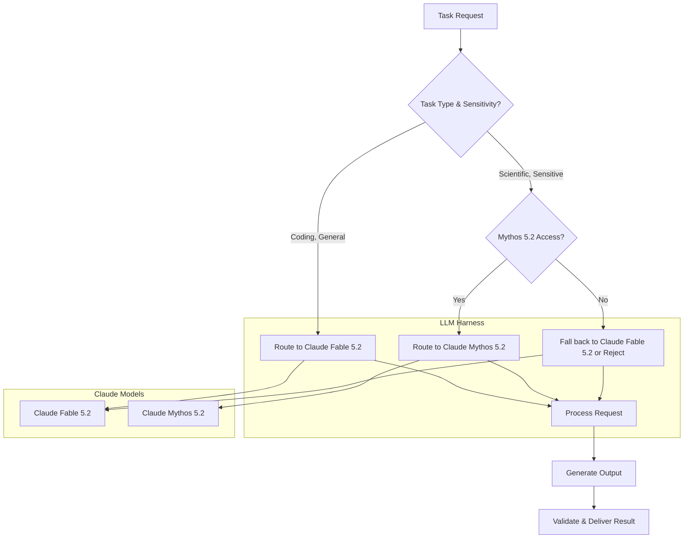

Claude Fable 5.2 및 Mythos 5.2를 LLM 하네스에 통합하여 복잡한 코딩, 고급 추론, 시각 이해 능력에서 성능을 크게 향상시킨다. Anthropic의 최신 모델들은 이전 5.1 버전 대비 최대 30% 빠른 출력 속도를 제공하며, 이는 지식 처리 및 프로젝트 관제 효율성 증대로 직결된다. 핵심 가치는 정교한 소프트웨어 전환, 전자 장비 설계, 과학 문제 해결, 수학 증명 형식화 등 심층적인 분석 및 견고한 실행이 요구되는 에이전트 워크플로우를 처리하는 능력 향상에 있다.

### 기술 통합을 통한 기능 강화
Claude Fable 5.2와 Mythos 5.2의 통합은 기존 LLM 하네스의 역량을 더욱 강력한 인지 엔진으로 확장한다. `Claude Code` 하네스의 경우, 향상된 상황 이해와 논리적 추론 능력을 바탕으로 에이전트가 보다 정교한 코드 생성, 리팩토링, 디버깅을 수행할 수 있음을 의미한다. 모델의 향상된 시각적 기능은 스크린샷 기반 UI/UX 분석 또는 코드베이스 내 다이어그램 해석과 같은 작업에서 새로운 가능성을 열어준다.

### 모델 선택 및 접근성 고려사항
Fable 5.2는 강력한 사이버 보안 및 생물학적 안전 장치를 갖추고 일반적으로 제공되지만, Mythos 5.2는 주로 유익한 연구를 수행하는 검증된 기관에 제공된다. 이러한 차이는 하네스 내 모델 배포에 전략적 접근을 요구한다:
*   **Fable 5.2**: 일반적인 코딩, 추론, 시각적 작업을 위한 기본 선택지로, 속도 및 기능 향상의 이점을 활용한다.
*   **Mythos 5.2**: 고도로 민감하거나 과학적으로 복잡한 작업에 활용되며, 조직이 Anthropic의 접근 기준을 충족하는 경우 전문적인 접근 및 정교한 기능을 최대한 활용할 수 있다.

### 속도 및 비용 효율성을 통한 성능 최적화
출력 생성 속도가 30% 증가했다는 보고는 유연한 가격 정책 (입력 토큰 100만 개당 8 USD, 출력 토큰 100만 개당 40 USD) 및 선택적인 고속 모드 (토큰 생성 최대 2.5배 가속)와 결합하여 상당한 성능 및 비용 최적화 기회를 제공한다. 하네스는 이러한 모델로 요청을 동적으로 라우팅할 수 있으며, 특히 지연 시간에 민감한 작업이나 높은 처리량(throughput)이 요구되는 경우에 유용하다.

**예제: 코드 하네스 내 동적 모델 라우팅**

이러한 모델을 통합하는 핵심 패턴은 작업의 복잡성, 민감도 및 요구되는 속도를 기반으로 한 동적 라우팅이다.

```python
import anthropic
import os
import time

class LLMHarness:
    def __init__(self, fable_api_key, mythos_api_key=None):
        self.fable_client = anthropic.Anthropic(api_key=fable_api_key)
        self.mythos_client = anthropic.Anthropic(api_key=mythos_api_key) if mythos_api_key else None

    def _call_model(self, client, model_name, prompt, max_tokens=1024, temperature=0.7):
        start_time = time.time()
        try:
            response = client.messages.create(
                model=model_name,
                max_tokens=max_tokens,
                temperature=temperature,
                messages=[
                    {"role": "user", "content": prompt}
                ]
            )
            end_time = time.time()
            print(f"Model '{model_name}' call took {end_time - start_time:.2f} seconds.")
            return response.content[0].text
        except Exception as e:
            print(f"Error calling {model_name}: {e}")
            return None

    def execute_task(self, task_description, task_type="general_coding", is_sensitive=False):
        model_to_use = "claude-fable-5.2"
        client_to_use = self.fable_client
        prompt = f"Analyze and solve this {task_type} problem: {task_description}"

        if is_sensitive and self.mythos_client:
            model_to_use = "claude-mythos-5.2"
            client_to_use = self.mythos_client
            print(f"Routing sensitive task to {model_to_use}...")
        elif task_type == "scientific_research" and self.mythos_client:
            model_to_use = "claude-mythos-5.2"
            client_to_use = self.mythos_client
            print(f"Routing scientific research task to {model_to_use}...")
        else:
            print(f"Routing general task to {model_to_use}...")

        return self._call_model(client_to_use, model_to_use, prompt)

# Example Usage (replace with actual API keys)
# fable_api_key = os.getenv("CLAUDE_FABLE_API_KEY")
# mythos_api_key = os.getenv("CLAUDE_MYTHOS_API_KEY") # Optional, if available

# if fable_api_key:
#     harness = LLMHarness(fable_api_key, mythos_api_key)

#     # General coding task
#     code_task = "Refactor this Python function for better readability and performance: `def factorial(n): return 1 if n==0 else n*factorial(n-1)`"
#     result_code = harness.execute_task(code_task, task_type="coding")
#     print(f"Refactored Code: {result_code[:200]}...")

#     # Scientific research task (if Mythos is available)
#     if mythos_api_key:
#         science_task = "Explain the latest advancements in quantum entanglement and propose a novel experimental setup."
#         result_science = harness.execute_task(science_task, task_type="scientific_research", is_sensitive=True)
#         print(f"Scientific Explanation: {result_science[:200]}...")
# else:
#     print("Please set CLAUDE_FABLE_API_KEY environment variable.")
```

**Mermaid를 활용한 워크플로우 시각화**

`playbook` 내 통합은 동적 의사 결정과 라우팅을 포함한다.



**2026 트렌드: 고급 에이전트 워크플로우**
Fable 5.2와 Mythos 5.2의 뛰어난 추론 및 코딩 능력은 차세대 에이전트 워크플로우를 위한 핵심 동력이다. 이는 `agent self-correction`, `autonomous agent complex decision logic`, `agent collaboration pattern design`을 포함한다. 이러한 모델을 장착한 에이전트는 복잡한 요구 사항을 더 잘 해석하고, 정교한 솔루션을 합성하며, 더 효과적인 다중 에이전트 협업에 참여하여 궁극적으로 `project management tool review` 및 `knowledge accumulation`을 가속화한다. 향상된 속도는 `closed-loop automation design philosophy` 내에서 더 빠른 반복 주기를 지원한다.

## 트레이드오프

### 1. 성능 증대 vs. 비용 및 접근성
*   **언제 좋은가**: 복잡한 코딩, 추론, 과학 연구 등 고성능이 필수적인 작업에서 생산성 및 결과 품질을 극대화할 때 매우 효과적이다. 특히 `harness-engineering/realtime-llm-latency-optimization-patterns`과 같이 응답 속도가 중요한 시나리오에서 큰 이점을 제공한다.
*   **언제 나쁜가**: 예산 제약이 크거나, 단순 반복 작업에 고성능 모델을 적용할 때 비용 효율성이 떨어진다. 또한 Mythos 5.2의 경우 접근 조건이 엄격하여 모든 프로젝트에서 활용하기 어렵다.

### 2. 향상된 추론 및 시각 이해 vs. 모델 특정 종속성
*   **언제 좋은가**: 멀티모달 입력 처리(`agents/multimodal-agent-complex-task-design-patterns`)나 복잡한 시스템 설계(`agents/agent-codebase-exploration-visualization-tool`)와 같이 심층적인 이해가 요구되는 분야에서 `agents/llm-agent-autonomy-complex-problem-solving` 역량을 강화한다.
*   **언제 나쁜가**: 특정 모델에 대한 의존도가 높아져 `harness-engineering/llm-api-dependency-reassessment-model-diversification` 전략에 위배될 수 있다. 다른 LLM으로의 전환 비용이 증가하고, Anthropic 정책 변화에 취약해질 수 있다.

### 3. 빠른 출력 속도 vs. 안정성 및 최적화 노력
*   **언제 좋은가**: 대량의 `evaluation/llm-output-validation-pipeline-enhancement`이나 `harness-engineering/llm-workflow-orchestration-harness-production-patterns`에서 전반적인 처리량(throughput)을 높여 `harness-engineering/llm-continuous-performance-validation`을 가속화할 때 유리하다.
*   **언제 나쁜가**: 단순히 속도가 빠르다고 해서 항상 최적의 결과를 보장하지 않는다. 고속 모드의 활용이나 모델 호출 전략을 `harness-engineering/llm-cost-optimization-token-streaming-caching-systems`과 같은 방식으로 세밀하게 조정하지 않으면 `agents/ai-agent-runaway-cost-prevention-control-systems` 위험이 있다. 또한, 모델 업데이트가 `evaluation/llm-output-style-tone-drift-detection-mitigation`을 유발할 수 있으므로 지속적인 검증이 필요하다.

## 실전 체크리스트

- [ ] Claude Fable 5.2 API 키 통합 및 기본 연동 테스트 완료.
- [ ] 핵심 `Claude Code` 작업(예: 코드 생성, 리팩토링)에 대한 Fable 5.2의 `latency` 및 `throughput`을 Claude 5.1과 비교 벤치마킹하여 성능 향상 수치 확보.
- [ ] Mythos 5.2 모델의 접근 권한 및 API 키 확보 여부 확인, 필요 시 보안 및 규정 준수 검토 완료.
- [ ] 동적 모델 라우팅 로직(`harness-engineering/dynamic-llm-routing-system-implementation-patterns`)을 구현하여 작업 유형(일반 코딩, 과학 연구, 보안) 및 민감도에 따라 Fable 5.2와 Mythos 5.2를 적절히 전환하는지 검증.
- [ ] Fable 5.2 및 Mythos 5.2 사용 시 예상되는 토큰 사용량(`harness-engineering/llm-token-usage-monitoring-cost-efficiency-patterns`)을 예측하고, `high-speed mode` 활성화 여부를 포함한 비용 최적화 전략 수립.
- [ ] 모델의 시각 이해 능력 (`agents/multimodal-agent-vision-language-reasoning-patterns`)을 활용하는 신규 태스크에 대한 POC를 수행하고, 유효성을 검증.
- [ ] 모델 업데이트 후 `evaluation/llm-output-validation-pipeline-enhancement`을 통해 생성된 코드/텍스트의 품질, 정확성, 안전성(`harness-engineering/llm-production-safety-security-harness-patterns`)에 대한 회귀 테스트를 수행하여 `output drift` 여부 확인.