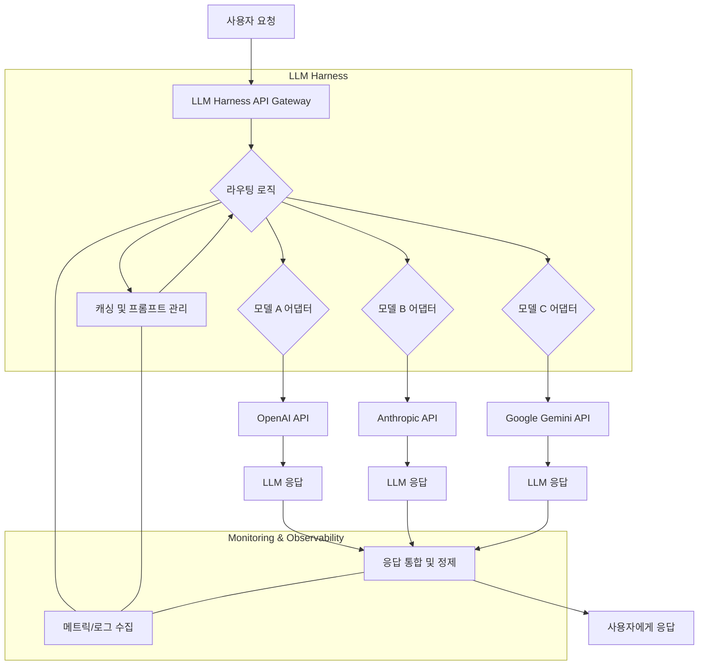

엔터프라이즈 환경에서 단일 LLM(Large Language Model)에 대한 의존도를 넘어, 다양한 LLM 모델의 강점을 활용하고 잠재적 위험을 분산하는 것은 필수적인 전략입니다. 다중 LLM API 연동을 위한 하네스(Harness) 아키텍처는 이러한 복잡성을 추상화하고, 유연한 모델 선택, 비용 최적화, 성능 관리, 그리고 서비스 안정성을 보장하는 핵심 솔루션입니다.

## 왜 다중 LLM 하네스 아키텍처인가?

다양한 LLM 모델들은 각기 다른 특성과 강점을 가지고 있습니다. 특정 작업에는 Anthropic Claude가, 다른 작업에는 OpenAI GPT나 Google Gemini가 더 효율적이거나 비용 효과적일 수 있습니다. 또한, 특정 모델의 서비스 중단, 가격 인상, 또는 정책 변경은 비즈니스 연속성에 심각한 위협이 될 수 있습니다. 하네스 아키텍처는 이러한 문제들을 해결하며 다음과 같은 이점을 제공합니다.

*   **유연성 및 공급업체 종속성 완화**: 단일 LLM 공급업체에 대한 종속성을 줄이고, 시장에 출시되는 최신 모델을 빠르게 통합 및 교체할 수 있습니다.
*   **비용 최적화**: 각 요청의 특성에 따라 가장 저렴하고 효율적인 모델을 동적으로 선택하여 운영 비용을 절감합니다.
*   **성능 최적화**: 레이턴시나 처리량 요구사항에 맞춰 최적의 성능을 제공하는 모델을 선택하거나, 여러 모델에 걸쳐 부하를 분산합니다.
*   **안정성 및 재해 복구**: 한 모델 API에 문제가 발생하더라도 다른 모델로 자동으로 페일오버(Failover)하여 서비스 중단을 최소화합니다.
*   **특정 기능 활용**: 특정 모델이 제공하는 고유한 기능(예: 긴 컨텍스트 윈도우, 특정 언어 처리 능력)을 필요에 따라 활용할 수 있습니다.
*   **데이터 거버넌스 및 규정 준수**: 데이터 처리 위치나 보안 요구사항에 따라 적절한 모델 및 공급업체를 선택할 수 있는 기반을 마련합니다.

## 핵심 컴포넌트 설계

다중 LLM 하네스 아키텍처는 크게 다음과 같은 핵심 컴포넌트들로 구성됩니다.

### 1. API 추상화 레이어 (Abstraction Layer)

다양한 LLM API는 각기 다른 요청 및 응답 형식, 인증 방식, 에러 코드를 가집니다. 추상화 레이어는 이 모든 차이를 표준화된 단일 인터페이스로 감싸서, 애플리케이션 개발자가 특정 LLM API의 세부사항에 신경 쓰지 않고 비즈니스 로직에 집중할 수 있도록 합니다.

### 2. 동적 라우터 및 오케스트레이터 (Dynamic Router & Orchestrator)

들어오는 요청의 특성(사용자, 프롬프트 내용, 예상 비용, 요구되는 정확도, 레이턴시 등)에 따라 어떤 LLM 모델을 사용할지 결정하는 지능형 엔진입니다. 이는 부하 분산(Load Balancing), 캐스케이딩(Cascading) 또는 병렬 호출(Parallel Calling)과 같은 전략을 포함할 수 있습니다.

### 3. 프롬프트 및 컨텍스트 관리 (Prompt & Context Management)

프롬프트 엔지니어링 전략을 중앙에서 관리하고 버전화합니다. 또한, 반복되는 프롬프트 또는 특정 사용자 세션의 컨텍스트를 캐싱하여 API 호출 비용을 절감하고 응답 속도를 향상시킵니다.

### 4. 옵저버빌리티 및 모니터링 (Observability & Monitoring)

각 LLM 호출에 대한 로그, 메트릭, 트레이스(Trace)를 수집하여 모델별 성능, 비용, 에러율을 실시간으로 파악합니다. 이는 최적의 라우팅 전략을 수립하고 문제 발생 시 신속하게 대응하는 데 필수적입니다.

### 5. 보안 및 거버넌스 (Security & Governance)

API 키 관리, 접근 제어, 데이터 익명화, 민감 정보 필터링과 같은 보안 정책을 중앙에서 적용합니다. 또한, LLM 사용에 대한 규정 준수 감사 기능을 제공합니다.

## 아키텍처 다이어그램



## 코드 예시: 다중 LLM 클라이언트 (Python)

다음은 간단한 Python 예제로, `ModelAdapter`를 통해 다양한 LLM API를 추상화하고, `LLMHarness`가 동적으로 모델을 선택하여 호출하는 방식을 보여줍니다. 이 예시는 라우팅 로직을 간소화했지만, 실제 환경에서는 복잡한 기준에 따라 모델을 선택할 수 있습니다.

```python
import os
from abc import ABC, abstractmethod
from typing import Dict, Any, Optional

# 가상의 LLM 클라이언트 (실제 API 호출 대체)
class MockOpenAIClient:
    def create_completion(self, model: str, prompt: str, **kwargs) -> Dict[str, Any]:
        print(f