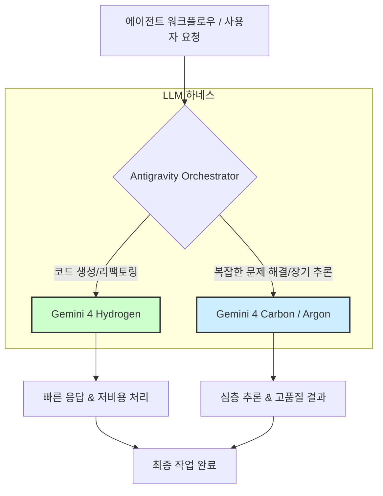

Gemini 4 Hydrogen은 Google이 일상적인 코딩 작업과 다양한 에이전트 태스크를 위해 특별히 설계한 고속 실행 LLM입니다. 기존 Gemini 4 Carbon이나 Argon이 깊고 장기적인 추론에 집중하는 것과 달리, Hydrogen은 빠른 응답과 효율적인 자원 소모에 중점을 둡니다. 이 모델은 기본 추론 설정에서 Artificial Analysis Intelligence Index 51점을 기록하며 Argon의 50점을 뛰어넘는 인상적인 성능을 보여주면서도, 100만 토큰 컨텍스트를 지원하며 100만 토큰당 입력 $1.50, 출력 $7.50의 경쟁력 있는 요금을 제공합니다.

## LLM 하네스 및 에이전트 시스템 업그레이드 필요성

LLM 기반 시스템, 특히 에이전트 워크플로우와 자동화된 코딩 하네스에서 모델의 선택은 성능, 비용, 사용자 경험에 직접적인 영향을 미칩니다. Gemini 4 Hydrogen의 등장은 '일상적인' 성격의 작업에 특화된 모델을 통해 전체 시스템의 효율성을 획기적으로 개선할 기회를 제공합니다. 이는 특히 짧은 지연 시간과 반복적인 호출이 잦은 환경에서 큰 이점으로 작용합니다.

### 기존 시스템에서의 모델 전환 전략

현재 Gemini 모델을 사용하고 있는 시스템의 경우, Gemini 4 Hydrogen API로의 전환은 비교적 용이하게 이루어질 수 있습니다. 핵심은 기존 추론 로직에서 모델 호출 부분을 Hydrogen 엔드포인트로 변경하고, Hydrogen이 제공하는 100만 토큰 컨텍스트를 효과적으로 활용하는 것입니다. 예를 들어, Claude Code 하네스나 허브-워커 복리 자동화 로직과 같이 코드 생성, 문서화, 간단한 리팩토링 등 반복적이고 빠른 처리가 필요한 에이전트 작업에 Hydrogen을 우선적으로 적용할 수 있습니다.

이러한 전환은 단순히 모델을 교체하는 것을 넘어, 에이전트의 작업 할당량을 최적화하고 완료 시간을 단축하는 데 기여합니다. Terminal-Bench 4.0 테스트 결과는 Carbon에 가까운 성공률을 유지하면서도 평균 할당량 소모를 24% 줄이고 완료 시간을 19% 단축했음을 보여줍니다. 이는 곧 더 많은 작업을 더 적은 리소스로 빠르게 처리할 수 있다는 의미입니다.

### Google Antigravity Orchestrator의 역할

Google Antigravity의 Orchestrator는 세션 내에서 Carbon과 Hydrogen 같은 다양한 Gemini 모델을 자동으로 전환하는 기능을 제공합니다. 이는 개발자가 수동으로 모델을 선택하거나 복잡한 라우팅 로직을 구현할 필요 없이, 작업의 성격에 따라 가장 적합한 모델을 동적으로 할당하여 최적의 성능과 비용 효율성을 달성하게 합니다.

#### 모델 라우팅 및 작업 흐름 시각화



이 다이어그램은 Antigravity Orchestrator가 어떻게 다양한 작업 유형에 따라 최적의 Gemini 모델을 동적으로 선택하여 LLM 하네스의 효율성을 극대화하는지 보여줍니다. Hydrogen은 특히 빠른 처리와 비용 효율성이 중요한 '코드 생성/리팩토링'과 같은 일상적인 에이전트 작업에 할당됩니다.

## Gemini 4 Hydrogen 적용을 위한 코드 예제

다음은 Python에서 기존 Gemini API 호출을 Gemini 4 Hydrogen으로 전환하는 간단한 예제입니다. 실제 환경에서는 LLM SDK나 프레임워크를 통해 모델 이름을 변경하는 방식으로 이루어집니다.

```python
import google.generativeai as genai
import os

# API 키 설정 (실제 환경에서는 환경 변수 또는 보안 저장소 사용)
# genai.configure(api_key=os.environ["GEMINI_API_KEY"])

def generate_code_with_gemini(model_name: str, prompt: str) -> str:
    """지정된 Gemini 모델을 사용하여 코드를 생성합니다."""
    model = genai.GenerativeModel(model_name=model_name)
    response = model.generate_content(prompt)
    return response.text

# 기존 Gemini (예: Gemini Pro) 호출
# current_model_output = generate_code_with_gemini("gemini-pro", "Python으로 피보나치 수열을 생성하는 함수를 작성해줘.")
# print(f"Current Model Output: {current_model_output[:100]}...")

# Gemini 4 Hydrogen으로 전환
# 'gemini-4-hydrogen'은 예시적인 모델명이며, 실제 API 이름은 Google Cloud 문서 참조
hydrogen_model_output = generate_code_with_gemini(
    "gemini-4-hydrogen", # 실제 모델명으로 대체
    "Node.js에서 Express.js를 사용하여 간단한 REST API 엔드포인트를 구현하는 코드를 작성해줘. GET /items, POST /items를 포함해야 해."
)
print(f"Gemini 4 Hydrogen Output: {hydrogen_model_output[:200]}...")

# 에이전트 시스템에서 100만 토큰 컨텍스트 활용 예시
long_codebase_summary_prompt = (
    "다음은 대규모 Node.js 프로젝트의 여러 파일 내용이야. "
    "이 코드를 분석하고, 핵심 모듈 간의 의존성 그래프를 Markdown 형식으로 그려줘. "
    "그리고 개선이 필요한 지점 3가지를 제안해줘.\n\n" +
    "<file_a>\n...[수십만 토큰에 달하는 파일 내용]...\n</file_a>\n" +
    "<file_b>\n...[수십만 토큰에 달하는 파일 내용]...\n</file_b>"
)

# hydrogen_long_context_output = generate_code_with_gemini(
#     "gemini-4-hydrogen",
#     long_codebase_summary_prompt
# )
# print(f"Long Context Analysis Output: {hydrogen_long_context_output[:200]}...")
```

위 예제는 `generate_code_with_gemini` 함수에서 `model_name` 인자만 변경하여 쉽게 모델을 전환할 수 있음을 보여줍니다. 또한, 100만 토큰 컨텍스트는 대규모 코드베이스 분석이나 복잡한 문서 요약과 같은 작업에 Hydrogen을 효과적으로 활용할 수 있게 합니다. 에이전트는 이 넓은 컨텍스트 윈도우를 활용하여 더 포괄적인 정보를 바탕으로 의사결정을 내리고, 더 정확한 코드를 생성하거나 작업을 수행할 수 있습니다.

## 트레이드오프

Gemini 4 Hydrogen으로의 업그레이드는 명확한 이점을 제공하지만, 몇 가지 트레이드오프를 고려해야 합니다.

*   **성능 vs. 깊은 추론:**
    *   **언제 좋음:** 일상적인 코딩, 간단한 스크립트 작성, 문서화, 빠른 에이전트 액션 등 신속한 처리와 비용 효율성이 중요한 작업에 매우 유리합니다. Carbon이나 Argon 대비 평균 할당량 소모 및 완료 시간 단축 효과가 큽니다.
    *   **언제 나쁨:** 복잡하고 다단계적인 장기 추론, 전략적 기획, 심도 깊은 문제 해결 등 고차원적인 사고와 긴 컨텍스트 내의 미묘한 의미 파악이 요구되는 작업에는 Gemini 4 Carbon이나 Argon이 더 적합할 수 있습니다. Hydrogen은 '빠른 실행'에 초점을 맞춥니다.

*   **비용 효율성 vs. 모델 범용성:**
    *   **언제 좋음:** 대규모 반복 작업에서 토큰당 비용이 낮아 전반적인 운영 비용을 크게 절감할 수 있습니다. 특히 입력 토큰 비용이 저렴하여 다양한 시도를 해볼 수 있는 환경에 적합합니다.
    *   **언제 나쁨:** 단일 모델로 모든 종류의 태스크를 처리하려는 경우, Hydrogen은 특정 복잡성 이상의 추론에서 Carbon이나 Argon만큼의 정교함을 제공하지 못할 수 있습니다. 모델 라우팅 로직 없이는 최적의 모델 활용이 어렵습니다.

*   **컨텍스트 활용도 vs. API 호환성:**
    *   **언제 좋음:** 100만 토큰 컨텍스트는 매우 큰 코드베이스 분석, 장문 보고서 요약, 복잡한 대화 기록 유지 등 광범위한 정보를 한 번에 처리해야 하는 에이전트 작업에 혁신적인 기회를 제공합니다.
    *   **언제 나쁨:** 기존 LLM SDK 및 프레임워크가 아직 Gemini 4 Hydrogen의 새로운 API(만약 있다면)나 특정 기능을 완벽하게 지원하지 않을 수 있습니다. 이 경우, 통합 과정에서 추가적인 개발 및 테스트 노력이 필요할 수 있습니다.

## 실전 체크리스트

Gemini 4 Hydrogen을 기존 LLM 하네스 및 에이전트 시스템에 성공적으로 통합하기 위한 실전 체크리스트입니다.

*   [ ] **API 호환성 검증:** 기존 LLM 통합 로직이 Gemini 4 Hydrogen의 API 엔드포인트 및 호출 방식과 호환되는지 확인합니다. 필요한 경우 SDK 업데이트 또는 어댑터 개발 계획을 수립합니다.
*   [ ] **성능 벤치마킹:** 현재 사용 중인 모델과 Gemini 4 Hydrogen을 대상으로 실제 에이전트 작업 시나리오 (예: 코드 생성, 문서 요약)에서 속도, 성공률, 토큰 사용량을 벤치마킹하여 성능 개선 효과를 정량적으로 측정합니다.
*   [ ] **비용 분석 및 최적화:** Hydrogen의 토큰당 비용과 예상 사용량을 기반으로 월별/작업별 비용을 예측하고, 기존 모델과의 비용 효율성 차이를 분석하여 비용 절감 목표를 수립합니다.
*   [ ] **에이전트 워크플로우 재검토:** Hydrogen의 빠른 실행 특성과 100만 토큰 컨텍스트를 최대한 활용할 수 있도록 기존 에이전트 워크플로우를 재설계하거나 최적화할 지점을 식별합니다.
*   [ ] **Antigravity Orchestrator 연동 전략 수립:** Google Antigravity Orchestrator를 통해 작업의 복잡성과 유형에 따라 Hydrogen, Carbon, Argon 모델을 동적으로 전환하는 전략을 수립하고 구현합니다.
*   [ ] **컨텍스트 관리 로직 개선:** 100만 토큰 컨텍스트 윈도우를 효율적으로 사용하기 위해 프롬프트 구성, 정보 주입, 컨텍스트 압축/요약 등의 로직을 개선합니다. 특히 장기 실행 에이전트의 메모리 관리에 이를 적용합니다.
*   [ ] **예외 처리 및 폴백 전략:** Gemini 4 Hydrogen 사용 중 발생할 수 있는 Rate Limit, API 오류, 성능 저하 등의 상황에 대비하여 적절한 예외 처리 및 다른 모델로의 폴백(Fallback) 전략을 구현합니다.