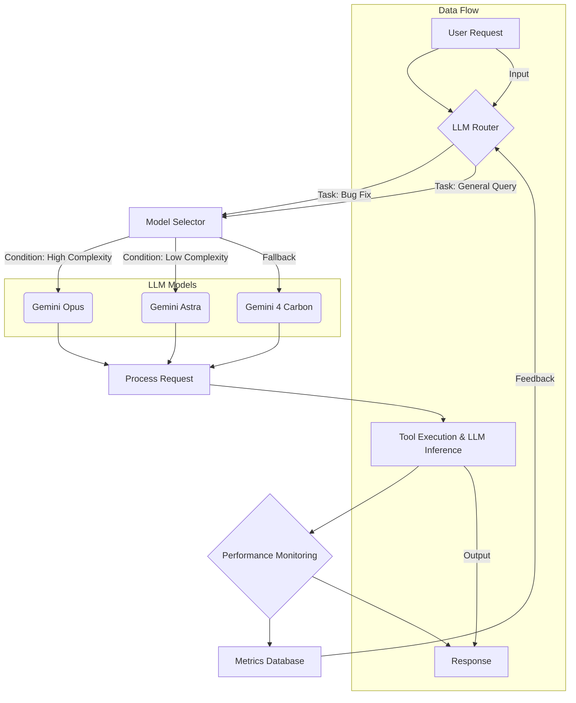

대규모 언어 모델(LLM) 기반 에이전트 시스템에서 모델의 효율성은 성능, 비용, 사용자 경험에 직접적인 영향을 미칩니다. 특히, 코드 하네스(code harness)와 같은 반복적이고 복잡한 작업 흐름에서는 모델의 추론 시간과 토큰 사용량이 중요하게 평가됩니다. 최근 Gemini 모델, 특히 Gemini 4 Carbon과 같은 특정 모델에서 관찰된 비효율성은 최적 모델로의 전환 필요성을 부각시키고 있습니다. 

## Gemini 4 Carbon의 비효율성 분석
Gemini 4 Carbon은 특정 작업에서 Opus나 Astra 같은 다른 모델에 비해 현저히 느린 추론 시간을 보였습니다. 비공개 버그 수정 평가(private bug fix evaluation)에서 Gemini 4 Carbon은 다른 모델이 몇 분 안에 완료하는 작업을 처리하는 데 거의 한 시간을 소요했습니다. 이러한 비효율성은 다음과 같은 여러 요인에 기인합니다:

### 불필요한 작업 및 비효율적인 도구 사용
*   **과도한 단계 수행**: Carbon은 동일한 버그를 수정하는 데 Astra보다 약 7배 많은 단계를 거쳤습니다. 이는 작업에 불필요하거나 중복되는 탐색 및 처리 과정이 많았음을 시사합니다.
*   **비효율적인 도구 사용**: 도구 작업(tool operations) 측면에서 Astra보다 11배 많은 작업을 수행했습니다. 이는 도구 호출 전략이 최적화되지 않았거나, 잘못된 도구를 선택하는 경향이 있었음을 나타냅니다.
*   **불필요한 코드 점검**: 버그의 원인을 찾은 후에도, 수정에 필요 없는 코드를 점검하거나 이미 버그 보고서의 조건상 배제된 경우까지 대비하는 등 요청되지 않은 작업(unrequested tasks)에 전체 단계의 약 절반을 사용했습니다.

### 누적 토큰 사용량 증가
길어진 대화(extended conversations)를 매번 다시 보내면서 누적 입력 토큰(cumulative input tokens)이 16배 이상 증가했습니다. 이는 컨텍스트 윈도우(context window) 관리의 비효율성을 보여주며, 비용 증가로 직결됩니다.

## 최적 모델 전환 전략
이러한 비효율성을 해결하기 위해, 현재 Claude Code 하네스에서 사용 중인 Gemini 모델의 성능을 정밀 분석하고, Opus나 Astra 등 더 효율적이고 빠른 Gemini 모델 또는 대체 LLM으로 전환하는 전략을 수립해야 합니다.

### 1. 성능 스카우트(Scout) 및 벤치마킹
다양한 LLM 후보 모델(예: Gemini Opus, Astra, Claude 3.5 Sonnet, GPT-4o 등)에 대해 실제 작업 시나리오를 기반으로 한 벤치마킹을 수행합니다. 주요 평가 지표는 다음과 같습니다:
*   **추론 시간(Inference Time)**: 특정 작업 완료까지 걸리는 시간.
*   **토큰 사용량(Token Usage)**: 입력 및 출력에 사용된 총 토큰 수.
*   **정확도(Accuracy)**: 주어진 문제 해결의 정확성 및 코드 품질.
*   **도구 활용 효율성(Tool Use Efficiency)**: 도구 호출의 적절성 및 효율성.
*   **작업 완료율(Task Completion Rate)**: 전체 작업 중 성공적으로 완료된 작업의 비율.

```python
import time
from typing import Dict, Any

class LLMModel:
    def __init__(self, name: str, inference_time_factor: float, token_cost_factor: float):
        self.name = name
        self.inference_time_factor = inference_time_factor
        self.token_cost_factor = token_cost_factor

    def generate(self, prompt: str, tools: Dict[str, Any]) -> Dict[str, Any]:
        start_time = time.time()
        # Simulate LLM inference and tool use
        simulated_tokens = len(prompt) // 4 + 100 # Estimate tokens
        simulated_inference_duration = simulated_tokens * self.inference_time_factor
        time.sleep(simulated_inference_duration)

        # Simulate tool use based on prompt complexity
        tool_execution_time = 0.0
        if "bug fix" in prompt.lower() and self.name == "Gemini 4 Carbon":
            tool_execution_time = simulated_inference_duration * 0.5 # Carbon's inefficiency
            simulated_tokens *= 1.5 # More tokens for Carbon
        elif "bug fix" in prompt.lower():
            tool_execution_time = simulated_inference_duration * 0.1 # Efficient tool use
        time.sleep(tool_execution_time)

        end_time = time.time()
        total_duration = end_time - start_time
        total_tokens_used = simulated_tokens
        estimated_cost = total_tokens_used * self.token_cost_factor

        return {
            "model": self.name,
            "response": f"Generated content by {self.name} for: {prompt[:30]}...",
            "duration_seconds": total_duration,
            "tokens_used": total_tokens_used,
            "estimated_cost": estimated_cost
        }

class DynamicLLMRouter:
    def __init__(self, models: Dict[str, LLMModel]):
        self.models = models
        self.performance_history: Dict[str, list] = {name: [] for name in models.keys()}

    def route_request(self, prompt: str, task_type: str = "general") -> LLMModel:
        # Simple routing logic: prioritize Opus for 'bug fix', then Astra, then others
        if "bug fix" in prompt.lower():
            if "Opus" in self.models: return self.models["Opus"]
            if "Astra" in self.models: return self.models["Astra"]
        
        # Fallback to a default or cheapest model
        return self.models.get("Opus", list(self.models.values())[0])

    def process_request(self, prompt: str, task_type: str = "general", tools: Dict[str, Any] = None):
        selected_model = self.route_request(prompt, task_type)
        print(f"Routing to model: {selected_model.name}")
        result = selected_model.generate(prompt, tools)
        self.performance_history[selected_model.name].append(result)
        return result

# Example Usage:
models = {
    "Gemini 4 Carbon": LLMModel("Gemini 4 Carbon", 0.005, 0.00003),
    "Opus": LLMModel("Opus", 0.0008, 0.000015),
    "Astra": LLMModel("Astra", 0.001, 0.00001)
}

router = DynamicLLMRouter(models)

print("--- Processing Bug Fix Request ---")
bug_fix_prompt = "Analyze the Python bug in this code snippet and provide a fix. The bug is related to an off-by-one error in array indexing."
result_bug_fix = router.process_request(bug_fix_prompt, task_type="bug_fix", tools={"debugger": True})
print(f"Result: {result_bug_fix}")

print("--- Processing General Query Request ---")
general_query_prompt = "Explain the concept of containerization in cloud computing."
result_general_query = router.process_request(general_query_prompt, task_type="general")
print(f"Result: {result_general_query}")

```

### 2. 동적 모델 라우팅 구현
LLM API 호출을 추상화하고, 작업 유형, 예상 복잡도, 실시간 성능 지표를 기반으로 최적의 모델을 동적으로 선택할 수 있는 라우팅 계층을 구현합니다. 이는 다음과 같은 이점을 제공합니다:
*   **비용 효율성**: 저렴하지만 특정 작업에 최적화된 모델을 우선 사용하고, 복잡한 작업에만 고성능/고비용 모델을 활용합니다.
*   **성능 최적화**: 특정 작업에서 우수한 성능을 보이는 모델로 트래픽을 유도하여 전체 시스템의 응답 시간을 단축합니다.
*   **유연성**: 새로운 LLM이 출시되거나 기존 모델의 성능이 변경될 때, 코드 수정 없이 빠르게 전환하거나 테스트할 수 있습니다.

### 3. 지속적인 모니터링 및 A/B 테스팅
모델 전환 후에도 새로운 모델의 성능, 비용, 안정성을 지속적으로 모니터링해야 합니다. A/B 테스팅을 통해 여러 모델의 실제 운영 환경에서의 효과를 비교하고, 데이터를 기반으로 최적의 모델 사용 전략을 반복적으로 개선합니다. 2026년 트렌드에 따라 LLM Ops 파이프라인에 이러한 평가 및 전환 메커니즘을 내재화하는 것이 중요합니다.

## LLM 모델 라우팅 아키텍처


## 트레이드오프

### 1. 비용 절감 vs. 모델 선택 복잡성
*   **장점**: 추론 시간과 토큰 사용량을 최적화하여 LLM 운영 비용을 크게 절감할 수 있습니다. 각 작업에 가장 적합한 모델을 사용함으로써 전반적인 ROI를 높입니다.
*   **단점**: 다양한 모델을 통합하고 관리하는 복잡성이 증가합니다. 모델 간의 API 호환성, 버전 관리, 성능 벤치마킹 및 라우팅 로직 구현에 추가적인 엔지니어링 노력이 필요합니다.
*   **언제 좋은가**: 비용이 주요 제약 조건이고, 다양한 유형의 LLM 작업이 존재하며, 팀에 모델 통합 및 관리 전문성이 충분할 때 유용합니다.
*   **언제 나쁜가**: 초기 개발 단계이거나, 단일 모델로도 충분한 성능을 보장하는 경우, 모델 전환의 복잡성이 얻는 이점보다 클 수 있습니다.

### 2. 성능 최적화 vs. 시스템 안정성
*   **장점**: 특정 작업에 최적화된 모델을 사용함으로써 전체 시스템의 응답 속도와 처리량을 향상시킬 수 있습니다. 특히 Latency-sensitive한 애플리케이션에서 사용자 경험을 극대화합니다.
*   **단점**: 여러 모델에 대한 의존성이 증가하고, 한 모델에 문제가 발생했을 때 전체 시스템에 미치는 영향이 커질 수 있습니다. 각 모델의 가용성 및 안정성 관리가 더욱 중요해집니다.
*   **언제 좋은가**: 고성능이 Critical Path에 있는 서비스이거나, 여러 모델 간의 Failover 및 Fallback 메커니즘을 견고하게 구축할 수 있을 때 유리합니다.
*   **언제 나쁜가**: 안정성을 최우선으로 고려해야 하는 시스템에서, 복잡한 라우팅 로직이 잠재적인 장애 포인트를 추가할 수 있습니다.

### 3. 유연한 아키텍처 vs. 초기 개발 비용
*   **장점**: 모델 라우팅 계층은 향후 새로운 LLM 모델의 도입이나 기존 모델의 교체를 용이하게 만듭니다. 이는 장기적인 확장성과 기술 변화에 대한 빠른 대응력을 확보하게 합니다.
*   **단점**: 초기에 라우팅 로직, 벤치마킹 시스템, 모니터링 인프라 등을 구축하는 데 상당한 개발 시간과 리소스가 소요됩니다. 이러한 초기 투자가 프로젝트 타임라인에 부담을 줄 수 있습니다.
*   **언제 좋은가**: LLM 기반 서비스가 지속적으로 발전하고 다양한 모델을 실험해야 하는 장기 프로젝트에 적합합니다.
*   **언제 나쁜가**: 빠른 MVP(Minimum Viable Product) 출시가 목표이거나, 모델 변화의 가능성이 낮다고 판단될 때 초기 투자 비용이 과도할 수 있습니다.

## 실전 체크리스트

- [ ] 현재 사용 중인 LLM(Gemini 4 Carbon 포함)의 평균 추론 시간 및 토큰 사용량 Baseline 측정 및 기록
- [ ] 후보 LLM(Gemini Opus, Astra, 기타)에 대한 실제 작업 시나리오 기반 벤치마킹 환경 구축 완료
- [ ] 벤치마킹 결과에 따라 각 작업 유형별 최적 모델 선정 기준(성능, 비용, 품질) 정의 완료
- [ ] 동적 LLM 라우팅을 위한 추상화 계층(예: `LLMAdapter` 또는 `ModelRouter`) 아키텍처 설계 및 프로토타입 구현
- [ ] 모델 전환 및 라우팅 로직에 대한 지속적인 성능, 비용, 안정성 모니터링 대시보드 구축
- [ ] 새로운 모델 도입 시, 점진적 전환(Canary Deployment) 또는 A/B 테스팅을 위한 배포 전략 수립
- [ ] LLM API Rate Limit 및 Failover 처리 로직이 라우터 계층에 견고하게 구현되었는지 검토