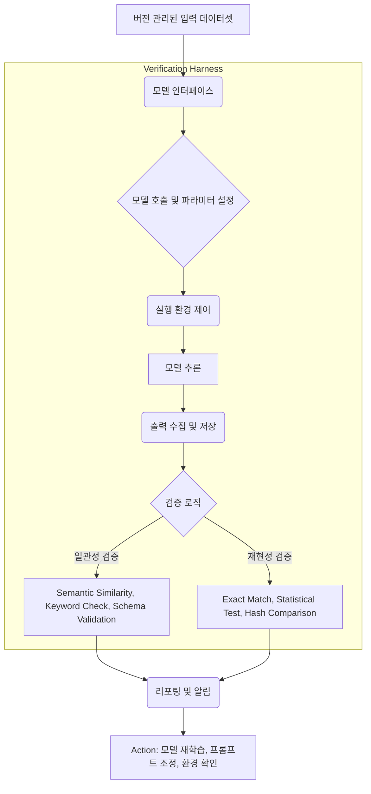

Generative AI 모델은 놀라운 잠재력을 제공하지만, 실제 프로덕션 환경에서 신뢰성을 확보하기 위해서는 출력의 일관성(Consistency)과 재현성(Reproducibility)이 필수적입니다. 불일치하거나 비재현적인 출력은 사용자 경험 저하, 잘못된 의사결정, 심각한 경우 비즈니스 손실로 이어질 수 있습니다. 본 위키 엔트리는 생성형 AI 모델의 출력 일관성 및 재현성을 체계적으로 검증하기 위한 Harness 구축 패턴을 제시합니다.

## 핵심 개념: 일관성 및 재현성

### 일관성(Consistency)

동일한 입력(또는 유사한 맥락)에 대해 모델이 합리적으로 유사한 출력을 생성하는 능력입니다. 이는 모델의 안정성과 신뢰도를 측정하는 중요한 척도입니다. 프롬프트 엔지니어링, 파라미터(예: `temperature`, `top_p`) 설정, 그리고 모델 가중치의 작은 변화가 출력에 큰 영향을 미칠 수 있습니다.

### 재현성(Reproducibility)

주어진 입력, 모델 버전, 그리고 실행 환경에서 모델이 매번 정확히 동일하거나 통계적으로 유사한 출력을 생성하는 능력입니다. 특히, 디버깅, 감사(auditing), 그리고 규제 준수(compliance) 측면에서 매우 중요합니다. 결정론적 시드(Deterministic seeding), 환경 변수 관리, 모델 버전 관리가 필수적입니다.

## 검증 Harness 아키텍처 (Verification Harness Architecture)

생성형 AI 모델의 출력 일관성과 재현성을 검증하는 Harness는 다음 핵심 구성 요소로 이루어집니다:

1.  **입력 데이터셋 관리(Input Dataset Management)**: 검증을 위한 정형화되고 버전 관리되는 입력 프롬프트 및 컨텍스트 데이터셋. 다양한 시나리오와 엣지 케이스를 포함해야 합니다.
2.  **모델 인터페이스(Model Interface Layer)**: 테스트 대상 AI 모델과의 표준화된 통신 계층. 모델 API 호출, 파라미터 설정, 그리고 로깅을 담당합니다.
3.  **실행 환경 제어(Execution Environment Control)**: 모델 추론(inference)이 발생하는 환경을 격리하고 통제합니다. 이는 재현성을 보장하는 데 중요하며, 컨테이너화(Docker), 가상 환경(virtual environments) 등을 활용합니다.
4.  **출력 수집 및 저장(Output Collection & Storage)**: 모델의 모든 출력을 구조화된 형태로 수집하고 버전 관리하여 저장합니다. 이는 `Delta Lake`나 `MLflow` 같은 시스템과 연동될 수 있습니다.
5.  **검증 로직(Validation Logic)**: 수집된 출력을 분석하여 일관성 및 재현성 지표를 계산합니다.
    *   **일관성 지표**: Semantic Similarity (예: Cosine Similarity, Embeddings 기반), Keyword Presence, Structured Output Validation (JSON Schema), Rule-based Checks.
    *   **재현성 지표**: Exact Match, Statistical Similarity Tests (예: t-test, chi-squared test), Hash-based Comparison (for exact replication).
6.  **리포팅 및 알림(Reporting & Alerting)**: 검증 결과와 지표를 대시보드 형태로 시각화하고, 임계값을 벗어나는 경우 개발팀에 알림을 보냅니다.



## 코드 예시: Python 기반 간소화된 Harness (Simplified Python Harness Example)

이 예시는 간단한 모델 출력의 일관성과 재현성을 검증하는 파이썬 코드를 보여줍니다. 실제 시스템에서는 더 복잡한 로직과 MLOps 툴체인 통합이 필요합니다.

```python
import hashlib
from typing import List, Dict, Any
# from sentence_transformers import SentenceTransformer, util # 설치 필요: pip install sentence-transformers
import numpy as np

# Mock LLM (실제 LLM API 호출로 대체)
class MockLLM:
    def __init__(self, seed: int = 42):
        self.seed = seed

    def generate(self, prompt: str, temperature: float = 0.7) -> str:
        # 간단한 해싱을 통해 '재현성' 시뮬레이션
        np.random.seed(self.seed)
        response_base = f"The answer for '{prompt}' is "
        if "hello" in prompt.lower():
            if np.random.rand() < temperature:
                return response_base + "greetings!"
            else:
                return response_base + "hello there."
        elif "weather" in prompt.lower():
            if np.random.rand() < temperature:
                return response_base + "sunny and warm."
            else:
                return response_base + "partly cloudy."
        return response_base + "some generated text."

# 임베딩 모델 로드 (Semantic Similarity 계산용)
# model = SentenceTransformer('all-MiniLM-L6-v2') # 실제 사용 시 주석 해제

class VerificationHarness:
    def __init__(self, llm_model: Any, embedding_model: Any = None):
        self.llm = llm_model
        self.embedding_model = embedding_model # 'all-MiniLM-L6-v2' 같은 모델

    def run_inference(self, prompt: str, params: Dict[str, Any], runs: int = 3) -> List[str]:
        outputs = []
        for _ in range(runs):
            outputs.append(self.llm.generate(prompt, **params))
        return outputs

    def check_consistency(self, outputs: List[str], threshold: float = 0.8) -> Dict[str, Any]:
        if not self.embedding_model:
            return {"status": "SKIPPED", "reason": "Embedding model not loaded for semantic consistency."}
        
        # embeddings = self.embedding_model.encode(outputs, convert_to_tensor=True)
        # # 모든 출력 쌍에 대한 코사인 유사도 계산
        # cosine_scores = util.cos_sim(embeddings, embeddings)
        
        # # 평균 유사도 및 최소 유사도 계산
        # avg_similarity = np.mean([score for i, row in enumerate(cosine_scores) for j, score in enumerate(row) if i < j])
        # min_similarity = np.min([score for i, row in enumerate(cosine_scores) for j, score in enumerate(row) if i < j])

        # is_consistent = min_similarity >= threshold
        # return {
        #     "status": "PASS" if is_consistent else "FAIL",
        #     "avg_similarity": float(avg_similarity),
        #     "min_similarity": float(min_similarity),
        #     "consistent": is_consistent
        # }
        return {"status": "SKIPPED", "reason": "Semantic consistency check requires sentence_transformers. Check `check_reproducibility`."} # Placeholder

    def check_reproducibility(self, outputs: List[str]) -> Dict[str, Any]:
        if len(set(outputs)) == 1:
            return {"status": "PASS", "reproducible": True, "output": outputs[0]}
        else:
            # 추가 분석: 어떤 출력이 다른지
            return {"status": "FAIL", "reproducible": False, "distinct_outputs": list(set(outputs))}

# 테스트 실행
if __name__ == "__main__":
    llm = MockLLM(seed=42) # 재현성을 위한 시드 고정
    # embedding_model_instance = SentenceTransformer('all-MiniLM-L6-v2') # 실제 사용 시 주석 해제
    harness = VerificationHarness(llm_model=llm, embedding_model=None) # 임베딩 모델 없이 실행

    test_prompt = "What is the weather like today?"
    test_params = {"temperature": 0.1} # 낮은 temperature로 일관성 향상 기대

    print("--- Reproducibility Test ---")
    repro_outputs = harness.run_inference(test_prompt, test_params, runs=5)
    print(f"Outputs: {repro_outputs}")
    repro_result = harness.check_reproducibility(repro_outputs)
    print(f"Reproducibility Result: {repro_result}")
    print("\n")

    print("--- Consistency Test (Semantic) ---")
    # 일관성 테스트를 위해 temperature를 높여 다양한 출력을 유도할 수 있습니다.
    # 참고: MockLLM은 seed와 temperature로 '다양성'을 시뮬레이션
    high_temp_params = {"temperature": 0.9}
    cons_outputs = harness.run_inference(test_prompt, high_temp_params, runs=5)
    print(f"Outputs: {cons_outputs}")
    # 실제 일관성 검증을 위해 SentenceTransformer 모델을 로드해야 합니다.
    # harness_with_embedding = VerificationHarness(llm_model=llm, embedding_model=embedding_model_instance)
    # cons_result = harness_with_embedding.check_consistency(cons_outputs)
    print("Semantic consistency check skipped as embedding model is not loaded.")
```

## 트레이드오프 (Trade-offs)

1.  **높은 검증 비용 대 신뢰도(High Validation Cost vs. Reliability)**
    *   **장점**: 매우 높은 신뢰도와 예측 가능성을 제공합니다. 프로덕션 환경에서 치명적인 오류를 방지하고, 사용자에게 일관된 경험을 제공하는 데 필수적입니다. 규제 준수(compliance)가 중요한 도메인에 적합합니다.
    *   **단점**: 검증 Harness 구축 및 운영에는 상당한 컴퓨팅 자원(특히 대규모 데이터셋과 복잡한 모델)과 개발 노력이 필요합니다. 이는 모델 학습 및 추론 비용을 초과할 수도 있습니다. 소규모 프로젝트나 PoC 단계에서는 과도할 수 있습니다.
2.  **엄격한 재현성 대 모델의 창의성/다양성(Strict Reproducibility vs. Model Creativity/Diversity)**
    *   **장점**: 특정 시점의 모델 동작을 정확히 고정하고 재현할 수 있어, 디버깅, 감사, A/B 테스트의 신뢰성을 높입니다.
    *   **단점**: 생성형 AI 모델의 본질적인 탐색적(exploratory)이고 다양한(diverse) 출력 특성을 제한할 수 있습니다. 창의성이나 다양한 답변이 중요한 애플리케이션(예: 스토리 생성, 브레인스토밍 도구)에서는 너무 엄격한 재현성 요구가 오히려 모델의 가치를 떨어뜨릴 수 있습니다.
3.  **정적(Static) 테스트셋 대 동적(Dynamic) 프롬프트 환경(Static Test Sets vs. Dynamic Prompt Environments)**
    *   **장점**: 정적 테스트셋은 통제된 환경에서 일관된 평가 기준을 제공하며, 회귀 테스트(regression testing)에 효과적입니다.
    *   **단점**: 실제 사용자 프롬프트는 매우 동적이며, 컨텍스트 변화, 사용자 의도 변경, 외부 데이터 연동 등으로 인해 정적 테스트셋만으로는 현실 세계의 복잡성을 완전히 반영하기 어렵습니다. 실시간 피드백 루프와 동적 테스트셋 업데이트 메커니즘이 필요합니다.

## 실전 체크리스트 (Practical Checklist)

이 Harness 패턴을 적용할 때 다음 항목들을 검증하여 효과적인 구현을 보장합니다.

- [ ] **입력 데이터셋 버전 관리 및 다양성 확보**: 검증에 사용되는 모든 입력 데이터셋이 버전 관리되고, 실제 프로덕션 시나리오의 다양성을 충분히 반영하는가?
- [ ] **결정론적 실행 환경(Deterministic Execution Environment) 구축**: 모델 추론 환경이 완전히 격리되고, seed 값 고정 등 재현성을 위한 모든 제어 장치가 마련되었는가?
- [ ] **출력 수집 및 메타데이터 저장 자동화**: 모델의 모든 출력이 일관된 형식으로 수집되고, 모델 버전, 입력 파라미터 등 관련 메타데이터가 함께 저장되는가?
- [ ] **일관성 및 재현성 지표 정의 및 임계값 설정**: 애플리케이션의 요구사항에 맞는 구체적인 일관성(Semantic Similarity, Key Info Presence) 및 재현성(Exact Match, Statistical Test) 지표와 허용 가능한 임계값이 명확히 정의되었는가?
- [ ] **이상 감지 및 알림 시스템 통합**: 정의된 임계값을 벗어나는 출력에 대해 즉각적인 알림이 관련 팀에 전달되는 시스템이 구축되었는가?
- [ ] **지속적인 검증 주기 및 피드백 루프**: 새로운 모델 배포, 프롬프트 변경, 환경 업데이트 시마다 Harness가 자동으로 실행되고, 검증 결과가 모델 개선 주기에 반영되는가?
- [ ] **실패 사례 분석 및 테스트셋 확장**: 검증 실패 사례가 발생했을 때, 해당 원인을 분석하고 이를 반영하여 테스트셋을 지속적으로 확장하는 프로세스가 있는가?