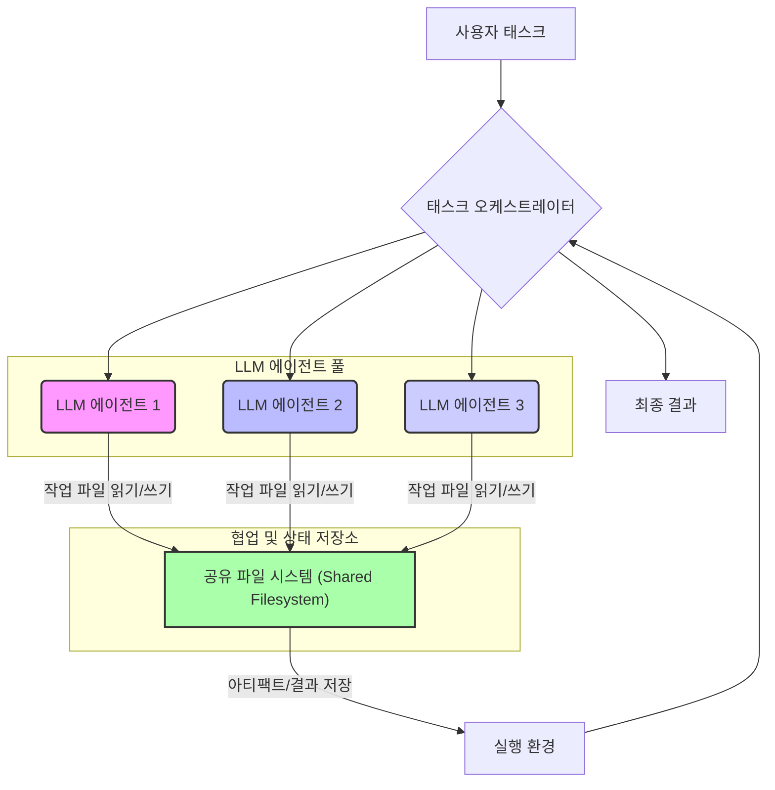

GVS5H 패턴은 복잡한 태스크를 해결하기 위해 여러 개의 LLM 인스턴스를 활용하는 협업 시스템 아키텍처입니다. 특히 코드 생성, 고난도 추론 등 단일 LLM으로 해결하기 어려운 문제에 효과적인 접근 방식으로 부상하고 있습니다. 이 패턴의 핵심은 문제를 작은 단위로 분해하고, 각 에이전트가 이 분해된 문제를 독립적으로 처리하며, 공유 파일 시스템을 통해 정보를 교환하고 협력하는 방식입니다. 이는 기존의 복잡한 오케스트레이션 로직 없이도 강력한 에이전트 시스템을 구축할 수 있는 가능성을 제시합니다.

## GVS5H 패턴의 핵심 원리

GVS5H는 'General-purpose Visual-spatial Shared-memory 5-Heads'의 약자로, 여러 개의 LLM 인스턴스(Heads)가 공유 메모리(Shared-memory), 즉 공유 파일 시스템을 통해 시각적, 공간적 정보를 포함한 다양한 형태의 데이터를 교환하며 협업하는 개념을 의미합니다. 이 패턴은 다음과 같은 주요 원칙을 기반으로 합니다.

### 문제 분해 및 위임 (Problem Decomposition & Delegation)
주어진 복잡한 태스크는 에이전트 오케스트레이터 또는 선임 에이전트에 의해 더 작고 관리 가능한 서브태스크로 분해됩니다. 각 서브태스크는 특정 LLM 에이전트에 위임되어 독립적으로 처리됩니다. 이는 마치 인간 팀이 복잡한 프로젝트를 담당자별로 나누어 처리하는 방식과 유사합니다.

### 다중 LLM 인스턴스 (Multiple LLM Instances)
단일 LLM의 한계를 극복하기 위해 동일하거나 상이한 LLM 모델의 여러 인스턴스가 동시에 작동합니다. 각 인스턴스는 특정 역할을 맡아 전문성을 발휘하거나, 동일한 태스크에 대해 병렬적으로 접근하여 결과의 견고성을 높일 수 있습니다.

### 공유 파일 시스템을 통한 협업 (Collaboration via Shared Filesystem)
에이전트 간의 통신 및 상태 관리는 중앙 집중식 공유 파일 시스템을 통해 이루어집니다. 각 에이전트는 자신의 작업 결과를 파일로 저장하고, 다른 에이전트는 이 파일을 읽어 자신의 다음 작업을 수행하는 방식으로 협업합니다. 이 방식은 별도의 복잡한 IPC(Inter-Process Communication)나 메시지 큐 시스템 없이도 에이전트 간의 상태와 아티팩트를 효과적으로 공유할 수 있게 합니다. 특히 코드, 데이터 파일, 로그 등 다양한 형태의 정보를 자연스럽게 교환할 수 있다는 장점이 있습니다.

## GVS5H 아키텍처 다이어그램

다음 Mermaid 다이어그램은 GVS5H 패턴의 기본적인 아키텍처를 보여줍니다. 사용자 태스크는 오케스트레이터에 의해 여러 LLM 에이전트에 분배되고, 이 에이전트들은 공유 파일 시스템을 중심으로 상호작용하며 최종 결과를 도출합니다.



## 프로토타입 개발 접근 방식

Playbook의 AI 에이전트 하네스 역량을 강화하기 위해 GVS5H 패턴을 적용한 프로토타입을 개발할 때, 다음과 같은 단계를 고려할 수 있습니다.

1.  **환경 설정**: 공유 파일 시스템으로 기능할 로컬 디렉토리 또는 간단한 클라우드 스토리지(예: S3 버킷)를 설정합니다.
2.  **오케스트레이터 구현**: 초기 태스크를 분해하고 에이전트에 위임하며, 최종 결과를 수집하는 중앙 로직을 작성합니다. 이는 Python 스크립트와 같은 간단한 형태로 구현될 수 있습니다.
3.  **LLM 에이전트 래퍼 개발**: 각 LLM 인스턴스가 특정 서브태스크를 받아 처리하고, 그 결과를 다시 공유 파일 시스템에 기록하는 래퍼를 만듭니다. 이 래퍼는 LLM API 호출, 프롬프트 엔지니어링, 결과 파싱 로직을 포함합니다.
4.  **태스크 정의**: GVS5H 패턴의 효과를 검증할 복잡한 코딩 또는 추론 태스크를 정의합니다 (예: '특정 라이브러리를 사용하여 주어진 요구사항에 맞는 Python 함수를 작성하고, 테스트 코드를 생성한 뒤, 실행 결과를 검증하라').
5.  **성능 검증**: 프로토타입을 실행하여 단일 LLM 에이전트와 비교했을 때의 성능 향상(예: 코드 생성 pass@1 비율)을 측정합니다.

### 코드 예시: 간단한 GVS5H 상호작용 (Python)

아래 코드는 GVS5H 패턴의 핵심 아이디어인 '공유 파일 시스템을 통한 에이전트 협업'을 보여주는 단순화된 프로토타입 스케치입니다. 실제 LLM API 호출 대신 파일 I/O를 통해 에이전트의 작업을 시뮬레이션합니다.

```python
import os
import time

SHARED_WORKSPACE = "./gvs5h_workspace"

def initialize_workspace():
    os.makedirs(SHARED_WORKSPACE, exist_ok=True)
    print(f"Workspace '{SHARED_WORKSPACE}' initialized.")

def agent_write(agent_id, filename, content):
    file_path = os.path.join(SHARED_WORKSPACE, filename)
    with open(file_path, "w", encoding="utf-8") as f:
        f.write(content)
    print(f"[{agent_id}] created/updated '{filename}'.")

def agent_read(agent_id, filename):
    file_path = os.path.join(SHARED_WORKSPACE, filename)
    if os.path.exists(file_path):
        with open(file_path, "r", encoding="utf-8") as f:
            content = f.read()
        print(f"[{agent_id}] read '{filename}'.")
        return content
    print(f"[{agent_id}] '{filename}' not found.")
    return None

def orchestrator_task():
    initialize_workspace()

    # Step 1: Orchestrator provides initial problem description
    agent_write("Orchestrator", "problem_statement.md", """
    Analyze the given data structure in 'data.json' and generate a Python class
    that encapsulates this data and provides a 'calculate_summary' method.
    After generating the class, write a simple test case in 'test_class.py'.
    """)

    # Step 2: Agent 1 (Planner) reads problem and creates a plan
    problem = agent_read("Agent-Planner", "problem_statement.md")
    # In a real scenario, LLM would process 'problem'
    plan_content = f"""
    Plan:
    1. Read 'data.json' (if available).
    2. Generate Python class based on data structure -> 'generated_class.py'.
    3. Generate test case for the class -> 'test_class.py'.
    4. Orchestrator can then review/execute.
    """
    agent_write("Agent-Planner", "plan.md", plan_content)
    time.sleep(1) # Simulate LLM processing time

    # Step 3: Agent 2 (Code Generator) reads plan and generates class
    current_plan = agent_read("Agent-CodeGen", "plan.md")
    # Assume 'data.json' exists for context (or created by another agent)
    # For this example, let's create a dummy data.json
    agent_write("Orchestrator", "data.json", "{"items": [{"id": 1, "value": 10}, {"id": 2, "value": 20}]}")

    generated_class_code = """
class DataProcessor:
    def __init__(self, data):
        self.data = data

    def calculate_summary(self):
        return sum(item['value'] for item in self.data['items'])
"""
    agent_write("Agent-CodeGen", "generated_class.py", generated_class_code)
    time.sleep(1)

    # Step 4: Agent 3 (Test Generator) reads plan and generated class, creates test
    generated_code = agent_read("Agent-TestGen", "generated_class.py")
    test_code = """
import unittest
from generated_class import DataProcessor

class TestDataProcessor(unittest.TestCase):
    def test_summary_calculation(self):
        test_data = {"items": [{"id": 1, "value": 5}, {"id": 2, "value": 15}]}
        processor = DataProcessor(test_data)
        self.assertEqual(processor.calculate_summary(), 20)

if __name__ == '__main__':
    unittest.main()
"""
    agent_write("Agent-TestGen", "test_class.py", test_code)
    time.sleep(1)

    # Step 5: Orchestrator collects and displays final artifacts
    print("\n--- Final Artifacts in Workspace ---")
    print(agent_read("Orchestrator", "problem_statement.md"))
    print(agent_read("Orchestrator", "plan.md"))
    print(agent_read("Orchestrator", "generated_class.py"))
    print(agent_read("Orchestrator", "test_class.py"))

    # Cleanup (optional)
    # import shutil
    # shutil.rmtree(SHARED_WORKSPACE)

if __name__ == "__main__":
    orchestrator_task()
```

## 2026년 트렌드와 GVS5H의 중요성

2026년에는 LLM 기술이 더욱 고도화되고 있지만, 여전히 단일 모델이 모든 복잡한 태스크를 완벽하게 해결하기는 어렵습니다. 특히 비용 효율적인 오픈 웨이트 모델 (예: Qwen3.8-27B)의 성능을 극대화하면서도 Fable 5와 같은 최상위 모델에 필적하는 결과를 얻으려는 시도가 활발합니다. GVS5H 패턴은 이러한 트렌드에 발맞춰, 학습이나 파인튜닝 없이도 기존 모델의 협업을 통해 성능을 비약적으로 향상시킬 수 있는 실용적인 방법론을 제공합니다. 이는 리소스 제약이 있거나 특정 도메인에 특화된 다중 에이전트 시스템을 구축하는 데 특히 유용합니다.

## 트레이드오프

GVS5H 패턴은 여러 장점을 제공하지만, 시스템 설계 시 고려해야 할 트레이드오프도 명확합니다.

*   **장점: 확장성 및 병렬 처리 용이성**
    *   **언제 좋고**: 복잡한 태스크를 여러 서브태스크로 분해하여 독립적으로 처리할 수 있을 때 유리합니다. 각 에이전트가 CPU/GPU 리소스를 독립적으로 사용할 수 있어 전체 처리 시간을 단축할 수 있습니다.
    *   **언제 나쁜지**: 태스크 간 의존성이 매우 높거나 순차적인 처리가 필수적인 경우, 병렬 처리의 이점이 상쇄되고 오히려 조정 오버헤드가 커질 수 있습니다.

*   **장점: 모듈성과 유연성**
    *   **언제 좋고**: 각 에이전트가 특정 도메인 지식이나 도구 사용에 특화될 수 있어 시스템의 모듈성이 높아집니다. 특정 에이전트의 로직 변경이 다른 에이전트에 미치는 영향이 적어 유지보수 및 확장이 용이합니다. 또한, 필요에 따라 다양한 LLM 모델 (예: 코드 생성은 Qwen, 기획은 Claude)을 조합하여 사용할 수 있습니다.
    *   **언제 나쁜지**: 에이전트 간의 역할 구분이 모호하거나 책임 영역이 겹칠 경우, 비효율적인 중복 작업이 발생하거나 충돌할 가능성이 있습니다.

*   **단점: 조정 및 디버깅의 복잡성**
    *   **언제 좋고**: 공유 파일 시스템을 통한 비동기 협업이 가능하여 실시간 동기화 부담이 적을 때 효과적입니다.
    *   **언제 나쁜지**: 에이전트 간의 복잡한 의존성 체인이 형성되거나, 공유 파일 시스템에서 데이터 충돌 또는 일관성 문제가 발생할 경우, 문제 진단과 디버깅이 매우 어려워집니다. 각 에이전트의 실행 로그를 통합하여 전체 시스템의 동작을 이해하는 것이 도전 과제가 될 수 있습니다.

*   **단점: 성능 병목 가능성**
    *   **언제 좋고**: 파일 I/O가 비교적 적거나, 에이전트의 작업이 대부분 메모리 내에서 이루어지는 경우 효율적입니다.
    *   **언제 나쁜지**: 모든 에이전트가 공유 파일 시스템에 빈번하게 접근하거나 대용량 파일을 처리해야 할 경우, 파일 시스템 자체가 병목 지점이 되어 전체 시스템의 성능을 저하시킬 수 있습니다. 네트워크 파일 시스템 사용 시 추가적인 지연이 발생할 수 있습니다.

*   **단점: 보안 및 데이터 무결성 문제**
    *   **언제 좋고**: 모든 에이전트가 신뢰할 수 있는 환경에서 작동하고, 처리하는 데이터의 민감도가 낮은 경우 단순한 접근 제어로 충분할 수 있습니다.
    *   **언제 나쁜지**: 민감한 정보를 처리하거나, 외부 에이전트와 협업할 경우, 공유 파일 시스템에 대한 접근 권한 관리, 데이터 암호화, 악의적인 코드 주입 방지 등 강력한 보안 메커니즘이 필요합니다. 잘못된 파일 수정이나 삭제로 인한 데이터 무결성 손상 위험도 있습니다.

## 실전 체크리스트

GVS5H 패턴 기반 LLM 에이전트 협업 시스템 프로토타입을 프로젝트에 적용하기 전에 다음 항목들을 검증하십시오.

- [ ] **태스크 분해 전략 검증**: 정의된 태스크 분해 전략이 복잡한 원본 문제를 에이전트들이 독립적으로 처리할 수 있는 서브태스크로 효과적으로 나눌 수 있는지 테스트 케이스를 통해 검증했습니다.
- [ ] **공유 파일 시스템 성능 평가**: 프로토타입 환경에서 공유 파일 시스템의 I/O 성능이 예상되는 에이전트 수 및 태스크 부하를 충분히 감당할 수 있는지 로드 테스트를 통해 평가했습니다.
- [ ] **데이터 일관성 및 동시성 제어**: 에이전트들이 동시에 파일에 접근하거나 수정할 때 발생할 수 있는 데이터 충돌 및 일관성 문제를 방지하기 위한 Lock 또는 낙관적 잠금 (optimistic locking)과 같은 메커니즘이 설계되고 구현되었는지 확인했습니다.
- [ ] **모니터링 및 로깅 시스템 구축**: 각 에이전트의 작업 진행 상황, 생성된 아티팩트, 그리고 발생 가능한 오류를 실시간으로 추적하고 통합하여 볼 수 있는 모니터링 및 로깅 시스템이 구축되었는지 확인했습니다.
- [ ] **에이전트 역할 및 책임 명확화**: 각 LLM 인스턴스(에이전트)의 역할이 명확하게 정의되었으며, 서로 오버랩 없이 독립적으로 특정 서브태스크를 수행하도록 설계되었는지 검토했습니다.
- [ ] **보안 및 접근 제어 구현**: 공유 파일 시스템 내 민감한 정보에 대한 접근 권한 관리, 악의적인 데이터 주입 방지, 에이전트별 읽기/쓰기 권한 제어 등 기본적인 보안 가드레일이 구현되었는지 점검했습니다.
- [ ] **성능 지표 측정 및 목표 달성 여부 확인**: 프로토타입 실행 후, 목표하는 성능 지표(예: 복잡한 코딩 태스크의 pass@1 비율 갱신)를 측정하고, 단일 에이전트 방식 대비 유의미한 성능 향상이 있었는지 확인했습니다.