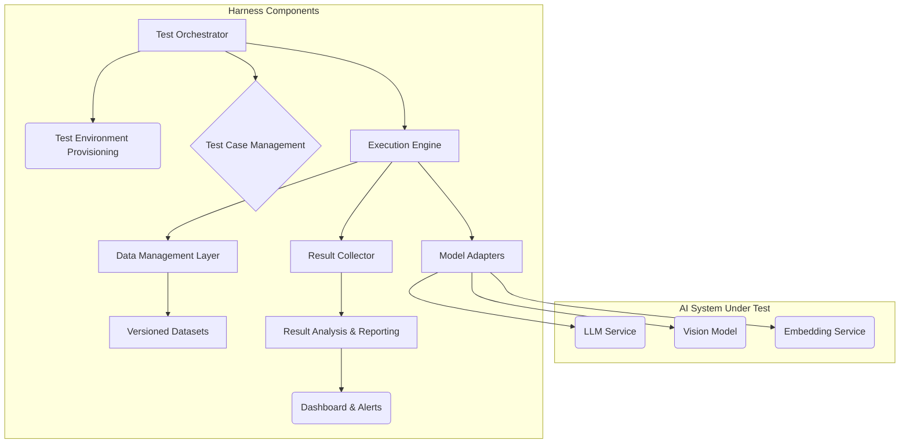

Large-scale AI 모델의 복잡성과 상호의존성은 견고한 통합 테스트 하네스의 필요성을 증대시킨다. AI 모델의 비결정적 특성, 방대한 데이터 의존성, 지속적인 진화는 전통적인 테스트 방식으로는 효과적으로 검증하기 어렵다. 통합 테스트 하네스는 이러한 도전 과제를 해결하고, 다양한 AI 모델 컴포넌트들이 실제 운영 환경과 유사하게 상호작용하는 방식을 체계적으로 검증하여, 배포 전 잠재적 오류를 식별하고 시스템 안정성을 보장한다.

## 핵심 디자인 패턴

하네스는 개별 모델의 정확도 측정뿐 아니라, 전체 AI 시스템의 End-to-End 동작 검증에 중점을 둔다.

### 모듈형 테스트 스위트 (Modular Test Suites)
AI 시스템은 다양한 모델과 서비스 조합으로 구성된다. 각 컴포넌트(LLM, 임베딩 모델 등)는 독립적으로 테스트되지만, 통합 단계에서는 이들의 상호작용에 초점을 맞춰야 한다. 기능별, 서비스별, 도메인별로 테스트를 분리 관리하고, 유연하게 조합하여 변경 시 영향을 받는 부분만 효율적으로 재검증한다.

### 데이터 중심 테스트 (Data-Centric Testing)
AI 모델 성능은 데이터에 크게 의존한다. 하네스는 실제 운영 데이터 분포를 반영하는 다양한 데이터셋을 활용해야 한다.
*   **버전 관리된 데이터셋 (Versioned Datasets)**: 테스트 데이터셋은 버전 관리가 되어야 하며, 모델 업데이트 시 해당 모델 버전에 맞는 데이터셋으로 테스트를 수행하여 회귀(regression)를 방지한다.
*   **데이터 증강 및 변이 (Data Augmentation & Variation)**: 실제 세계의 다양한 시나리오를 포괄하기 위해 데이터 증강 기법을 활용, 엣지 케이스 및 취약점 발견에 필수적이다.

### 시나리오 기반 End-to-End 테스트 (Scenario-Based End-to-End Testing)
사용자 여정 또는 비즈니스 프로세스를 모방하는 복잡한 시나리오를 정의하고, AI 시스템이 이 시나리오 전반에 걸쳐 예상대로 동작하는지 검증한다. 이는 여러 AI 모델과 외부 시스템 연동 시 발생하는 문제를 파악하는 데 효과적이다. (예: `agents/llm-agent-multi-stage-task-orchestration-patterns`와 같은 에이전트 협업 시나리오)

### 성능 및 강건성 테스트 (Performance & Robustness Testing)
대규모 AI 시스템은 높은 처리량(throughput)과 낮은 지연 시간(latency)을 요구한다. 하네스는 부하 테스트, 스트레스 테스트, 장애 주입 테스트를 통해 시스템의 성능 병목 현상과 안정성을 평가한다.
*   **지연 시간 및 처리량 (Latency & Throughput)**: 다양한 부하 조건에서 응답 시간과 초당 요청 수를 측정한다.
*   **에러 복구 및 회복탄력성 (Error Recovery & Resilience)**: 의도적으로 오류를 주입하여 시스템이 정상적으로 에러를 처리하고 복구하는지 검증한다. (참조: `agents/autonomous-agent-error-recovery-resilient-design`)

## 아키텍처 구성 요소

통합 테스트 하네스의 일반적인 아키텍처:

#### 1. 테스트 오케스트레이터 (Test Orchestrator)
테스트 실행 흐름 관리, 테스트 케이스 스케줄링, 환경 배포, 병렬 실행, 재시도 로직, 의존성 관리를 담당하는 핵심 컴포넌트.

#### 2. 데이터 관리 레이어 (Data Management Layer)
테스트 데이터셋의 생성, 저장, 버전 관리, 모델로의 주입을 담당.

#### 3. 모델 어댑터 (Model Adapters)
서로 다른 AI 모델 인터페이스를 표준화된 방식으로 추상화하여, 모델 유형 관계없이 일관된 테스트 실행을 지원한다. (참조: `harness-engineering/multi-llm-api-unified-interface-design-multi-llm-orchestration`)

#### 4. 결과 분석 및 보고 시스템 (Result Analysis & Reporting System)
테스트 결과를 수집, 분석, 시각화한다. 실패 원인 분석, 성능 트렌드 추적, 보고서 생성을 지원한다.



## 코드 예제

Python `pytest`와 `requests`를 활용한 AI 모델 통합 테스트 하네스 예시. AI 모델 API의 응답 구조와 지연 시간을 검증한다.

```python
import pytest
import requests
import time
import os

AI_SERVICE_ENDPOINT = os.getenv("AI_SERVICE_ENDPOINT", "http://localhost:8000/predict")
MAX_LATENCY_MS = int(os.getenv("MAX_LATENCY_MS", "500"))

test_scenarios = [
    {"input": "Tell me about large language models.", "expected_keywords": ["LLM", "transformer"]},
    {"input": "What is the capital of France?", "expected_keywords": ["Paris", "Europe"]},
    {"input": "Describe the concept of integrated test harness.", "expected_keywords": ["testing", "harness", "AI"]},
]

@pytest.fixture(scope="module")
def api_client():
    return requests.Session()

@pytest.mark.parametrize("scenario", test_scenarios, ids=[s["input"][:30] for s in test_scenarios])
def test_ai_model_integration_scenario(api_client, scenario):
    input_data = {"text": scenario["input"]}
    start_time = time.time()
    try:
        response = api_client.post(AI_SERVICE_ENDPOINT, json=input_data, timeout=10)
    except requests.exceptions.RequestException as e:
        pytest.fail(f"API request failed for input: {scenario['input']}. Error: {e}")

    latency_ms = (time.time() - start_time) * 1000

    assert response.status_code == 200, f"Expected status 200, got {response.status_code} for input: {scenario['input']}"
    assert latency_ms <= MAX_LATENCY_MS, f"Latency {latency_ms:.2f}ms exceeded max {MAX_LATENCY_MS}ms for input: {scenario['input']}"

    response_json = response.json()
    assert "response" in response_json, f"Response JSON missing 'response' field for input: {scenario['input']}"
    
    actual_response_text = response_json["response"].lower()
    for keyword in scenario["expected_keywords"]:
        assert keyword.lower() in actual_response_text, f"Response '{actual_response_text[:100]}...' missing keyword '{keyword}' for input: {scenario['input']}"
```
이 코드는 `pytest.mark.parametrize`를 활용하여 여러 시나리오에 대해 동일한 테스트 로직을 반복 적용하며, 환경 변수를 통해 유연하게 엔드포인트와 성능 임계값을 조정할 수 있다.

## 트레이드오프

대규모 AI 모델 통합 테스트 하네스 설계의 트레이드오프:

*   **높은 초기 투자 vs. 장기적 안정성 및 비용 절감**:
    *   **언제 좋나**: 복잡한 AI 시스템의 장기적인 안정성과 예측 가능성이 중요하며, 잦은 배포와 변경이 예상될 때 탁월하다. 초기 투자를 통해 결함을 조기에 발견하고, 운영 중 막대한 비용과 평판 손상을 예방한다.
    *   **언제 나쁘나**: MVP 개발처럼 빠른 시장 출시와 유연한 변경이 최우선이거나, AI 모델이 단순하고 변경 빈도가 매우 낮은 경우 과도한 설계는 불필요한 오버헤드가 될 수 있다.

*   **테스트 범위 포괄성 vs. 실행 시간 및 자원 소모**:
    *   **언제 좋나**: 모델 간 복잡한 상호작용이 많거나, 다양한 외부 시스템 연동이 필수적인 경우 포괄적인 테스트가 필요하다. 특히 안전 및 규제 준수가 중요한 도메인에서 유용하다.
    *   **언제 나쁘나**: CI/CD 파이프라인에서 빠른 피드백이 요구되거나, GPU 자원 사용이 제한적일 때, 너무 넓은 테스트 범위는 개발 속도를 저해하고 자원 낭비를 초래할 수 있다. 계층적 테스트 전략을 통해 중요도에 따라 테스트를 선별해야 한다.

*   **테스트 데이터 현실성 vs. 데이터 관리 복잡성 및 개인정보 보호**:
    *   **언제 좋나**: 실제 운영 데이터와 유사한 분포와 복잡성을 가진 데이터를 사용하여 테스트할 때 모델의 실제 성능을 가장 정확하게 예측할 수 있다. 모델 편향이나 공정성 문제 검증에 필수적이다.
    *   **언제 나쁘나**: 민감한 개인정보를 포함하는 데이터를 사용해야 할 경우, 데이터 익명화, 합성 데이터 생성 등 추가적인 보안 및 규제 준수 작업이 필요하며, 이는 데이터 관리 프로세스를 복잡하게 만들고 비용을 증가시킨다. (참조: `context-engineering/llm-agent-context-sensitive-data-leakage-prevention`)

*   **테스트 자동화 수준 vs. 유지보수 노력**:
    *   **언제 좋나**: 반복적인 수동 테스트 작업량이 많고, 모델 및 시스템 변경 빈도가 높을 때 자동화는 개발 효율성을 극대화하고 인적 오류를 줄인다. `harness-engineering/llm-app-automated-regression-testing`과 같이 회귀 테스트 자동화에 대표적이다.
    *   **언제 나쁘나**: AI 모델 출력 해석이 주관적이거나, 사람이 개입해야 하는 탐색적 테스트가 중요한 경우, 또는 시스템이 자주 변경되어 테스트 스크립트 자체가 빠르게 구식이 되는 상황에서는 과도한 자동화가 오히려 유지보수 부담을 가중시킬 수 있다.

## 실전 체크리스트

프로젝트에 대규모 AI 모델 통합 테스트 하네스를 적용할 때 다음 항목들을 검증해야 한다.

- [ ] **테스트 데이터셋 버전 관리 및 재생산성 확보**: 모든 테스트 데이터셋이 Git LFS, DVC 등 유사 시스템으로 버전 관리되며, 특정 모델 버전과 매핑되어 언제든지 동일한 테스트를 재생산할 수 있는가?
- [ ] **모듈형 테스트 스위트 구조 구현**: 각 AI 모델 컴포넌트(LLM, 임베딩, 에이전트 도구 등) 및 주요 서비스 인터페이스별로 독립적인 테스트 스위트가 정의되어 있으며, 이들이 유연하게 조합될 수 있는 구조인가?
- [ ] **핵심 시나리오 기반 End-to-End 테스트 케이스 정의**: 실제 사용자 워크플로우를 반영하는 5개 이상의 핵심 시나리오에 대해 End-to-End 테스트 케이스가 상세히 정의되고 구현되었는가?
- [ ] **성능 임계값 및 강건성 지표 설정**: AI 시스템의 응답 지연 시간(latency), 처리량(throughput), 에러율(error rate) 등 핵심 성능 지표에 대한 명확한 임계값이 설정되어 있으며, 이를 테스트 하네스가 자동으로 검증하는가?
- [ ] **테스트 결과 대시보드 및 알림 시스템 구축**: 모든 테스트 실행 결과가 중앙 집중식 대시보드에서 시각적으로 제공되며, 주요 실패나 성능 저하 발생 시 담당자에게 자동 알림이 발송되는가?
- [ ] **CI/CD 파이프라인 통합 및 자동화**: 통합 테스트 하네스가 CI/CD 파이프라인에 완벽하게 통합되어, 코드 변경 및 모델 업데이트 시 자동으로 테스트가 실행되고 결과를 피드백하는가? (참조: `harness-engineering/llm-application-reliable-ci-cd-deployment-pipelines`)
- [ ] **테스트 환경 격리 및 재현 가능성**: 개발, 스테이징, 프로덕션 환경과 유사한 테스트 환경이 격리되어 제공되며, 각 테스트 실행이 독립적이고 상호 영향을 주지 않아 항상 동일한 결과를 재현할 수 있는가?