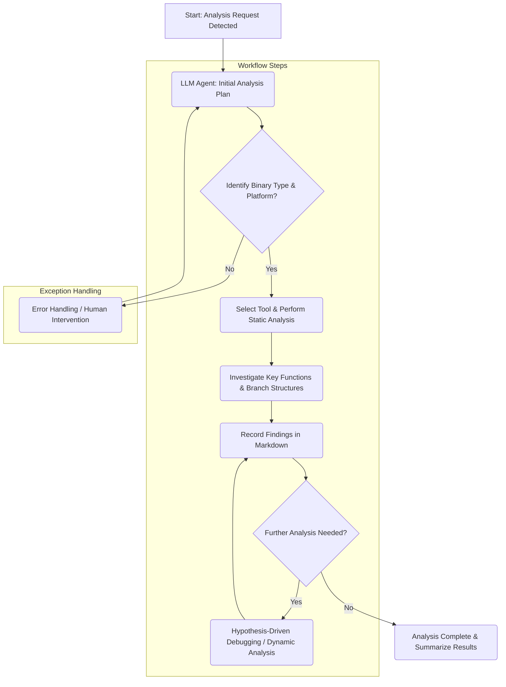

LLM(Large Language Model) 에이전트 기반 복합 분석 워크플로우는 기존의 수작업에 의존하던 복잡하고 전문적인 분석 작업을 자동화하고, 인간 전문가의 역량을 확장하는 새로운 패러다임을 제시한다. 특히 수십 년간 고도로 숙련된 인력에 의존해 온 하드웨어/소프트웨어 리버스 엔지니어링(Reverse Engineering, RE) 분야에서 LLM 에이전트의 도입은 작업 효율성을 혁신적으로 개선할 잠재력을 지닌다. 이 문서에서는 리버스 엔지니어링 사례를 중심으로 LLM 에이전트 기반 복합 분석 워크플로우의 설계 및 도입 방안을 심층적으로 다룬다.

## LLM 에이전트 기반 분석의 필요성

전통적인 리버스 엔지니어링은 바이너리(binary) 분석, 도구 선택, 주요 함수 및 분기 구조 조사 등 다단계에 걸쳐 고도의 지식과 경험을 요구하는 작업이다. 이러한 과정은 시간이 많이 소요되고, 분석자의 피로도에 따라 오류 발생 가능성이 높으며, 작업의 일관성을 유지하기 어렵다는 한계가 있다. LLM 에이전트는 이러한 반복적이고 지식 집약적인 작업을 자동화하고, 분석 과정을 표준화하며, 인간 분석자가 더욱 전략적인 의사결정에 집중할 수 있도록 지원한다.

## 리버스 엔지니어링 워크플로우 자동화 핵심 구성 요소

LLM 에이전트를 활용한 리버스 엔지니어링 워크플로우는 다음과 같은 핵심 구성 요소를 포함한다.

### 1. 바이너리 유형 및 플랫폼 파악

분석의 첫 단계는 대상 바이너리의 유형(예: PE, ELF, Mach-O)과 실행 플랫폼(Windows, Linux, macOS 등)을 정확하게 식별하는 것이다. LLM 에이전트는 특정 도구(예: `file` 명령어, `PEfile` 라이브러리)를 활용하여 이 정보를 자동으로 추출하고, 이를 기반으로 다음 분석 단계 및 도구 선택을 위한 계획을 수립한다.

### 2. 동적 도구 선택 및 정적/동적 분석

파악된 바이너리 유형 및 플랫폼에 따라 에이전트는 적절한 분석 도구(예: Ghidra, IDA Pro, objdump, radare2)를 동적으로 선택하고 실행한다. 초기에는 정적 분석을 통해 주요 함수, 문자열, import/export 테이블 등을 조사한다. 정적 분석만으로 한계에 도달하면, 에이전트는 디버거(debugger)를 이용한 동적 분석, 로그 수집, 실행 환경 제어 등의 다음 단계를 계획하고 수행한다.

### 3. 구조화된 발견 사항 기록 (Markdown 기반 컨텍스트 관리)

에이전트가 분석 과정에서 발견한 모든 정보(함수 시그니처, 분기 구조, 의심스러운 코드 패턴 등)는 Markdown 파일 형식으로 상세하게 기록된다. 이 Markdown 문서는 단순한 보고서가 아니라, 에이전트의 `context window`에 압축된 형태로 제공되어, 장기 실행(long-running) 작업에서 컨텍스트를 지속적으로 유지하고, 에이전트 교체 시에도 작업이 원활하게 이어지도록 하는 `persistent memory` 역할을 한다.

### 4. 가설 기반 디버깅 및 인간 피드백 루프

복합 분석에서는 잘못된 탐색 방향으로 진행될 위험이 항상 존재한다. 에이전트는 현재까지의 분석 결과를 바탕으로 `검증 가능한 가설`을 수립하고, 이를 CSV(Comma Separated Values) 파일에 기록한다. 인간 분석자는 에이전트의 대화 및 추론 기록을 검토하고, 가설 CSV를 통해 에이전트의 탐색 방향을 교정하거나 새로운 가설을 제시하는 `피드백 루프`에 참여한다. 이를 통해 인간의 직관과 에이전트의 자동화된 분석 능력이 시너지를 낸다.

## LLM 에이전트 워크플로우 예시 (Python)

다음은 LLM 에이전트가 초기 바이너리 분석 및 보고서 생성을 수행하는 개념적인 (Python) 코드 예시이다. 실제 구현에서는 더 복잡한 도구 통합과 에이전트 오케스트레이션이 필요하다.

```python
import os
import json

def analyze_binary_type(file_path: str) -> dict:
    """
    Analyzes the given binary file to determine its type and platform.
    This is a placeholder for actual binary analysis tools (e.g., `file` command, `pefile`, `elfy`).
    """
    if not os.path.exists(file_path):
        return {"error": f"File not found: {file_path}"}

    # Simulate analysis result based on extension
    file_extension = os.path.splitext(file_path)[1].lower()
    if file_extension == ".exe":
        return {"binary_type": "Executable", "platform": "Windows"}
    elif file_extension == ".elf":
        return {"binary_type": "Executable", "platform": "Linux/Unix"}
    elif file_extension == ".dll" or file_extension == ".so":
        return {"binary_type": "Shared Library", "platform": "Cross-platform"}
    else:
        return {"binary_type": "Unknown", "platform": "Generic"}

def generate_markdown_report(analysis_results: dict, output_dir: str = "./reports") -> str:
    """
    Generates a Markdown report from analysis results.
    """
    os.makedirs(output_dir, exist_ok=True)
    report_path = os.path.join(output_dir, "analysis_report.md")
    
    with open(report_path, "w", encoding="utf-8") as f:
        f.write("# LLM Agent Binary Analysis Report\n\n")
        f.write("## Overview\n\n")
        f.write(f"This report summarizes the initial analysis performed by the LLM agent.\n\n")
        f.write("## Detected Properties\n\n")
        for key, value in analysis_results.items():
            # Ensure values are safely rendered in markdown, e.g., escaping backticks if needed
            f.write(f"- **{key.replace('_', ' ').title()}**: `{value}`\n")
        f.write("\n## Agent Suggested Next Steps\n\n")
        if analysis_results.get("binary_type") == "Executable":
            f.write("- Investigate main function and branching structures.\n")
            f.write("- Select appropriate disassembler/debugger based on platform.\n")
        else:
            f.write("- Further static analysis using specialized tools.\n")
    return report_path

# Example Usage:
# sample_binary_path = "test_program.elf" # Replace with an actual binary path
# # Create a dummy file for demonstration
# with open(sample_binary_path, "w") as f:
#     f.write("dummy elf content")
# initial_analysis_results = analyze_binary_type(sample_binary_path)
# report_file_path = generate_markdown_report(initial_analysis_results)
# print(f"Analysis report generated at: {report_file_path}")
# os.remove(sample_binary_path) # Clean up dummy file
```

## LLM 에이전트 기반 분석 워크플로우 다이어그램



## 트레이드오프

LLM 에이전트 기반 복합 분석 워크플로우 도입 시 고려해야 할 주요 트레이드오프는 다음과 같다.

*   **자동화 효율성 vs. 탐색적 유연성**: LLM 에이전트는 반복적이고 정형화된 분석 작업에 뛰어난 효율성을 제공한다. 그러나 완전히 새로운 유형의 취약점 탐색이나 예측 불가능한 분석 경로에서는 인간의 직관과 창의적인 탐색이 여전히 필수적이다. 자동화는 `반복적이고 잘 정의된 작업`에 적합하며, `미지의 영역`에서는 유연성이 저하될 수 있다.
*   **컨텍스트 관리 복잡성 vs. 지속성**: Markdown 기반의 컨텍스트 문서화는 에이전트의 `장기 기억(long-term memory)`을 유지하고 `에이전트 교체(agent swapping)` 시 작업 연속성을 보장한다. 하지만 대규모, 고속 동시 작업 환경에서는 `컨텍스트 동기화`, `버전 관리`, `파싱 오버헤드`가 복잡성을 가중시킬 수 있다. `단일 에이전트/순차적 작업`에는 효율적이나, `멀티 에이전트/병렬 작업`에서는 동기화 문제가 발생할 수 있다.
*   **초기 구축 비용 vs. 장기적 운영 비용 절감**: LLM 에이전트와 전용 스킬(skill) 워커의 설계, 구현, 검증에는 상당한 초기 투자(개발 인력, LLM API 비용, 인프라)가 필요하다. 그러나 성공적으로 도입되면 수십 년간 고숙련 전문가에 의존하던 작업 시간을 크게 단축하고, `전문가 의존도를 낮춰` 장기적인 운영 비용을 절감할 수 있다. `단기 프로젝트`에는 부담이 크지만, `장기적인 유지보수 및 확장`이 필요한 시스템에는 효과적이다.
*   **LLM 의존도 vs. 제어 가능성**: 워크플로우의 핵심 로직이 LLM의 추론 능력에 크게 의존하기 때문에, LLM의 `환각(hallucination)`이나 `잘못된 추론`이 전체 분석 결과에 치명적인 영향을 줄 수 있다. 따라서 에이전트의 `추론 과정을 투명하게 기록`하고, `가설 기반 디버깅`과 같은 `강력한 인간 개입 및 교정 메커니즘`이 필수적이다. `높은 자율성`은 효율성을 높이지만, `정확성 및 신뢰성` 측면에서는 제어 메커니즘이 중요해진다.

## 실전 체크리스트

LLM 에이전트 기반 복합 분석 워크플로우를 프로젝트에 성공적으로 도입하기 위한 실전 체크리스트는 다음과 같다.

*   [ ] LLM 에이전트가 처리하는 `바이너리 유형 및 플랫폼 자동 식별` 작업의 `정확도(accuracy)`를 최소 (90%) 이상 달성했는지 벤치마킹 완료. (측정 가능)
*   [ ] 각 분석 단계별 에이전트 출력(예: Markdown 보고서, 가설 CSV)의 `스키마를 명확히 정의`하고, 이에 대한 `자동화된 유효성 검사(validation) 로직`을 구현했는지 확인.
*   [ ] Markdown 기반 `컨텍스트 압축 및 에이전트 스와핑 메커니즘`의 `PoC(Proof of Concept)`를 구현하고, 컨텍스트 일관성이 유지되는지 테스트 완료.
*   [ ] 에이전트가 생성한 `가설 기반 디버깅 프로세스`의 `자동화율 및 가설 검증 정확도`를 측정할 수 있는 `지표(metrics)`를 정의하고 추적 시스템을 구축했는지 확인.
*   [ ] 인간 분석가가 에이전트의 `추론 경로를 시각적으로 검토`하고, `잘못된 탐색 방향을 효율적으로 교정`할 수 있는 `UI/CLI 인터페이스`를 설계 및 구현 완료.
*   [ ] 정적 분석으로 `해결 불가능한 문제` 발생 시, 에이전트가 `동적 분석/디버깅으로 전환`하는 `의사결정 로직`에 대한 `다양한 테스트 케이스`를 마련하고 검증 완료.
*   [ ] `드리프트 감지(drift detection)` 또는 `docs/solutions/ 자동 생성` 워크플로우에 통합될 `새로운 워커(worker)`의 `API 및 인터페이스 표준화`를 완료하고, 기존 시스템과의 연동 가능성을 확보.