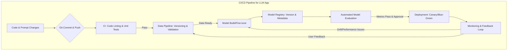

대규모 언어 모델(LLM) 기반 애플리케이션의 개발 주기는 기존 소프트웨어 개발보다 훨씬 빠르고 동적입니다. 프롬프트, 모델, 데이터셋의 빈번한 변경은 안정적인 서비스 운영을 위한 효율적인 CI/CD(Continuous Integration/Continuous Delivery) 파이프라인 구축을 필수적인 과제로 만듭니다. 본 문서는 LLM 애플리케이션에 특화된 CI/CD 파이프라인 구축 전략과 핵심 요소를 제시합니다.

## LLM CI/CD의 핵심 과제

기존 소프트웨어의 CI/CD는 주로 코드 변경에 집중하지만, LLM 애플리케이션은 코드 외에 다음과 같은 요소들을 통합 관리해야 합니다:

*   **데이터 관리 (`Data Management`)**: 학습 데이터셋, 평가 데이터셋의 버전 관리 및 품질 보증.
*   **프롬프트 엔지니어링 (`Prompt Engineering`)**: 프롬프트의 변경이 모델의 출력에 미치는 비결정론적 영향 관리, 버전 관리, 테스트.
*   **모델 버전 관리 (`Model Versioning`)**: Fine-tuning된 모델 또는 Embedding 모델의 지속적인 업데이트 및 버전 관리.
*   **평가 메트릭 복잡성 (`Evaluation Complexity`)**: LLM 출력의 품질(정확성, 일관성, 유해성 등)을 정량적으로 평가하기 어렵고, 사람의 개입이 필요한 경우가 많습니다.
*   **성능 및 비용 최적화 (`Performance & Cost Optimization`)**: 추론 Latency, Throughput, API 비용 최적화가 중요하며, 모델 버전별로 달라질 수 있습니다.
*   **드리프트 감지 (`Drift Detection`)**: 입력 데이터 분포의 변화(Data Drift)나 모델 성능 저하(Model Drift)를 감지하고, 이에 대한 자동화된 대응 메커니즘이 필요합니다.

## LLM CI/CD 파이프라인 구성 요소

LLM 기반 애플리케이션의 CI/CD 파이프라인은 기존 CI/CD 요소에 MLOps의 개념을 통합합니다.

### 1. 코드 및 프롬프트 버전 관리 (`Code & Prompt Versioning`)

애플리케이션 코드와 함께 프롬프트도 `Prompt as Code` 원칙에 따라 Git과 같은 버전 관리 시스템에 통합되어야 합니다. 이는 변경 이력을 추적하고, 롤백을 용이하게 하며, 코드와 프롬프트 간의 동기화를 보장합니다.

### 2. 데이터 파이프라인 및 버전 관리 (`Data Pipeline & Versioning`)

LLM의 성능은 데이터에 크게 의존합니다. 학습 및 평가 데이터셋은 DVC (Data Version Control), MLflow, 또는 Lakehouse 아키텍처를 통해 엄격하게 버전 관리되어야 합니다. 데이터 변경 시, 자동으로 데이터 유효성 검사(`Data Validation`)가 수행되고, 필요한 경우 모델 재학습을 트리거합니다.

### 3. 모델 빌드 및 레지스트리 (`Model Build & Registry`)

Fine-tuning 또는 Custom 모델 학습 과정은 자동화된 파이프라인을 통해 수행됩니다. 학습된 모델은 MLflow Model Registry, Hugging Face Hub 또는 클라우드 제공업체의 모델 레지스트리에 저장되어야 합니다. 각 모델 버전은 고유한 식별자를 가지며, 관련 메타데이터(학습 데이터, 하이퍼파라미터, 성능 메트릭)와 함께 관리됩니다.

### 4. 자동화된 테스트 및 평가 (`Automated Testing & Evaluation`)

이 단계는 LLM CI/CD에서 가장 중요한 부분 중 하나입니다. 기존 유닛/통합 테스트 외에 LLM 특화 테스트가 필수적입니다.

*   **프롬프트 테스트 (`Prompt Testing`)**: 다양한 입력과 기대 출력 쌍(Input-Output Pairs)을 정의하고, 프롬프트 변경 시 모델의 응답이 일관되고 예상대로 동작하는지 검증합니다.
*   **RAG (Retrieval-Augmented Generation) 평가**: RAG 시스템의 경우, 검색 결과의 관련성 (`Retrieval Relevance`)과 생성된 응답의 품질 (`Generation Quality`)을 함께 평가합니다.
*   **환각 및 편향 감지 (`Hallucination & Bias Detection`)**: 자동화된 도구를 사용하여 모델의 환각 현상이나 특정 편향을 감지하고, 임계값을 초과할 경우 배포를 중단하거나 수동 검토를 요청합니다.
*   **A/B 테스트 및 Canary 배포**: 새로운 프롬프트나 모델 버전을 프로덕션 환경에 직접 배포하기 전, 소수의 사용자에게만 노출하여 실제 성능을 검증합니다.

```python
# test_llm_response.py
import pytest
from your_llm_app.llm_service import generate_response

def test_greeting_response():
    assert "hello" in generate_response("Hi there").lower()

def test_specific_knowledge_retrieval():
    query = "What is the capital of France?"
    response = generate_response(query)
    assert "paris" in response.lower()

def test_hallucination_detection():
    # Simplified example: Check for known factual errors or inconsistencies
    response = generate_response("Who invented the internet in 1900?")
    assert "no single inventor" in response.lower() or "was not invented in 1900" in response.lower()

# ci_cd_pipeline.yml (GitHub Actions example)
name: LLM App CI/CD
on:
  push:
    branches:
      - main
  pull_request:
    branches:
      - main

jobs:
  build-and-test:
    runs-on: ubuntu-latest
    steps:
      - uses: actions/checkout@v4
      - name: Set up Python
        uses: actions/setup-python@v5
        with:
          python-version: '3.10'
      - name: Install dependencies
        run: pip install -r requirements.txt
      - name: Run unit and prompt tests
        run: pytest test_llm_response.py

  deploy:
    needs: build-and-test
    if: github.ref == 'refs/heads/main'
    runs-on: ubuntu-latest
    environment: production
    steps:
      - uses: actions/checkout@v4
      - name: Deploy LLM Service
        run: |
          echo "Deploying LLM application to production..."
          # Placeholder for actual deployment commands (e.g., Docker, Kubernetes, Serverless)
          # gcloud run deploy llm-service --image gcr.io/your-project/llm-service:${{ github.sha }}
          # kubectl apply -f kubernetes/deployment.yaml
          echo "Deployment complete."
```

### 5. 배포 전략 (`Deployment Strategies`)

LLM 애플리케이션의 배포는 컨테이너화(Docker)와 오케스트레이션(Kubernetes)을 통해 안정적으로 관리됩니다. Canary 배포나 Blue/Green 배포와 같은 전략은 새로운 모델이나 프롬프트 변경이 프로덕션 환경에 미칠 위험을 최소화합니다. 특히, LLM의 비결정론적 특성을 고려하여 점진적 배포가 중요합니다.

### 6. 모니터링 및 피드백 루프 (`Monitoring & Feedback Loop`)

배포 후에는 LLM 애플리케이션의 성능, 비용, 응답 품질을 지속적으로 모니터링해야 합니다. 주요 모니터링 지표는 다음과 같습니다:

*   **기술 지표**: Latency, Throughput, Error rates, GPU/CPU 사용량.
*   **비용 지표**: LLM API 호출 비용, 인프라 비용.
*   **품질 지표**: 사용자 만족도, Hallucination Rate, Bias Score, Data/Model Drift.

이상 징후 발생 시, 알림 시스템이 작동하여 담당자에게 통보하고, 필요 시 자동 롤백을 수행하거나 재학습 파이프라인을 트리거합니다. 사용자의 피드백은 모델 개선 및 재학습 데이터셋 구축에 활용되는 중요한 자원입니다.



## 트레이드오프

1.  **자동화된 모델 평가 vs. 수동 검토 (`Automated vs. Manual Model Evaluation`)**
    *   **장점**: 빠른 피드백 주기, 대규모 테스트 가능. 배포 속도 향상.
    *   **단점**: LLM 응답의 복잡성과 뉘앙스를 완벽하게 포착하기 어려움. 민감한 애플리케이션에서는 오탐(False Positives) 발생 가능성.
    *   **언제 좋고/언제 나쁜지**: 개발 초기, 빠른 반복이 중요하거나 명확한 정답이 있는 태스크(factual Q&A)에 좋습니다. 창의적/주관적 태스크, 고위험/규제 산업 애플리케이션에는 수동 검토 또는 Human-in-the-Loop 시스템이 필수적입니다.

2.  **단일 모델 vs. 다중 모델/라우팅 (`Single vs. Multi-Model/Routing`)**
    *   **장점**: 파이프라인 단순성, 관리 용이성. 초기 개발 및 소규모 서비스에 적합.
    *   **단점**: 특정 태스크에 최적화된 모델 활용 불가, 비용 비효율성. 확장성 및 유연성 제한.
    *   **언제 좋고/언제 나쁜지**: POC(Proof of Concept) 단계나 범용적인 단일 LLM으로 충분한 경우 좋습니다. 복잡한 워크로드, 다양한 태스크, 비용 효율성, Latency 최적화가 필요한 대규모 서비스에는 동적 모델 라우팅이 유리합니다.

3.  **Prompt-as-Code vs. 동적 Prompt 관리 (`Prompt-as-Code vs. Dynamic Prompt Management`)**
    *   **장점**: 프롬프트의 버전 관리, 코드와 함께 테스트, 협업 용이성, 재현성 보장.
    *   **단점**: 런타임에 유연한 프롬프트 변경 어려움, A/B 테스트를 위한 빠른 실험이 번거로울 수 있음.
    *   **언제 좋고/언제 나쁜지**: 안정적인 프롬프트가 필요한 핵심 기능, 규제 준수가 중요한 애플리케이션에 좋습니다. 빠른 실험과 최적화가 필요한 탐색 단계, 사용자 개인화가 중요한 경우 동적 관리가 더 적합할 수 있습니다.

4.  **Batch Inference vs. Real-time Inference (`Batch vs. Real-time Inference`)**
    *   **장점**: Batch Inference는 자원 효율적이며, 높은 처리량을 요구하는 비동기 작업에 적합합니다.
    *   **단점**: Batch Inference는 즉각적인 응답이 필요한 사용자 대면 서비스에는 부적합합니다.
    *   **언제 좋고/언제 나쁜지**: 주기적인 보고서 생성, 대규모 데이터 분석, 오프라인 작업 등에 Batch Inference가 좋습니다. 실시간 사용자 상호작용, 챗봇, 동적 콘텐츠 생성 등 Latency에 민감한 애플리케이션에는 Real-time Inference가 필수적입니다.

## 실전 체크리스트

LLM 기반 애플리케이션의 CI/CD 파이프라인을 구축하거나 개선할 때 다음 사항들을 검토해야 합니다.

- [ ] LLM 출력 품질 평가 지표 (예: Custom Metrics, ROUGE, BLEU)가 명확하게 정의되었으며, 자동화된 테스트에 활용되고 있는가?
- [ ] 프롬프트 변경 사항이 코드 버전 관리 시스템 (Git)에 기록되고 CI/CD 파이프라인의 트리거로 통합되었는가?
- [ ] 모델 추론 결과의 잠재적 편향 (Bias) 및 환각 (Hallucination)을 감지하는 자동화된 테스트가 파이프라인에 포함되어 있는가?
- [ ] A/B 테스트 또는 Canary 배포를 통해 새로운 모델/프롬프트 변경 사항을 점진적으로 적용하고 검증하는 메커니즘이 구축되었는가?
- [ ] 배포된 LLM 애플리케이션의 성능 (Latency, Throughput), 비용, 응답 품질을 지속적으로 모니터링하고, 이상 징후 발생 시 자동 알림 시스템이 작동하는가?
- [ ] 훈련 데이터와 운영 데이터 간의 분포 변화 (Data Drift) 및 모델 성능 저하 (Model Drift)를 주기적으로 감지하고, 필요한 경우 모델 재학습을 트리거하는 파이프라인이 구축되었는가?
- [ ] 모든 모델, 데이터셋, 프롬프트의 버전 이력이 추적 가능하며, 특정 버전으로의 롤백이 용이하게 설계되었는가?
