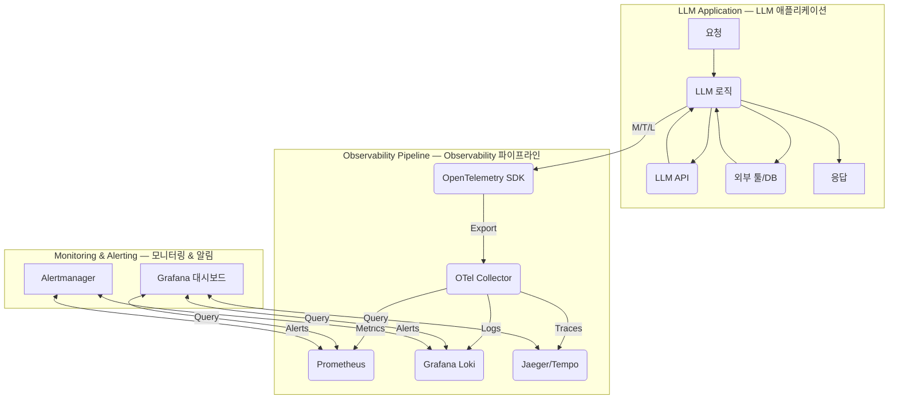

LLM 기반 애플리케이션의 운영 안정성과 신속한 문제 해결은 실시간 성능 모니터링 및 효과적인 로그 관리에 달려있습니다. 복잡한 추론 과정과 외부 서비스 의존성을 갖는 LLM 서비스의 특성상, 광범위한 영역에 대한 가시성 확보는 필수적입니다. 핵심 패턴은 통합된 대시보드 시스템 구축입니다.

## 핵심 LLM 애플리케이션 지표
LLM 성능과 안정성을 평가하려면 다음 핵심 지표를 모니터링해야 합니다.

*   **Latency 및 Responsiveness**: 최종 사용자 응답 시간(Response Time), 첫 토큰 생성 시간(TTFT).
*   **Resource Usage 및 Cost Efficiency**: Input/Output 토큰 사용량, LLM API 호출량.
*   **Error Rates 및 Reliability**: 모델/애플리케이션 오류율, Hallucination Rate, 툴/함수 호출 성공률.
*   **Context Window Usage**: 프롬프트의 총 길이 추적.

## 로그 관리 전략
LLM 애플리케이션 로그는 추론 과정, 프롬프트 입력, 응답 출력, 중간 단계 상세 기록이 필요합니다.

*   **Structured Logging**: 로그를 JSON 등 구조화된 형식으로 기록하여 검색 및 분석 용이.
*   **Trace IDs**: 요청의 모든 단계를 `trace_id`로 연결하여 종단 간 추적. OpenTelemetry 표준 활용.
*   **PII Masking**: 민감한 사용자 정보(PII) 유출 방지를 위한 프롬프트/응답 마스킹 처리 필수.

## 대시보드 설계 원칙
효과적인 대시보드는 신속한 문제 진단 및 해결책을 지원합니다.

*   **Granularity**: 전체 개요부터 상세 트레이스까지 다양한 수준 제공.
*   **Actionability**: 임계값 초과 시 즉각적인 조치 유도 및 관련 로그/트레이스 연결.
*   **User-centric Views**: 개발자, SRE 등 역할에 맞춘 정보 구성.

## 구현 패턴: OpenTelemetry, Prometheus, Grafana/Loki
LLM 애플리케이션 모니터링에 널리 사용되는 패턴은 `OpenTelemetry`로 지표, 로그, 트레이스를 수집하고, `Prometheus` (지표), `Loki` (로그), `Grafana` (시각화)를 통합하는 것입니다.



**코드 예시: OpenTelemetry 통합 LLM 호출 (Python)**
```python
import logging, time
from opentelemetry import trace, metrics
from opentemetry.sdk.resources import Resource
from opentemetry.sdk.trace import TracerProvider, BatchSpanProcessor
from opentemetry.sdk.trace.export import ConsoleSpanExporter
from opentemetry.sdk.metrics import MeterProvider, PeriodicExportingMetricReader
from opentemetry.sdk.metrics.export import ConsoleMetricExporter
from opentemetry.sdk._logs import LoggerProvider, LoggingHandler, BatchLogProcessor
from opentemetry.sdk._logs.export import ConsoleLogExporter

# OpenTelemetry 최소 설정 (콘솔 출력)
resource = Resource.create({"service.name": "llm-obs-demo"}); trace.set_tracer_provider(TracerProvider(resource=resource)); trace.get_tracer_provider().add_span_processor(BatchSpanProcessor(ConsoleSpanExporter()))
metrics.set_meter_provider(MeterProvider(resource=resource, metric_readers=[PeriodicExportingMetricReader(ConsoleMetricExporter())]))
logger_provider = LoggerProvider(resource=resource); logging.getLogger().addHandler(LoggingHandler(logger_provider=logger_provider)); logger_provider.add_log_processor(BatchLogProcessor(ConsoleLogExporter()))

tracer = trace.get_tracer(__name__); meter = metrics.get_meter(__name__); app_logger = logging.getLogger("llm_logger")
llm_latency = meter.create_histogram("llm_call_latency_sec"); llm_tokens = meter.create_counter("llm_total_tokens")

def instrumented_llm_call(prompt: str):
    with tracer.start_as_current_span("llm_request_span") as span:
        start_t = time.time(); time.sleep(0.1); latency = time.time() - start_t # Simulate LLM call
        llm_latency.record(latency, {"model": "gpt-4"}); llm_tokens.add(50, {"type": "input"}); llm_tokens.add(100, {"type": "output"})
        app_logger.info("LLM 요청 완료", extra={"latency_ms": int(latency*1000)}); span.set_status(trace.Status(trace.StatusCode.OK))
        return "Simulated LLM response."

if __name__ == "__main__": instrumented_llm_call("What is OpenTelemetry?")
```

## 트레이드오프
LLM 모니터링 시스템 구축은 다음과 같은 트레이드오프를 고려해야 합니다.

*   **구현 복잡성 vs. 문제 해결 효율성**: 복잡한 LLM 체인에서 문제 파악에 유리하나, 초기 단계 과도한 구축은 자원 낭비.
*   **데이터 수집량 vs. 가시성/비용**: 상세 데이터는 이해도를 높이지만, 스토리지 및 처리 비용 증가와 노이즈 발생 가능. PII 마스킹 필수.
*   **실시간 처리 vs. 시스템 부하**: 실시간 감지는 즉각 대응을 가능하게 하지만, 고성능 시스템 요구로 인한 부하 및 비용 상승.
*   **표준화 도구 vs. 특정 LLM 최적화**: OpenTelemetry는 벤더 중립적이나, 특정 LLM의 고급 기능 통합 시 커스텀 개발 필요.

## 실전 체크리스트
LLM 애플리케이션 모니터링 대시보드 적용 시 검증 항목입니다.

- [x] 핵심 지표(Latency, 토큰, 오류율 등) 정의 및 OpenTelemetry를 통한 수집 메커니즘 구현.
- [x] 모든 LLM 호출 및 관련 로직에 `trace_id`를 포함한 구조화된 로깅 적용.
- [x] PII 마스킹 처리 구현 및 보안/개인정보 보호 정책 준수 검토.
- [x] 핵심 지표 임계값 초과 시 자동 알림(Slack 등) 발송 시스템 구성 및 테스트.
- [x] 개발자, SRE, Product Owner 등 역할별 맞춤형 Grafana 대시보드 설계 및 배포.
- [x] 중앙 집중식 로그 관리 시스템(Loki 등) 구축 및 효과적인 검색/필터링 기능 확인.
- [x] LLM 토큰 사용량 및 API 비용 기반 자동화된 비용 분석 보고서 생성 및 모니터링.