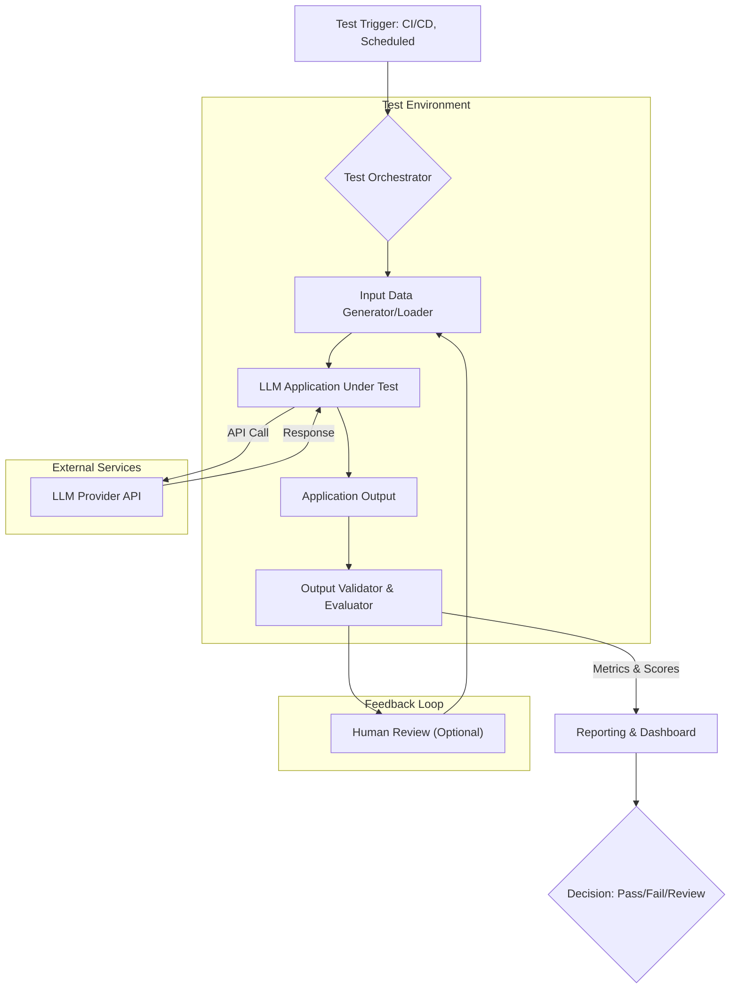

The inherent non-determinism and emergent behaviors of Large Language Model (LLM) based applications necessitate robust end-to-end (E2E) testing. Traditional software testing paradigms often fall short in validating complex, conversational, and context-dependent LLM workflows. An E2E test harness for LLM applications provides a structured, automated environment to ensure reliability, performance, and alignment with desired outcomes across the entire application lifecycle, particularly in 2026's rapidly evolving AI landscape.

### LLM E2E 테스트 Harness의 핵심 구성 요소

LLM 기반 애플리케이션의 E2E 테스트 Harness는 다음과 같은 핵심 구성 요소들을 포함하여 복잡한 상호작용을 효과적으로 검증한다.

1.  **입력 데이터 관리 (Input Data Management):**
    *   다양한 사용자 시나리오를 대표하는 프롬프트, 사용자 대화 이력, 외부 데이터 (RAG 문서 등)를 체계적으로 관리한다.
    *   Edge case, adversarial prompt, long-tail 시나리오 등 광범위한 입력 데이터를 포함하여 모델의 견고함을 평가한다.
    *   데이터 드리프트 (data drift) 발생 시 테스트 케이스를 자동으로 업데이트하거나 새로운 테스트 케이스를 생성하는 메커니즘을 포함할 수 있다.

2.  **테스트 오케스트레이션 및 실행 (Test Orchestration & Execution):**
    *   테스트 스위트 (test suite)를 정의하고 실행 순서를 관리하는 중앙 컨트롤러 역할을 한다.
    *   병렬 테스트 실행을 지원하여 테스트 시간을 단축하고, 다양한 LLM 모델 또는 버전에 대한 동시 평가를 가능하게 한다.
    *   CI/CD 파이프라인과 통합되어 코드 변경 시 자동으로 E2E 테스트를 트리거한다.

3.  **LLM 상호작용 계층 (LLM Interaction Layer):**
    *   테스트 Harness가 실제 LLM API (예: OpenAI, Anthropic, Gemini)와 상호작용하는 부분을 추상화한다.
    *   모델 전환, 재시도 로직, 캐싱 (caching) 메커니즘을 포함하여 테스트 실행의 효율성과 안정성을 높인다.
    *   특정 테스트 시나리오를 위해 LLM 응답을 Mocking하거나 Stubbing하는 기능을 제공한다.

4.  **출력 검증 및 평가 (Output Validation & Evaluation):**
    *   LLM의 응답이 기대하는 품질, 정확성, 안전성 기준을 충족하는지 검증하는 가장 중요한 부분이다.
    *   **정량적 검증 (Quantitative Validation):** 특정 키워드 포함 여부, JSON 형식 유효성, 길이 제한 등 규칙 기반의 자동 검증.
    *   **정성적 검증 (Qualitative Validation):**
        *   **LLM-as-a-Judge:** 다른 LLM을 사용하여 대상 LLM의 응답을 평가하는 기법 (예: CoT prompting을 활용한 점수화).
        *   **Human-in-the-Loop (HITL):** 복잡하거나 판단하기 어려운 케이스에 대해 사람의 수동 검토를 통합한다.
    *   **메트릭 기반 평가:** Hallucination rate, Toxicity score, Relevance, Fluency 등 다양한 LLM 평가 메트릭을 계산하고 추적한다.

5.  **환경 및 리소스 관리 (Environment & Resource Management):**
    *   각 테스트 실행이 독립적인 환경에서 이루어지도록 샌드박스 (sandbox) 환경을 제공한다.
    *   API 키, 데이터베이스 연결, 외부 서비스 종속성 등을 안전하게 관리한다.
    *   테스트 환경에서의 GPU 자원 및 API 토큰 사용량을 모니터링하여 비용을 최적화한다.

### E2E 테스트 Harness 워크플로우

LLM 애플리케이션의 엔드투엔드 테스트 Harness는 다음 다이어그램과 같은 일반적인 워크플로우를 따른다.



### 코드 예제: 간단한 Python 기반 E2E 테스트

아래는 Python의 `pytest`와 `unittest.mock`을 사용하여 LLM 기반 애플리케이션의 E2E 테스트 Harness의 일부를 구성하는 예제이다. 실제 LLM과 Mock LLM을 모두 사용하여 유연한 테스트 전략을 보여준다.

```python
# app.py (LLM 기반 애플리케이션의 핵심 로직)
import os
import openai

class LLMService:
    def __init__(self, api_key: str):
        openai.api_key = api_key

    def generate_response(self, prompt: str, model: str = "gpt-4o") -> str:
        try:
            response = openai.chat.completions.create(
                model=model,
                messages=[{"role": "user", "content": prompt}],
                temperature=0.7,
                max_tokens=100
            )
            return response.choices[0].message.content
        except Exception as e:
            return f"Error: {e}"

class MyLLMApp:
    def __init__(self, llm_service: LLMService):
        self.llm_service = llm_service

    def process_query(self, query: str) -> str:
        if "안녕" in query:
            return "안녕하세요! 무엇을 도와드릴까요?"
        
        prompt = f"다음 사용자 질의에 친절하게 답변해 주세요: {query}"
        llm_response = self.llm_service.generate_response(prompt)
        return llm_response

# test_app.py (테스트 Harness 부분)
import pytest
from unittest.mock import MagicMock
from app import LLMService, MyLLMApp

@pytest.fixture
def mock_llm_service():
    """Mock LLM Service for deterministic testing."""
    mock = MagicMock(spec=LLMService)
    mock.generate_response.return_value = "Mocked LLM response: Hello, how can I help?"
    return mock

@pytest.fixture
def real_llm_service():
    """Real LLM Service for integration/E2E testing."""
    api_key = os.environ.get("OPENAI_API_KEY")
    if not api_key:
        pytest.skip("OPENAI_API_KEY not set. Skipping real LLM tests.")
    return LLMService(api_key)

def test_my_llm_app_greeting(mock_llm_service):
    """Test a simple, deterministic greeting."""
    app = MyLLMApp(mock_llm_service)
    response = app.process_query("안녕")
    assert "안녕하세요!" in response

def test_my_llm_app_general_query_mocked(mock_llm_service):
    """Test a general query using a mocked LLM response."""
    app = MyLLMApp(mock_llm_service)
    response = app.process_query("오늘 날씨는 어때?")
    assert "Mocked LLM response" in response
    mock_llm_service.generate_response.assert_called_once()
    assert "오늘 날씨는 어때?" in mock_llm_service.generate_response.call_args[0][0] # Check prompt content

@pytest.mark.e2e
def test_my_llm_app_general_query_real_llm(real_llm_service):
    """E2E test with a real LLM, verifying expected content."""
    app = MyLLMApp(real_llm_service)
    query = "가장 좋아하는 과일은 무엇인가요?"
    response = app.process_query(query)
    print(f"Real LLM Response: {response}")
    assert "Error:" not in response # Ensure no API errors
    assert len(response) > 10 # Ensure a meaningful response length
    # Further validation could involve semantic checks or LLM-as-a-judge
    # For example, use another small LLM to check if the response is "about fruit".
```

위 예제에서 `@pytest.mark.e2e` 데코레이터를 사용하여 실제 LLM을 호출하는 테스트를 분리할 수 있다. 이는 CI/CD 파이프라인에서 E2E 테스트를 특정 환경에서만 실행하거나, 별도의 비용 및 시간 제약 하에 관리하는 데 유용하다.

### ## 트레이드오프

1.  **높은 초기 구축 비용 vs. 장기적 신뢰성 확보**:
    *   **언제 좋음:** 복잡한 LLM 애플리케이션으로, 장기적인 운영과 높은 신뢰성이 요구되는 서비스 (예: 금융, 헬스케어 챗봇)에 적합하다. 초기 비용을 상회하는 운영 안정성 확보 및 사용자 신뢰 구축에 기여한다.
    *   **언제 나쁨:** MVP (Minimum Viable Product) 단계이거나, 빠르게 시장에 출시하여 사용자 피드백을 우선적으로 받아야 하는 경우. 단순한 LLM 프롬프트 기반 PoC (Proof of Concept)에는 과도한 오버헤드가 될 수 있다.

2.  **테스트 실행 시간 및 비용 증가 vs. Hallucination 및 오작동 감소**:
    *   **언제 좋음:** LLM의 비결정적 특성으로 인한 Hallucination, 편향 (bias), 보안 취약점 등을 사전에 탐지하여 심각한 비즈니스 리스크를 예방해야 하는 경우. 특히 다수의 모델 업데이트나 프롬프트 변경이 잦은 환경에서 효과적이다.
    *   **언제 나쁨:** 테스트 실행 속도가 중요하거나, 예산 제약이 엄격한 프로젝트. 테스트 실패가 비즈니스에 미치는 영향이 미미하고, 신속한 배포가 최우선인 경우.

3.  **복잡한 Output Validation 로직 vs. 단순한 키워드 매칭**:
    *   **언제 좋음:** LLM 응답의 `의미론적 정확성 (Semantic Accuracy)`, `일관성 (Consistency)`, `톤 앤 매너 (Tone and Manner)` 등 정성적인 품질이 중요한 애플리케이션에 필수적이다. LLM-as-a-Judge나 정교한 룰 기반 시스템은 인간 검증을 보완한다.
    *   **언제 나쁨:** LLM이 단순한 팩트 추출이나 특정 형식(예: JSON)으로만 응답하면 되는 경우. 이러한 경우 복잡한 Output Validation은 불필요한 개발 및 유지보수 부담을 가중시킨다.

4.  **Mocking/Stubbing 활용 vs. Real LLM 호출**:
    *   **언제 좋음:** 단위 테스트나 통합 테스트 단계에서 비결정적 외부 의존성 (LLM API)을 격리하여 테스트의 안정성과 속도를 확보할 때. LLM API 호출 비용을 절감하는 데 매우 효과적이다.
    *   **언제 나쁨:** 실제 운영 환경에서의 LLM 동작을 정확하게 검증해야 하는 E2E 테스트 단계에서는 Mocking이 현실을 반영하지 못할 수 있다. Mock된 응답으로는 LLM의 미묘한 동작 변화나 신규 모델의 성능 저하를 감지하기 어렵다.

### ## 실전 체크리스트

LLM 기반 애플리케이션의 엔드투엔드 테스트 Harness를 구축할 때 다음 항목들을 검증해야 한다.

-   [ ] **다양한 입력 시나리오 커버리지:** 최소 100개 이상의 다양한 사용자 질의, 엣지 케이스, 비정상적인 입력 데이터를 포함하는 테스트 세트가 정의되어 있는가? (예: `input_data.json` 파일에 저장)
-   [ ] **CI/CD 파이프라인 통합:** Pull Request (PR)가 병합되기 전에 E2E 테스트가 자동으로 실행되고, 실패 시 병합을 차단하는 메커니즘이 구현되어 있는가?
-   [ ] **테스트 격리 및 샌드박스 환경:** 각 테스트 실행이 독립적인 환경에서 이루어지며, 외부 리소스 (DB, LLM API 호출)가 명확히 분리되거나 Mocking되어 있는지 확인했는가?
-   [ ] **LLM-as-a-Judge 활용 검토:** LLM 응답의 `정확성`, `관련성`, `완전성`을 평가하기 위해 최소 1개 이상의 LLM-as-a-Judge 기반 평가 로직이 포함되어 있는가? (예: `evaluate_response` 함수)
-   [ ] **비용 및 성능 모니터링:** E2E 테스트 실행 시 LLM 토큰 사용량, API 호출 횟수, Latency 등의 메트릭을 수집하고 대시보드에서 시각화하고 있는가?
-   [ ] **버전 관리 및 재현성:** 테스트 데이터, 프롬프트 템플릿, 모델 버전, 그리고 테스트 결과가 모두 버전 관리 시스템 (Git 등)으로 추적되며, 특정 시점의 테스트를 재현할 수 있는가?
-   [ ] **인간 검토 (Human-in-the-Loop) 메커니즘:** 자동화된 검증으로 판단하기 어려운 케이스에 대해 Slack 알림이나 웹 인터페이스를 통해 인간 검토를 요청하는 프로세스가 정의되어 있는가? (예: 특정 임계치 이하 점수 또는 플래그가 지정된 응답)