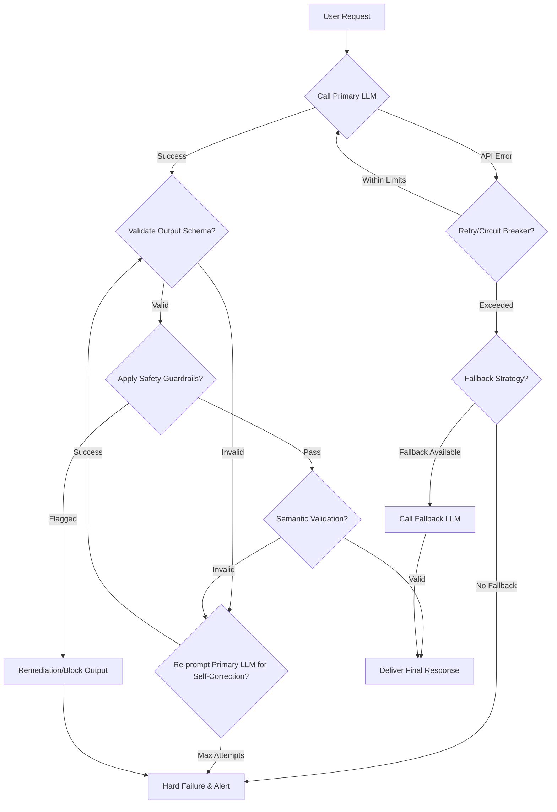

LLM (Large Language Model) 기반 애플리케이션은 기존 소프트웨어와 다른 고유한 에러 및 예외 처리 과제를 안고 있습니다. LLM의 확률론적 특성, 외부 API 의존성, 비결정론적 출력, 그리고 예측 불가능한 토큰 사용량은 시스템의 안정성과 신뢰성을 확보하기 위한 견고한(robust) 디자인 패턴을 필수적으로 요구합니다. 사용자 경험을 저해하거나, 시스템 비용을 초과하거나, 심지어 보안 문제까지 야기할 수 있는 잠재적 실패 지점을 사전에 방지하고 복구하는 메커니즘은 프로덕션 환경에서 LLM 애플리케이션의 성공을 좌우합니다.

## LLM 애플리케이션의 주요 에러 유형

LLM 기반 시스템에서 발생할 수 있는 주요 에러 유형은 다음과 같습니다:

### 1. API 연결 및 Rate Limit 에러
LLM 제공자의 API 서버 문제, 네트워크 지연, 그리고 API 호출 Rate Limit 초과 등은 가장 흔한 외부 의존성 에러입니다. 이러한 에러는 일반적으로 일시적이며, 적절한 재시도(retry) 메커니즘으로 복구될 수 있습니다.

### 2. LLM 출력 파싱/스키마 불일치
LLM이 JSON이나 특정 구조의 텍스트를 출력하도록 프롬프트하더라도, 항상 정확한 스키마를 따르지 않을 수 있습니다. 이는 특히 Agentic 워크플로우에서 Tool 사용 시 критический(critical)한 문제로 이어질 수 있습니다. 잘못된 형식의 출력은 다운스트림 로직의 오작동을 유발합니다.

### 3. 내용 검증 및 안전성 위반 (Content Moderation/Safety Violation)
LLM의 출력은 때때로 부적절하거나 유해한 내용을 포함할 수 있습니다 (Hallucination 포함). 사용자에게 전달되기 전에 반드시 내용 검증(Content Moderation) 및 안전성 가드레일(Safety Guardrails)을 통과해야 합니다.

### 4. Tool 실행 실패 (Agentic Systems)
LLM이 외부 Tool을 호출하는 Agentic 시스템에서는 Tool 자체의 실행 실패(예: 외부 API 호출 실패, 권한 문제)가 LLM 애플리케이션의 전체 워크플로우를 중단시킬 수 있습니다.

### 5. Semantic 에러 및 Hallucination
LLM이 문법적으로는 옳지만, 사실과 다르거나, 비논리적이거나, 요청의 의도를 완전히 벗어나는 응답(Hallucination)을 생성할 수 있습니다. 이는 감지하고 복구하기 가장 어려운 유형의 에러 중 하나입니다.

### 6. 비용 초과 (Cost Overrun)
비효율적인 프롬프트 디자인, 무한 루프, 과도한 재시도 등으로 인해 LLM 토큰 사용량이 예상치를 초과하여 비용이 급증할 수 있습니다.

## 견고한 에러 처리를 위한 디자인 패턴

### 1. 재시도(Retry)와 지수적 백오프(Exponential Backoff)
일시적인 네트워크 문제나 Rate Limit 에러에 대응하기 위한 핵심 패턴입니다. `tenacity`와 같은 라이브러리를 사용하여 구현할 수 있습니다. 재시도 간격이 점진적으로 증가하는 지수적 백오프는 서버에 가해지는 부하를 줄이고, 복구 성공률을 높입니다.

```python
from tenacity import retry, stop_after_attempt, wait_exponential, retry_if_exception_type
import openai
import json

class LLMAPIError(Exception):
    pass

@retry(
    stop=stop_after_attempt(5),
    wait=wait_exponential(multiplier=1, min=4, max=10),
    retry=retry_if_exception_type(openai.APITimeoutError) | retry_if_exception_type(openai.APIError)
)
def call_llm_with_retry(prompt: str) -> str:
    try:
        response = openai.chat.completions.create(
            model="gpt-4o-mini",
            messages=[{"role": "user", "content": prompt}],
            temperature=0.7
        )
        return response.choices[0].message.content
    except openai.RateLimitError as e:
        print(f"Rate limit exceeded. Retrying...: {e}")
        raise LLMAPIError("Rate limit error") from e # Custom exception to trigger retry
    except openai.APIError as e:
        print(f"API Error. Retrying...: {e}")
        raise LLMAPIError("API error") from e

# Example usage
try:
    result = call_llm_with_retry("Tell me a short story about a brave knight.")
    print(result)
except LLMAPIError as e:
    print(f"Final failure after retries: {e}")
```

### 2. Fallback 메커니즘
주요 LLM API가 지속적으로 실패하거나 특정 유형의 에러(예: 토큰 초과)가 발생할 때, 대체 수단으로 전환하는 전략입니다. 이는 사용자 경험을 유지하는 데 중요합니다.

*   **대체 LLM 사용**: 더 저렴하거나, 더 간단한 모델로 전환 (예: `gpt-4` -> `gpt-3.5`).
*   **단순화된 프롬프트**: 복잡한 요청을 간단한 버전으로 재시도.
*   **캐시된 응답**: 이전에 성공한 유사한 요청의 결과를 반환.
*   **Human-in-the-Loop**: 복구가 불가능한 경우, 사람의 개입을 요청.

### 3. 구조화된 출력 유효성 검사 (Structured Output Validation)
LLM 출력이 특정 스키마를 따라야 할 때 `Pydantic` (Python) 또는 `Zod` (TypeScript) 같은 라이브러리를 사용하여 출력을 즉시 검증합니다. 스키마에 맞지 않는 경우, LLM에게 재시도를 요청하거나 Fallback 전략을 적용합니다.

```python
from pydantic import BaseModel

class ArticleSummary(BaseModel):
    title: str
    summary: str
    keywords: list[str]

def validate_llm_output(output: str) -> ArticleSummary | None:
    try:
        data = json.loads(output)
        return ArticleSummary(**data)
    except (json.JSONDecodeError, ValueError) as e:
        print(f"Output validation failed: {e}")
        return None
```

### 4. 가드레일(Guardrails) 및 안전 필터
LLM의 출력 전후에 안전성 검사를 수행하여 유해하거나 부적절한 내용을 필터링합니다. 이는 LLM 제공자의 자체 모더레이션 API를 사용하거나, 커스텀 필터링 로직을 구현하여 적용할 수 있습니다. 예를 들어, 특정 키워드 목록, 정규 표현식, 또는 다른 소형 LLM/분류 모델을 활용할 수 있습니다.

### 5. Circuit Breaker 패턴
서비스가 반복적으로 실패할 때, 더 이상의 요청을 보내지 않고 빠르게 실패(fail-fast)하도록 시스템을 설계하는 패턴입니다. 이는 다운스트림 시스템의 부하를 줄이고, 완전한 서비스 중단을 방지합니다. 예를 들어, 일정 횟수 이상의 LLM API 호출 실패 시, 5분간 해당 API 호출을 중단하고 Fallback을 강제하는 방식입니다.

### 6. Semantic 유효성 검사 및 자가 수정(Self-Correction)
가장 진보된 패턴으로, LLM의 응답이 `Semantic`적으로 타당한지 검증하고, 필요시 LLM 스스로 수정하도록 유도합니다. 예를 들어, 한 LLM이 생성한 코드의 Unit Test를 다른 LLM이 검토하고, 실패하는 경우 첫 번째 LLM에게 수정을 요청하는 방식입니다. 이는 Agentic 시스템에서 중요한 역할을 합니다.



### 7. 비용 모니터링 및 제한
LLM 토큰 사용량을 실시간으로 모니터링하고, 설정된 임계값(threshold)을 초과할 경우 알림을 보내거나 자동으로 특정 기능(예: 복잡한 Chain, 특정 LLM 모델)을 제한하는 시스템을 구축합니다. 이는 예상치 못한 비용 지출을 방지합니다.

## 트레이드오프

*   **복잡성 vs. 견고성 (Complexity vs. Robustness)**
    *   **언제 좋고**: 높은 신뢰성과 가용성이 필수적인 프로덕션 시스템에서 시스템의 장애 허용 능력을 극대화해야 할 때 좋습니다. 복잡한 에러 처리 로직은 장기적인 유지보수 비용을 줄여줍니다.
    *   **언제 나쁜지**: 개발 초기 단계나 간단한 Proof-of-Concept (PoC) 프로젝트에서는 과도한 복잡성이 개발 속도를 저해하고 불필요한 오버헤드를 발생시킬 수 있습니다.

*   **성능 vs. 재시도/대체 (Performance vs. Retry/Fallback)**
    *   **언제 좋고**: 외부 서비스의 일시적인 문제로 인해 사용자 경험이 저하되는 것을 방지해야 할 때 좋습니다. 안정적인 서비스 제공이 최우선 목표인 경우, 약간의 지연은 감수할 만합니다.
    *   **언제 나쁜지**: 실시간 응답 속도가 매우 중요한 애플리케이션(예: Latency에 민감한 대화형 에이전트)에서는 재시도나 대체 메커니즘이 추가적인 지연을 유발하여 사용자 만족도를 떨어뜨릴 수 있습니다.

*   **비용 vs. 안정성 (Cost vs. Stability)**
    *   **언제 좋고**: 핵심 비즈니스 로직에 LLM이 깊이 관여되어 있어, 서비스 중단이나 품질 저하가 직접적인 매출 손실로 이어지는 경우, 안정성 확보를 위한 추가 비용 투자는 정당화됩니다.
    *   **언제 나쁜지**: 예산 제약이 크거나, LLM 기능이 보조적인 역할에 불과한 경우, 고품질 Fallback 모델이나 공격적인 재시도 정책으로 인한 비용 증가는 비효율적일 수 있습니다.

*   **과도한 복구 시도 vs. 빠른 실패 (Over-recovery vs. Fail-fast)**
    *   **언제 좋고**: 예상치 못한 에러 상황에서도 최대한 서비스 연속성을 확보하여 사용자에게 최종적인 실패를 알리지 않아야 할 때 좋습니다. 특히, 비결정론적 LLM의 특성을 고려할 때, 시스템이 자체적으로 복구를 시도하는 것이 더 나은 사용자 경험을 제공할 수 있습니다.
    *   **언제 나쁜지**: 복구 시도가 시스템 리소스를 과도하게 소모하거나, 잘못된 응답을 계속 생성하여 오히려 사용자에게 더 큰 혼란을 줄 수 있는 경우에는 빠른 실패가 더 나은 전략입니다. 디버깅이 어려워질 수 있습니다.

## 실전 체크리스트

LLM 기반 애플리케이션에 견고한 에러 처리 패턴을 적용하기 위한 실전 체크리스트입니다.

*   [ ] 모든 LLM API 호출에 대해 **재시도 로직(Retry Logic)**과 **지수적 백오프(Exponential Backoff)**가 구현되었는가?
*   [ ] 주요 LLM 기능의 장애 발생 시 작동할 수 있는 **최소 한 가지의 Fallback 전략** (예: 대체 모델, 캐시된 응답, 단순화된 프롬프트)이 설계되고 구현되었는가?
*   [ ] LLM의 구조화된 출력(JSON 등)에 대해 **스키마 유효성 검사(Schema Validation)** (예: Pydantic, Zod)가 적용되었으며, 실패 시의 처리 로직이 명확한가?
*   [ ] 모든 LLM 출력에 대해 **내용 검증 및 안전성 가드레일(Content Moderation & Safety Guardrails)**이 사전/사후 처리 단계에 통합되었는가?
*   [ ] LLM 관련 에러 및 토큰 사용량을 실시간으로 **모니터링**하고, **알림(Alerting) 임계값**이 설정되어 비용 초과나 심각한 서비스 저하를 조기에 감지할 수 있는가?
*   [ ] Agentic 시스템에서 외부 **Tool 호출 실패에 대한 구체적인 예외 처리** 및 복구 전략(예: Tool 재시도, 다른 Tool 사용 시도, 사용자 피드백 요청)이 정의되었는가?
*   [ ] 에러 발생 시 디버깅 및 분석을 위해 충분한 **로깅(Logging) 및 분산 추적(Distributed Tracing)** 정보 (프롬프트, 응답, 에러 유형, 소요 시간 등)가 기록되고 있는가?