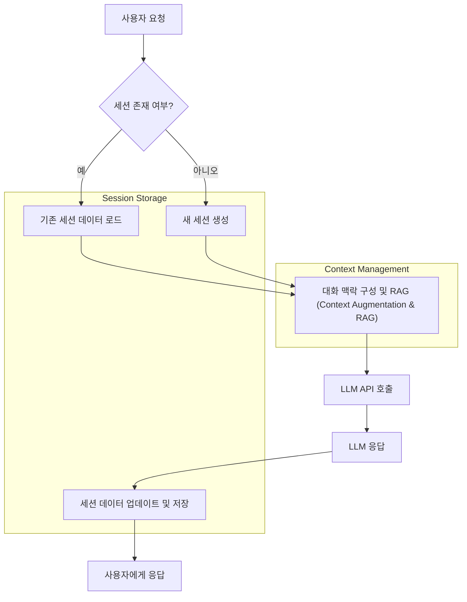

LLM(Large Language Model) 기반 애플리케이션은 사용자에게 자연스럽고 맥락을 이해하는 대화 경험을 제공하는 것을 목표로 합니다. 그러나 LLM 자체는 기본적으로 Stateless합니다. 즉, 매 호출마다 이전 대화의 맥락을 기억하지 못하며, 이는 복잡한 대화 흐름이나 장기적인 상호작용이 필요한 애플리케이션에서 심각한 한계로 작용합니다. 이러한 문제를 해결하고 사용자 경험을 혁신적으로 향상시키기 위해 상태 관리(State Management) 및 세션 지속성(Session Persistence) 구현은 LLM 애플리케이션 설계의 핵심 요소로 부상하고 있습니다.

## 핵심 개념: 상태 관리와 세션 지속성
LLM 애플리케이션의 상태 관리와 세션 지속성은 사용자와 LLM 간의 상호작용을 연속적으로 유지하고, 이전 대화 맥락을 기반으로 일관된 응답을 생성할 수 있도록 하는 메커니즘을 의미합니다.

### 단기 메모리(Short-Term Memory)와 장기 메모리(Long-Term Memory)
*   **단기 메모리**: 주로 현재 상호작용 또는 대화 세션 내에서 유지되는 맥락 정보입니다. LLM의 컨텍스트 윈도우(Context Window)에 직접 포함되거나, 요약된 형태로 전달되어 모델이 즉각적인 대화 흐름을 이해하는 데 사용됩니다. 휘발성(Volatile)이며, 세션이 종료되면 소멸되는 경우가 많습니다.
*   **장기 메모리**: 여러 세션에 걸쳐 지속되거나, 특정 주제에 대한 심층적인 지식, 사용자 선호도, 과거 행동 기록 등 오랫동안 유지되어야 하는 정보입니다. 일반적으로 외부 데이터베이스나 벡터 데이터베이스에 저장되어 필요할 때마다 검색(Retrieval)되어 LLM 컨텍스트에 주입됩니다.

### 맥락 윈도우(Context Window) 관리의 도전과제
LLM은 한 번에 처리할 수 있는 입력 토큰의 양, 즉 컨텍스트 윈도우에 제한이 있습니다. 이 제한을 초과하면 이전 대화 내용이 잘리거나 무시되어 대화의 일관성이 저해됩니다. 또한, 컨텍스트 윈도우 내의 모든 토큰은 LLM 호출 비용과 직접적으로 연결되므로, 비효율적인 컨텍스트 관리는 불필요한 비용 증가로 이어집니다. 따라서 중요한 맥락만 선별하여 지속적으로 전달하고, 불필요한 정보를 제거하는 전략이 필수적입니다.

## LLM 애플리케이션을 위한 상태 관리 및 세션 지속성 전략

### 1. 인메모리 세션 관리 (In-Memory Session Management)
가장 간단한 형태로, 애플리케이션 서버의 메모리에 세션 데이터를 저장하는 방식입니다. 주로 개발 초기 단계나 간단한 데모, 단일 서버 환경에서 사용됩니다.
*   **장점**: 구현 단순성, 매우 빠른 접근 속도.
*   **단점**: 서버 재시작 시 데이터 손실, 확장성(Scalability) 및 고가용성(High Availability) 부족, 다중 서버 환경에서 세션 공유 어려움.

### 2. 외부 데이터베이스를 활용한 세션 저장 (External Database for Session Storage)
대부분의 프로덕션 LLM 애플리케이션에서 채택하는 방식으로, Redis, PostgreSQL, MongoDB와 같은 외부 데이터베이스에 세션 데이터를 저장합니다.
*   **관계형 DB (PostgreSQL, MySQL)**: 사용자 ID, 세션 ID, 대화 기록(JSONB 필드), 타임스탬프 등을 구조화하여 저장합니다. 대화 기록의 무결성과 복잡한 쿼리가 필요한 경우 유리합니다.
*   **NoSQL DB (MongoDB, DynamoDB)**: 유연한 스키마로 대화 기록과 관련 메타데이터를 JSON 형태로 저장하기 용이합니다. 빠른 읽기/쓰기 성능과 수평적 확장성이 강점입니다.
*   **인메모리 데이터 스토어 (Redis)**: 세션 데이터를 Key-Value 형태로 저장하여 매우 빠른 접근을 제공합니다. 휘발성 데이터나 캐싱 목적으로 주로 사용되지만, RDB 스냅샷 또는 AOF(Append Only File)를 통해 지속성을 확보할 수도 있습니다.
*   **장점**: 데이터 지속성 보장, 다중 서버 환경에서 세션 공유 가능, 높은 확장성 및 견고성.
*   **단점**: 네트워크 Latency 발생, DB 관리 및 운영의 복잡성 증가, 저장되는 데이터 양에 따른 비용 증가.

### 3. 벡터 데이터베이스를 활용한 장기 메모리 구현 (Vector Database for Long-Term Memory)
RAG(Retrieval Augmented Generation) 패턴의 핵심으로, 과거 대화 기록이나 외부 지식 문서를 임베딩(Embedding)하여 벡터 데이터베이스(예: Pinecone, Weaviate, ChromaDB)에 저장합니다. 새로운 사용자 쿼리가 들어오면, 이 쿼리를 임베딩하여 벡터 DB에서 가장 관련성 높은 과거 맥락이나 지식을 검색한 후, 이를 LLM의 컨텍스트에 주입합니다.
*   **장점**: LLM 컨텍스트 윈도우의 물리적 한계를 넘어선 맥락 확장, 최신 정보 및 전문 지식 반영, 할루시네이션(Hallucination) 감소.
*   **단점**: 임베딩 생성 및 검색 비용 발생, 검색 정확도(Retrieval Relevance)를 높이기 위한 임베딩 모델 및 청킹(Chunking) 전략 튜닝 필요, 데이터 동기화 및 관리 복잡성.

### 4. 컨텍스트 압축 및 요약 (Context Compaction and Summarization)
매번 전체 대화 기록을 LLM에 전달하는 것은 비효율적이며 비용이 많이 듭니다. 따라서 이전 대화 내용을 요약하거나, 핵심 키워드 및 엔티티만 추출하여 컨텍스트 윈도우를 최적화하는 전략이 필요합니다.
*   **대화 요약 모델 활용**: 별도의 LLM을 사용하여 이전 대화 내용을 압축된 형태로 요약하여 저장합니다.
*   **키워드/엔티티 추출**: 특정 정보(예: 상품명, 날짜, 사용자 의도)만 추출하여 구조화된 형태로 저장하고 필요시 재주입합니다.
*   **장점**: 토큰 사용량 및 API 호출 비용 절감, 컨텍스트 윈도우 효율성 증대, 중요한 정보 유지.
*   **단점**: 요약 과정에서 정보 손실 위험, 추가적인 LLM 호출로 인한 Latency 및 비용 증가, 요약 품질에 대한 지속적인 평가 필요.

### 5. 캐싱 전략 (Caching Strategies)
자주 요청되는 LLM 응답이나 임베딩 결과를 캐싱하여 Latency를 줄이고 API 비용을 절감할 수 있습니다. Redis나 Memcached 같은 인메모리 캐시 시스템을 활용합니다.
*   **LLM 응답 캐싱**: 동일한 프롬프트에 대한 LLM 응답을 캐싱하여 재사용합니다.
*   **임베딩 캐싱**: 이미 생성된 임베딩 벡터를 캐싱하여 불필요한 임베딩 모델 호출을 줄입니다.
*   **장점**: Latency 감소, LLM API 호출 비용 절감, 처리량(Throughput) 증대.
*   **단점**: 캐시 무효화(Cache Invalidation) 전략의 복잡성, 오래된 데이터 제공 위험, 캐시 일관성(Cache Coherence) 유지 문제.

## LLM 애플리케이션 세션 관리 흐름

## 코드 예제: Python 기반 세션 관리
다음은 Python에서 간단한 인메모리 세션 관리자를 구현한 예시입니다. 실제 프로덕션 환경에서는 `storage_type=