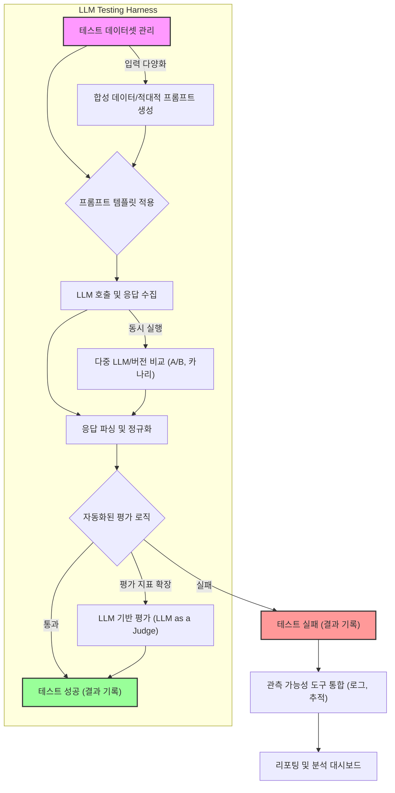

LLM (Large Language Model) 기반 애플리케이션의 품질을 확보하고 예상치 못한 동작을 방지하기 위해서는 체계적인 테스트 및 디버깅 환경, 즉 하네스(Harness) 구축이 필수적입니다. 기존 소프트웨어와 달리 LLM은 비결정적(non-deterministic) 특성을 가지며, 환각(hallucination), 프롬프트 주입(prompt injection), 의도치 않은 편향(bias) 등 고유한 문제점을 내포합니다. 이러한 복잡성으로 인해 전통적인 테스트 방법론만으로는 LLM 애플리케이션의 견고성을 보장하기 어렵습니다. 따라서 전용 하네스 구성 패턴을 통해 LLM의 입력-출력 흐름을 제어하고, 다양한 시나리오에 대한 성능을 정량적으로 평가하며, 문제 발생 시 효율적으로 원인을 분석하는 것이 중요합니다.

## LLM 하네스의 핵심 구성 요소
LLM 애플리케이션을 위한 효과적인 하네스는 다음 구성 요소들을 통합하여 동작합니다.

### 1. 테스트 데이터 및 프롬프트 관리
하네스의 가장 기본적인 역할은 다양한 입력 프롬프트와 예상 응답을 관리하는 것입니다. 이는 단순한 정적 데이터셋을 넘어, 동적으로 프롬프트를 생성하거나, 특정 조건을 만족하는 합성 데이터를 활용하여 테스트 커버리지를 넓히는 기능을 포함합니다.

### 2. LLM 호출 및 실행 환경 제어
하네스는 LLM API 호출을 추상화하고, 요청 매개변수(온도, `top_p` 등)를 제어하며, 멀티모달 LLM의 경우 이미지, 오디오 등 다양한 입력 형식을 처리할 수 있어야 합니다. 또한, 여러 LLM 모델 또는 버전을 동시에 테스트할 수 있는 기능을 제공하여 A/B 테스트나 카나리 배포(Canary deployment)에 활용될 수 있습니다.

### 3. 평가 메트릭 및 자동화된 검증
LLM의 응답을 평가하는 것은 주관적일 수 있으므로, 하네스는 정확도(accuracy), 관련성(relevance), 일관성(coherence), 안전성(safety), 특정 형식 준수 여부 등을 자동화된 방식으로 측정해야 합니다. 이를 위해 RAG (Retrieval Augmented Generation) 지표, 언어학적 유사성(semantic similarity), 독점적인 평가 모델(LLM as a judge) 등 다양한 메트릭이 활용됩니다. 2026년에는 Agentic 워크플로우에 대한 행동 기반 평가와 비용/지연 시간 최적화 지표가 더욱 중요해지고 있습니다.

### 4. 관측 가능성(Observability) 및 디버깅 도구
문제가 발생했을 때, 하네스는 LLM의 추론 과정, 중간 단계, API 호출 로그, 토큰 사용량 등을 상세히 기록하고 시각화하는 기능을 제공해야 합니다. 이는 문제의 원인을 파악하고 디버깅하는 데 결정적인 역할을 합니다. `OpenTelemetry`와 같은 표준을 사용하여 분산 추적(distributed tracing)을 구현하는 것이 일반적입니다.

## 하네스 구성 패턴

### 1. 골든 데이터셋 기반 회귀 테스트 (Golden Dataset Regression Testing)
미리 정의된 입력 프롬프트와 예상되는 '정답' 응답(Golden responses) 쌍을 기반으로 LLM의 응답이 시간이 지나도 일관성을 유지하는지 검증하는 패턴입니다. LLM 모델 업데이트, 프롬프트 변경, 혹은 RAG 데이터 소스 변경 시 발생하는 성능 저하(regression)를 탐지하는 데 효과적입니다.

```python
import openai
import json

def load_golden_dataset(filepath):
    with open(filepath, 'r', encoding='utf-8') as f:
        return json.load(f)

def evaluate_llm_response(expected, actual):
    # 실제 평가 로직: 유사성, 키워드 포함 여부, 형식 준수 등
    # 간단한 문자열 비교 예시
    return expected.strip().lower() == actual.strip().lower()

def run_regression_test(llm_client, dataset):
    results = {}
    for item in dataset:
        prompt = item["prompt"]
        expected_response = item["expected_response"]
        
        try:
            # LLM 호출 (예시: OpenAI API)
            response = llm_client.chat.completions.create(
                model="gpt-4o",
                messages=[{"role": "user", "content": prompt}]
            )
            actual_response = response.choices[0].message.content
            
            passed = evaluate_llm_response(expected_response, actual_response)
            results[prompt] = {
                "expected": expected_response,
                "actual": actual_response,
                "passed": passed
            }
        except Exception as e:
            results[prompt] = {"error": str(e), "passed": False}
            
    return results

# 예시 사용
# golden_data = load_golden_dataset("golden_dataset.json")
# # llm_client = openai.OpenAI(api_key="YOUR_API_KEY")
# # test_results = run_regression_test(llm_client, golden_data)
# # for prompt, result in test_results.items():
# #     print(f"Prompt: {prompt}, Passed: {result['passed']}")
```

### 2. 적대적 테스트 및 에지 케이스 분석 (Adversarial & Edge Case Testing)
LLM이 예상치 못한 입력에 어떻게 반응하는지 테스트하는 패턴입니다. 프롬프트 주입 공격, 모호하거나 이중적인 의미의 질문, 악의적인 의도를 가진 입력, 혹은 극단적인 길이의 입력 등을 통해 LLM의 취약점과 안전성(safety)을 검증합니다. 2026년에는 Agentic 시스템의 툴 사용(tool use) 맥락에서 적대적 입력이 도구 오용(tool misuse)으로 이어지는 케이스에 대한 테스트가 중요해지고 있습니다.

### 3. A/B 테스트 및 카나리 배포 하네스 (A/B Testing & Canary Deployment Harness)
새로운 LLM 모델, 프롬프트 엔지니어링 전략, RAG 구성 등을 실제 서비스에 적용하기 전에, 기존 버전과 비교하여 성능 지표(예: 사용자 만족도, 비용, 지연 시간)를 측정하고 평가하는 패턴입니다. 소규모 사용자 그룹에게만 신규 버전을 먼저 배포하는 카나리 배포 전략과 결합하여 위험을 최소화합니다.

### 4. 에이전틱 하네스 (Agentic Harness: LLM이 LLM을 테스트)
LLM 자체가 다른 LLM의 응답을 평가하거나, 테스트 케이스를 생성하고, 디버깅 시나리오를 자동화하는 패턴입니다. 예를 들어, 한 LLM 에이전트가 특정 목표를 달성하도록 다른 LLM 에이전트를 조종하고, 그 과정을 모니터링하며 실패 시 원인을 분석하는 방식입니다. 이는 복잡한 Agentic 워크플로우를 테스트하는 데 특히 유용하며, 2026년 LLM 테스트의 최전선에 있습니다.

다음은 LLM 하네스의 일반적인 워크플로우를 보여주는 Mermaid 다이어그램입니다.



## 트레이드오프

### 1. 초기 구축 복잡성 vs. 장기적 품질 확보
*   **언제 좋고**: LLM 애플리케이션의 개발 초기에 하네스를 구축하면, 잠재적 문제점을 조기에 발견하고 수정하여 개발 주기 단축 및 장기적인 품질을 확보할 수 있습니다. 특히 복잡한 Agentic 시스템이나 규제가 엄격한 도메인에서 필수적입니다.
*   **언제 나쁜지**: 단순한 PoC (Proof of Concept) 단계나 단발성 LLM 스크립트에는 과도한 오버헤드가 될 수 있습니다. 초기 구축에 상당한 시간과 리소스가 소요될 수 있습니다.

### 2. 평가의 주관성 자동화 vs. 휴먼 인 더 루프(Human-in-the-Loop) 비용
*   **언제 좋고**: 대부분의 LLM 응답 평가를 자동화하면 대규모 테스트를 효율적으로 수행하고 일관된 평가 기준을 유지할 수 있습니다. 특히 정형화된 출력이나 특정 사실 검증에 강점을 보입니다.
*   **언제 나쁜지**: 창의성, 미묘한 뉘앙스, 복잡한 추론 과정 등 인간의 주관적 판단이 필요한 경우에는 자동화된 평가만으로는 한계가 있습니다. 이러한 경우 `Human-in-the-Loop` 검토 시스템이 필요하며, 이는 높은 운영 비용을 발생시킬 수 있습니다.

### 3. 테스트 커버리지 확장 vs. 리소스 소비
*   **언제 좋고**: 합성 데이터 생성, 적대적 테스트 등을 통해 테스트 시나리오를 광범위하게 확장하면 LLM의 예상치 못한 동작을 줄이고 견고성을 크게 향상시킬 수 있습니다.
*   **언제 나쁜지**: 테스트 케이스 수가 증가할수록 LLM API 호출에 따른 비용과 테스트 실행 시간이 비례하여 증가합니다. 무분별한 테스트 확장은 비효율적인 리소스 소비로 이어질 수 있습니다.

### 4. 결정론적(Deterministic) 환경 구축 vs. LLM의 비결정성
*   **언제 좋고**: 하네스는 LLM 호출의 매개변수를 고정하고, 외부 도구 사용을 샌드박스화하며, 시드를 지정하는 등 최대한 결정론적인 환경을 구축하여 재현 가능한 테스트를 가능하게 합니다. 이는 디버깅 시 문제 원인 특정에 매우 중요합니다.
*   **언제 나쁜지**: LLM 자체의 본질적인 비결정성은 완벽하게 제거될 수 없습니다. 특정 테스트 케이스가 간헐적으로 실패하거나 성공하는 '플레이키 테스트(flaky test)'를 유발할 수 있으며, 이는 하네스 자체의 신뢰도에 대한 의문을 제기할 수 있습니다.

## 실전 체크리스트

프로젝트에 LLM 애플리케이션 테스트 및 디버깅 하네스를 적용할 때 다음 항목들을 검증합니다.

- [ ] **기본 테스트 프레임워크 선정**: `Pytest`나 `Langchain` 테스트 모듈 등 애플리케이션 스택에 맞는 기본 테스트 프레임워크를 결정하고 통합했는가?
- [ ] **골든 데이터셋 구축 및 관리**: 핵심 기능에 대한 입력-예상 응답 쌍으로 구성된 골든 데이터셋을 최소 100개 이상 구축하고, 버전 관리 시스템으로 관리하는가?
- [ ] **자동화된 평가 메트릭 정의**: LLM 응답의 정확도, 관련성, 안전성 등을 측정할 수 있는 최소 3가지 이상의 자동화된 평가 메트릭(예: `ROUGE`, `BLEU`, `semantic similarity`, 정규식 기반 검증)을 정의하고 구현했는가?
- [ ] **LLM 호출 로깅 및 추적**: 모든 LLM API 호출에 대한 프롬프트, 응답, 토큰 사용량, 지연 시간 등을 로깅하고, 분산 추적(Distributed Tracing) 도구(예: `OpenTelemetry`, `LangSmith`)와 통합했는가?
- [ ] **에지 케이스 및 적대적 프롬프트 테스트**: 일반적인 사용 시나리오 외에, 입력 길이 제한, 모호한 질문, 잠재적 프롬프트 주입 공격 등 5가지 이상의 에지 케이스를 포함하는 테스트 스위트를 구성했는가?
- [ ] **CI/CD 파이프라인 통합**: 하네스 테스트가 코드 변경 시 자동으로 실행되도록 CI/CD 파이프라인에 통합하고, 실패 시 적절한 알림 메커니즘을 설정했는가?
- [ ] **성능 및 비용 모니터링**: LLM 호출의 평균 지연 시간, 토큰 비용, 특정 모델의 실패율 등 핵심 성능 및 비용 지표를 지속적으로 모니터링하고 시각화하는 대시보드를 구축했는가?
- [ ] **Agentic 하네스 도입 가능성 검토**: 복잡한 Agentic 워크플로우를 개발 중이라면, LLM이 다른 LLM을 테스트하거나 시나리오를 생성하는 '에이전틱 하네스' 패턴의 도입을 검토하고 프로토타이핑 계획을 수립했는가?