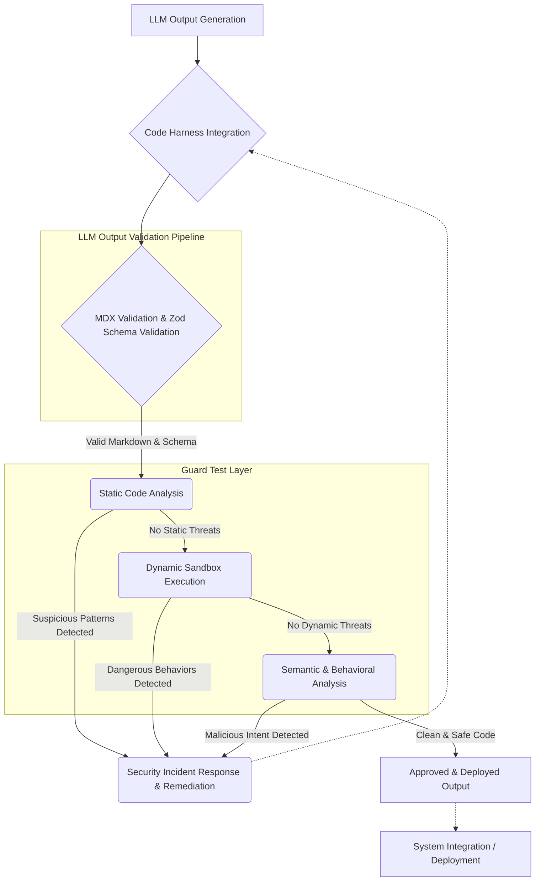

LLM(Large Language Model)의 발전은 소프트웨어 개발 생산성을 혁신적으로 향상시켰지만, 동시에 새로운 사이버 보안 위협을 초래하고 있습니다. 긱뉴스 기사에서 언급된 바와 같이, LLM은 이론적 취약점이나 패치 차이(patch difference)를 실제 공격 코드로 전환하는 속도를 가속화하여, 취약점 공개와 방어 사이의 시간(Time-to-Patch) 간격을 더욱 줄이는 압력으로 작용합니다. 이는 잠재적 위험을 실제 위협으로 빠르게 변환시키는 공격자의 능력을 증폭시키며, 기존 보안 메커니즘만으로는 대응하기 어려운 상황을 만들 수 있습니다.

`playbook` 환경에서 Claude Code 하네스(harness) 및 LLM 출력 검증 파이프라인(MDX validation, Zod schema)은 LLM의 강력한 코드 생성 능력을 활용하는 동시에, 그 위험을 관리하는 중요한 접점입니다. 이 파이프라인 내의 가드 테스트(Guard Test)를 강화하는 것은 LLM이 생성할 수 있는 악의적이거나 취약한 코드를 사전에 탐지하고 방어하는 데 필수적입니다. 특히 잠재적 취약점 코드 패턴이나 악의적인 의도를 가진 출력에 대한 탐지 및 방어 로직을 고도화하는 것이 핵심 과제입니다.

## LLM 기반 공격 코드 위협의 본질
LLM은 방대한 데이터 학습을 통해 코드의 문맥(context)을 이해하고, 특정 기능 요구사항에 맞는 코드를 생성하는 데 탁월한 능력을 보입니다. 그러나 이러한 능력은 양날의 검으로 작용합니다. 예를 들어, 특정 운영체제나 라이브러리의 알려진 취약점을 설명하고 이에 대한 공격 코드를 요청하면, LLM은 해당 취약점을 실제 악용할 수 있는 코드를 쉽게 생성할 수 있습니다. 기존에는 보안 전문가가 수동으로 분석하고 exploit 코드를 작성해야 했지만, LLM은 이 과정을 자동화하고 가속화하여 사이버 공격의 문턱을 낮춥니다.

`playbook`의 Claude Code 하네스는 개발 생산성을 높이는 데 기여하지만, 생성된 코드가 의도치 않게 보안 취약점을 포함하거나, 악의적인 사용자의 지시에 따라 공격 코드를 생성할 가능성을 내포합니다. 따라서 LLM 출력 검증 파이프라인에 강력한 가드 테스트를 통합하여 이러한 위험을 체계적으로 관리해야 합니다.

## 가드 테스트 강화 전략 및 구현 방안
LLM이 생성하는 공격 코드로부터 시스템을 보호하기 위한 가드 테스트는 다층적인 접근 방식을 요구합니다. 코드의 구문적(syntactic) 유효성뿐만 아니라 의미론적(semantic) 의도와 잠재적 행위까지 분석해야 합니다.

### 1. 정적 코드 분석(Static Code Analysis) 기반 Guard Test
LLM이 생성한 코드를 실행하기 전에 코드 내부에 알려진 위험 패턴이나 취약점이 있는지 분석합니다. 이는 `playbook`의 MDX validation 및 Zod schema와 결합하여 더욱 강력한 검증 체계를 구축할 수 있습니다.

*   **위험 함수/API 호출 탐지:** `os.system()`, `eval()`, `subprocess.run(shell=True)`, `shell_exec()`, `system()`, `passthru()`, `proc_open()` 등 시스템 명령 실행, 코드 동적 실행, 외부 프로세스 제어와 관련된 함수 호출을 탐지합니다.
*   **정규 표현식(Regular Expression) 패턴 매칭:** SQL Injection, XSS(Cross-Site Scripting), Path Traversal 등 일반적인 웹 취약점 패턴을 정규 표현식을 사용하여 탐지합니다.
*   **AST(Abstract Syntax Tree) 분석:** 코드의 구조를 파싱하여, 동적 변수 접근, 의도치 않은 리소스 접근, 비정상적인 코드 흐름 등 더 복잡한 패턴을 분석합니다.

### 2. 동적 코드 실행 환경(Dynamic Sandbox Execution) Guard Test
정적 분석만으로는 탐지하기 어려운 런타임(runtime) 동작 기반의 취약점을 탐지하기 위해, LLM이 생성한 코드를 격리된 샌드박스 환경에서 제한적으로 실행하고 그 행위를 모니터링합니다. 이는 실제 공격 코드가 작동하는지 판별하는 데 중요합니다.

*   **컨테이너(Container) 기반 샌드박스:** Docker나 gVisor와 같은 기술을 사용하여 코드 실행 환경을 완전히 격리합니다.
*   **자원 제한(Resource Limiting):** CPU, 메모리, 네트워크, 파일 시스템 접근 등을 제한하여 코드의 오용을 방지합니다.
*   **행위 모니터링(Behavioral Monitoring):** 코드 실행 중 발생할 수 있는 비정상적인 시스템 호출, 외부 네트워크 통신 시도, 민감한 파일 접근 시도 등을 탐지하고 기록합니다.

### 3. 시맨틱 및 행동 분석(Semantic & Behavioral Analysis) Guard Test
단순히 위험 패턴을 찾는 것을 넘어, 코드의 실제 의도와 시스템에 미칠 수 있는 영향을 분석합니다. 2026년 트렌드에서는 AI 기반의 심층 시맨틱 분석이 더욱 중요해질 것입니다.

*   **LLM 기반 코드 의도 분석:** 다른 LLM 모델을 사용하여 생성된 코드의 목적이 악의적인지, 잠재적 위험을 내포하는지 분석합니다.
*   **컨텍스트 기반 위험 점수화:** 프롬프트 입력, 이전 대화 이력, 사용자 권한 등 다양한 컨텍스트 정보를 활용하여 생성된 코드의 위험도를 점수화하고 임계값(threshold)을 초과하는 경우 차단합니다.
*   **이상 탐지(Anomaly Detection):** 정상적인 코드 생성 패턴과 다른 이상 징후를 머신러닝 모델로 학습하여 새로운 형태의 공격 코드를 탐지합니다.

### 예제 코드: Python 기반 LLM 출력 검증 (개념적) 
LLM이 생성한 Python 코드를 가드 테스트 파이프라인의 일부로 검증하는 간단한 예제입니다. `MDX validation`은 마크다운 구문과 코드 블록의 유효성을, `Zod schema`는 JSON 출력 등의 구조적 유효성을 담당하며, 이 코드는 그 내부의 Python 코드 로직을 검사합니다.

```python
import re
import ast
import os

def validate_llm_generated_python_code(code_string: str) -> list[str]:
    """
    LLM이 생성한 Python 코드를 정적으로 검증하여 잠재적 위험 요소를 반환합니다.
    """
    warnings = []

    # 1. 위험한 함수/모듈 호출 탐지
    dangerous_patterns = {
        r"os\.system\(": "Potential OS command injection via os.system()",
        r"subprocess\.run\(.*shell=True.*": "Potential shell execution via subprocess.run(shell=True)",
        r"eval\(": "Potential dynamic code execution via eval()",
        r"exec\(": "Potential dynamic code execution via exec()",
        r"import\s+os": "Import of 'os' module, review for system calls",
        r"import\s+subprocess": "Import of 'subprocess' module, review for system calls",
        r"import\s+shutil": "Import of 'shutil' module, review for dangerous file operations"
    }
    for pattern, msg in dangerous_patterns.items():
        if re.search(pattern, code_string):
            warnings.append(msg)

    # 2. AST 기반 동적 코드 생성 및 파일/네트워크 접근 패턴 탐지 (간소화)
    try:
        tree = ast.parse(code_string)
        for node in ast.walk(tree):
            # 동적 임포트/실행 탐지
            if isinstance(node, ast.Call) and hasattr(node.func, 'id') and node.func.id in ['compile', 'getattr', '__import__']:
                warnings.append(f"Dynamic code operation ({node.func.id}) detected.")
            # 파일 쓰기/삭제 탐지 (open(..., 'w') 또는 os.remove)
            if isinstance(node, ast.Call) and isinstance(node.func, ast.Name) and node.func.id == 'open':
                for arg in node.args:
                    if isinstance(arg, ast.Constant) and 'w' in str(arg.value):
                        warnings.append("File write operation detected via open().")
            if isinstance(node, ast.Call) and isinstance(node.func, ast.Attribute) and node.func.attr == 'remove' and hasattr(node.func.value, 'id') and node.func.value.id == 'os':
                warnings.append("File remove operation via os.remove().")

    except SyntaxError:
        warnings.append("Syntax error in generated code, potentially malicious or malformed.")
    except Exception as e:
        warnings.append(f"AST analysis failed: {str(e)}")

    return warnings

# Example Usage:
# llm_code_output_1 = "print('Hello World')"
# print(f"Code 1 warnings: {validate_llm_generated_python_code(llm_code_output_1)}")
#
# llm_code_output_2 = "import os; os.system('ls -la');"
# print(f"Code 2 warnings: {validate_llm_generated_python_code(llm_code_output_2)}")
#
# llm_code_output_3 = "def f(): return eval('1+1')"
# print(f"Code 3 warnings: {validate_llm_generated_python_code(llm_code_output_3)}")
```

### LLM 출력 코드 검증 파이프라인



## 2026년 트렌드와 미래 전망
LLM 기반 공격 코드 방어는 지속적으로 진화할 것입니다. 2026년에는 다음과 같은 트렌드가 두드러질 것으로 예상됩니다:

*   **자율 방어 LLM 에이전트:** LLM 자체를 활용하여 새로운 공격 패턴을 학습하고, 가드 테스트 규칙을 자율적으로 업데이트하며, 실시간으로 위협에 대응하는 자율 방어 에이전트(Autonomous Defense Agent)가 등장할 것입니다.
*   **제로 트러스트(Zero Trust) 코드 실행 환경:** LLM이 생성한 모든 코드는 기본적으로 신뢰하지 않고, 최소한의 권한으로 격리된 환경에서만 실행하며, 명시적인 검증을 통과해야만 허용되는 제로 트러스트 원칙이 강화됩니다.
*   **행위 기반 지능형 위협 탐지:** 정적 패턴을 우회하는 정교한 공격에 대응하기 위해, 코드의 실행 행위(runtime behavior)를 심층적으로 분석하고, 비정상적인 행위를 AI 기반으로 탐지하는 기술이 발전할 것입니다.
*   **연합 학습(Federated Learning)을 통한 위협 인텔리전스 공유:** 다양한 조직에서 수집된 LLM 생성 공격 코드 및 방어 성공 사례를 연합 학습 방식으로 공유하여, 전체 생태계의 방어력을 강화하는 협력 모델이 활성화될 것입니다.

## 트레이드오프

### 1. 보안 강도 vs. 개발 생산성
*   **언제 좋고:** 높은 보안 강도는 LLM 생성 공격 코드의 시스템 유입을 최소화하여 심각한 보안 사고를 방지합니다. 특히 금융, 국방 등 보안이 최우선시되는 분야에 적합합니다.
*   **언제 나쁜지:** 과도하게 엄격한 Guard Test는 LLM의 정상적인 코드 생성까지 차단하여 개발자의 작업 흐름을 방해하고 생산성을 저해할 수 있습니다. 빠르게 프로토타이핑해야 하는 초기 개발 단계에는 부담이 될 수 있습니다.

### 2. 성능 오버헤드 vs. 실시간 검증
*   **언제 좋고:** 실시간 Guard Test는 공격 코드를 즉시 탐지하고 차단하여 위협 확산을 막는 데 효과적입니다. 사용자에게 빠른 피드백을 제공해야 하는 인터랙티브(interactive) 시스템에 중요합니다.
*   **언제 나쁜지:** 정적 분석, 샌드박스 실행, 시맨틱 분석 등 복잡한 Guard Test는 상당한 컴퓨팅 자원과 시간을 소모하여 LLM 응답 지연을 유발할 수 있습니다. 낮은 지연시간이 요구되는 대규모 실시간 서비스에는 성능 병목이 될 수 있습니다.

### 3. 구현 복잡성 vs. 유지보수 용이성
*   **언제 좋고:** 다층적이고 정교한 Guard Test는 다양한 유형의 LLM 생성 공격에 효과적으로 대응할 수 있습니다. 고도의 보안 전문성과 기술력이 확보된 팀에 적합합니다.
*   **언제 나쁜지:** 복잡한 Guard Test 로직은 구현 및 유지보수에 높은 비용과 전문성을 요구합니다. 새로운 공격 패턴이나 LLM 모델 변화에 따라 Guard Test 규칙을 지속적으로 업데이트해야 하므로, 리소스가 제한적인 팀에는 큰 부담이 될 수 있습니다.

### 4. 커버리지 vs. 심층 분석
*   **언제 좋고:** 넓은 커버리지는 예측 불가능하거나 새로운 형태의 공격에 대한 방어력을 높입니다. 다양한 유형의 코드와 컨텍스트를 다루는 시스템에 유리합니다.
*   **언제 나쁜지:** 광범위한 커버리지를 목표로 하면 각 공격 유형에 대한 심층적인 분석이 어려워질 수 있으며, 특정 고도화된 공격(zero-day exploits)에 대한 방어력이 약해질 수 있습니다. 제한된 범위 내에서 특정 고위험 취약점에 대한 정밀 방어가 필요한 경우 비효율적일 수 있습니다.

## 실전 체크리스트

- [ ] LLM 생성 코드에 대한 **정적 분석 규칙** (위험 함수, 패턴)이 최신 위협 트렌드를 반영하여 주기적으로 업데이트되는가?
- [ ] LLM 출력의 **MDX/Zod 스키마 검증**이 강화되어, 예상치 못한 구조나 타입의 악성 출력을 사전에 차단하는가?
- [ ] **샌드박스 환경**에서 LLM 생성 코드를 격리하여 실행하고, 잠재적 위험 행위(네트워크, 파일 시스템 접근 등)를 탐지하는 **동적 분석 Guard Test**가 구현되었는가?
- [ ] LLM 출력의 **시맨틱 분석**을 통해 코드의 실제 의도와 잠재적 악의성을 판단하는 로직이 포함되어 있는가?
- [ ] Guard Test에서 탐지된 위협에 대한 **자동화된 경고 및 차단 메커니즘**이 즉시 작동하며, 관련 보안 팀에 실시간으로 통보되는가?
- [ ] Guard Test의 **False Positive 및 False Negative 비율**을 지속적으로 모니터링하고, 이를 개선하기 위한 피드백 루프(feedback loop)가 구축되어 있는가?
- [ ] 새로운 LLM 모델 또는 프롬프트 변경 시, Guard Test의 **회귀(regression) 테스트**를 통해 기존 방어 로직의 유효성이 유지되는지 검증하는가?