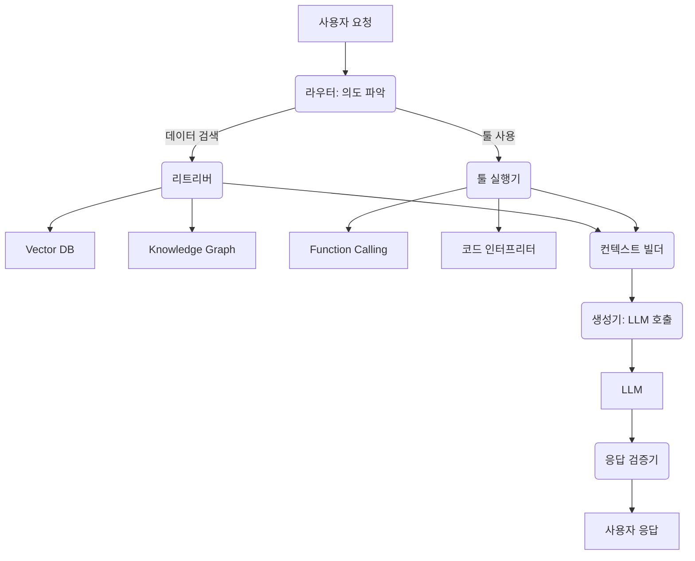

LLM (Large Language Model)의 환각(Hallucination)은 모델이 사실과 다른 정보를 생성하는 현상으로, LLM 기반 시스템의 신뢰성을 저해하는 주요 문제입니다. 이를 해결하기 위한 핵심 전략은 신뢰할 수 있는 외부 데이터 소스와 전문화된 외부 툴을 LLM과 연동하는 하네스(Harness)를 설계하는 것입니다. 이 하네스는 LLM의 응답 정확성을 높이고 최신 정보를 반영하며, 특정 도메인 지식에 대한 접근을 가능하게 합니다.

**LLM 환각 및 외부 지식 활용의 필요성**
LLM은 학습 시점 이후 정보나 특정 도메인 지식에 한계가 있어 환각이 발생합니다. 외부 데이터 소스(Vector DB, Knowledge Graph, API 등)와 외부 툴(검색 엔진, 계산기 등)을 효과적으로 통합하면 LLM은 자신이 '알지 못하는' 정보에 대해 '찾거나', '수행할' 수 있게 되어, 지식과 도구를 활용하여 문제를 해결하는 능력을 갖추게 됩니다. 이는 LLM의 신뢰성을 높이는 2026년의 핵심 트렌드입니다.

**하네스 설계 패턴의 핵심 원칙**
*   **모듈성 (Modularity)**: 각 데이터 소스와 툴을 독립적인 모듈로 설계하여 유연하게 추가, 제거, 업데이트합니다.
*   **확장성 (Scalability)**: 다양한 데이터 소스와 툴을 쉽게 통합하고, 요청 증가에도 안정적으로 동작합니다.
*   **관측 가능성 (Observability)**: LLM이 참조한 외부 정보, 사용한 툴, 결과 등을 투명하게 추적하고 디버깅합니다.
*   **보안성 (Security)**: 샌드박싱(Sandboxing)을 통해 툴 호출 시 민감 정보 노출 및 보안 위협을 방지합니다.
*   **검증 가능성 (Verifiability)**: LLM 응답이 참조 정보와 일치하는지, 툴 사용 결과가 정확한지 검증합니다.

**데이터 소스 연동 패턴: RAG (Retrieval Augmented Generation) 중심**
RAG는 사용자 쿼리 기반으로 관련 문서를 검색(Retrieval)하고, LLM 프롬프트 컨텍스트에 추가하여 응답을 생성(Generation)합니다.

### 1. 벡터 데이터베이스 (Vector Database)
텍스트 데이터를 임베딩(Embedding) 벡터로 변환하여 저장하고, 유사도 검색으로 관련 문서를 찾아 LLM 프롬프트에 추가합니다. 대규모 비정형 데이터에 대한 고속, 고정밀 검색이 가능하여 LLM의 최신 정보 반영 및 도메인 지식 활용에 필수적입니다.

### 2. 지식 그래프 (Knowledge Graph)
개체(Entity)와 관계(Relation)를 그래프 형태로 표현하여 구조화된 지식을 제공합니다. LLM이 지식 그래프 쿼리를 생성하여 복잡한 추론이나 다단계 질의에 활용, 사실 관계의 명확한 출처를 제공하여 환각을 효과적으로 줄입니다.

### 3. 외부 API (External APIs)
RESTful API 등을 통해 실시간 데이터나 특정 기능을 활용합니다. LLM이 요청을 분석하여 호출할 API와 매개변수를 결정하고, 하네스는 이를 실행하여 결과를 LLM에 전달합니다. 실시간 정보 및 동적 기능 연동에 적합합니다.

**외부 툴 연동 패턴: 에이전트 기반 접근 (Agentic Approach)**
LLM이 '행동하는' 주체(Agent)가 되려면 외부 툴 연동이 필수적입니다.

### 1. 함수 호출 (Function Calling)
LLM이 특정 작업을 위해 외부 함수를 호출해야 함을 인식하고 필요한 인자를 JSON으로 출력합니다. 하네스는 이 출력을 파싱하여 실제 함수를 실행하고 결과를 LLM에 다시 전달합니다. LLM이 구조화된 방식으로 툴과 상호작용하게 하여 예측 가능성을 높입니다.

### 2. 코드 인터프리터 (Code Interpreter)
LLM이 코드를 생성하고 실행하여 문제를 해결하는 툴입니다. LLM이 복잡한 계산, 데이터 분석 등이 필요하다고 판단하면 코드를 작성하고, 하네스는 이를 샌드박싱된 환경에서 실행하여 결과를 제공합니다. LLM의 수학적, 논리적 한계를 보완하고 데이터 처리 능력을 확장합니다.

### 3. 웹 검색 (Web Search)
LLM이 최신 정보나 광범위한 공개 지식을 검색 엔진을 통해 직접 찾아보는 툴입니다. LLM이 정보 부족 시 검색 쿼리를 생성하고, 하네스는 이를 실행하여 결과를 LLM에 전달합니다. 실시간 최신 정보에 접근하여 지식 범위를 무한히 확장할 수 있습니다.

**하네스 아키텍처 및 워크플로우**
효과적인 하네스는 라우터, 리트리버, 툴 실행기, 컨텍스트 빌더, 생성기, 응답 검증기로 구성됩니다.



*   **라우터**: 요청 의도 분석 후 데이터 검색 또는 툴 사용 결정.
*   **리트리버**: 벡터 DB, 지식 그래프 등에서 정보 검색.
*   **툴 실행기**: 함수 호출, 코드 인터프리터, 웹 검색 등 외부 툴 실행.
*   **컨텍스트 빌더**: 검색/툴 결과 취합하여 LLM 프롬프트 컨텍스트 구성.
*   **생성기**: 최종 프롬프트로 LLM 호출, 응답 생성.
*   **응답 검증기**: LLM 응답의 환각 여부 및 출처 일치 여부 검증.

**코드 예제: RAG & 간단한 툴 연동 (개념)**
```python
import os
from openai import OpenAI # Dummy, replace with actual client
from typing import List, Dict, Any, Callable

# Example tool: Calculator
def calculator(expression: str) -> str:
    """Calculates a mathematical expression."""
    try: return str(eval(expression)) # 보안 주의 (Security Warning)
    except Exception as e: return f"Error: {e}"

# Example RAG function
def retrieve_docs(query: str) -> List[str]:
    """Simulates vector DB search."""
    if "환각" in query: return ["LLM 환각은 잘못된 정보 생성입니다."]
    return []

# Harness logic sketch
def run_llm_harness(user_query: str, client: OpenAI) -> str:
    docs = retrieve_docs(user_query)
    context = "\n".join(docs)
    
    # LLM Prompt for RAG + Tool Use (Conceptual)
    prompt_messages = [
        {"role": "system", "content": "You are a helpful assistant. Use external tools if necessary."},
        {"role": "user", "content": f"User: {user_query}\n\nContext: {context}\n\nAvailable tools: calculator('expression')"},
    ]
    # In a real harness, LLM output is parsed to decide tool call or direct response.
    # If a tool call is detected (e.g., JSON output), execute it and re-prompt LLM.
    # For this example, we directly call LLM with combined context.
    
    response = client.chat.completions.create(
        model="gpt-4o-mini",
        messages=prompt_messages,
        max_tokens=300
    )
    return response.choices[0].message.content

# Placeholder for actual OpenAI client
# client_instance = OpenAI()
# print(run_llm_harness("LLM 환각이 뭐야?", client_instance))
# print(run_llm_harness("10 * 5 + 3의 값은?", client_instance))
```

**## 트레이드오프**

*   **정확성 향상 vs 복잡도 증가**: 환각 감소에 효과적이나, 설계 및 구현 복잡도가 높습니다. (비즈니스 크리티컬 앱에 유리, 단순 PoC에는 불리)
*   **유연성 및 확장성 vs 성능 오버헤드**: 동적인 환경에 유리하나, 다단계 처리로 인한 응답 지연(Latency)이 발생할 수 있습니다. (실시간 고빈도 앱에 불리)
*   **비용 효율성 vs 리소스 소모**: 불필요한 LLM 토큰 소모를 줄이지만, 외부 DB/API/샌드박스 등 추가 인프라 비용이 발생할 수 있습니다.
*   **보안성 강화 vs 개발 및 운영 부담**: 샌드박싱, 인증 등으로 보안이 강화되지만, 구현 및 운영에 추가적인 전문성이 요구됩니다.

**## 실전 체크리스트**

*   [ ] **데이터 소스 신뢰성 및 최신성 검증**: 활용할 외부 데이터 소스가 환각 감소에 충분히 신뢰할 수 있고 최신 정보를 제공하는지 확인.
*   [ ] **툴 스키마 및 IAM 최소 권한 원칙 적용**: 각 외부 툴의 스키마를 명확히 정의하고, 호출 시 최소한의 권한만 부여되도록 IAM 정책 설정.
*   [ ] **라우팅 로직의 효율성 평가**: 사용자 쿼리에 따른 데이터/툴 선택 라우팅 로직(프롬프트, 소형 모델)이 효율적으로 동작하는지 주기적으로 평가.
*   [ ] **환각 감지 및 복구 모듈 구현 여부**: LLM 응답의 사실 확인(Fact-Checking) 및 불일치 시 재시도/대안 응답 생성 로직 포함 여부 확인.
*   [ ] **성능/비용 모니터링 시스템 구축**: 각 하네스 단계의 Latency, 토큰 사용량, 외부 API 호출 비용 등을 실시간 모니터링 및 대시보드 구축.
*   [ ] **샌드박싱 기반 툴 실행 환경 확보**: 코드 인터프리터 등 외부 툴 호출 시 격리된 샌드박스 환경에서 실행되는지 검증.
*   [ ] **응답 출처 명시 UX 적용**: LLM 응답이 외부 데이터를 참조했을 경우, 그 출처를 명확하게 명시하여 사용자 신뢰도를 높이는지 확인.