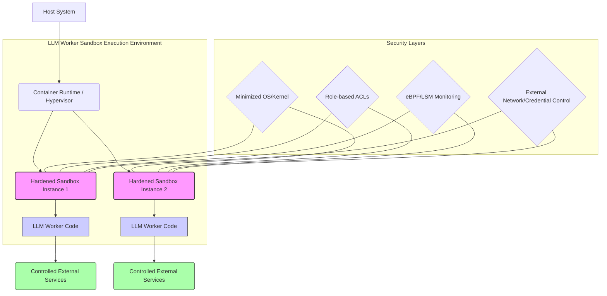

LLM(Large Language Model)이 생성한 코드를 실행하거나 LLM 워커를 배포하는 환경에서는 강력한 샌드박스 격리가 필수적입니다. 예측 불가능한 LLM의 출력 특성상, 잠재적으로 악의적이거나 시스템에 해를 끼칠 수 있는 코드가 생성될 위험이 항상 존재합니다. Replit이 microVM 기반으로 샌드박스 엔진을 재구축한 사례는 LLM 워크로드 샌드박스 설계에 중요한 통찰을 제공합니다. 이는 보안, 기능, 클라우드 이식성을 극대화하기 위한 KVM 기반 격리 원칙을 LLM 하네스에 적용하는 방법을 제시합니다.

## LLM 워커 실행 환경의 보안 과제
LLM이 생성한 코드는 다양한 목적을 가질 수 있습니다. 데이터 분석 스크립트, 웹 애플리케이션 코드, 심지어 시스템 명령까지 포함할 수 있습니다. 이러한 코드를 직접 실행할 경우 다음과 같은 심각한 보안 문제가 발생할 수 있습니다.

*   **Host Kernel Compromise**: 잘못된 코드가 호스트 커널 취약점을 공격하여 시스템 전체를 장악할 수 있습니다.
*   **데이터 유출 (Data Exfiltration)**: LLM이 접근 가능한 민감 정보나 환경 변수를 외부로 전송하는 코드를 생성할 수 있습니다.
*   **서비스 거부 (Denial of Service)**: 무한 루프, 과도한 리소스 사용 등으로 시스템을 마비시킬 수 있습니다.
*   **권한 상승 (Privilege Escalation)**: 샌드박스 내에서 예상치 못한 방법으로 높은 권한을 획득할 수 있습니다.

기존 컨테이너(Docker 등)는 일정 수준의 격리를 제공하지만, 호스트 커널을 공유하므로 게스트 커널이 침해되면 호스트 커널도 위험에 노출될 수 있는 한계가 있습니다. microVM은 이러한 한계를 극복하기 위한 강력한 대안입니다.

## MicroVM 기반 샌드박스 강화 원칙
Replit의 사례에서 영감을 받은 LLM 샌드박스 강화 원칙은 다음과 같습니다.

### KVM 기반 격리 및 독립적인 게스트 커널
각 샌드박스 인스턴스에 전용 Linux 커널을 할당하여 Guest Kernel 침해가 Host Kernel로 전파되는 것을 원천적으로 차단합니다. 이는 hypervisor-based isolation의 핵심입니다. LLM 워커별로 독립적인 실행 환경을 제공하여 한 워커의 문제가 다른 워커나 호스트 시스템에 영향을 미치지 않도록 합니다.

### 최소화된 게스트 커널 및 역할 기반 권한
*   **Minimized Guest Kernel**: 샌드박스 내 Guest Kernel의 기능을 최소화하여 공격 표면(attack surface)을 줄입니다. 필요한 드라이버와 서비스만 포함하고 나머지는 제거합니다. 이는 microVM의 빠른 부팅 시간과 낮은 오버헤드에도 기여합니다.
*   **Role-based Privilege Restriction**: 각 샌드박스 워커는 자신이 수행해야 할 작업에 필요한 최소한의 권한만 가집니다. 예를 들어, 파일 시스템 접근은 특정 디렉터리로 제한하고, 네트워크 통신은 허용된 엔드포인트로만 제한합니다. 이는 `Least Privilege Principle`을 엄격히 적용하는 것입니다.

### 런타임 관찰 및 제어를 위한 eBPF/LSM 활용
*   **eBPF (extended Berkeley Packet Filter)**: Host OS 레벨에서 샌드박스 내부의 시스템 호출(syscall), 네트워크 활동 등을 실시간으로 관찰하고 분석하는 데 활용됩니다. 이를 통해 비정상적인 동작 패턴을 감지하고, 의심스러운 행위를 차단할 수 있습니다.
*   **LSM (Linux Security Modules)**: Linux 커널의 보안 기능을 확장하여 특정 정책에 따라 워크로드의 동작을 제한할 수 있습니다. 예를 들어, AppArmor나 SELinux와 같은 LSM 기반 도구를 사용하여 파일 시스템 접근, 프로세스 실행 등을 세밀하게 제어할 수 있습니다.

### 네트워크 및 자격 증명 외부 통제
샌드박스 내부에서 직접 네트워크 정책을 설정하거나 민감한 자격 증명(credentials)을 관리하는 대신, 이를 샌드박스 외부에서 중앙 집중적으로 통제합니다. 워커는 외부 서비스와의 통신을 위해 게이트웨이나 프록시를 통해야 하며, 자격 증명은 워커에게 직접 노출되지 않고 짧은 수명을 가진 임시 토큰 형태로 제공됩니다.

## 컨테이너 환경에서의 원칙 적용 방안
당장 microVM 도입이 어렵다면, Docker와 같은 컨테이너 기반 환경에서도 위 원칙들을 최대한 적용하여 샌드박스를 강화할 수 있습니다.

*   **최소화된 이미지**: `scratch` 또는 `distroless` 이미지와 같이 베이스 이미지의 크기와 포함된 구성 요소를 최소화합니다. Alpine Linux와 같은 경량 리눅스 배포판도 좋은 선택입니다.
*   **컨테이너 런타임 보안 기능**: Docker의 `--security-opt` (예: `seccomp`, `apparmor`), `--cap-drop`, `--read-only` 옵션을 활용하여 컨테이너의 권한을 최소화하고 파일 시스템 변경을 제한합니다.
*   **네트워크 정책**: Kubernetes `NetworkPolicy`를 사용하거나 Docker 컨테이너의 네트워크를 격리하여 외부 통신을 엄격히 제어합니다.
*   **시크릿 관리**: Kubernetes Secrets, HashiCorp Vault와 같은 외부 시크릿 관리 도구를 사용하여 자격 증명을 컨테이너 이미지나 환경 변수에 직접 노출시키지 않습니다.

### 코드 예제: Hardened Docker Container 실행
다음은 LLM 워커 코드를 실행하기 위한 강화된 Docker 컨테이너 실행 명령의 개념적인 예시입니다. 특정 라이브러리 설치나 네트워크 요청이 필요한 경우를 가정합니다.

```bash
#!/bin/bash

# LLM이 생성한 Python 스크립트라고 가정
LLM_GENERATED_CODE="""
import os
import requests

print(f"Hello from LLM worker in sandbox!")

# 환경 변수 접근 시도 (제한되어야 함)
if 'DANGEROUS_SECRET' in os.environ:
    print("Accessed DANGEROUS_SECRET")

# 외부 네트워크 통신 시도 (제한되어야 함)
try:
    response = requests.get('http://evil.com', timeout=1)
    print(f"Network request successful: {response.status_code}")
except requests.exceptions.RequestException as e:
    print(f"Network request failed or blocked: {e}")

# 파일 시스템 접근 시도 (제한되어야 함)
try:
    with open('/etc/passwd', 'r') as f:
        print("Accessed /etc/passwd")
except IOError:
    print("Cannot access /etc/passwd")
"""

# LLM 코드를 임시 파일에 저장
echo "$LLM_GENERATED_CODE" > /tmp/llm_worker.py

# Python 환경을 포함하는 최소화된 Docker 이미지 사용 (예: python:3.9-alpine)
# 보안 옵션:
# --rm: 컨테이너 종료 시 자동 삭제
# --read-only: 컨테이너 파일 시스템을 읽기 전용으로 마운트 (단, /tmp, /var/tmp 등 쓰기 가능한 볼륨은 예외)
# --cap-drop ALL: 모든 Linux Capabilities 제거
# --security-opt=no-new-privileges: 컨테이너 내에서 새로운 권한을 획득하지 못하도록 방지
# --network=none: 네트워크 접근 차단 (또는 특정 브릿지 네트워크로 제한)
# -v /tmp/llm_worker.py:/app/worker.py: LLM 코드 주입
# -w /app: 작업 디렉토리 설정
# python /app/worker.py: LLM 코드 실행

docker run --rm \ 
  --name llm-sandbox-worker \ 
  --read-only \ 
  --cap-drop ALL \ 
  --security-opt=no-new-privileges \ 
  --network=none \ 
  -v /tmp/llm_worker.py:/app/worker.py \ 
  -v /tmp:/tmp:rw \ 
  -e SAFE_ENV_VAR="MyValue" \ 
  -w /app python:3.9-alpine python /app/worker.py

rm /tmp/llm_worker.py # 임시 파일 정리
```

## 샌드박스 격리 아키텍처



## 트레이드오프

### 1. 보안 강화 vs. 성능 오버헤드
*   **언제 좋은가**: LLM 생성 코드의 잠재적 위험이 높거나, 처리해야 할 민감 데이터가 많은 경우 강력한 격리(microVM)는 최상의 보안을 제공합니다. 샌드박스 탈출이 서비스에 치명적인 영향을 미칠 수 있는 환경에서 특히 유용합니다.
*   **언제 나쁜가**: 극도로 낮은 지연 시간(latency)이 요구되거나, 막대한 수의 워커를 동시에 운영해야 하는 고성능 환경에서는 microVM의 추가적인 가상화 오버헤드가 병목이 될 수 있습니다. 컨테이너 기반의 경량화된 접근이 더 적합할 수 있습니다.

### 2. 강력한 격리 vs. 운영 복잡성
*   **언제 좋은가**: 보안 취약점 발생 시 피해 확산을 최소화하고, 독립적인 환경에서 워커를 안정적으로 실행해야 할 때 좋습니다. 각 워커의 상태를 독립적으로 관리할 수 있어 문제 진단 및 복구가 용이합니다.
*   **언제 나쁜가**: microVM 인프라를 구축하고 관리하는 것은 Docker 컨테이너에 비해 훨씬 높은 기술적 난이도와 운영 리소스를 요구합니다. 작은 규모의 프로젝트나 빠른 프로토타이핑 단계에서는 과도한 복잡성을 야기할 수 있습니다.

### 3. 공격 표면 감소 vs. 유연성 제한
*   **언제 좋은가**: 샌드박스 내부의 기능을 최소화하고 권한을 엄격히 제한함으로써 알려지지 않은 공격 경로를 줄일 수 있습니다. 이는 제로데이 공격에 대한 방어력을 높이는 데 기여합니다.
*   **언제 나쁜가**: 샌드박스 내에서 동적으로 다양한 툴이나 라이브러리를 설치하고 실행해야 하는 유연한 LLM 워커 환경에는 적합하지 않습니다. 필요한 기능이 추가될 때마다 샌드박스 구성을 업데이트해야 하는 불편함이 따릅니다.

## 실전 체크리스트

LLM 하네스 샌드박스 강화 원칙을 프로젝트에 적용할 때 다음 항목들을 검증합니다.

- [ ] **샌드박스 기반 이미지 최소화**: LLM 워커 실행 환경에 필요한 최소한의 OS 구성 요소와 라이브러리만을 포함하는 경량화된(예: `scratch`, `distroless`, Alpine) 베이스 이미지를 사용하는가?
- [ ] **권한 최소화 (Least Privilege)**: 샌드박스 내 워커 프로세스가 파일 시스템 접근, 네트워크 통신, 시스템 호출 등에서 자신이 수행해야 할 작업에 필요한 최소한의 권한만을 가지도록 엄격하게 제한되었는가?
- [ ] **런타임 보안 프로파일 적용**: AppArmor, Seccomp, SELinux와 같은 런타임 보안 프로파일을 적용하여 LLM 워커의 비정상적인 시스템 호출 및 행위를 사전에 차단하는가?
- [ ] **네트워크 격리 및 제어**: 샌드박스 워커의 네트워크 접근이 외부에서 엄격히 통제되며, 허용된 엔드포인트(화이트리스트)로의 통신만 허용하고, 모든 인바운드 연결은 기본적으로 차단되는가?
- [ ] **자격 증명(Credentials) 외부 관리**: API 키, 토큰 등 민감한 자격 증명이 샌드박스 내부로 직접 전달되지 않고, 외부 시크릿 관리 시스템을 통해 안전하게 관리되며, 필요 시 임시 토큰 형태로 제공되는가?
- [ ] **리소스 제한 설정**: CPU, 메모리, 디스크 I/O 등 샌드박스 워커가 사용할 수 있는 최대 리소스 양을 명확히 정의하고 제한하여 DoS(서비스 거부) 공격을 방지하는가?
- [ ] **정기적인 샌드박스 탈출(Escape) 테스트**: 모의 공격(penetration test)을 통해 샌드박스 격리가 실제로 얼마나 견고한지 주기적으로 검증하고, 발견된 취약점을 즉시 패치하는 프로세스가 있는가?