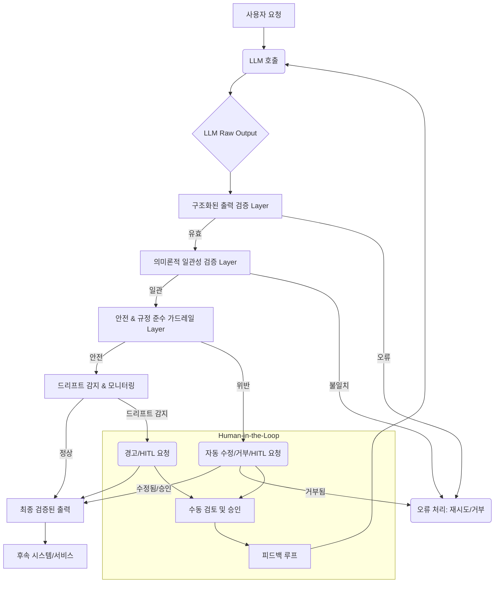

대규모 언어 모델(LLM) 기반 시스템의 유연성과 강력함은 혁신적인 애플리케이션을 가능하게 하지만, 동시에 출력의 비결정성(nondeterminism)과 잠재적인 환각(hallucination) 문제로 인해 신뢰성 확보가 핵심 과제로 부상하고 있습니다. 특히 복잡한 워크플로우를 자동화하는 하네스 엔지니어링(Harness Engineering) 환경에서 LLM 출력의 신뢰성을 검증하는 패턴은 시스템의 안정성, 예측 가능성, 그리고 안전성을 높이는 데 필수적입니다. 본 문서에서는 LLM 출력의 신뢰성을 체계적으로 검증하기 위한 주요 패턴들을 탐구합니다.

## LLM 출력 신뢰성 검증의 중요성

LLM은 주어진 프롬프트에 따라 다양하고 창의적인 응답을 생성할 수 있습니다. 그러나 이러한 유연성은 동시에 예측 불가능성을 내포하며, 잘못된 정보, 유해한 콘텐츠, 또는 기대와 다른 형식의 출력을 생성할 위험을 안고 있습니다. 하네스 시스템에서 LLM 출력이 다른 모듈이나 시스템의 입력으로 사용될 경우, 검증되지 않은 LLM 출력은 전체 시스템의 오작동, 보안 취약점, 또는 심각한 비즈니스 손실로 이어질 수 있습니다. 따라서 LLM 출력의 신뢰성을 확보하기 위한 다층적인 검증 메커니즘은 현대 AI 시스템 개발의 필수 요소입니다.

## 핵심 검증 패턴

### 1. 구조화된 출력 검증 (Structured Output Validation)

LLM이 특정 형식(예: JSON, XML)의 데이터를 생성해야 할 때, 출력 스키마에 대한 엄격한 검증은 필수적입니다. Pydantic, JSON Schema 등의 도구를 활용하여 LLM 출력이 사전 정의된 데이터 타입, 필드 존재 여부, 값의 범위 등에 부합하는지 확인합니다. 이는 후속 시스템이 LLM 출력을 파싱하고 처리하는 데 필요한 일관성을 보장합니다.

```python
from pydantic import BaseModel, Field
from typing import List, Optional
import json

class TaskItem(BaseModel):
    task_id: str = Field(..., description="Unique identifier for the task")
    description: str = Field(..., description="Detailed description of the task")
    status: str = Field(..., pattern="^(PENDING|IN_PROGRESS|COMPLETED|FAILED)$")
    assignee: Optional[str] = Field(None, description="Optional assignee for the task")

class TaskListOutput(BaseModel):
    tasks: List[TaskItem] = Field(..., min_items=1)
    summary: str = Field(..., description="Overall summary of the tasks")

def validate_llm_output(llm_raw_output: str) -> Optional[TaskListOutput]:
    try:
        parsed_data = json.loads(llm_raw_output)
        validated_output = TaskListOutput(**parsed_data)
        return validated_output
    except (json.JSONDecodeError, ValueError) as e:
        print(f"Validation error: {e}")
        return None

# Example Usage
llm_response_ok = """
{
  "tasks": [
    {
      "task_id": "T101",
      "description": "Develop API endpoint for user authentication.",
      "status": "IN_PROGRESS",
      "assignee": "Alice"
    },
    {
      "task_id": "T102",
      "description": "Write unit tests for authentication service.",
      "status": "PENDING"
    }
  ],
  "summary": "Two tasks related to user authentication are underway."
}
"""

llm_response_error = """
{
  "tasks": [
    {
      "task_id": "T103",
      "description": "Fix database migration bug.",
      "status": "BROKEN",
      "assignee": "Bob"
    }
  ],
  "summary": "One critical bug fix task."
}
"""

validated_ok = validate_llm_output(llm_response_ok)
if validated_ok:
    print("Valid output:", validated_ok.model_dump_json(indent=2))

validated_error = validate_llm_output(llm_response_error)
if not validated_error:
    print("Invalid output detected.")
```

### 2. 의미론적 일관성 검사 (Semantic Consistency Checks)

LLM 출력 내용의 사실성(factuality)과 일관성을 검증하는 패턴입니다. 이는 주로 외부 데이터 소스나 내부 지식 그래프(Knowledge Graph), RAG(Retrieval Augmented Generation)에서 검색된 증거(evidence)와 LLM 출력을 비교하여 수행됩니다. 예를 들어, LLM이 생성한 답변이 검색된 문서의 내용과 모순되는지 확인하거나, 이미 알려진 사실과 다른 주장을 하는지 검토합니다.

### 3. 안전 및 규정 준수 가드레일 (Safety & Compliance Guardrails)

유해하거나 민감한 콘텐츠(Harmful Content), 개인 식별 정보(PII), 또는 기업 정책에 위배되는 내용이 LLM 출력에 포함되지 않도록 검증하고 필터링합니다. 특정 키워드 목록, 정규 표현식, 또는 별도의 소형 분류 모델(Small Classifier Models)을 사용하여 출력을 스캔하고, 위반이 감지되면 출력을 수정(redaction), 거부(punt), 또는 플래그(flag) 처리합니다. 2026년에는 더욱 정교한 Prompt Injection 방어 및 Zero-day PII 유출 방지 메커니즘이 중요해지고 있습니다.

### 4. 드리프트 감지 및 이상 징후 모니터링 (Drift Detection & Anomaly Monitoring)

시간이 지남에 따라 LLM의 출력 특성(예: 길이, 특정 키워드 사용 빈도, 감성, 응답 시간)이 변화하는 것을 모니터링하여 예상치 못한 품질 저하(degradation)나 편향(bias)을 감지합니다. 통계적 방법론이나 머신러닝 기반의 이상 감지(Anomaly Detection) 기법을 활용하여 기준선(baseline)에서 벗어나는 패턴을 식별하고, 시스템 관리자에게 경고를 보냅니다. 이는 LLM 모델의 지속적인 업데이트나 프롬프트 변경 시 발생하는 Silent Drift를 방지하는 데 효과적입니다.

### 5. Human-in-the-Loop (HITL) 및 피드백 루프 (Feedback Loops)

자동화된 검증만으로는 커버하기 어려운 복잡하거나 중요도가 높은 케이스에 대해 사람의 개입을 통해 최종 검토 및 의사결정을 수행합니다. HITL은 특히 초기 배포 단계나 새로운 유형의 오류가 발생했을 때 중요하며, 사람의 피드백을 시스템에 다시 반영(feedback loop)하여 LLM의 프롬프트, 미세 조정 데이터, 또는 자동화된 검증 규칙을 지속적으로 개선하는 데 활용됩니다. 이를 통해 시스템은 시간이 지남에 따라 더욱 견고해집니다.

## 검증 패턴 흐름도



## 트레이드오프

### 1. 엄격한 구조화된 출력 검증 (Strict Structured Output Validation)
*   **언제 좋고**: LLM 출력이 다른 시스템의 정형 데이터 입력으로 사용되어 엄격한 형식 준수가 필수적일 때 탁월합니다. 예측 가능한 데이터 흐름을 보장하고 개발 복잡성을 줄입니다.
*   **언제 나쁜지**: LLM의 창의성이나 유연한 응답이 필요한 경우, 엄격한 스키마는 출력을 제약하여 LLM의 잠재력을 제한할 수 있습니다. 스키마 변경 시 LLM 프롬프트 및 검증 로직 업데이트 비용이 발생합니다.

### 2. 의미론적 일관성 검사 (Semantic Consistency Checks)
*   **언제 좋고**: LLM의 환각을 최소화하고 사실적 정확성이 중요한 금융, 의료, 법률 분야 등에서 신뢰성을 크게 향상시킬 수 있습니다.
*   **언제 나쁜지**: 검증에 필요한 신뢰할 수 있는 외부 데이터 소스나 지식 그래프를 구축하고 유지하는 데 상당한 비용과 노력이 필요합니다. 복잡한 추론이나 주관적인 내용에 대한 검증은 어렵거나 불가능할 수 있습니다.

### 3. 안전 및 규정 준수 가드레일 (Safety & Compliance Guardrails)
*   **언제 좋고**: 유해 콘텐츠, PII 유출, 또는 법적/윤리적 문제를 방지하여 서비스의 안정성과 브랜드 평판을 보호해야 할 때 필수적입니다.
*   **언제 나쁜지**: 너무 광범위하거나 민감한 가드레일은 LLM 출력을 과도하게 필터링하여 사용자 경험을 저해(False Positives)하거나, 의도치 않은 서비스 제한을 초래할 수 있습니다. 새로운 위협 패턴에 대한 지속적인 업데이트가 요구됩니다.

### 4. 드리프트 감지 및 모니터링 (Drift Detection & Monitoring)
*   **언제 좋고**: LLM 모델 업데이트, 프롬프트 변경, 또는 데이터 분포 변화에 따른 장기적인 품질 저하를 조기에 감지하여 선제적으로 대응할 수 있습니다.
*   **언제 나쁜지**: 기준선 설정과 '드리프트'의 정의가 주관적일 수 있으며, 정상적인 변동성을 드리프트로 오인하여 불필요한 경고(False Alarms)를 발생시킬 수 있습니다. 충분한 과거 데이터가 필요합니다.

### 5. Human-in-the-Loop (HITL)
*   **언제 좋고**: 자동화된 시스템이 처리하기 어려운 예외 상황, 고위험 의사결정, 또는 주관적인 판단이 필요한 경우에 최고의 신뢰성을 제공합니다. 시스템 학습을 위한 고품질 피드백을 제공합니다.
*   **언제 나쁜지**: 사람의 개입은 느리고, 비용이 많이 들며, 대규모 트래픽을 처리하는 데 확장성이 부족합니다. 모든 LLM 출력에 적용하기에는 비효율적입니다.

## 실전 체크리스트

프로젝트에 LLM 출력 신뢰성 검증 패턴을 적용할 때 다음 항목들을 검증하십시오.

- [x] 모든 구조화된 LLM 출력에 대해 Pydantic (Python) 또는 JSON Schema 기반의 명확한 스키마를 정의하고 이를 코드에 반영했는가?
- [x] LLM 출력의 핵심 사실(factuality)을 검증하기 위해 RAG 소스 또는 내부 지식 그래프와 교차 참조하는 의미론적 검증 레이어를 구현했는가?
- [x] 유해 콘텐츠, PII, 또는 규정 위반을 탐지하고 처리하기 위한 안전 및 규정 준수 가드레일을 구축하고, 정기적으로 업데이트 정책을 수립했는가?
- [x] LLM 출력의 길이, 감성, 키워드 분포 등 주요 지표에 대한 실시간 모니터링 시스템을 구축하여 'Silent Drift'를 감지할 수 있는가?
- [x] 검증 실패 시 자동 재시도, 오류 로깅, 그리고 중요한 경우에는 Human-in-the-Loop (HITL) 검토로 이어지는 명확한 에스컬레이션(escalation) 및 처리 워크플로우를 설계했는가?
- [x] LLM 출력의 견고성(robustness)을 사전 테스트하기 위해 CI/CD 파이프라인에 적대적 테스트(Adversarial Testing) 또는 에지 케이스(Edge Case) 테스트 시나리오를 통합했는가?
- [x] HITL 피드백, 모니터링 데이터, 그리고 검증 실패 사례를 바탕으로 LLM 프롬프트, 모델, 또는 검증 로직을 개선하는 지속적인 피드백 루프 메커니즘을 구현했는가?