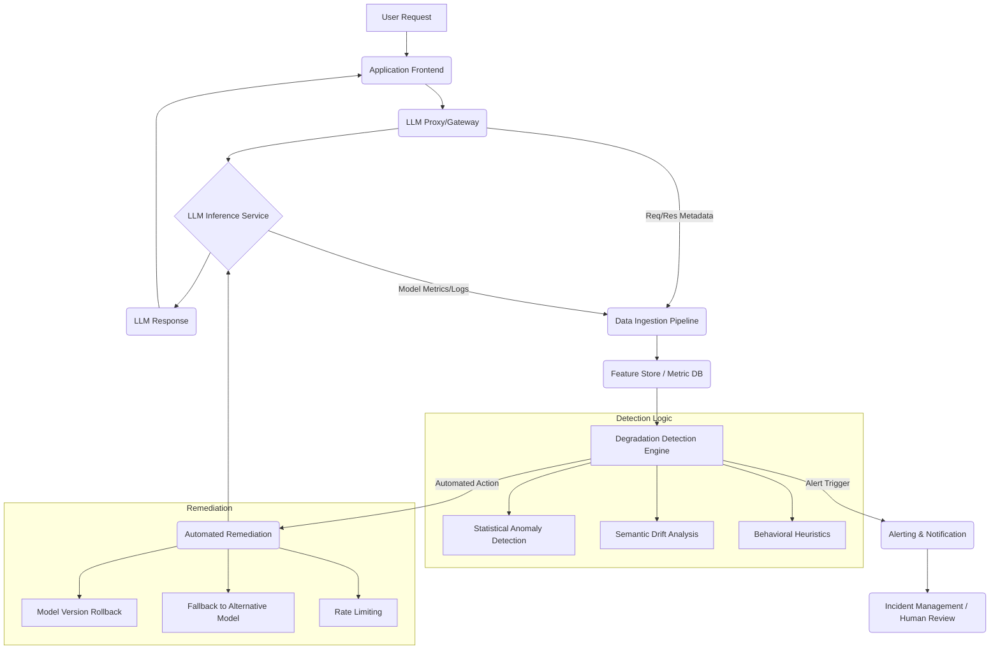

운영 환경에서 Large Language Model (LLM)의 예측 불가능한 성능 변화는 서비스 품질에 심각한 영향을 미칠 수 있다. LLM은 학습 데이터, 프롬프트 엔지니어링, 파인튜닝 등의 요소에 따라 미묘하게 동작이 달라질 수 있으며, 이는 사용자 경험 저하, 비용 증가, 심지어 안전 문제로 이어질 수 있다. 따라서 이러한 성능 저하를 신속하게 감지하고 대응하기 위한 지능형 모니터링 시스템 구축은 필수적이다.

## LLM 성능 저하의 유형 및 감지 지표

LLM의 성능 저하는 다양한 형태로 나타날 수 있으며, 각 유형에 맞는 감지 전략이 필요하다.

### 1. 품질 저하 (Quality Degradation)
LLM 응답의 유용성, 정확성, 일관성 등이 떨어진다.
*   **지표**: RAGAS (Faithfulness, Answer Relevance), Perplexity, BLEU/ROUGE 스코어 (참조 응답이 있는 경우), 사용자 피드백 (Implicit/Explicit), Agent의 Self-reflection 스코어.
*   **감지 전략**:
    *   **골든 데이터셋 재평가 (Golden Dataset Re-evaluation)**: 주기적으로 대표적인 프롬프트-응답 쌍으로 구성된 골든 데이터셋을 LLM에 질의하고, 그 응답의 품질을 자동화된 메트릭 또는 사람의 평가로 비교한다.
    *   **임베딩 드리프트 감지 (Embedding Drift Detection)**: LLM의 입력 또는 출력 임베딩 벡터 분포의 변화를 감지한다. 예를 들어, `Wasserstein distance`나 `Cosine Similarity`를 활용하여 시간에 따른 분포 변화를 모니터링할 수 있다.
    *   **의미적 일관성 검증 (Semantic Coherence Verification)**: 특정 패턴을 가진 응답이 갑자기 다른 의미를 갖거나, 일관성 없는 정보를 제공하는 경우를 탐지한다.

### 2. 레이턴시 증가 (Latency Increase)
응답 시간 지연으로 사용자 경험이 저하된다.
*   **지표**: P50, P90, P99 응답 시간, Token per Second (TPS).
*   **감지 전략**: 시계열 기반 이상 감지 (Time-series Anomaly Detection) 알고리즘을 사용하여 평소 패턴에서 벗어난 급격한 레이턴시 증가를 감지한다.

### 3. 비용 초과 (Cost Overruns)
불필요한 토큰 사용량 증가, API 호출 빈도 상승 등으로 운영 비용이 증가한다.
*   **지표**: Input/Output 토큰 수, API 호출 횟수, 비용 (Cost per Request).
*   **감지 전략**: 토큰 사용량 및 API 호출 비용에 대한 임계값 (Threshold) 기반 모니터링, 예산 초과 감지.

### 4. 안전성 및 유해성 증가 (Safety & Harmfulness Increase)
편향된, 유해한, 또는 안전하지 않은 응답을 생성하는 빈도가 증가한다.
*   **지표**: 가드레일 위반 횟수, Toxicity Score, Sentiment Analysis (부정적 감정).
*   **감지 전략**: 사전에 훈련된 안전성 분류 모델 (Safety Classifier) 또는 규칙 기반 필터를 통해 LLM 응답을 스캔하고, 유해성 지표의 급증을 감지한다.

## 지능형 모니터링 시스템 아키텍처 패턴

지능형 모니터링 시스템은 여러 컴포넌트의 유기적인 결합으로 이루어진다. 핵심은 실시간 데이터 수집, 지표화, 분석, 그리고 자동화된 대응이다.


**Figure 1**: 지능형 LLM 성능 저하 감지 모니터링 파이프라인

1.  **데이터 수집 및 전처리 (Data Ingestion & Preprocessing)**: LLM 입력 프롬프트, 출력 응답, 컨텍스트, 사용자 세션 정보, API 호출 메타데이터 등을 실시간으로 수집한다. 이 데이터는 분석 가능한 형태로 정제되어 `Feature Store`나 `Metric DB`에 저장된다.
2.  **지표 추출 및 특징 엔지니어링 (Metric Extraction & Feature Engineering)**: 수집된 원시 데이터에서 품질, 레이턴시, 비용, 안전성 관련 핵심 지표 (Perplexity, Factual Consistency Score, Token Usage, Latency)를 추출하고, 임베딩 벡터와 같은 특징을 생성한다.
3.  **성능 저하 감지 엔진 (Degradation Detection Engine)**:
    *   **통계적 이상 감지 (Statistical Anomaly Detection)**: 시계열 데이터 (예: 레이턴시, 토큰 사용량)에 대해 `EWMA (Exponentially Weighted Moving Average)`, `Isolation Forest`, `ARIMA`와 같은 모델을 적용하여 비정상적인 패턴을 감지한다.
    *   **의미적 드리프트 분석 (Semantic Drift Analysis)**: 입력 프롬프트 또는 출력 응답의 임베딩 분포가 기준 분포 (Baseline Distribution)와 달라지는 현상을 감지한다. `Mahalanobis distance`나 `Jensen-Shannon divergence` 등이 활용될 수 있다.
    *   **행동 기반 휴리스틱 (Behavioral Heuristics)**: 특정 오류 코드의 급증, 특정 프롬프트에 대한 반복적인 잘못된 응답, 특정 도구 (Tool) 호출 실패율 증가 등을 감지한다.
4.  **알림 및 통지 (Alerting & Notification)**: 성능 저하 감지 시 `PagerDuty`, `Slack`, `email` 등 지정된 채널로 알림을 보낸다. 중요도에 따라 알림 레벨을 설정하고 에스컬레이션 정책을 적용한다.
5.  **자동화된 대응 및 완화 (Automated Remediation)**: 경미하거나 명확한 성능 저하에 대해서는 `모델 롤백 (Model Rollback)`, `대체 모델로 전환 (Fallback to Alternative Model)`, `프롬프트 재작성`, `트래픽 제한 (Rate Limiting)` 등 자동화된 조치를 취한다.
6.  **인간 개입 및 사후 분석 (Human-in-the-Loop & Post-mortem Analysis)**: 복잡하거나 중대한 성능 저하의 경우 사람의 검토와 분석을 통해 근본 원인을 파악하고 장기적인 해결책을 마련한다.

### 코드 예시: 간단한 임베딩 드리프트 감지 (Python)

다음은 LLM 응답 임베딩 간의 `Wasserstein distance`를 활용한 드리프트 감지 예시이다. 실제 환경에서는 더 복잡한 통계적 모델과 시계열 데이터베이스를 사용한다.

```python
import numpy as np
from scipy.stats import wasserstein_distance
from collections import deque

# Simulate LLM response embeddings (e.g., from OpenAI's embedding API)
def generate_embedding(seed, is_degraded=False):
    np.random.seed(seed)
    base_embedding = np.random.rand(1, 768) # 768-dim embedding example
    if is_degraded:
        # Simulate degradation by shifting the distribution
        return base_embedding + np.random.normal(loc=0.5, scale=0.2, size=base_embedding.shape)
    return base_embedding + np.random.normal(loc=0, scale=0.1, size=base_embedding.shape)

# Reference distribution (e.g., from a stable period)
reference_embeddings = [generate_embedding(i) for i in range(100)]
reference_distribution = np.concatenate(reference_embeddings).flatten()

# Monitor window for real-time embeddings
monitor_window_size = 50
current_window_embeddings = deque(maxlen=monitor_window_size)

drift_threshold = 0.5 # A threshold for Wasserstein distance

print("--- Starting LLM Embedding Drift Monitoring ---")

for i in range(150):
    is_degraded_period = (i > 100) and (i % 2 == 0) # Simulate degradation after 100 steps
    new_embedding = generate_embedding(100 + i, is_degraded=is_degraded_period)
    current_window_embeddings.append(new_embedding)

    if len(current_window_embeddings) == monitor_window_size:
        current_distribution = np.concatenate(list(current_window_embeddings)).flatten()
        
        # Calculate Wasserstein distance between reference and current distributions
        distance = wasserstein_distance(reference_distribution, current_distribution)
        
        status = "NORMAL"
        if distance > drift_threshold:
            status = "!!! DEGRADATION DETECTED !!!"
        
        print(f"Step {i+1}: Wasserstein Distance = {distance:.4f} - Status: {status}")

        if status != "NORMAL":
            # In a real system, trigger alerts or automated actions here
            pass
```

## 트레이드오프

LLM 성능 저하 감지 시스템을 구축할 때는 여러 트레이드오프를 고려해야 한다.

*   **정밀한 감지 vs. 시스템 복잡성 및 비용**:
    *   **언제 좋은가**: 고품질 LLM 서비스가 핵심 비즈니스 로직에 연결되어 작은 성능 저하도 큰 손실로 이어지는 경우, 다층적이고 정밀한 감지 메커니즘이 필요하다.
    *   **언제 나쁜가**: 실험적인 LLM 애플리케이션이나 중요도가 낮은 서비스의 경우, 과도한 모니터링 시스템은 불필요한 개발 및 운영 비용을 발생시킨다.
*   **조기 경보 vs. False Positive**:
    *   **언제 좋은가**: 서비스 안정성이 최우선이며, 잠재적 문제에 즉시 대응해야 하는 경우, 낮은 임계값으로 조기에 경보를 발생시키는 것이 유리하다.
    *   **언제 나쁜가**: 운영 팀의 피로도가 높거나, 자동화된 대응 로직이 미성숙한 경우, 잦은 `False Positive`는 시스템에 대한 신뢰도를 떨어뜨리고 실제 문제 대응을 지연시킬 수 있다.
*   **자동화된 대응 vs. 인간 개입**:
    *   **언제 좋은가**: 명확한 패턴을 가진 예측 가능한 성능 저하 (예: 레이턴시 급증, 토큰 비용 초과)는 자동화된 롤백이나 스위치 오버로 빠르게 해결하는 것이 효율적이다.
    *   **언제 나쁜가**: LLM 응답 품질 저하와 같이 복잡하고 주관적인 문제의 경우, 자동화된 대응이 오히려 상황을 악화시킬 수 있으므로 인간의 판단과 심층 분석이 필수적이다.
*   **실시간 모니터링 vs. 배치 분석**:
    *   **언제 좋은가**: 사용자 경험에 직결되는 레이턴시나 안전성 문제와 같이 즉각적인 대응이 필요한 시나리오에서는 실시간 모니터링이 필수적이다.
    *   **언제 나쁜가**: 장기적인 트렌드 분석, 복잡한 품질 평가, 비용 최적화와 같은 목적으로는 배치 처리 방식의 심층 분석이 더 적합하며, 리소스 소모가 적다.

## 실전 체크리스트

LLM 성능 저하 감지 시스템을 프로젝트에 적용할 때 다음 항목들을 검증한다.

*   [ ] 핵심 LLM 애플리케이션의 `사용자 경험 (UX)`에 직접적인 영향을 미치는 주요 성능 지표 (예: 응답 레이턴시, 응답 품질 점수)를 정의하고 측정 가능하도록 구현했는가?
*   [ ] `골든 데이터셋` 또는 `벤치마크 데이터셋`을 구축하고, 주기적으로 LLM 성능을 재평가하여 품질 저하를 감지하는 자동화된 파이프라인을 마련했는가?
*   [ ] 입력 프롬프트 및 출력 응답의 `임베딩 벡터 분포 변화 (Embedding Drift)`를 모니터링하고, 통계적 유의미한 변화 발생 시 알림을 발생시키는 시스템을 갖추었는가?
*   [ ] `토큰 사용량` 및 `API 호출 비용`에 대한 상한선을 설정하고, 이를 초과할 경우 즉시 경보가 울리도록 설정하여 비용 초과를 방지하고 있는가?
*   [ ] LLM 응답에서 `유해하거나 편향된 콘텐츠 (Harmful/Biased Content)`가 생성되는 경우를 감지하기 위한 안전성 분류 모델 또는 규칙 기반 필터를 통합하고, 관련 지표를 모니터링하는가?
*   [ ] 감지된 성능 저하 유형에 따라 `모델 자동 롤백`, `대체 모델 전환`, `프롬프트 재작성`과 같은 자동화된 완화 조치 (Automated Remediation)를 최소 1개 이상 구현했는가?
*   [ ] 모든 성능 저하 알림이 `Slack`, `PagerDuty` 등 지정된 채널로 전달되고, 중요도에 따른 `에스컬레이션 정책`이 명확하게 정의되어 운영 팀이 신속하게 대응할 수 있는가?