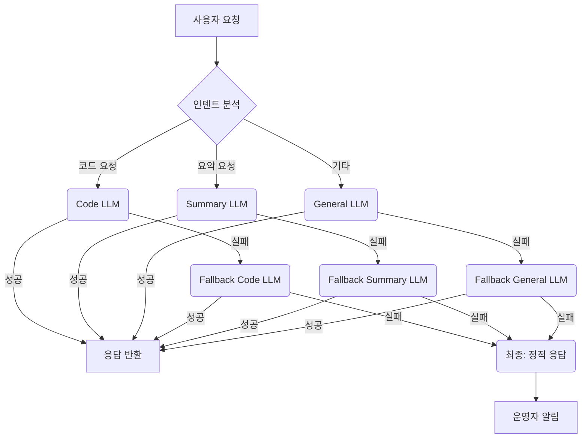

### LLM 기반 애플리케이션의 견고성을 위한 프롬프트 라우팅 및 폴백 전략

LLM 기반 애플리케이션의 안정성과 효율성은 프로덕션 운영에 필수적입니다. 단일 LLM 의존보다, 다양한 모델 특성, 비용, 성능을 고려하여 요청을 동적으로 라우팅하고 실패에 대비한 폴백(Fallback) 전략을 구현해야 합니다. 이는 시스템 신뢰성, 운영 비용 최적화, 사용자 경험 일관성을 확보합니다.

#### 프롬프트 라우팅 패턴

동적 라우팅은 요청 특성, 시스템 상태, LLM 모델 지표를 종합 고려하여 최적 LLM으로 요청을 분배합니다.

*   **규칙 기반 (Rule-Based)**: 프롬프트 내 키워드, 인텐트 기반 모델 선택. 예: "요약" → `LLM-A`.
*   **메타 프롬프팅 (Meta-Prompting)**: 라우터 LLM이 요청 의도 분석 후 다음 LLM 선택. 복잡한 요청에 유연합니다.
*   **성능/비용 기반 (Performance/Cost-Based)**: LLM 실시간 Latency, 처리량, 토큰 비용 모니터링 후 가장 효율적인 모델로 분배.

#### 견고한 폴백 전략 구현

라우팅만으로는 모든 실패에 대비 불가합니다. LLM 응답 실패, Rate Limit, 부적절한 응답 반환 시 폴백 메커니즘이 필수적입니다.

*   **순차적 폴백 (Sequential Fallback)**: 주력 모델 실패 시, 정의된 순서(예: 고성능 → 저성능, 캐시, 기본값)에 따라 다른 모델로 순차 시도.
*   **병렬 폴백 및 검증 (Parallel Fallback & Validation)**: 여러 모델에 동시 요청 후 최적/유효 응답 사용. 신뢰성을 극대화합니다.
*   **인간 개입 (Human-in-the-Loop)**: 모든 자동 폴백 실패 시, 운영자 알림으로 수동 개입 유도.

### 구현 예제 (Python)

```python
import time, random

class LLMService:
    def __init__(self, name, cost, latency, error_rate, caps):
        self.name, self.cost, self.latency, self.error_rate, self.capabilities = name, cost, latency, error_rate, caps
    def generate(self, prompt, is_fallback=False):
        time.sleep(self.latency / 1000); print(f"Trying {self.name} (F:{is_fallback})")
        if random.random() < self.error_rate: raise Exception(f"{self.name} error")
        if "code" in prompt.lower() and "code" not in self.capabilities: raise Exception(f"{self.name} caps mismatch")
        return f"[{self.name}] '{prompt[:15]}...'. Out: {random.randint(100,999)}"

class LLMRouter:
    def __init__(self, services): self.services = services
    def route_and_fallback(self, prompt):
        primary = []; s_lower = prompt.lower()
        if "code" in s_lower: primary = sorted([s for s in self.services if "code" in s.capabilities], key=lambda s: s.cost)
        elif "summarize" in s_lower: primary = sorted([s for s in self.services if "summary" in s.capabilities], key=lambda s: s.latency)
        else: primary = sorted(self.services, key=lambda s: s.cost)
        
        all_attempts = primary + [s for s in self.services if s not in primary]
        for i, service in enumerate(all_attempts):
            try: return service.generate(prompt, is_fallback=(i > 0))
            except Exception as e:
                print(f"Fail {service.name}: {e}")
                if i == len(all_attempts) - 1: return "ERROR: All LLM services failed."
        return "ERROR: Unexpected failure."

llm_opus = LLMService("Opus", 0.03, 500, 0.2, ["code", "summary"])
llm_flash = LLMService("Flash", 0.001, 150, 0.05, ["summary"])
llm_gpt4o = LLMService("GPT-4o", 0.015, 400, 0.1, ["code", "summary"])
router = LLMRouter([llm_opus, llm_flash, llm_gpt4o])

print(router.route_and_fallback("Generate Python code to sort a list."))
print(router.route_and_fallback("Summarize LLM routing strategies."))
print(router.route_and_fallback("What is the capital of Japan?"))
```

### 프롬프트 라우팅 및 폴백 워크플로우



### 2026년 최신 트렌드

2026년에는 LLM 앱의 견고성 및 효율성 극대화를 위해 다음 트렌드가 부상합니다.

*   **적응형 라우팅**: 강화 학습 기반 동적 정책 조정.
*   **자율 복구 시스템**: LLM 서비스 문제 자동 진단 및 복구 시도 병행.
*   **컨텍스트 인식 라우팅**: 프롬프트 의미론적 컨텍스트 분석 후 온디바이스 소형 LLM 등으로 사전 분류.
*   **비용-성능 최적화 지능화**: 실시간 시장 가격, 할인, 예상 토큰 사용량 고려한 최적화.

---

## 트레이드오프

LLM 프롬프트 라우팅 및 폴백 전략 구현 시 고려해야 할 트레이드오프입니다.

*   **복잡성 vs. 신뢰성/비용 효율성**:
    *   **Good**: LLM API 의존성 높고, 안정적 서비스 및 비용 최적화 필수 시.
    *   **Bad**: 단순 LLM 앱, PoC 단계에서 불필요한 엔지니어링 오버헤드 유발.

*   **초기 개발 시간 vs. 장기 운영 안정성**:
    *   **Good**: LLM 서비스 중단, 성능 저하, 비용 증가 대비, 장기 운영 안정성 및 TCO 절감 목표 시.
    *   **Bad**: 출시 기한 촉박, 초기 사용자 적어 모델 전환 필요성 낮은 경우.

*   **모니터링 및 진단 복잡성 vs. 문제 해결 용이성**:
    *   **Good**: 여러 LLM API 성능, 비용, 에러율 실시간 추적, 신속한 원인 파악 및 대응 필요 시.
    *   **Bad**: 모니터링 시스템 미비 시, 오히려 문제 추적 어렵게 만들어 디버깅 시간 증가.

---

## 실전 체크리스트

LLM 앱에 견고한 라우팅 및 폴백 전략을 적용할 때 검증할 항목입니다.

*   [ ] **모델 역량/비용 매핑**: 각 LLM 서비스의 비용, Latency, 작업 강점/약점을 문서화하고 라우팅 정책에 반영했는가?
*   [ ] **라우팅 조건 정의**: 요청 인텐트, 복잡성, 사용자 그룹 등을 파악할 명확한 라우팅 조건을 정의하고 구현했는가?
*   [ ] **폴백 시나리오 설계**: 주력 모델 실패 시 API 에러, Rate Limit 초과 등 시나리오별 폴백 전략(대체 모델, 캐시, 정적 응답) 우선순위를 명확히 설계했는가?
*   [ ] **실시간 모니터링 구축**: 각 LLM 서비스 호출 성공률, Latency, 에러율, 토큰 사용량, 비용 등을 실시간 모니터링하는 대시보드 및 알림 시스템을 구축했는가?
*   [ ] **응답 유효성 검증 로직**: 폴백 응답의 유효성(예: JSON 형식, 안전성)을 검증하는 로직을 구현하여 불량 응답을 방지했는가?
*   [ ] **End-to-End 테스트 자동화**: 라우팅/폴백 로직 검증을 위한 E2E 테스트를 작성하고 CI/CD 파이프라인에 통합했는가?
*   [ ] **비용/성능 최적화 주기적 검토**: 라우팅 정책이 LLM 시장 변동, 새 모델 출시, 앱 사용 패턴 변화에 따라 최적인지 주기적으로 검토 및 조정하는 프로세스를 확립했는가?