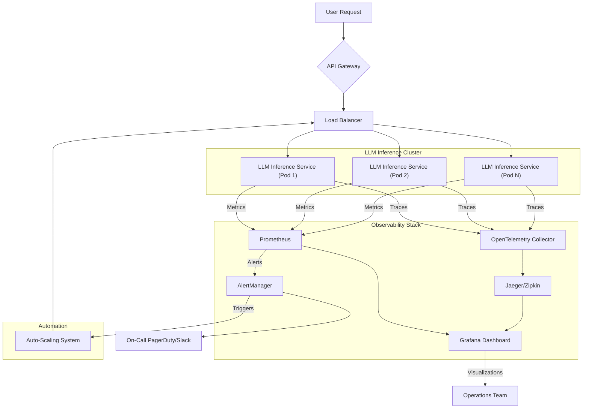

LLM 기반 서비스의 안정적인 운영은 실시간 성능 추적과 트래픽 변화에 따른 유연한 인프라 관리에 달려 있습니다. 기존 마이크로서비스 아키텍처와 달리, LLM 서비스는 추론(inference) 과정에서 발생하는 고유한 특징들을 가집니다. 예를 들어, 토큰 길이에 따른 가변적인 응답 시간, GPU와 같은 고비용 자원의 효율적인 활용, 그리고 예측하기 어려운 사용자 트래픽 패턴 등이 있습니다. 이러한 복잡성을 관리하기 위해서는 정교한 모니터링 시스템과 지능적인 자동 스케일링 전략이 필수적입니다.

## 실시간 성능 모니터링
LLM 서비스의 성능을 효과적으로 모니터링하기 위해서는 핵심 지표(Key Performance Indicators, KPIs)를 정확히 측정하고 시각화하는 것이 중요합니다.

### 핵심 지표 (Key Metrics)
*   **레이턴시 (Latency)**:
    *   **TTFT (Time to First Token)**: 첫 번째 토큰이 응답되기까지 걸리는 시간. 사용자 체감 성능에 직접적인 영향을 미칩니다.
    *   **TTT (Time to Total Tokens)**: 모든 토큰이 응답되기까지 걸리는 시간. 긴 응답을 처리하는 데 중요합니다.
    *   **P99/P95 Latency**: 가장 느린 요청의 성능을 파악하여 서비스 품질 저하를 방지합니다.
*   **처리량 (Throughput)**:
    *   **RPM (Requests Per Minute)** 또는 **TPS (Tokens Per Second)**: 특정 시간당 처리되는 요청 수 또는 생성되는 토큰 수. 서비스 용량을 나타냅니다.
*   **에러율 (Error Rates)**: API 호출 실패, 모델 오류, 응답 파싱 오류 등. 서비스 안정성의 핵심 지표입니다.
*   **토큰 사용량 (Token Usage)**:
    *   **Input Tokens**: 사용자 입력에 사용된 토큰 수.
    *   **Output Tokens**: LLM이 생성한 응답 토큰 수.
    *   이 두 가지는 비용과 직결되며, `Context Window` 사용 효율성을 파악하는 데 중요합니다.
*   **자원 활용률 (Resource Utilization)**:
    *   **GPU Utilization**: LLM 추론에 사용되는 GPU의 활용률. GPU는 고비용 자원이므로 효율적인 사용이 중요합니다.
    *   **GPU Memory Usage**: GPU 메모리 사용량. Out-of-memory (OOM) 오류 방지에 필수적입니다.
    *   **CPU/Memory Usage**: 워커 노드 및 API 게이트웨이의 일반 자원 사용률.
*   **큐 깊이 (Queue Depth)**: 처리 대기 중인 요청의 수. 큐 깊이가 길어지면 레이턴시 증가로 이어집니다.

### 모니터링 도구 및 아키텍처 (Monitoring Tools & Architecture)
현대적인 클라우드 환경에서는 `Prometheus`, `Grafana` 조합이 널리 사용됩니다. `OpenTelemetry`와 같은 표준화된 트레이싱 시스템을 활용하여 요청의 전 생애 주기(end-to-end)를 추적하면 병목 현상을 정확히 파악할 수 있습니다.



## 자동 스케일링 (Automated Scaling)
LLM 서비스의 트래픽 변화에 따라 인프라 자원을 자동으로 조절하는 것은 비용 효율성과 서비스 안정성을 동시에 확보하는 핵심 전략입니다.

### 스케일링 유형 (Scaling Types)
*   **수평 스케일링 (Horizontal Scaling)**: 더 많은 인스턴스(Pod, VM)를 추가하여 부하를 분산합니다. LLM 서비스는 `GPU Sharing` 문제와 `Context Load Time` 때문에 `Warm-up` 시간이 길 수 있으므로, `Predictive Scaling` 또는 `Proactive Scaling`이 중요합니다.
*   **수직 스케일링 (Vertical Scaling)**: 현재 인스턴스의 자원(CPU, Memory, GPU)을 늘립니다. 짧은 시간 내에 급증하는 트래픽에 대응하거나, 특정 모델이 요구하는 최소 자원량을 충족할 때 유용합니다.

### 스케일링 트리거 메커니즘 (Scaling Trigger Mechanisms)
*   **임계값 기반 (Threshold-based)**: 가장 일반적인 방법으로, CPU 사용률, GPU 사용률, 큐 깊이, 또는 레이턴시가 특정 임계값을 초과할 때 스케일링을 트리거합니다.
    *   예: `GPU Utilization`이 70%를 5분 이상 유지하면 `Pod` 추가.
*   **예측 기반 (Predictive)**: 과거 트래픽 패턴이나 머신러닝 모델을 활용하여 미래의 부하를 예측하고 미리 스케일 아웃(scale out)합니다. 피크 타임 전에 미리 자원을 확보하여 사용자 경험 저하를 방지합니다.
*   **큐 깊이 기반 (Queue Depth-based)**: `Load Balancer` 또는 `API Gateway`의 처리 대기열에 쌓인 요청 수를 기준으로 스케일링을 결정합니다. 이는 사용자 요청의 즉각적인 부하를 반영합니다.

### 스케일링 구현 (Implementation)
`Kubernetes` 환경에서는 `Horizontal Pod Autoscaler (HPA)`와 `Cluster Autoscaler`가 핵심적인 역할을 합니다. `HPA`는 `Prometheus`와 연동하여 커스텀 메트릭(`Custom Metrics`)을 기반으로 `Pod` 수를 조절할 수 있습니다.

#### Kubernetes HPA를 활용한 LLM 서비스 스케일링 예시
다음은 `Kubernetes HPA`를 사용하여 `GPU Utilization`과 `Requests Per Second (RPS)`를 기준으로 LLM 서비스 `Deployment`를 자동 스케일링하는 예시입니다. `Kube-state-metrics`와 `Prometheus Adapter`가 설치되어 있어야 합니다.

```yaml
apiVersion: autoscaling/v2
kind: HorizontalPodAutoscaler
metadata:
  name: llm-inference-hpa
spec:
  scaleTargetRef:
    apiVersion: apps/v1
    kind: Deployment
    name: llm-inference-service
  minReplicas: 2
  maxReplicas: 10
  metrics:
  - type: Resource
    resource:
      name: cpu
      target:
        type: Utilization
        averageUtilization: 60
  - type: Pods
    pods:
      metricName: gpu_utilization_average_seconds_total
      target:
        type: AverageValue
        averageValue: "70" # GPU Utilization 70%
  - type: Object
    object:
      metric:
        name: http_requests_total
        selector:
          matchLabels:
            app: llm-inference-service
      describedObject:
        apiVersion: networking.k8s.io/v1
        kind: Ingress
        name: llm-api-ingress
      target:
        type: Value
        value: "100" # RPS 100
```
이 설정은 CPU 사용률, 개별 Pod의 평균 GPU 사용률, 그리고 Ingress를 통한 HTTP 요청 수를 복합적으로 고려하여 Pod 수를 자동으로 조절합니다. `minReplicas`를 2로 설정하여 항상 최소한의 가용성을 유지합니다.

## 트레이드오프 (Trade-offs)

LLM 서비스의 실시간 모니터링 및 자동 스케일링 전략을 구현할 때는 다음과 같은 트레이드오프를 고려해야 합니다.

*   **즉시성 (Immediacy) vs. 비용 효율성 (Cost Efficiency)**
    *   **언제 좋은가**: `Predictive Scaling`이나 높은 `minReplicas` 설정은 급작스러운 트래픽 스파이크에 즉시 대응하여 사용자 경험을 최적화합니다.
    *   **언제 나쁜가**: 유휴 시간에도 자원을 미리 확보하므로 비용이 증가합니다. 특히 `GPU` 자원은 `Cloud`에서 고가이므로, `Over-provisioning`은 재정적 부담으로 이어질 수 있습니다.
*   **정교한 메트릭 (Granular Metrics) vs. 모니터링 오버헤드 (Monitoring Overhead)**
    *   **언제 좋은가**: `Token-level` 레이턴시, `GPU Memory` 사용량 등 정교한 메트릭은 서비스의 깊은 통찰을 제공하고 미세한 최적화를 가능하게 합니다.
    *   **언제 나쁜가**: 너무 많은 메트릭을 수집하고 처리하는 것은 모니터링 시스템 자체에 부하를 주며, 저장 공간과 네트워크 비용을 증가시킵니다. 불필요한 메트릭은 분석의 복잡성만 높일 수 있습니다.
*   **빠른 스케일 업/다운 (Fast Scale Up/Down) vs. 안정성 (Stability)**
    *   **언제 좋은가**: 공격적인 `Threshold`와 짧은 `Cooldown` 기간은 트래픽 변화에 빠르게 반응하여 자원 낭비를 줄이고 `SLA`를 유지합니다.
    *   **언제 나쁜가**: 너무 민감한 스케일링 설정은 `Flapping` 현상(잦은 스케일 업/다운 반복)을 유발하여 시스템 불안정성을 초래하고, `Pod`의 `Warm-up` 지연으로 오히려 서비스 저하를 가져올 수 있습니다. 특히 `LLM` 컨테이너는 `Model Loading`에 시간이 오래 걸릴 수 있습니다.
*   **`GPU Sharing` vs. `Dedicated GPU`**
    *   **언제 좋은가**: `GPU Sharing`은 여러 모델 또는 여러 추론 요청이 하나의 `GPU`를 공유하여 자원 활용률을 극대화하고 비용을 절감합니다. `vLLM` 같은 프레임워크가 이를 지원합니다.
    *   **언제 나쁜가**: `Workload Isolation`이 어려워지고, 한 `Workload`의 부하가 다른 `Workload`의 성능에 영향을 줄 수 있습니다. 예측 불가능한 `Latency` 증가로 이어질 수 있습니다.

## 실전 체크리스트 (Practical Checklist)

LLM 기반 서비스의 실시간 성능 모니터링 및 자동 스케일링을 프로젝트에 적용할 때 다음 항목들을 검증해야 합니다.

*   [ ] **핵심 메트릭 정의 및 수집**: `TTFT`, `TTT`, `P99 Latency`, `GPU Utilization`, `Queue Depth`, `Error Rates` 등 LLM 서비스에 특화된 핵심 성능 지표들이 충분히 정의되고 모든 인스턴스에서 실시간으로 수집되는가?
*   [ ] **경고 시스템 구성**: 정의된 핵심 지표들이 임계값을 초과할 경우, 관련 팀에 즉시 알림(`Slack`, `PagerDuty`)이 전송되는 `Alerting System`이 작동하는가? `Flapping alert` 방지 `Suppress` 설정은 되어 있는가?
*   [ ] **분산 트레이싱 구현**: `OpenTelemetry`와 같은 표준을 사용하여 사용자 요청의 `End-to-End` 흐름을 추적하고, LLM 추론 내부의 병목(`Token Generation`, `Cache Hit Rate`)을 시각화할 수 있는가?
*   [ ] **자동 스케일링 정책 검토**: `HPA` 또는 `Cloud-native Autoscaler`의 `minReplicas`, `maxReplicas`, `targetMetric`, `cooldownPeriod` 설정이 현재 LLM 모델의 `Warm-up` 시간과 예측된 트래픽 패턴에 최적화되어 있는가? 특히 `GPU`가 할당된 `Pod`의 `Warm-up` 시간을 고려했는가?
*   [ ] **로드 테스트 및 부하 시뮬레이션**: 실제 운영 환경과 유사한 부하를 주어 `Auto-Scaling`이 예상대로 작동하는지, 그리고 `Scale-Up` 및 `Scale-Down` 과정에서 서비스 품질 저하가 없는지 검증했는가?
*   [ ] **비용 모니터링 연동**: `Token Usage` 및 `GPU Utilization`과 같은 비용 관련 메트릭이 `Cost Management System`과 연동되어 실시간으로 비용 효율성을 추적하고 최적화 기회를 식별할 수 있는가?
*   [ ] **재해 복구 계획 (DRP) 연동**: `Auto-Scaling`이 특정 `Availability Zone` 또는 `Region` 실패 시 `Cross-AZ/Region Failover`와 연동되어 서비스 연속성을 보장하는가?