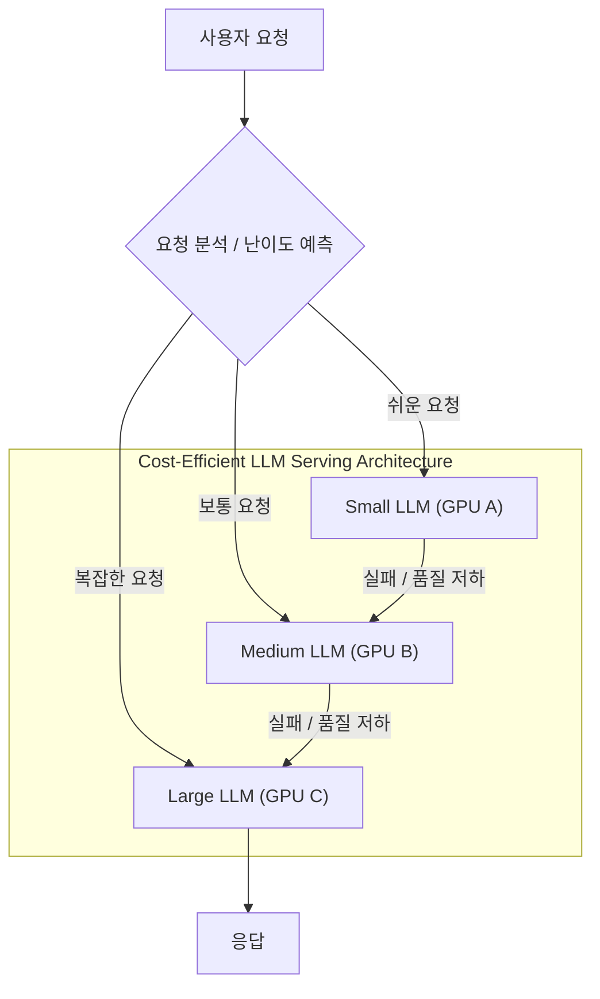

대규모 언어 모델(LLM)의 상용화는 혁신적인 서비스 기회를 제공하지만, 높은 추론 비용과 복잡한 인프라 관리는 상당한 도전 과제로 남아 있습니다. 특히 실시간 응답이 요구되는 서비스에서 LLM 서빙의 비용 효율성을 확보하는 것은 비즈니스 지속 가능성의 핵심입니다. 이 문서는 LLM 서빙의 운영 비용을 절감하고 안정적인 성능을 확보하기 위한 최신 인프라 설계 패턴과 전략을 분석합니다.

## 핵심 비용 효율화 전략

### 1. 모델 최적화: 경량화와 효율성 극대화
LLM의 추론 비용은 모델 크기와 직접적인 연관이 있습니다. 모델 자체를 경량화하는 것은 인프라 비용 절감의 가장 근본적인 방법입니다.

*   **양자화 (Quantization)**: 모델의 가중치를 낮은 비트(예: FP16 < 8-bit < 4-bit)로 표현하여 메모리 사용량과 연산 속도를 개선합니다. 이는 GPU 메모리 점유율을 낮춰 더 많은 모델을 동일 GPU에 로드하거나, 더 작은 GPU를 사용하여 비용을 절감할 수 있게 합니다. 2026년에는 FP8, INT4 등 더욱 정교한 저비트 양자화 기술이 보편화될 것입니다.
*   **가지치기 (Pruning)**: 모델의 중요하지 않은 가중치나 뉴런을 제거하여 모델 크기를 줄입니다. 이는 성능 저하를 최소화하면서 추론 속도를 향상시킵니다.
*   **지식 증류 (Knowledge Distillation)**: 대규모 교사 모델(teacher model)의 지식을 소규모 학생 모델(student model)로 이전하여, 작은 모델이 큰 모델과 유사한 성능을 내도록 학습시킵니다.

### 2. 인프라 계층 최적화: 자원 활용도 극대화
LLM 서빙을 위한 GPU 자원은 매우 고가이므로, 이를 효율적으로 활용하는 것이 중요합니다.

*   **동적 배치 (Dynamic Batching)**: 여러 사용자 요청을 하나의 배치로 묶어 GPU에 한 번에 처리하도록 하여 GPU 활용률을 극대화합니다. `vLLM`의 PagedAttention과 같은 기술은 가변 길이 시퀀스에서도 효율적인 GPU 메모리 관리를 가능하게 합니다.
*   **프롬프트 캐싱 (Prompt Caching) 및 KV 캐싱 (KV Caching)**:
    *   **KV 캐싱**: LLM의 Attention 메커니즘에서 Key와 Value 벡터를 캐싱하여, 동일한 프롬프트의 반복적인 부분이나 긴 대화 컨텍스트에서 이전 계산 결과를 재사용합니다. 이는 특히 긴 컨텍스트 길이에서 지연 시간과 계산 비용을 크게 줄입니다.
    *   **프롬프트 캐싱**: 자주 사용되는 프롬프트나 프롬프트의 공통 접두사를 캐싱하여 새로운 요청이 들어올 때 불필요한 재계산을 방지합니다.
*   **멀티테넌시 및 스케줄링**: 단일 GPU에 여러 모델 또는 여러 사용자 요청을 동시에 서빙하는 멀티테넌시를 구현하고, 요청 우선순위 및 자원 할당을 최적화하는 스케줄러를 도입하여 GPU 활용률을 더욱 높입니다.

### 3. 지능형 라우팅 및 계단식 모델 서빙 (Cascading Model Serving)
단일 모델로 모든 요청을 처리하는 것은 비효율적입니다. 요청의 복잡도와 중요도에 따라 적절한 모델을 동적으로 선택하는 라우팅 전략은 비용 효율성을 크게 높입니다.

*   **동적 모델 라우팅 (Dynamic Model Routing)**:
    초기 프롬프트 분석 또는 경량 모델 추론을 통해 요청의 난이도를 평가하고, 이에 따라 적합한 크기와 비용의 LLM으로 요청을 라우팅합니다. 예를 들어, 간단한 질문은 소형 모델로, 복잡한 추론이나 코딩 작업은 대형 모델로 보냅니다.
*   **계단식 모델 서빙 (Cascading Model Serving)**:
    낮은 비용의 소형 모델로 먼저 시도하고, 응답의 품질이 기준에 미달하거나 특정 조건을 만족하지 못할 경우 점진적으로 더 크고 비싼 모델로 폴백(fallback)하는 전략입니다. 이는 대부분의 요청을 저비용 모델로 처리하면서도 필요한 경우 고품질 응답을 보장합니다.

### 4. 서버리스 및 분산 인프라 활용
클라우드의 서버리스 컴퓨팅 및 GPU 인스턴스를 활용하여 사용량 기반 과금(pay-as-you-go) 모델을 극대화하고, 인프라 관리 오버헤드를 줄입니다.

*   **Function-as-a-Service (FaaS) with GPU**:
    클라우드 제공업체의 GPU 지원 서버리스 함수 (예: AWS Lambda with GPU, Google Cloud Run with GPU)를 사용하여 트래픽이 없을 때는 비용을 최소화하고, 필요 시 빠르게 스케일업합니다.
*   **분산 추론 (Distributed Inference)**:
    매우 큰 모델의 경우, 모델 병렬화(Model Parallelism)나 파이프라인 병렬화(Pipeline Parallelism)를 통해 여러 GPU 또는 서버에 모델을 분산하여 추론 성능을 향상시키고 단일 GPU의 한계를 극복합니다.
*   **전문 LLM 서빙 프레임워크**:
    `vLLM`, `Text Generation Inference (TGI)`, `Ray LLM`과 같은 전문 프레임워크는 PagedAttention, Continuous Batching, Tensor Parallelism 등의 최적화 기법을 내장하여 LLM 추론 처리량과 지연 시간을 획기적으로 개선합니다.

### 5. 인프라 자동화 및 모니터링
지속적인 비용 효율성을 유지하기 위해서는 인프라 자동화와 실시간 모니터링이 필수적입니다.

*   **오토스케일링 (Autoscaling)**:
    트래픽 변화에 따라 GPU 인스턴스 또는 컨테이너 수를 자동으로 조절하여 필요한 자원만 사용하고 유휴 자원으로 인한 비용 낭비를 방지합니다.
*   **A/B 테스팅 및 모델 버전 관리**:
    새로운 모델 버전이나 최적화 기법을 배포하기 전에 실제 트래픽에서 A/B 테스팅을 통해 성능과 비용 효율성을 검증하고, 모델 버전을 체계적으로 관리하여 롤백 및 비교 분석을 용이하게 합니다.
*   **비용 모니터링 및 알림**:
    LLM 추론 비용을 실시간으로 모니터링하고, 예기치 않은 비용 증가 발생 시 즉시 알림을 통해 빠른 대응을 가능하게 합니다.

## 트레이드오프

### 1. 모델 경량화 (Quantization, Pruning, Distillation)
*   **장점 (언제 좋은가)**: GPU 메모리 사용량 및 추론 Latency, 비용을 크게 절감할 수 있으며, 작은 모델로도 충분한 성능을 낼 수 있는 Use Case (예: 간단한 질의응답, 분류)에 적합합니다. Edge device 배포 시 필수적입니다.
*   **단점 (언제 나쁜가)**: 모델 정확도 (Accuracy)나 품질 저하가 발생할 수 있습니다. 특히 복잡한 추론, 미묘한 뉘앙스 파악, 또는 고정밀도가 요구되는 Use Case에서는 신중한 평가와 튜닝이 필요합니다. 초기 경량화 과정에 추가적인 엔지니어링 리소스가 소요될 수 있습니다.

### 2. 동적 배치 및 캐싱 (PagedAttention, KV Cache, Prompt Cache)
*   **장점 (언제 좋은가)**: 높은 동시성 요청이 발생하고, 특히 긴 시퀀스 길이나 반복적인 프롬프트 패턴이 많은 Use Case에서 GPU 활용률과 처리량(Throughput)을 극대화하여 비용을 크게 절감할 수 있습니다.
*   **단점 (언제 나쁜가)**: 배치 크기가 작거나, 요청 빈도가 매우 낮은 Use Case에서는 오버헤드가 더 클 수 있습니다. 캐싱 전략은 메모리 관리를 복잡하게 만들 수 있으며, 캐시 미스(Cache Miss) 발생 시 오히려 Latency가 증가할 가능성도 있습니다.

### 3. 동적 모델 라우팅 및 계단식 서빙
*   **장점 (언제 좋은가)**: 다양한 난이도의 요청이 혼재하는 서비스에서 대부분의 트래픽을 저비용 소형 모델로 처리하여 전체 운영 비용을 획기적으로 줄일 수 있습니다. 사용자 경험을 저해하지 않으면서 비용 효율성을 확보할 수 있습니다.
*   **단점 (언제 나쁜가)**: 요청의 난이도를 정확하게 분류하는 초기 분류기(Classifier)의 개발 및 유지보수 비용이 발생합니다. 잘못된 라우팅은 사용자 경험 저하(지연 시간 증가, 낮은 품질의 응답)로 이어질 수 있으며, 계단식 폴백은 Latency를 증가시킬 수 있습니다.

### 4. 서버리스 GPU 및 오토스케일링
*   **장점 (언제 좋은가)**: 예측 불가능한 트래픽 패턴이나 간헐적인 사용량 피크가 발생하는 서비스에 최적입니다. 유휴 자원에 대한 비용 지불 없이 사용량에 따라 정확히 과금되므로 초기 투자 비용과 운영 비용을 최소화할 수 있습니다.
*   **단점 (언제 나쁜가)**: 콜드 스타트 (Cold Start) 문제가 발생하여 첫 요청에 대한 Latency가 증가할 수 있습니다. 특정 클라우드 벤더에 대한 종속성(Vendor Lock-in)이 심화될 수 있으며, 복잡한 상태 관리나 모델 로딩 최적화가 어려울 수 있습니다.

## 실전 체크리스트

다음은 대규모 언어 모델 서빙을 위한 비용 효율적인 인프라를 설계하고 운영할 때 고려해야 할 실전 체크리스트입니다.

- [ ] **모델 양자화 및 압축 전략 검토**: 현재 사용 중인 LLM에 대해 FP16 대비 8-bit, 4-bit 양자화 적용 가능성을 평가하고, 성능 저하 임계치를 설정했는가?
- [ ] **동적 배치 및 PagedAttention 도입**: `vLLM` 또는 `TGI`와 같은 전문 LLM 서빙 프레임워크를 도입하여 GPU 활용률 및 처리량 지표(QPS, Latency)를 2026년 최신 벤치마크와 비교 분석했는가?
- [ ] **KV 캐시 및 프롬프트 캐시 구현**: 주요 API 호출 패턴에서 KV 캐시 및 프롬프트 캐시의 효과를 측정하고, 캐시 적중률(Cache Hit Rate) 목표를 설정했는가?
- [ ] **지능형 모델 라우팅 전략 수립**: 요청 난이도 분류를 위한 경량 모델 또는 규칙 기반 라우팅을 구현하고, 라우팅 정확도 및 비용 절감 효과를 지속적으로 모니터링하는 대시보드를 구축했는가?
- [ ] **계단식 모델 서빙(Cascading) 설계**: 저비용 모델로 시작하여 점진적으로 고비용 모델로 전환하는 계단식 서빙 로직을 설계하고, 각 단계의 품질 임계치 및 Latency 허용 범위를 정의했는가?
- [ ] **클라우드 서버리스 GPU 서비스 활용**: 간헐적인 트래픽 패턴에 대응하기 위해 AWS Lambda/Google Cloud Run with GPU와 같은 서버리스 옵션을 탐색하고, 콜드 스타트 영향도를 최소화하는 방안(예: 프로비저닝된 동시성)을 고려했는가?
- [ ] **자동화된 비용 모니터링 및 알림 시스템 구축**: LLM API 호출 및 GPU 사용량에 따른 비용을 실시간으로 추적하고, 일일/주간 예산 초과 시 즉시 담당자에게 알림을 보내는 시스템을 갖추었는가?
- [ ] **A/B 테스팅을 통한 최적화 검증**: 새로운 모델 버전, 인프라 최적화 기법, 라우팅 전략 변경 시 A/B 테스팅을 통해 실제 환경에서의 성능, Latency, 비용 지표를 객관적으로 검증하는 프로세스를 확립했는가?