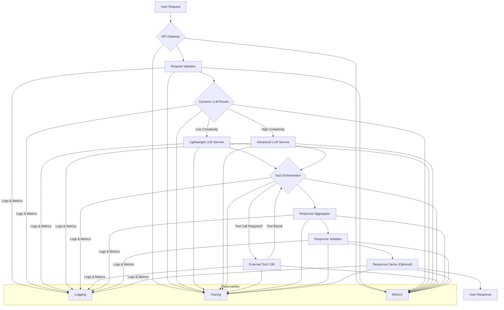

LLM 기반 애플리케이션의 복잡도 증가는 프로덕션 환경에서 안정적이고 확장 가능한 LLM 워크플로우 오케스트레이션 하네스(Harness) 구축의 중요성을 부각합니다. 이 하네스는 LLM 호출, 외부 도구 연동, 상태 관리, 에러 처리 등 다단계 태스크를 조정/관리하는 프레임워크입니다. 단순 질의응답을 넘어 다단계 의사결정 및 외부 시스템 연동을 수행할 때 필수적입니다.

## LLM 워크플로우 하네스 필요성

생성형 AI 프로덕션 도입 가속화에 따라, LLM은 이제 단일 호출이 아닌, 추론 단계, RAG(Retrieval Augmented Generation), API 호출, 피드백 루프 등을 포함하는 복합 워크플로우의 핵심입니다. 프로덕션 시스템 운영을 위해 다음을 충족해야 합니다.

*   **안정성 (Reliability)**: LLM 비결정성 및 외부 시스템 실패에 대응하여 워크플로우 중단 없이 실행을 보장.
*   **확장성 (Scalability)**: 증가하는 트래픽과 워크로드에 유연하게 대응.
*   **관측 가능성 (Observability)**: LLM 호출, 도구 사용, 상태 변화 등을 모니터링, 추적하여 신속한 문제 진단 가능.
*   **비용 효율성 (Cost-Efficiency)**: 모델 라우팅, 캐싱, 토큰 최적화를 통해 LLM 호출 비용 관리.
*   **보안 및 규정 준수 (Security & Compliance)**: 민감 데이터 처리, API 키 관리, 출력 검증으로 보안 강화 및 규정 준수.

## 핵심 구축 패턴

LLM 워크플로우 오케스트레이션 하네스는 다음 패턴들을 통합합니다.

### 1. 동적 LLM 라우팅 (Dynamic LLM Routing)

워크로드 특성(길이, 복잡성)에 따라 최적 LLM 모델을 동적으로 선택, 비용/성능/정확도 트레이드오프 관리로 자원 활용 효율 극대화. (예: 컨텍스트, 성능/비용, 폴백 라우팅).

### 2. 상태 저장 워크플로우 관리 (Stateful Workflow Management)

장기 실행/다단계 워크플로우의 상태(State), 컨텍스트(Context), 중간 결과 저장 및 관리. 스테이트 머신(State Machine) 또는 워크플로우 엔진(Workflow Engine) 패턴, 세션 컨텍스트(Session Context) 유지 및 체크포인트(Checkpointing) 구현이 핵심.

### 3. 도구 오케스트레이션 및 관리 (Tool Orchestration and Management)

LLM이 외부 데이터 조회, API 호출, 코드 실행 등 작업을 수행하도록 도구(Tools) 연동 및 관리. 도구 레지스트리(Tool Registry) 관리, 샌드박스 환경에서의 안전한 도구 실행, 에러 처리 및 재시도 로직 구현이 중요.

### 4. 관측 가능성 (Observability)

워크플로우 복잡성 관리 및 문제 진단을 위한 포괄적 모니터링, 로깅, 트레이싱 시스템 필수. 중앙 집중식 로깅(Centralized Logging), OpenTelemetry 기반 분산 트레이싱(Distributed Tracing), LLM 지표 모니터링(Metrics Monitoring)으로 가시성 확보.

## 워크플로우 아키텍처 예시

다음 Mermaid 다이어그램은 동적 LLM 라우팅과 도구 오케스트레이션을 포함하는 LLM 워크플로우 하네스 아키텍처를 보여줍니다.



## 코드 예시: 동적 라우팅 및 단순 도구 사용

아래 Python 코드는 LLM 워크플로우 하네스의 동적 라우팅 및 간단한 도구 호출 개념을 보여줍니다. 이는 LangChain, LiteLLM 또는 자체 구현 프레임워크의 기반이 될 수 있습니다.

```python
import os
from typing import Dict, Any

class LLMService:
    def __init__(self, name: str, cost_per_token: float, latency_ms: int):
        self.name = name
        self.cost_per_token = cost_per_token
        self.latency_ms = latency_ms

    def generate(self, prompt: str) -> str:
        return f"Response from {self.name} for '{prompt}'. (tool_needed: {'yes' if 'tool' in prompt.lower() else 'no'})"

def get_llm_services() -> Dict[str, LLMService]:
    return {
        "gpt-4o-mini": LLMService("GPT-4o Mini", 0.0000005, 100),
        "claude-opus": LLMService("Claude Opus", 0.000015, 500),
    }

def dynamic_llm_router(user_query: str, services: Dict[str, LLMService]) -> LLMService:
    if len(user_query.split()) < 20 and "complex analysis" not in user_query.lower():
        return services["gpt-4o-mini"]
    else:
        return services["claude-opus"]

def execute_external_tool(tool_name: str, params: Dict[str, Any]) -> str:
    if tool_name == "search_database":
        return "Search result: Found relevant data."
    elif tool_name == "call_api":
        return "API call successful: Data retrieved."
    return "Unknown tool output."

def orchestrate_llm_workflow(query: str) -> str:
    llm_services = get_llm_services()
    selected_llm = dynamic_llm_router(query, llm_services)
    initial_llm_output = selected_llm.generate(query)
    final_response = initial_llm_output

    if "tool_needed: yes" in initial_llm_output:
        tool_name = "search_database"
        tool_params = {"query": query}
        tool_result = execute_external_tool(tool_name, tool_params)
        refined_query = f"{initial_llm_output}. Based on this, and the tool result: '{tool_result}', provide a final answer."
        final_response = selected_llm.generate(refined_query)

    return final_response

if __name__ == "__main__":
    simple_query = "What is the capital of South Korea?"
    orchestrate_llm_workflow(simple_query)

    complex_query = "Perform a complex analysis on recent market trends for AI startups. Also, find recent news using a tool."
    orchestrate_llm_workflow(complex_query)
```

## 트레이드오프 (Trade-offs)

LLM 워크플로우 오케스트레이션 하네스 구축 시 주요 트레이드오프입니다.

*   **복잡성 vs 유연성**:
    *   **언제 좋고**: 다단계 추론, 외부 시스템 연동, 동적 라우팅이 필요한 복잡한 LLM 애플리케이션에 적합하며, 유연성과 재사용성을 높입니다.
    *   **언제 나쁜지**: 단순 LLM 호출 시 불필요한 오버헤드를 추가하여 개발/유지보수 비용을 증가시킬 수 있습니다.
*   **비용 효율성 vs 응답 속도**:
    *   **언제 좋고**: 동적 LLM 라우팅으로 트래픽 특성에 따라 저비용/고성능 모델을 활용하여 전체 비용 최적화 및 특정 워크로드 응답 속도를 개선합니다.
    *   **언제 나쁜지**: 라우팅 로직 지연이나 모델 서비스 간 네트워크 오버헤드로 인해 초고속 응답이 필수적인 경우 불리할 수 있습니다.
*   **견고성 vs 자원 사용량**:
    *   **언제 좋고**: 체크포인트, 재시도, 에러 핸들링으로 LLM 비결정성 및 외부 시스템 실패에도 워크플로우 중단을 최소화하고 성공률을 높입니다.
    *   **언제 나쁜지**: 상태 저장, 로깅, 트레이싱은 추가 스토리지, 컴퓨팅, 네트워크 대역폭을 요구하며, 대규모 트래픽에서 운영 비용을 증가시킬 수 있습니다.
*   **개발 시간 vs 프로덕션 안정성**:
    *   **언제 좋고**: 초기 개발 노력은 크지만, 프로덕션 문제 예측/관리, 장기적 유지보수 비용 및 인시던트 발생률을 낮춥니다.
    *   **언제 나쁜지**: 빠른 프로토타이핑/MVP 개발 시 하네스 구축 초기 비용이 부담될 수 있습니다.

## 실전 체크리스트 (Practical Checklist)

LLM 워크플로우 오케스트레이션 하네스 프로덕션 적용을 위한 체크리스트입니다.

*   [ ] **모델 라우팅 전략 정의**: 쿼리 복잡도, 사용자 등급, 비용 예산에 따른 동적 LLM 라우팅 규칙을 명확히 정의하고 테스트했는가?
*   [ ] **워크플로우 상태 관리 설계**: 장기 실행 워크플로우의 단계별 상태 저장, 컨텍스트 전달, 체크포인트 및 재시작 메커니즘을 설계하고 구현했는가?
*   [ ] **외부 도구 통합 및 보안**: LLM이 호출할 수 있는 모든 외부 도구가 안전한 샌드박스에서 실행되며, 인증/인가 및 입력 검증 로직이 적용되었는가?
*   [ ] **종합적인 관측 가능성 확보**: LLM 호출, 도구 사용, 워크플로우 전환 등 모든 주요 이벤트에 대한 중앙 집중식 로깅, 분산 트레이싱, 핵심 지표 모니터링 시스템을 구축하고 대시보드를 연동했는가?
*   [ ] **에러 처리 및 복구 메커니즘**: LLM 출력 실패, 외부 도구 에러, 타임아웃 등에 대한 재시도, 폴백, 알림 등 견고한 에러 처리 및 복구 로직을 구현했는가?
*   [ ] **확장성 및 성능 테스트**: 최대 트래픽 부하 상황에서 하네스가 의도한 성능을 유지하며 확장 가능한지 스트레스/부하 테스트를 수행했는가?
*   [ ] **비용 모니터링 및 최적화**: LLM 토큰 사용량 및 API 호출 비용을 실시간 모니터링하고, 비용 임계값 초과 시 알림 및 자동 조치(예: 저비용 모델 전환)를 트리거하도록 구성했는가?