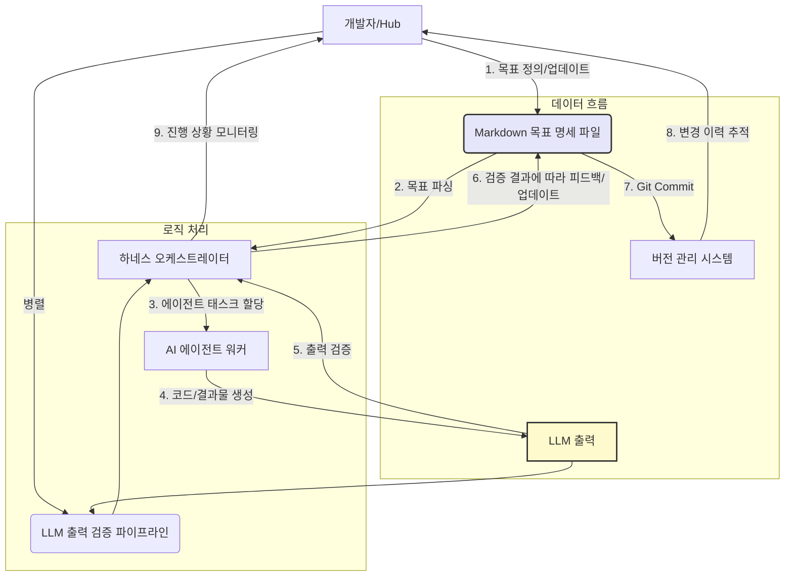

AI 에이전트 개발이 복잡해짐에 따라, 에이전트의 현재 목표와 진행 상태를 명확하게 관리하는 것은 필수적인 과제가 되었습니다. 특히 여러 프로젝트를 동시에 진행하거나 장기적인 자율성을 요구하는 에이전트의 경우, 비정형적인 지시나 내부 상태만으로는 일관된 개발과 신뢰성 있는 운영이 어렵습니다. 마크다운(Markdown) 기반 명세 하네스(Specification Harness)는 이러한 문제를 해결하기 위한 경량화된 접근 방식입니다. 이는 에이전트의 목표를 인간과 LLM이 모두 이해하고 관리할 수 있는 형태로 정의하고, 이를 기반으로 에이전트의 행동을 제어하고 검증하는 체계를 구축합니다.

## 마크다운 기반 명세의 필요성

전통적인 AI 에이전트의 목표 설정 및 관리 방식은 주로 코드 내 하드코딩, 프롬프트 엔지니어링을 통한 동적 지시, 또는 복잡한 데이터베이스 스키마에 의존해왔습니다. 그러나 이러한 방식들은 다음과 같은 한계를 가집니다.

*   **불투명성 (Lack of Transparency)**: 에이전트의 현재 목표와 진행 상태가 코드 깊숙이 숨겨져 있거나 LLM의 내부 컨텍스트에만 존재하여, 개발자가 에이전트의 행동을 이해하고 디버깅하기 어렵습니다.
*   **버전 관리의 어려움 (Version Control Challenges)**: 목표 변경 이력을 추적하고, 특정 시점의 목표 상태로 롤백하는 것이 쉽지 않습니다.
*   **LLM 출력 검증의 한계 (LLM Output Validation Limitations)**: 명확한 목표 명세가 없으면 LLM이 생성한 결과물의 '정확성'이나 '목표 부합성'을 평가하기 위한 기준이 모호해집니다.

마크다운은 이러한 문제에 대한 효과적인 해결책을 제공합니다. 텍스트 기반으로 가볍고, Git과 같은 버전 관리 시스템에 친화적이며, 인간이 읽고 쓰기 쉽습니다. 또한, LLM이 마크다운 문서를 이해하고 파싱하는 데 탁월하여, 에이전트의 동적인 목표 설정과 자체 보고 메커니즘을 구축하는 데 유리합니다.

## 아키텍처 및 통합 전략

마크다운 기반 AI 에이전트 목표 관리 명세 하네스를 도입하기 위한 핵심적인 아키텍처는 `playbook` 내에 `content/goals/` 또는 `docs/specs/`와 같은 디렉토리를 신설하고, 이 안에 에이전트의 개별 목표를 마크다운 파일(`.md`)로 관리하는 것입니다.

### 1. 목표 디렉토리 구조

예를 들어, 에이전트가 수행할 다양한 프로젝트나 태스크에 대한 목표는 다음과 같이 정의될 수 있습니다.

```text
playbook/
├── content/
│   └── goals/
│       ├── project-a/
│       │   ├── feature-x.md
│       │   └── bug-fix-y.md
│       └── shared-tasks/
│           └── code-refactoring-standards.md
└── src/
    └── harness/
        ├── agent_orchestrator.py
        └── validation_engine.py
```

각 마크다운 파일은 에이전트가 달성해야 할 구체적인 목표, 성공 기준(success criteria), 제약 조건(constraints), 현재 진행 상태(current status) 등을 포함할 수 있습니다. 예를 들어, `feature-x.md` 파일은 다음과 같은 내용을 가질 수 있습니다.

```markdown
# Feature X 개발

## 목표
사용자 인증 시스템에 2단계 인증(2FA) 기능을 추가하고, 기존 로그인 흐름과 Seamless하게 통합한다.

## 성공 기준
- [x] 사용자 계정 설정 페이지에 2FA 활성화 옵션 추가
- [ ] 2FA 활성화 시 QR 코드 및 복구 코드 제공
- [ ] 로그인 시 2FA 코드 입력 페이지로 리다이렉트
- [ ] 유효한 2FA 코드 입력 시 로그인 성공
- [ ] 유효하지 않은 2FA 코드 입력 시 오류 메시지 표시 및 재시도 기회 제공 (최대 3회)
- [ ] 테스트 커버리지 90% 이상 달성

## 제약 조건
- 기존 사용자 데이터베이스 스키마에 최소한의 변경으로 구현
- 새로운 의존성 라이브러리 추가 시 보안 검토 필수

## 현재 상태
- `2FA 활성화 옵션 추가` 완료.
- QR 코드 생성 로직 개발 중.
```

### 2. LLM 출력 검증 파이프라인 연동

에이전트가 코드, 문서, 또는 기타 아티팩트를 생성하면, 하네스는 해당 목표 마크다운 파일의 '성공 기준' 섹션을 참조하여 LLM의 출력을 검증합니다. 예를 들어, 에이전트가 `feature-x.md`에 정의된 2FA 기능 개발 후 관련 코드를 생성했다면, 검증 엔진은 이 코드와 성공 기준을 비교하여 목표 달성 여부를 판단합니다. 특히 체크박스 `- [ ]` 형식은 LLM에게 명확한 태스크 리스트를 제공하고, 에이전트가 완료한 항목을 `- [x]`로 업데이트하도록 지시하는 데 활용될 수 있습니다.

### 3. 허브-워커 복리 자동화 연동

오케스트레이터 역할을 하는 허브(Hub)는 마크다운 목표 명세를 읽어 에이전트 워커(Worker)에게 특정 태스크를 할당합니다. 워커는 태스크를 수행한 후, 해당 마크다운 파일의 '현재 상태'나 '성공 기준' 섹션을 업데이트하여 진행 상황을 보고합니다. 이 업데이트는 Git 커밋을 통해 이루어져 변경 이력이 명확하게 관리됩니다. 이러한 프로세스는 다음과 같은 복리 자동화 효과를 가져옵니다.

*   **지속적인 목표 동기화**: 에이전트는 항상 최신 목표 명세를 기반으로 작업합니다.
*   **투명한 진행 상황 추적**: 모든 팀원이 에이전트의 현재 목표와 진행 상태를 쉽게 파악할 수 있습니다.
*   **자동화된 피드백 루프**: 검증 파이프라인을 통해 목표 미달성 시 에이전트에게 자동 피드백을 제공하고, 이를 바탕으로 에이전트가 스스로 수정하거나 다음 작업을 계획하도록 유도할 수 있습니다.

## 구현 예시: Python 기반 Harness

다음은 Python 기반 하네스가 마크다운 목표 파일을 읽고, 에이전트의 작업을 지시하며, LLM 출력 검증에 활용하는 간단한 예시입니다.

```python
import os
import re
from typing import Dict, List

def parse_goal_spec(file_path: str) -> Dict[str, any]:
    """Reads a markdown goal spec and parses it into a dictionary."""
    with open(file_path, 'r', encoding='utf-8') as f:
        content = f.read()

    spec = {
        "title": re.search(r'# (.+)', content).group(1) if re.search(r'# (.+)', content) else "Untitled",
        "goal": re.search(r'## 목표\n([\s\S]+?)(?=##|$)', content).group(1).strip() if re.search(r'## 목표\n([\s\S]+?)(?=##|$)', content) else "",
        "success_criteria": [],
        "constraints": re.search(r'## 제약 조건\n([\s\S]+?)(?=##|$)', content).group(1).strip() if re.search(r'## 제약 조건\n([\s\S]+?)(?=##|$)', content) else "",
        "current_status": re.search(r'## 현재 상태\n([\s\S]+?)(?=##|$)', content).group(1).strip() if re.search(r'## 현재 상태\n([\s\S]+?)(?=##|$)', content) else ""
    }

    # Parse success criteria checkboxes
    criteria_match = re.search(r'## 성공 기준\n([\s\S]+?)(?=##|$)', content)
    if criteria_match:
        criteria_lines = criteria_match.group(1).strip().split('\n')
        for line in criteria_lines:
            if line.strip().startswith('- ['):
                is_completed = line.strip().startswith('- [x]')
                description = line[line.find(']') + 2:].strip()
                spec["success_criteria"].append({"completed": is_completed, "description": description})
    
    return spec

def validate_llm_output(llm_output: str, goal_spec: Dict[str, any]) -> List[str]:
    """Conceptual validation of LLM output against success criteria."""
    feedback = []
    for criterion in goal_spec["success_criteria"]:
        if not criterion["completed"]:
            # A real validation would involve more sophisticated checks (e.g., semantic similarity, code execution, AST analysis)
            if criterion["description"].lower() not in llm_output.lower(): # Simplistic check
                feedback.append(f"Output does not seem to address: {criterion['description']}")
    return feedback

# Example Usage:
goal_file = "content/goals/project-a/feature-x.md" # Assume this file exists
if os.path.exists(goal_file):
    current_goal_spec = parse_goal_spec(goal_file)
    print(f"Parsed Goal: {current_goal_spec['title']}")
    print(f"Remaining Criteria: {[c['description'] for c in current_goal_spec['success_criteria'] if not c['completed']]}")

    # Simulate LLM output (e.g., generated code or progress report)
    simulated_llm_output = "Implemented QR code generation logic and integrated it into the system. Users can now enable 2FA."
    
    validation_feedback = validate_llm_output(simulated_llm_output, current_goal_spec)
    if validation_feedback:
        print("\nValidation Feedback:")
        for msg in validation_feedback:
            print(f"- {msg}")
    else:
        print("\nLLM output appears to align with goal (simplified check).")
else:
    print(f"Goal file not found: {goal_file}")
```

## 워크플로우 다이어그램



## 트레이드오프

### 1. **명세의 유연성 vs. 구조화된 데이터의 한계**
*   **언제 좋은가**: 목표나 태스크가 복잡하거나 변화에 유연하게 대응해야 할 때. 마크다운은 자연어와 간단한 구조를 통해 목표를 쉽게 표현할 수 있어, 초기 단계나 빠르게 변화하는 프로젝트에 적합합니다.
*   **언제 나쁜가**: 고도로 구조화된 데이터 형식(예: JSON Schema, Protobuf)이 필요한 경우. 마크다운은 기본적으로 텍스트 기반이므로, 엄격한 유효성 검사나 복잡한 데이터 관계를 정의하는 데는 한계가 있습니다.

### 2. **인간 가독성 vs. 자동화된 파싱 복잡성**
*   **언제 좋은가**: 개발자나 비기술 직군이 에이전트의 목표를 쉽게 읽고 이해해야 할 때. 마크다운은 직관적이고 친숙한 형식이므로 협업 효율성을 높입니다.
*   **언제 나쁜가**: 마크다운 파일 내에서 매우 복잡한 로직이나 동적 파라미터가 필요한 경우. 정규 표현식이나 파싱 라이브러리를 통한 복잡한 구조 추출은 오류를 유발할 수 있으며, 유지보수 비용이 증가할 수 있습니다.

### 3. **경량성 및 Git 친화성 vs. 대규모/실시간 상태 관리**
*   **언제 좋은가**: 목표 정의나 에이전트의 진행 상태가 비교적 독립적이고, 버전 관리가 중요한 프로젝트에 적합합니다. Git을 통해 목표 변경 이력을 완벽하게 추적할 수 있습니다.
*   **언제 나쁜가**: 수백 개 이상의 에이전트가 실시간으로 목표를 업데이트하거나, 극도로 낮은 지연 시간을 요구하는 동적인 상태 관리 시스템이 필요한 경우. 파일 I/O 및 Git 커밋 오버헤드가 병목 현상을 일으킬 수 있습니다. 이때는 `datalog-persistent-memory-llm-agents-state`와 같은 더 복잡한 시스템을 고려할 수 있습니다.

## 실전 체크리스트

다음은 마크다운 기반 AI 에이전트 목표 관리 명세 하네스를 도입할 때 검증해야 할 항목들입니다.

*   [ ] **명세 파일 위치 및 접근성**: `content/goals/` 또는 `docs/specs/` 디렉토리가 `playbook` 내부에 명확히 정의되었으며, 에이전트와 하네스 모두 해당 경로에 접근 가능한가?
*   [ ] **명세 파싱 로직의 견고성**: 마크다운 파일의 목표, 성공 기준, 상태 등의 필드를 안정적으로 파싱하는 파이프라인이 구축되었는가? (`re` 모듈 또는 전용 라이브러리 사용).
*   [ ] **LLM 출력 검증 연동**: 에이전트의 LLM 출력이 마크다운 명세의 '성공 기준'에 따라 자동 검증되는 메커니즘이 구현되었는가? (예: 키워드 매칭, 의미론적 유사성 검사, 코드 AST 분석).
*   [ ] **상태 업데이트 자동화**: 에이전트가 목표 달성 후 또는 특정 작업 완료 시, 해당 마크다운 명세 파일의 '현재 상태'나 '성공 기준' 체크박스 (`- [ ]` -> `- [x]`)를 자동으로 업데이트하고 Git 커밋을 생성하는가?
*   [ ] **버전 관리 통합**: Git을 통해 마크다운 목표 명세 파일의 모든 변경 이력이 추적되며, 필요한 경우 롤백이 가능한가?
*   [ ] **협업 및 가시성**: 팀원들이 마크다운 목표 명세를 쉽게 열람하고, 에이전트의 진행 상황을 투명하게 확인할 수 있는가?
*   [ ] **예외 처리 및 피드백 루프**: 목표 달성 실패 또는 명세 파싱 오류 시, 에이전트나 개발자에게 명확한 피드백을 제공하고, 에이전트의 재시도 또는 수동 개입을 유도하는 메커니즘이 있는가?