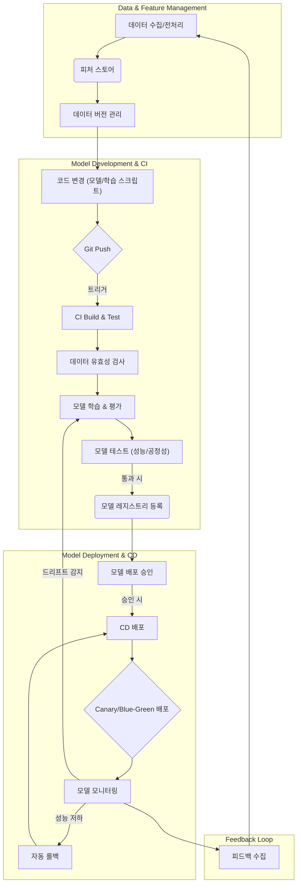

AI 모델의 개발부터 운영까지의 전 과정은 복잡하며, 수동 작업이 많을 경우 비효율성과 오류 발생 가능성이 증대됩니다. MLOps (Machine Learning Operations) CI/CD 파이프라인은 이러한 문제를 해결하고, AI 모델의 신속하고 신뢰성 있는 배포를 가능하게 하는 핵심적인 방법론입니다. 이는 코드, 데이터, 모델의 변경 사항을 지속적으로 통합하고 배포하여, AI 제품의 가치를 극대화하는 것을 목표로 합니다.

## MLOps CI/CD 핵심 원칙

MLOps CI/CD 파이프라인은 기존 소프트웨어 CI/CD의 원칙을 AI/ML 워크로드에 맞게 확장한 것입니다. 주요 원칙은 다음과 같습니다:

*   **자동화 (Automation)**: 모델 학습, 평가, 배포, 모니터링 등 모든 단계를 자동화하여 수동 개입을 최소화합니다.
*   **지속적 통합 (Continuous Integration, CI)**: 코드뿐만 아니라 데이터와 모델 아티팩트의 변경 사항도 지속적으로 통합하고 테스트합니다.
*   **지속적 배포 (Continuous Delivery/Deployment, CD)**: 테스트를 통과한 모델을 자동으로 프로덕션 환경에 배포할 수 있는 상태로 유지하거나 실제로 배포합니다.
*   **버전 관리 (Version Control)**: 코드, 데이터, 모델, 환경 설정 등 모든 자산에 대한 엄격한 버전 관리를 통해 재현성을 보장합니다.
*   **모니터링 (Monitoring)**: 배포된 모델의 성능, 데이터 드리프트, 개념 드리프트를 지속적으로 모니터링하여 문제 발생 시 신속하게 대응합니다.
*   **재현성 (Reproducibility)**: 언제든지 특정 시점의 모델과 데이터를 사용하여 동일한 결과를 재현할 수 있어야 합니다.

## MLOps CI/CD 파이프라인 디자인 패턴

효율적인 MLOps CI/CD 파이프라인은 여러 핵심 컴포넌트와 패턴의 조합으로 구성됩니다. 2026년 현재, 클라우드 네이티브 환경과 서버리스, 그리고 책임감 있는 AI (Responsible AI) 원칙이 통합되는 방향으로 발전하고 있습니다.

### 1. Feature Store Integration (피처 스토어 통합)

피처 스토어는 모델 학습 및 서빙에 사용되는 피처(Feature)를 중앙에서 관리, 저장, 제공하는 시스템입니다. 이를 CI/CD 파이프라인에 통합하면 데이터 일관성과 재현성을 크게 향상시킬 수 있습니다. 학습 데이터와 서빙 데이터 간의 격차(skew)를 줄이고, 피처 엔지니어링 코드를 공유하여 중복 개발을 방지합니다.

### 2. Model Registry & Versioning (모델 레지스트리 및 버전 관리)

모델 레지스트리는 학습된 모델을 저장, 버전 관리, 메타데이터 관리하는 중앙 허브입니다. 각 모델 버전은 성능 지표, 학습 데이터셋, 학습 코드 버전, 하이퍼파라미터 등과 연결되어 관리됩니다. CI/CD 파이프라인은 새로운 모델 버전이 생성될 때 자동으로 모델 레지스트리에 등록하고, 승인된 모델만 배포 후보로 올립니다.

### 3. Automated Testing (자동화된 테스트)

AI 모델의 테스트는 코드 테스트를 넘어 데이터, 모델 성능, 그리고 책임감 있는 AI 원칙 준수 여부까지 확장됩니다.

*   **데이터 유효성 검사 (Data Validation)**: 입력 데이터 스키마, 분포, 품질을 자동으로 검사하여 데이터 드리프트나 이상치를 감지합니다.
*   **모델 유닛/통합 테스트 (Model Unit/Integration Test)**: 모델 예측 로직, 서빙 코드, 종속성 등을 검증합니다.
*   **모델 성능 테스트 (Model Performance Test)**: 학습 후 모델이 특정 성능 임계값을 충족하는지 검사합니다 (예: Accuracy > 90%, F1-score > 0.8).
*   **편향 및 공정성 테스트 (Bias and Fairness Test)**: 젠더, 인종 등 특정 그룹에 대한 모델의 편향 여부를 자동으로 평가합니다.
*   **설명 가능성 테스트 (Explainability Test)**: 모델의 예측이 합리적으로 설명될 수 있는지 검증합니다.

### 4. Progressive Deployment Strategies (점진적 배포 전략)

Canary, Blue-Green, A/B 테스트 등의 전략을 사용하여 새로운 모델을 점진적으로 배포하고, 실제 사용자 트래픽에서 성능을 모니터링합니다. 문제가 발생하면 즉시 이전 버전으로 롤백하여 서비스 중단을 최소화합니다.

### 5. Continuous Monitoring & Retraining (지속적 모니터링 및 재학습)

배포된 모델은 성능 저하, 데이터 드리프트 (data drift), 개념 드리프트 (concept drift) 등을 감지하기 위해 지속적으로 모니터링되어야 합니다. 모니터링 지표에 따라 자동으로 알림을 트리거하거나, 모델 재학습 파이프라인을 시작하여 성능을 복구합니다.

## MLOps CI/CD 파이프라인 흐름 (예시)

다음은 일반적인 MLOps CI/CD 파이프라인의 시각적 흐름입니다.



### GitHub Actions를 활용한 모델 배포 예시 (Python)

다음은 간단한 Python 기반 ML 모델을 GitHub Actions를 통해 AWS Sagemaker에 배포하는 CI/CD 파이프라인의 예시입니다. 여기서는 모델 학습, 평가, S3 업로드 및 SageMaker 배포를 자동화하는 대략적인 흐름을 보여줍니다.

```yaml
name: MLOps CI/CD Pipeline for Churn Prediction

on:
  push:
    branches:
      - main
  workflow_dispatch:

jobs:
  build-and-deploy:
    runs-on: ubuntu-latest
    env:
      AWS_REGION: us-east-1
      S3_BUCKET: your-mlops-bucket-2026
      SAGEMAKER_ROLE: arn:aws:iam::123456789012:role/SageMakerExecutionRole

    steps:
      - name: Checkout code
        uses: actions/checkout@v4

      - name: Set up Python
        uses: actions/setup-python@v5
        with:
          python-version: '3.10'

      - name: Install dependencies
        run: pip install -r requirements.txt

      - name: Configure AWS Credentials
        uses: aws-actions/configure-aws-credentials@v4
        with:
          aws-access-key-id: ${{ secrets.AWS_ACCESS_KEY_ID }}
          aws-secret-access-key: ${{ secrets.AWS_SECRET_ACCESS_KEY }}
          aws-region: ${{ env.AWS_REGION }}

      - name: Run Data Validation and Feature Engineering
        run: | # Assumes a script that checks data quality and prepares features
          python scripts/data_preparation.py

      - name: Train and Evaluate Model
        id: train_eval
        run: | # Assumes a script that trains, evaluates, and outputs metrics/model artifact
          python scripts/train_model.py
          # Example: echo "model_accuracy=0.92" >> $GITHUB_OUTPUT

      - name: Check Model Performance
        run: |
          # Get accuracy from previous step output (hypothetical)
          # ACCURACY=$(cat model_metrics.json | jq -r .accuracy)
          # if (( $(echo "$ACCURACY < 0.85" | bc -l) )); then
          #   echo "Model accuracy below threshold!" >&2
          #   exit 1
          # fi
          echo "Model performance meets criteria."

      - name: Upload Model Artifact to S3
        run: |
          aws s3 cp model.pkl s3://${{ env.S3_BUCKET }}/models/churn_prediction/${{ github.sha }}/model.pkl
          echo "Model uploaded to S3: s3://${{ env.S3_BUCKET }}/models/churn_prediction/${{ github.sha }}/model.pkl"

      - name: Register Model in SageMaker Model Registry (Optional)
        run: |
          # This step would typically use boto3 to create a model package version
          # For simplicity, we skip full API calls here.
          echo "Model registered with version: ${{ github.sha }}"

      - name: Deploy Model to SageMaker Endpoint
        run: |
          # Example using AWS CLI to deploy a model to a SageMaker endpoint
          # Requires a pre-existing SageMaker Model and Endpoint Configuration
          # aws sagemaker create-endpoint-config --endpoint-config-name churn-pred-config-${{ github.sha }} ...
          # aws sagemaker create-endpoint --endpoint-name churn-pred-endpoint --endpoint-config-name churn-pred-config-${{ github.sha }}
          echo "Deploying model version ${{ github.sha }} to SageMaker endpoint..."
          # In a real scenario, this would manage endpoint updates/canary deployments.
```

## 2026년 MLOps CI/CD 트렌드 반영

2026년 MLOps CI/CD는 다음과 같은 트렌드를 중심으로 발전하고 있습니다.

*   **LLMOps (Large Language Model Operations)**: LLM의 특성을 고려한 CI/CD 파이프라인이 중요해지고 있습니다. 프롬프트 버전 관리, 프롬프트 엔지니어링의 자동화된 테스트, 파인튜닝 모델의 관리, 그리고 모델의 할루시네이션(hallucination) 및 편향성 검증이 핵심 요소입니다.
*   **Edge AI/On-Device ML**: 클라우드 뿐만 아니라 엣지 디바이스 및 온디바이스 환경을 위한 모델 경량화(quantization, pruning), 최적화, 그리고 배포 및 업데이트 메커니즘이 CI/CD에 통합됩니다.
*   **Responsible AI (책임감 있는 AI)**: 모델의 공정성, 투명성, 보안, 개인 정보 보호 등을 CI/CD 파이프라인의 자동화된 테스트 단계에 포함하여 규제 및 윤리적 요구사항을 충족합니다.
*   **Serverless Inference**: AWS Lambda, Google Cloud Functions, Azure Functions와 같은 서버리스 컴퓨팅을 활용하여 AI 모델을 배포하고 스케일링하는 패턴이 확산되고 있습니다. CI/CD는 이러한 서버리스 리소스의 프로비저닝과 업데이트를 자동화합니다.
*   **ML Metadata Management (ML 메타데이터 관리)**: MLflow Tracking, Kubeflow Metadata 등과 같은 도구를 사용하여 학습 실행, 데이터셋, 모델 파라미터, 성능 지표 등 ML 워크플로우 전반의 메타데이터를 추적하고 관리하여 높은 재현성과 디버깅 용이성을 확보합니다.

## 트레이드오프

### 1. 초기 구현 복잡성 vs. 장기적 운영 효율성
*   **언제 좋은가**: 장기적으로 많은 AI 모델을 운영하거나, 모델 업데이트 및 재학습이 빈번한 경우. 초기 투자 비용과 시간이 많이 들지만, 일단 구축되면 모델 배포 주기 단축, 오류 감소, 운영 비용 절감 효과가 큽니다.
*   **언제 나쁜가**: 소수의 실험적인 모델만 있거나, AI 모델의 변경 주기가 매우 길고 예측 불가능한 경우. 초기 구축 비용이 과도하게 느껴질 수 있으며, 복잡성만 증가할 수 있습니다.

### 2. 고수준 자동화 vs. 인간 개입 및 유연성
*   **언제 좋은가**: 예측 가능하고 반복적인 작업(예: 정기적인 모델 재학습, 성능 임계값 초과 시 자동 롤백)에 적합합니다. 일관성과 신뢰성을 높이고, 개발팀의 부담을 줄입니다.
*   **언제 나쁜가**: 새로운 모델 아키텍처 탐색, 비정형적인 데이터 문제 해결, 혹은 인간의 전문적인 판단이 필요한 복잡한 A/B 테스트 시나리오와 같이 높은 유연성과 창의적인 문제 해결이 요구될 때, 과도한 자동화는 오히려 제약이 될 수 있습니다.

### 3. 리소스 사용량 및 비용 vs. 성능 및 확장성
*   **언제 좋은가**: 대규모 데이터셋과 복잡한 모델을 다루는 경우, 클라우드 자원을 효율적으로 사용하여 고성능 컴퓨팅과 스토리지의 이점을 활용합니다. 필요에 따라 유연하게 확장 및 축소할 수 있습니다.
*   **언제 나쁜가**: 제한된 예산으로 소규모 프로젝트를 진행할 때. 클라우드 서비스 비용이 예측보다 많이 발생하거나, 파이프라인의 각 단계에 필요한 인프라 프로비저닝이 비효율적일 수 있습니다. 온프레미스 자원을 활용하거나 경량화된 솔루션이 더 적합할 수 있습니다.

### 4. 빠르고 잦은 배포 vs. 안정성과 엄격한 거버넌스
*   **언제 좋은가**: 시장 변화에 빠르게 대응해야 하는 서비스, 또는 모델 성능 개선이 즉각적인 비즈니스 가치로 이어지는 경우. 빠른 피드백 루프를 통해 지속적인 개선이 가능합니다.
*   **언제 나쁜가**: 규제가 엄격하거나(예: 금융, 의료), 모델의 오류가 치명적인 결과를 초래할 수 있는 경우. 모든 변경에 대한 철저한 검증과 승인 절차가 요구될 때, 과도한 자동화는 위험을 증가시킬 수 있습니다.

## 실전 체크리스트

프로젝트에 MLOps CI/CD 파이프라인을 적용할 때 다음 항목들을 검증합니다:

- [ ] 모든 코드, 데이터셋, 모델 아티팩트에 대한 버전 관리가 확립되어 있으며, 특정 시점의 전체 ML 시스템 상태를 재현할 수 있는가?
- [ ] 데이터 유효성 검사 (Data Validation) 스텝이 파이프라인에 통합되어 있으며, 데이터 스키마 변경, 분포 이상 감지 시 자동으로 CI/CD 파이프라인이 중단되거나 알림을 발생시키는가?
- [ ] 모델 학습 후 최소 성능 기준을 충족하는지 자동으로 평가하는 스텝이 존재하며, 기준 미달 시 배포가 차단되는가?
- [ ] 새로운 모델 버전 배포 시 Canary 또는 Blue-Green과 같은 점진적 배포 전략이 적용되어 프로덕션 환경에 미치는 위험을 최소화하는가?
- [ ] 배포된 모델의 성능 지표 (예: 정확도, 지연 시간) 및 데이터 드리프트, 개념 드리프트를 실시간으로 모니터링하고, 이상 감지 시 자동으로 경고를 발생시키는 시스템이 구축되어 있는가?
- [ ] 모델 성능 저하, 데이터 드리프트 발생 시 자동으로 모델 재학습 또는 이전 버전으로 롤백하는 메커니즘이 구현되어 있는가?
- [ ] CI/CD 파이프라인의 각 단계에 필요한 컴퓨팅 자원 (GPU, CPU) 및 스토리지(Feature Store, Model Registry) 프로비저닝 및 해제가 자동화되어 비용 효율성을 확보하는가?