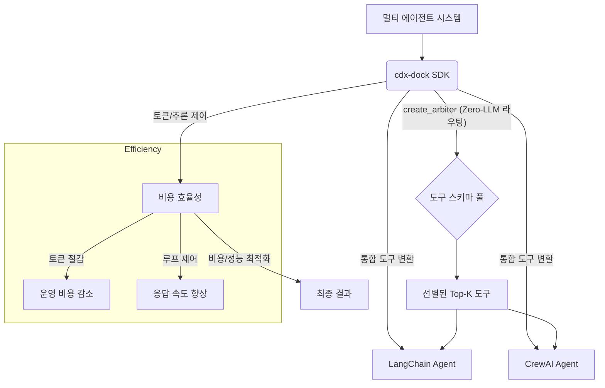

멀티 에이전트 시스템은 복잡한 자동화에 강력하지만, 이질적인 프레임워크 간 비효율적인 연결, LLM 토큰 비대화, 추론 루프 폭주, 외부 Vector DB 의존성은 개발 및 운영의 주요 병목입니다. `cdx-dock` SDK는 이러한 문제를 로컬 인-프로세스 Python SDK로 해결하며, 다양한 에이전트 프레임워크 연결을 단순화하고 토큰 및 추론 과정을 정교하게 제어합니다.

## 멀티 에이전트 시스템 통합의 도전 과제

기존 멀티 에이전트 시스템에서 흔히 겪는 난관은 다음과 같습니다.

### 1. 프레임워크 어댑터 보일러플레이트
LangChain, CrewAI, AutoGen, Nous Hermes 등 이질적인 에이전트 프레임워크를 상호 연결하려면 개별적인 어댑터 코드가 필요하며, 이는 개발 시간과 유지보수 부담을 가중시킵니다.

### 2. 토큰 비대화 및 추론 루프 폭주
에이전트 도구(Tool)의 JSON 또는 MCP 스키마가 커지면서 LLM 컨텍스트 윈도우를 불필요하게 소비하고 토큰 비용을 증가시킵니다. 또한, 에이전트가 최적 도구를 찾기 위해 LLM에 반복적으로 문의하는 `think` 루프 폭주는 추론 비용을 급증시키고 응답 지연을 유발합니다.

### 3. 외부 Vector DB 구축 및 관리 부담
도구 검색 및 라우팅을 위한 외부 벡터 데이터베이스 구축 및 관리는 상당한 인프라 및 운영 비용을 발생시킵니다. 이는 특히 로컬 개발이나 소규모 시스템에서 비효율적입니다.

## cdx-dock을 통한 멀티 에이전트 시스템 최적화

`cdx-dock`은 이러한 문제를 해결하기 위한 경량화된 Python SDK입니다.

### 1. 크로스 프레임워크 연결 단순화
`cdx-dock`은 `as_crewai_tool()`, `bridge()`, `CDXHermesDock` 등의 유틸리티를 제공하여 LangChain, CrewAI, AutoGen, Nous Hermes 에이전트를 단 한 줄의 코드로 상호 연결합니다. 이로써 각 프레임워크의 도구를 다른 프레임워크에서 쉽게 활용할 수 있습니다.

```python
# Python 예제: cdx-dock으로 LangChain 툴을 CrewAI 에이전트에 연결
from cdx_dock import CdxDock
# LangChain, CrewAI 임포트 생략

class SimpleLangChainTool:
    def run(self, input_text: str) -> str:
        return f"LangChain processed: {input_text}"

dock = CdxDock()
langchain_tool_for_crewai = dock.as_crewai_tool(
    name="LangChainProcessor",
    description="Processes text using LangChain logic.",
    tool_function=SimpleLangChainTool().run
)
# 이후 CrewAI Agent에 langchain_tool_for_crewai를 직접 통합
```

### 2. Zero-LLM 도구 라우터 (create_arbiter)
`create_arbiter` 기능은 수십 개의 도구 스키마 중 현재 질문에 필요한 상위 Top-K 도구만을 로컬에서 < 10ms 이내에 식별합니다. 이는 LLM 호출 없이 도구를 라우팅하여 토큰 사용량과 추론 지연을 획기적으로 줄입니다. 외부 Vector DB 없이도 인-프로세스 기반의 효율적인 도구 검색이 가능합니다.

```python
# Python 예제: create_arbiter를 이용한 로컬 도구 라우팅
from cdx_dock import CdxDock

tool_schemas = [
    {"name": "EmailSender", "description": "Sends an email."},
    {"name": "DataLoader", "description": "Loads data from DB."},
]

dock = CdxDock()
arbiter = dock.create_arbiter(tool_schemas)

query_email = "Send a report to John."
print(f"'{query_email}' -> {arbiter.select_tools(query_email, top_k=1)}")

query_data = "Fetch user activity logs."
print(f"'{query_data}' -> {arbiter.select_tools(query_data, top_k=1)}")
```

### 3. 토큰 및 추론 제어 메커니즘
`cdx-dock`은 LLM 출력 검증 파이프라인과 연동되어 토큰 사용량 및 추론 루프를 효과적으로 제어합니다. 불필요한 LLM 호출을 방지하고, 사전 정의된 비용 예산 내에서 에이전트가 동작하도록 가드레일을 설정하여 운영 안정성과 비용 효율성을 동시에 확보합니다.



## 2026년 에이전트 개발 트렌드와 cdx-dock

2026년 AI 에이전트 개발은 **효율적인 상호운용성, 비용 최적화, 빠른 프로토타이핑**에 중점을 둡니다. `cdx-dock`은 에이전트 간 복잡한 통합 로직을 추상화하여 개발 생산성을 높이고, `create_arbiter`를 통해 불필요한 LLM 호출을 최소화하며, 로컬 환경에서 신속한 도구 라우팅을 가능하게 합니다. 이는 복잡화되는 에이전트 기반 시스템의 안정성과 경제성을 확보하는 핵심 솔루션입니다.

## 트레이드오프

`cdx-dock` SDK 통합 시 고려할 트레이드오프는 다음과 같습니다.

*   **통합 단순화 vs. SDK 종속성**:
    *   **언제 좋은가**: 이질적인 프레임워크를 유연하게 결합하여 개발 복잡도를 크게 낮출 때.
    *   **언제 나쁜가**: `cdx-dock`에 대한 의존성으로, 특정 프레임워크의 최신 기능 활용에 제약이 생길 수 있습니다.
*   **비용 및 성능 최적화 vs. 초기 학습 및 디버깅 오버헤드**:
    *   **언제 좋은가**: LLM 토큰 비용 절감과 추론 속도 개선이 필수적인 프로덕션 환경에서 효과적입니다. `create_arbiter`는 외부 API 의존성 없이 로컬에서 빠른 결정을 내립니다.
    *   **언제 나쁜가**: SDK의 개념과 API에 익숙해지는 초기 학습 곡선과, 통합된 레이어에서 문제 발생 시 디버깅 복잡도가 증가할 수 있습니다.
*   **경량 로컬 도구 라우팅 vs. 대규모 벡터 DB의 기능**:
    *   **언제 좋은가**: 외부 인프라 구축 없이 빠르고 가볍게 도구 검색을 구현할 때 이상적입니다. 개발/테스트 환경 및 소규모/중규모 시스템에 적합합니다.
    *   **언제 나쁜가**: 수백, 수천 개의 도구 스키마 관리나 고도화된 벡터 검색 기능이 필요한 초대규모 시스템에는 전용 Vector DB가 더 견고할 수 있습니다.

## 실전 체크리스트

`cdx-dock` SDK를 프로젝트에 적용할 때 검증할 항목입니다.

*   [ ] **크로스 프레임워크 연결 테스트 완료**: 서로 다른 에이전트 프레임워크 간 도구 호출 및 결과 반환이 기대치에 부합하는지 통합 테스트를 수행했는가?
*   [ ] **LLM 토큰 사용량 감소 효과 측정**: `cdx-dock` 통합 후 LLM 호출 당 토큰 소비량이 유의미하게 감소했음을 측정 데이터로 확인했는가?
*   [ ] **도구 라우터(Arbiter)의 정확성 및 Latency 벤치마킹**: `create_arbiter`가 주어진 쿼리에 대해 정확한 Top-K 도구를 선택하며, 로컬에서 < 10ms 이내에 동작함을 벤치마킹했는가?
*   [ ] **추론 루프 폭주 방지 가드레일 작동 확인**: `think` 루프와 같은 반복적인 LLM 호출 패턴에 대해 `cdx-dock`의 제어 메커니즘이 정상 작동하여 불필요한 호출을 막는지 검증했는가?
*   [ ] **로컬 SDK 리소스 사용량 모니터링**: `cdx-dock` SDK의 CPU 및 메모리 점유율을 모니터링하여 애플리케이션 성능에 부정적인 영향을 미치지 않는지 확인했는가?
*   [ ] **오류 처리 및 로깅 체계 구현**: `cdx-dock` 관련 예외 상황 발생 시 적절한 오류 메시지와 로깅이 이루어지도록 시스템을 구성했는가?
*   [ ] **`cdx-dock` 통합 LLM 출력 검증 파이프라인 연동**: `cdx-dock`의 제어 기능이 LLM 출력 검증 파이프라인과 통합되어 비용 효율성과 안정성을 함께 관리하는지 확인했는가?
